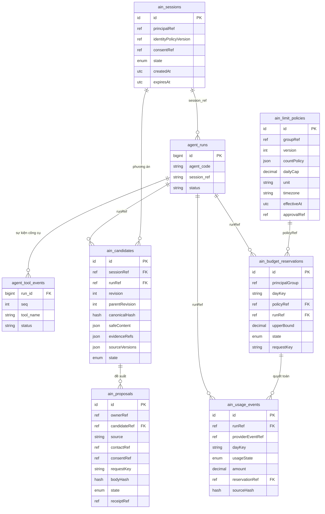

# ERD E9: kế thừa và delta đề xuất

Draft · 16/11/2026 · Thiết kế BA có điều kiện, chưa phê duyệt, chưa triển khai.

| Phiên bản | Ngày | Người thực hiện | Nội dung |
| :--- | :--- | :--- | :--- |
| 0.1.0 | 2026-11-16 | BA | Khởi tạo: vẽ quan hệ cho 6 thực thể delta trong mục "Delta đề xuất" của mapping E9 và các bảng nền liên quan. Không thêm thực thể hay trường |

Nguồn của sơ đồ là mục "Delta đề xuất, không merge" trong [mapping dữ liệu E9](../api/data-mapping.md) và [từ điển E9](data-dictionary.md). Mapping ghi rõ sáu tên là delta sơ bộ, không cam kết sáu bảng vật lý. **Schema chung giữ 65 bảng**; không DDL, không migration. Không có quan hệ tới hồ sơ sức khỏe.

## 1. Sơ đồ

`agent_runs`, `agent_tool_events` là bảng có sẵn trong [DBML tổng](../../nen-tang/srs/schema.dbml) (chỉ vẽ vài cột dùng ở đây). `agent_run_contexts` của E5 không được tái dùng cho AIN vì `actor_id` bắt buộc và có `applied_menu_id`; mapping đề xuất tách thành `ain_candidates`. Trường `principal/group` trong mapping được viết gộp thành `principalGroup` để hợp cú pháp sơ đồ.

## 2. Ràng buộc cần review

| Nhóm | Ràng buộc | Căn cứ / gate |
| :--- | :--- | :--- |
| Phiên | Không tự tạo `users` cho khách vãng lai; không lưu raw sức khỏe | BR-AIN-001/007; E9-Q02/10 |
| Candidate | Unique (sessionRef, id, revision); evidence phải cùng hash; không là thực đơn chính thức | BR-AIN-002; E9-Q12 |
| Đề xuất | ACK chỉ sau lưu bền vững; unique (owner, route, key); không ghi `customers`, `eaters`, `orders` | BR-AIN-004; E9-Q06/13/15 |
| Hạn mức | Giá trị chưa chọn; không sửa hồi tố; đổi cần duyệt theo E1 nếu policy yêu cầu | BR-AIN-009; E9-Q07/08 |
| Giữ chỗ | Admission nguyên tử; confirmed + reserved + upperBound không vượt cap; UNKNOWN không tự giải phóng | BR-AIN-008; E9-Q07/13 |
| Usage | Unique theo event nhà cung cấp; không sửa mất lịch sử; unknown khác 0 | BR-AIN-008; E9-Q13 |
| Hạn mức theo nhóm | `parameters` nền không có scope USER_GROUP; cần policy riêng hoặc mở rộng sau duyệt | Mapping E9 |
| Cách ly | Tài khoản DB của AIN không SELECT được bảng cost, kế toán, log AIO | BR-AIN-006; FR-AIN-SAFE-001 |
