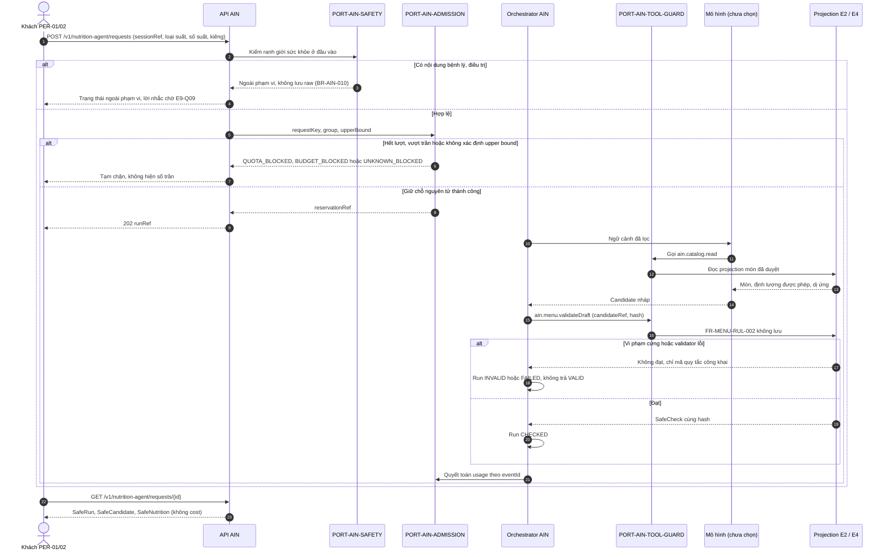
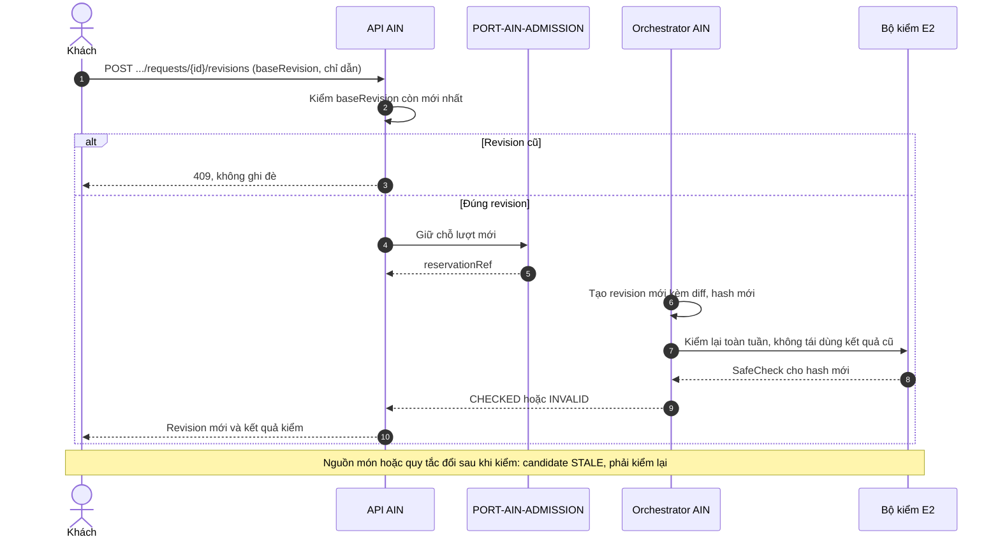
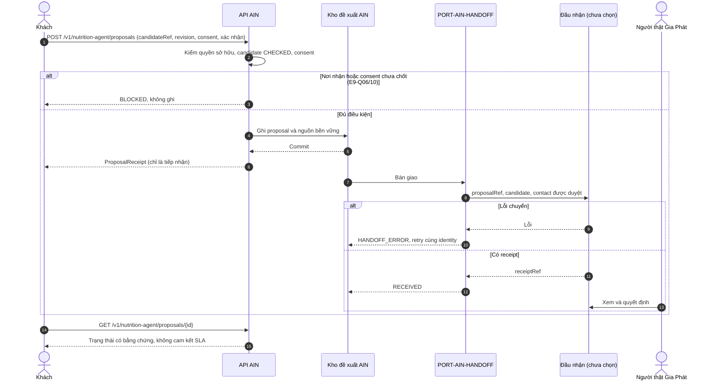

# Sơ đồ tuần tự E9: Agent Dinh dưỡng viên

Draft · 16/11/2026 · Thiết kế BA có điều kiện, chưa phê duyệt, chưa triển khai, không gọi mô hình AI.

| Phiên bản | Ngày | Người thực hiện | Nội dung |
| :--- | :--- | :--- | :--- |
| 0.1.0 | 2026-11-16 | BA | Khởi tạo: 3 sơ đồ tuần tự theo API-AIN, 4 port và BR-AIN hiện có. Không thêm endpoint, công cụ hay quy tắc |

Route, công cụ và port lấy từ [API và allowlist E9](../api/api-spec.md); trạng thái lấy từ [states](states.md). Cách chạy agent (hàng đợi, MCP công khai) tham chiếu [kiến trúc AI agent](../../nen-tang/srs/agent-architecture.md) ở mức đề xuất. Nhà cung cấp mô hình chưa chọn (E9-Q01).

## 1. Yêu cầu thực đơn, admission và kiểm E2 (FEAT-060, FEAT-064, FEAT-065)

## 2. Chỉnh thực đơn và kiểm lại (FEAT-061)

## 3. Gửi đề xuất về Gia Phát (FEAT-062)

Mô hình không gọi được PORT-AIN-HANDOFF; đề xuất không tạo thực đơn, đơn hàng hay báo giá (BR-AIN-004). Idempotency, TTL, deadline và giao dịch quota còn BLOCKED E9-Q13; chưa có bằng chứng chạy.
