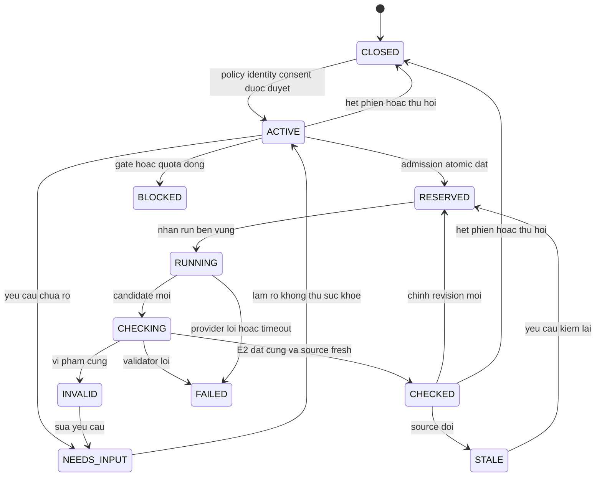
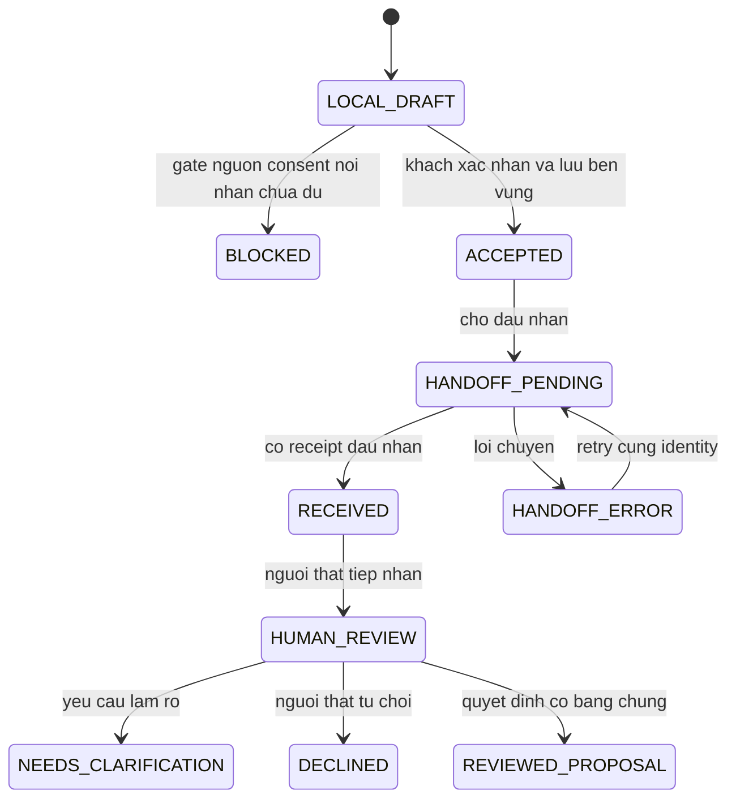
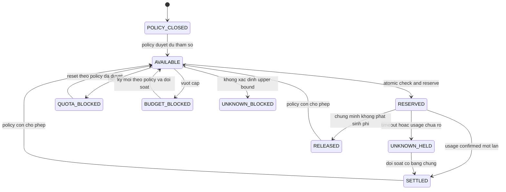

# Trạng thái E9

Draft · 12/11/2026 · Tên trạng thái đề xuất; không trạng thái triển khai. Mọi mũi tên thành công đều có điều kiện policy/quyền/nguồn được duyệt. Gate chưa đủ thì không thực thi.

## Phiên hội thoại và yêu cầu thực đơn

SESS là lifecycle quyền truy cập; run con có QUEUED/RUNNING/DONE/FAILED/REJECTED tương thích metadata nền, outcome phân biệt NEEDS_INPUT/INVALID/BLOCKED/STALE. Đồ thị là góc nhìn tổng hợp phiên và run, không ép hai lifecycle vào một cột status. Đóng/thu hồi phiên ở bất kỳ trạng thái nào chặn tool mới; lượt tính phí đang dở vẫn đối soát reservation. Candidate sau chỉnh phải CHECKING; không chuyển CHECKED bằng câu trả lời model. Chỉ tín hiệu tiến độ an toàn được hiện trước kiểm, không stream thực đơn chưa kiểm cho khách.

## Bản nháp gửi về Gia Phát

E9-Q06 chặn nơi nhận, vai trò, SLA, wording/status sau ACCEPTED; các trạng thái sau là phương án review, không cam kết runtime. Không có cạnh tự động tới MENU/ORDER/QUOTE. Ngay REVIEWED_PROPOSAL vẫn là đề xuất; nếu triển khai áp dụng về sau phải người thật và luồng FEAT-013, ngoài thao tác agent E9. ACK lưu và ACK bàn giao là hai bằng chứng riêng. Chưa có nơi lưu thì không ACCEPTED giả.

## Lượt/ngân sách AI

Không tự release khi timeout, không lấy confirmed=null làm0. Reset/ngày mới không bỏ nợ/reserve cũ, không cộng quota AIO. Quy trình đổi policy: đề nghị→duyệt nếu yêu cầu→hiệu lực theo version; khi cơ chế duyệt chưa chốt thì POLICY_CLOSED. Mỗi lần thay đổi có audit theo E1. Mức số/đơn vị/reset/định nghĩa lượt vẫn E9-Q07/08/13.
