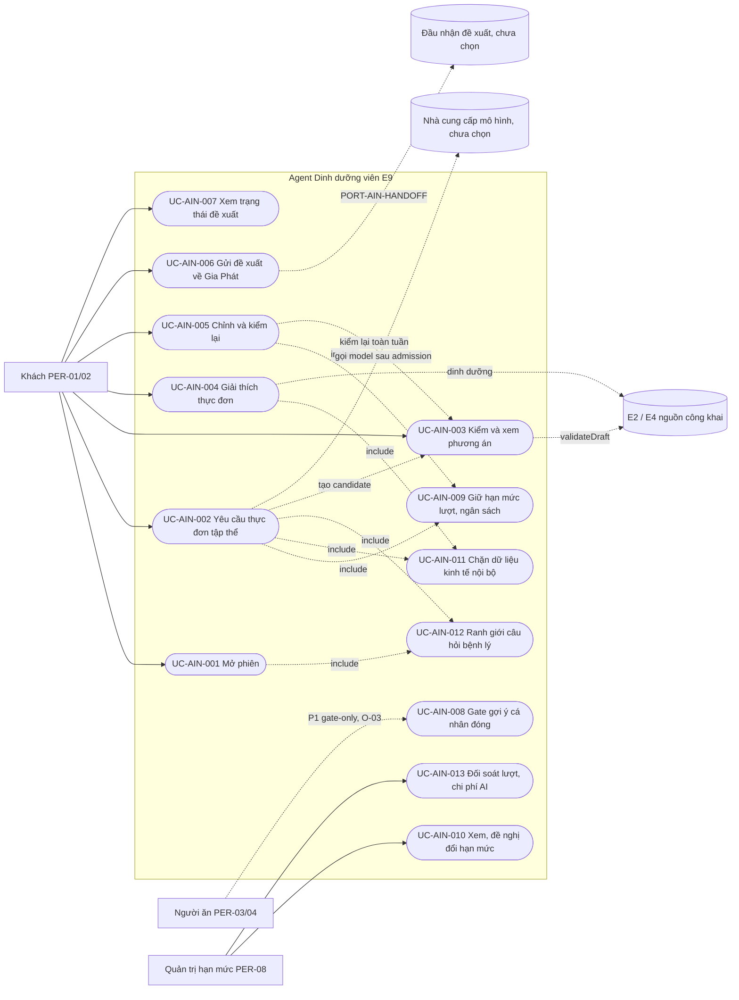

# Sơ đồ use case E9: Agent Dinh dưỡng viên

Draft · 16/11/2026 · Thiết kế BA có điều kiện, chưa phê duyệt, chưa triển khai, không gọi mô hình AI.

| Phiên bản | Ngày | Người thực hiện | Nội dung |
| :--- | :--- | :--- | :--- |
| 0.1.0 | 2026-11-16 | BA | Khởi tạo: sơ đồ actor và ma trận FR, UC, màn hình, API, port cho 13 UC hiện có. Không thêm FR hoặc UC |

File này chỉ vẽ lại phạm vi trong [SRS E9](spec.md), [danh mục UC](../usecases/index.md) và [màn hình](../ui/screens.md). Ba UC loại "bước hệ thống" (009, 011, 012) không có người kích hoạt riêng; chúng chạy bên trong luồng của khách và được vẽ bằng quan hệ include.

## 1. Tác nhân

| Tác nhân | Persona | Ghi chú |
| :--- | :--- | :--- |
| Khách có nhu cầu suất tập thể | PER-01, PER-02 | Có tài khoản hay cho phép khách vãng lai chờ E9-Q02 |
| Người ăn muốn gợi ý cá nhân | PER-03, PER-04 | Chỉ thấy gate FEAT-063 đóng; không có luồng gợi ý |
| Quản trị hạn mức AI | PER-08 khi được cấp quyền | Quyền cụ thể chờ E9-Q08 |
| Nguồn E2 / E4 | Hệ thống nội bộ | Danh mục món, bộ kiểm FR-MENU-RUL-002, dinh dưỡng; không có cost |
| Nhà cung cấp mô hình AI | Hệ thống ngoài | Chưa chọn (O-04, E9-Q01) |
| Đầu nhận đề xuất | Hệ thống hoặc người Gia Phát | Chưa chọn (E9-Q06); không phải CRM E10 đã duyệt |

## 2. Sơ đồ

Mô hình không có công cụ tự gửi đề xuất, không áp dụng thực đơn, không đọc cost. Gửi đề xuất là lệnh do khách xác nhận trên giao diện (BR-AIN-004). Người ăn PER-03/04 chỉ nhận trạng thái CLOSED.

## 3. Ma trận FR, UC, màn hình, API

| UC | FR | Feature | Tác nhân chính | Màn hình | API / port | Gate chính |
| :--- | :--- | :--- | :--- | :--- | :--- | :--- |
| [UC-AIN-001](../usecases/UC-AIN-001.md) | FR-AIN-SESS-001 | FEAT-060 | Khách | UI-AIN-01 | API-AIN-001 | E9-Q02/10 |
| [UC-AIN-002](../usecases/UC-AIN-002.md) | FR-AIN-GEN-001 | FEAT-060 | Khách | UI-AIN-01 | API-AIN-002 | E9-Q01/03/07/11/12/13 |
| [UC-AIN-003](../usecases/UC-AIN-003.md) | FR-AIN-CHK-001 | FEAT-060 | Khách | UI-AIN-02 | API-AIN-003 | E9-Q05/12/13 |
| [UC-AIN-004](../usecases/UC-AIN-004.md) | FR-AIN-EXPL-001 | FEAT-061 | Khách | UI-AIN-02 | API-AIN-004 | E9-Q04/05/12 |
| [UC-AIN-005](../usecases/UC-AIN-005.md) | FR-AIN-EDIT-001 | FEAT-061 | Khách | UI-AIN-03 | API-AIN-005 | E9-Q03/05/12/13 |
| [UC-AIN-006](../usecases/UC-AIN-006.md) | FR-AIN-SEND-001 | FEAT-062 | Khách | UI-AIN-04 | API-AIN-006, PORT-AIN-HANDOFF | E9-Q06/10/13 |
| [UC-AIN-007](../usecases/UC-AIN-007.md) | FR-AIN-STAT-001 | FEAT-062 | Khách | UI-AIN-04 | API-AIN-007 | E9-Q06/13 |
| [UC-AIN-008](../usecases/UC-AIN-008.md) | FR-AIN-GATE-001 | FEAT-063 (P1, gate-only) | Người ăn | UI-AIN-07 | API-AIN-008 | E9-Q14; O-03 |
| [UC-AIN-009](../usecases/UC-AIN-009.md) | FR-AIN-LIMT-001 | FEAT-064 | Hệ thống | UI-AIN-06 | PORT-AIN-ADMISSION | E9-Q01/07/13 |
| [UC-AIN-010](../usecases/UC-AIN-010.md) | FR-AIN-CONF-001 | FEAT-064 | Quản trị PER-08 | UI-AIN-05 | API-AIN-010, 014 | E9-Q07/08/13 |
| [UC-AIN-011](../usecases/UC-AIN-011.md) | FR-AIN-SAFE-001 | FEAT-065 | Hệ thống | UI-AIN-07 | PORT-AIN-TOOL-GUARD | E9-Q05/13 |
| [UC-AIN-012](../usecases/UC-AIN-012.md) | FR-AIN-MED-001 | FEAT-065 | Hệ thống | UI-AIN-07 | PORT-AIN-SAFETY | E9-Q03/09/10/14 |
| [UC-AIN-013](../usecases/UC-AIN-013.md) | FR-AIN-LOG-001 | FEAT-064 | Quản trị PER-08 | UI-AIN-05 | API-AIN-013 | E9-Q07/08/10/13 |

13/13 FR có đúng một UC. FEAT-060, 061, 062, 064, 065 có thiết kế nháp có điều kiện; FEAT-063 chỉ có gate, không tính vào độ phủ.
