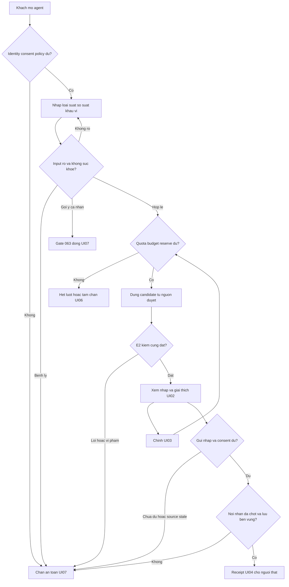
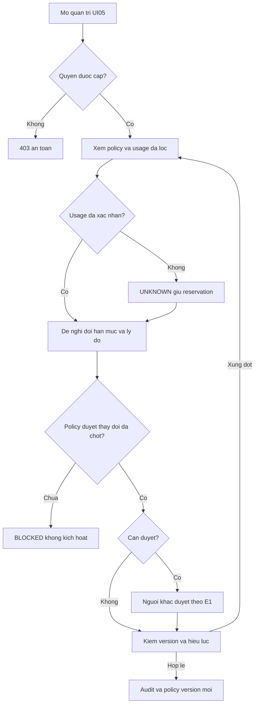

# User flow — E9

Draft · 12/11/2026 · Các nhánh thành công chỉ là thiết kế có điều kiện, chưa mở vận hành.

## PER-01 / PER-02

Happy: yêu cầu khả thi→kiểm→giải thích→chỉnh→kiểm lại→xác nhận gửi→receipt. Error: mất phiên, sai input, quota, validator/provider lỗi, gate chưa chốt, không có nơi lưu. Edge: hai tab sửa cùng revision; source đổi giữa xem và gửi; retry sau mất ACK; thu hồi quyền giữa tool; kiêng kỵ tự do không rõ không suy thành bệnh. PER-01 không mặc định guest được phép; PER-02 không tự được dùng data công ty ngoài scope. Không thử mở FEAT-063 theo persona.

## PER-08 có quyền hạn mức

Error: không quyền, không có policy/đơn vị, version conflict, lỗi audit không cập nhật thành công. Edge: giảm cap dưới spent+reserved chặn nhận mới, không xóa debt; đổi nhóm không cấp lại lượt lách trần; đổi ngày không xóa lượt đang chờ quyết toán; cần duyệt thì không tự duyệt. Q07/08/13 giữ BLOCKED, không đặt số cấu hình.
