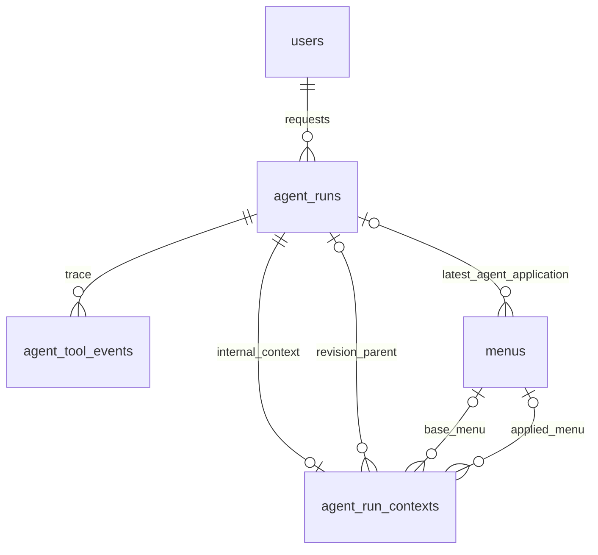

# ERD và từ điển dữ liệu — AIO

Phiên bản 0.1.0 · 2026-11-11 · **Draft — đề xuất thiết kế để review, chưa phê duyệt nghiệp vụ; chưa triển khai backend.**

| Phiên bản | Ngày | Người thực hiện | Thay đổi |
| :--- | :--- | :--- | :--- |
| 0.1.0 | 2026-11-11 | BA | Khởi tạo gói MVP từ PRD/roadmap và thiết kế hiện có |

Nguồn vật lý duy nhất: [schema tổng DBML v0.5.0](../../nen-tang/srs/schema.dbml). Thiết kế bổ sung, chưa migration. Không tạo bảng thứ hai thay nutrient_values hoặc agent_runs. DBML không tự thực thi mọi CHECK trong tài liệu này.

## Bảng kế thừa

`agent_runs` giữ id,agent_code,user_id,session_ref,request_text,tool_calls,result_summary,status,input_tokens,output_tokens,cost_vnd,started_at,finished_at,created_at theo [DBML tổng](../../nen-tang/srs/schema.dbml). Với NOI_BO, user_id bắt buộc ở ứng dụng, session_ref=null; request_text được lọc trước lưu, bản nhạy cảm nếu cần phải có chính sách AIO-Q04. Không sửa enum status cũ; trạng thái chi tiết đặt ở context.outcome. cost_vnd null khi chưa biết; không suy từ token khi chưa duyệt bảng giá/tỷ giá. tool_calls chỉ summary tương thích cũ; agent_tool_events là nguồn chi tiết, không duy trì hai bản log độc lập.

menus.agent_run_id chỉ run áp dụng gần nhất; lịch sử mọi apply truy từ agent_run_contexts và audit_logs, tránh mất lịch sử khi chỉnh nhiều lần. Actor, vai trò, cơ sở không thể lấy từ prompt làm quyền. Mọi việc ghi thay người dùng ghi cả service actor và on_behalf_user_id theo SYS.

## `agent_run_contexts`

| Tên / cột vật lý | Kiểu (độ dài) | Null? | Khóa / default | Diễn giải và ràng buộc |
| :--- | :--- | :--- | :--- | :--- |
| run_id | bigint | Không | pk, ref: - agent_runs.id | Một context mỗi run NOI_BO |
| parent_run_id | bigint | Có | ref: > agent_runs.id | Run nguồn khi chỉnh candidate |
| actor_id | bigint | Không | not null, ref: > users.id | Trùng agent_runs.user_id với NOI_BO, kiểm trong giao dịch |
| request_route | varchar(80) | Không | not null | runs hoặc revisions |
| request_key | varchar(128) | Không | not null | Idempotency tạo run |
| request_hash | varchar(64) | Không | not null | Hash body |
| scope_snapshot | json | Không | not null | Cơ sở yêu cầu, actor/service; không phải grant |
| input_snapshot | json | Không | not null | GenerateInput hoặc RevisionInput cùng nguồn đã resolve |
| base_menu_id | bigint | Có | ref: > menus.id | Menu gốc khi sửa |
| base_version | int | Có | — | Version menu nguồn |
| candidate_revision | int | Có | — | >=1 khi có candidate |
| candidate_hash | varchar(64) | Có | — | Hash payload do server tính |
| candidate_snapshot | json | Có | — | Chỉ populated cho VALID; gồm days/diff; không ghi đè sau terminal |
| evidence_snapshot | json | Có | — | Rule/cost versions, checkedAt, inputHash, nutrition refs nếu có |
| outcome | varchar(24) | Có | — | VALID/NEEDS_INPUT/NO_SOLUTION/BLOCKED_DATA/TIMEOUT/DEPENDENCY_ERROR |
| questions | json | Có | — | Câu hỏi và blocking reasons có mã; không lưu secret |
| deadline_at | datetime(3) | Không | not null | acceptedAt+60 giây |
| model_code | varchar(120) | Có | — | Chưa chọn model thì null |
| prompt_version | varchar(40) | Có | — | Phiên bản prompt được dùng |
| usage_status | varchar(16) | Không | not null, default: 'UNKNOWN' | UNKNOWN/ESTIMATED/CONFIRMED |
| applied_menu_id | bigint | Có | ref: > menus.id | Null trước apply |
| applied_menu_version | int | Có | — | Menu version kết quả để replay |
| application_key | varchar(128) | Có | — | Key apply; một run chỉ một apply |
| application_hash | varchar(64) | Có | — | Hash ApplyInput |
| applied_at | datetime(3) | Có | — | UTC commit apply |

Unique/index: `(actor_id, request_route, request_key) [unique]`.

## `agent_tool_events`

| Tên / cột vật lý | Kiểu (độ dài) | Null? | Khóa / default | Diễn giải và ràng buộc |
| :--- | :--- | :--- | :--- | :--- |
| id | bigint | Không | pk, increment | Mã sự kiện |
| run_id | bigint | Không | not null, ref: > agent_runs.id | Run cha |
| seq | int | Không | not null | Tăng đơn điệu trong run, unique |
| tool_name | varchar(80) | Không | not null | Allowlist tool hoặc lifecycle event |
| status | varchar(24) | Không | not null | STARTED/SUCCEEDED/FAILED/IGNORED; lifecycle có QUEUED/RUNNING/DONE/REJECTED |
| request_id | varchar(64) | Không | not null | Correlation id |
| argument_hash | varchar(64) | Có | — | Hash input đã chuẩn hóa |
| result_hash | varchar(64) | Có | — | Hash output |
| safe_summary | json | Không | not null | Chi tiết đã lọc: args/result lỗi, không token; quyền lọc lại khi đọc |
| started_at | datetime(3) | Không | not null | UTC |
| finished_at | datetime(3) | Có | — | Null khi đang gọi |

Unique/index: `(run_id, seq) [unique]`.

## Ràng buộc giao dịch, migration và bảo quản

1. Tạo agent_runs + context + event QUEUED trong cùng giao dịch trước gọi provider. Worker nhận việc từ kho bền vững; nếu publish queue lỗi sau commit, dispatcher phục hồi từ run QUEUED, không tạo run mới. Đây là thiết kế port, cần AIO-Q06 chốt outbox/claim và lease để không gọi model trùng.
2. context bắt buộc cho mọi run NOI_BO mới; actor_id=agent_runs.user_id. Unique(actor_id,request_route,request_key) chống retry tạo trùng. seq event tăng nguyên tử; event đến muộn ghi IGNORED, không đổi terminal run. Log sự kiện có thể STARTED trước crash và bổ sung FAILED sau recovery.
3. VALID phải có candidate, hash, evidence cùng revision; outcome khác thì candidate_snapshot=null. DONE không có outcome VALID thì apply trả422. deadline bắt đầu created_at, gồm queue/tools. Thông tin usage có thể cập nhật sau terminal mà không mở lại candidate.
4. Apply khóa context và menu/khóa duy nhất loại suất-tuần, kiểm version+scope+nguồn, ghi các ngày/món toàn tuần, audit và marker applied_menu_id/version/key/hash trong một giao dịch. Rollback tất cả nếu một bước lỗi. Một run chỉ apply một lần; key khác sau apply trả resource gốc nếu cùng payload hoặc409 nếu khác, không áp dụng lại. POST retry không chỉ dựa vào trạng thái HTTP.
5. Không tự xóa log hoặc cấp quyền đọc mọi prompt; AIO-Q04 chờ chốt retention/redaction. Không lưu secret/provider token trong JSON. Legacy agent_runs không có context vẫn đọc summary, không suy candidate VALID hoặc cho apply.
