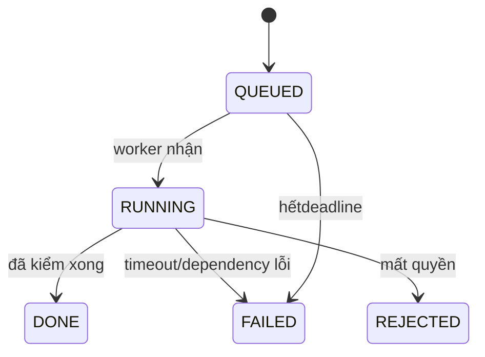

# Trạng thái: Agent Nội bộ

**Draft: thiết kế BA để review; chưa duyệt nghiệp vụ, chưa triển khai phần mềm.**

| Phiên bản | Ngày | Người thực hiện | Thay đổi |
| :--- | :--- | :--- | :--- |
| 0.1.0 | 2026-11-11 | BA | Bổ sung theo kế hoạch; giữ điểm mở và xác nhận đã có |

## Lượt chạy agent

| Hiện tại | Trigger | Guard | Đích | Actor |
| :--- | :--- | :--- | :--- | :--- |
| QUEUED | worker nhận | lease/quota/quyền hợp lệ | RUNNING | Worker |
| RUNNING | đã kiểm xong | outcomeVALID/NEEDS_INPUT/NO_SOLUTION/BLOCKED_DATA | DONE | Worker |
| RUNNING | timeout/dependency lỗi | quádeadline60s hoặc lỗi service | FAILED | Worker |
| QUEUED | hếtdeadline | chưa xử lý trong60s | FAILED | Worker/watchdog |
| RUNNING | mất quyền | kiểm giao quyền không đạt | REJECTED | Worker |

DONE/FAILED/REJECTED là terminal của generation. DONE chỉ outcomeVALID được apply; apply không đổi run thành APPROVED mà ghi MENU DRAFT và applied marker. Kết quả đến muộn ghi IGNORED. Usage có thể được cập nhật mà không mở lại candidate.

Mọi transition ngoài bảng bị từ chối, không tự suy từ nút UI. Version cũ409; quyền thiếu403/ngoài scope404 theo SRS. Các quyền/số liệu chưa chốt giữ trong sổ câu hỏi, không coi state diagram là quyết định duyệt.
