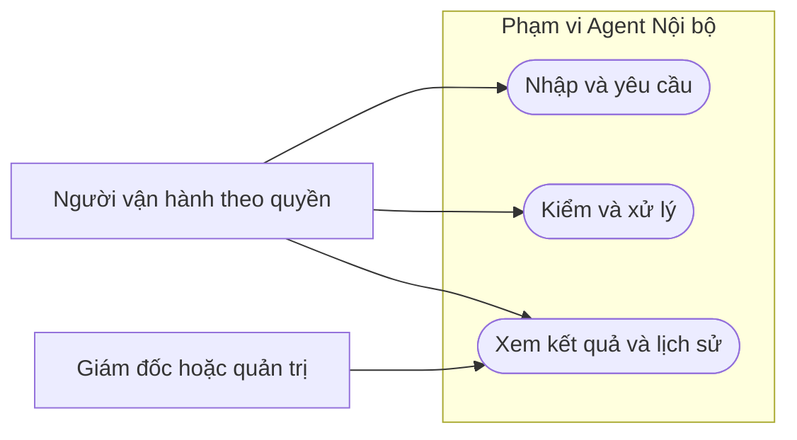

# Sơ đồ use case: Agent Nội bộ

**Draft: thiết kế BA để review; chưa duyệt nghiệp vụ, chưa triển khai phần mềm.**

| Phiên bản | Ngày | Người thực hiện | Thay đổi |
| :--- | :--- | :--- | :--- |
| 0.1.0 | 2026-11-11 | BA | Bổ sung theo kế hoạch; giữ điểm mở và xác nhận đã có |

Sơ đồ tổng quan chia nhóm để đọc; bảng dưới nối từng UC. Include/extend chỉ dùng khi có quan hệ nghiệp vụ, không coi mọi UC tự bao gồm nhau.

| UC | Tên / tài liệu |
| :--- | :--- |
| UC-AIO-001 | [UC-AIO-001: Yêu cầu dựng thực đơn tuần](../usecases/UC-AIO-001.md) |
| UC-AIO-002 | [UC-AIO-002: Kiểm phương án bằng hệ thống](../usecases/UC-AIO-002.md) |
| UC-AIO-003 | [UC-AIO-003: Chỉnh thực đơn bằng lời](../usecases/UC-AIO-003.md) |
| UC-AIO-004 | [UC-AIO-004: Áp dụng phương án thành bản nháp](../usecases/UC-AIO-004.md) |
| UC-AIO-005 | [UC-AIO-005: Tra cứu nhật ký agent](../usecases/UC-AIO-005.md) |
| UC-AIO-006 | [UC-AIO-006: Theo dõi và kết thúc lượt chạy lỗi](../usecases/UC-AIO-006.md) |
