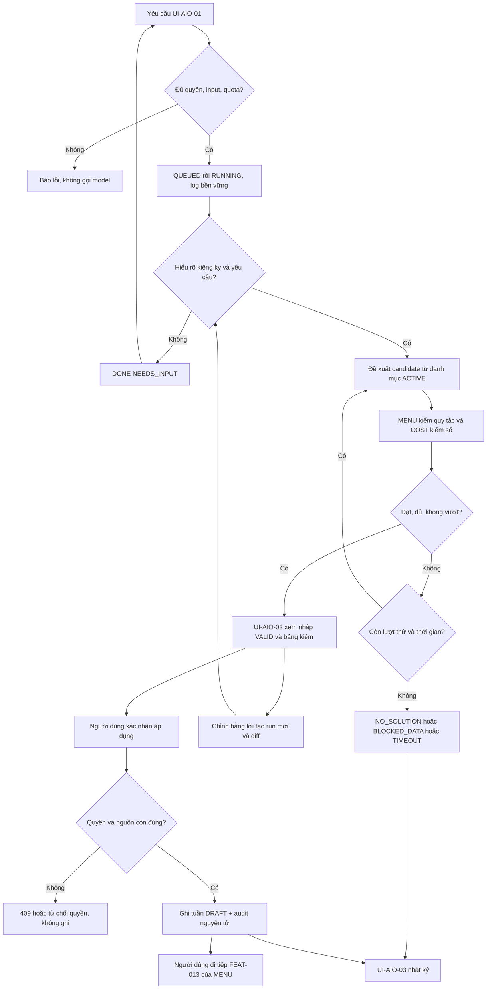

# User flow (AIO)

Phiên bản 0.1.0 · 2026-11-11 · **Draft: đề xuất thiết kế để review, chưa phê duyệt nghiệp vụ; chưa triển khai backend.**

| Phiên bản | Ngày | Người thực hiện | Thay đổi |
| :--- | :--- | :--- | :--- |
| 0.1.0 | 2026-11-11 | BA | Khởi tạo gói MVP từ PRD/roadmap và thiết kế hiện có |

## Trạng thái màn hình chung

| Trạng thái | Hiển thị / hành vi |
| :--- | :--- |
| Normal | Đủ nhãn, nguồn/version và quyền thao tác; nút quay lại không ghi dữ liệu |
| Loading | Khóa gửi trùng, giữ input; đối chiếu clientRevision hoặc runId trước nhận response |
| Empty | Nêu chưa có dữ liệu/lượt chạy; không thay bằng số 0 hoặc ví dụ thật |
| Error | Hiện mã/requestId và hướng xử lý SRS; 409 yêu cầu tải lại; không tự ghi đè |
| Offline | Dừng poll/tính/lưu; giữ nội dung nhập trong phiên, không báo thành công; trở lại mạng phải GET đối soát trước retry |
| Permission changed | Dừng gọi tiếp; bỏ dữ liệu hiển thị không còn quyền, server vẫn kiểm lại; không replay response cũ |

Truy vết màn và trường: [wireframe](wireframe-ascii.md); [API](../api/api-spec.md); [use case/story/test](../test/traceability.md). Không có test tương tác UI vì đây là wireframe ASCII.
