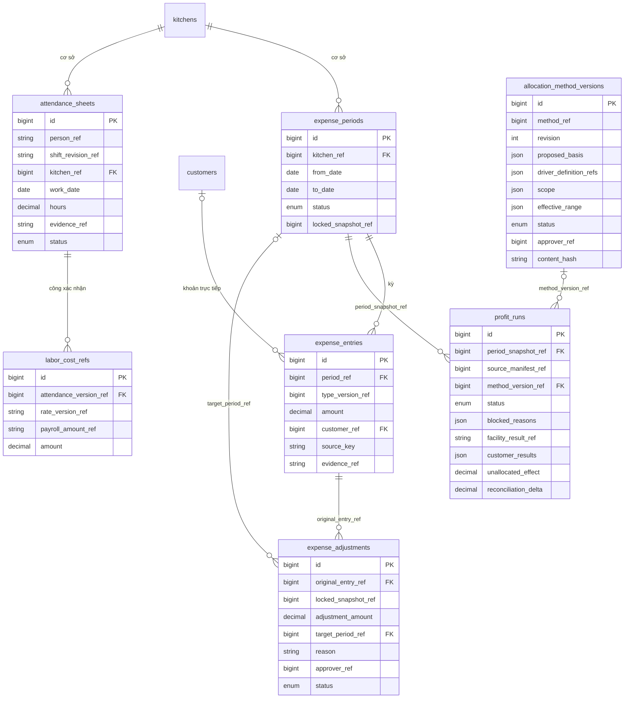

# ERD E13: kế thừa và delta đề xuất

Nháp có điều kiện · 16/11/2026 · Chưa phê duyệt, chưa triển khai.

| Phiên bản | Ngày | Người thực hiện | Nội dung |
| :--- | :--- | :--- | :--- |
| 0.1.0 | 2026-11-16 | BA | Khởi tạo: vẽ quan hệ cho 7 bảng đề xuất trong từ điển dữ liệu E13. Không thêm thực thể hay trường |

Sơ đồ chỉ vẽ lại [từ điển dữ liệu E13](data-dictionary.md). **Schema chung giữ 65 bảng**; không DBML, SQL hay migration. Mọi bảng đề xuất còn có `id`, `version`, `createdBy`, `createdAt`, `auditRef` theo từ điển; sơ đồ chỉ ghi `id`. `person_ref` không mặc định là `users.id`.

## 1. Sơ đồ

`kitchens`, `customers` là bảng có sẵn trong [DBML tổng](../../nen-tang/srs/schema.dbml). `shift_revision_ref` trỏ tới `production_shifts` của E11 (delta chưa merge) nên không vẽ thành quan hệ. Danh mục loại chi phí (`type_version_ref`) và manifest nguồn (`source_manifest_ref`) được nhắc trong từ điển nhưng chưa có bảng riêng.

## 2. Ràng buộc cần review

| Nhóm | Ràng buộc | Căn cứ / gate |
| :--- | :--- | :--- |
| Kỳ | Chỉ OPEN và LOCKED; khóa phải có snapshot; biên ngày chờ chốt | FR-EXP-PER-001; E13-Q02 |
| Chi phí | Khoản trực tiếp bắt buộc có khách; `source_key` chống trùng với E3, E11; tiền là DECIMAL, không float | FR-EXP-COST-001; E13-Q01/09 |
| Chấm công | Giờ để trống khi thiếu, 0 chỉ khi xác nhận 0 giờ; phân ca không chứng minh đã làm | FR-EXP-TIME-001; E13-Q03 |
| Nhân công | Một cách tính được duyệt (đơn giá hoặc bảng lương), không cộng cả hai | FR-EXP-LAB-001; E13-Q04 |
| Phương pháp | Unique (method_ref, revision); bất biến sau duyệt; người duyệt khác người lập, sửa cuối | FR-EXP-METH/APRV; E13-Q05 |
| Lần chạy | `method_version_ref` để trống chỉ khi BLOCKED; tách từng cơ sở, khách, phần chưa phân bổ | FR-EXP-ALLOC/PROF/RECON; E13-Q08 |
| Điều chỉnh | Giữ bản gốc; đủ lý do, bằng chứng, người duyệt trước POSTED; kỳ đích chưa chọn | FR-EXP-ADJ-001; E13-Q10 |
