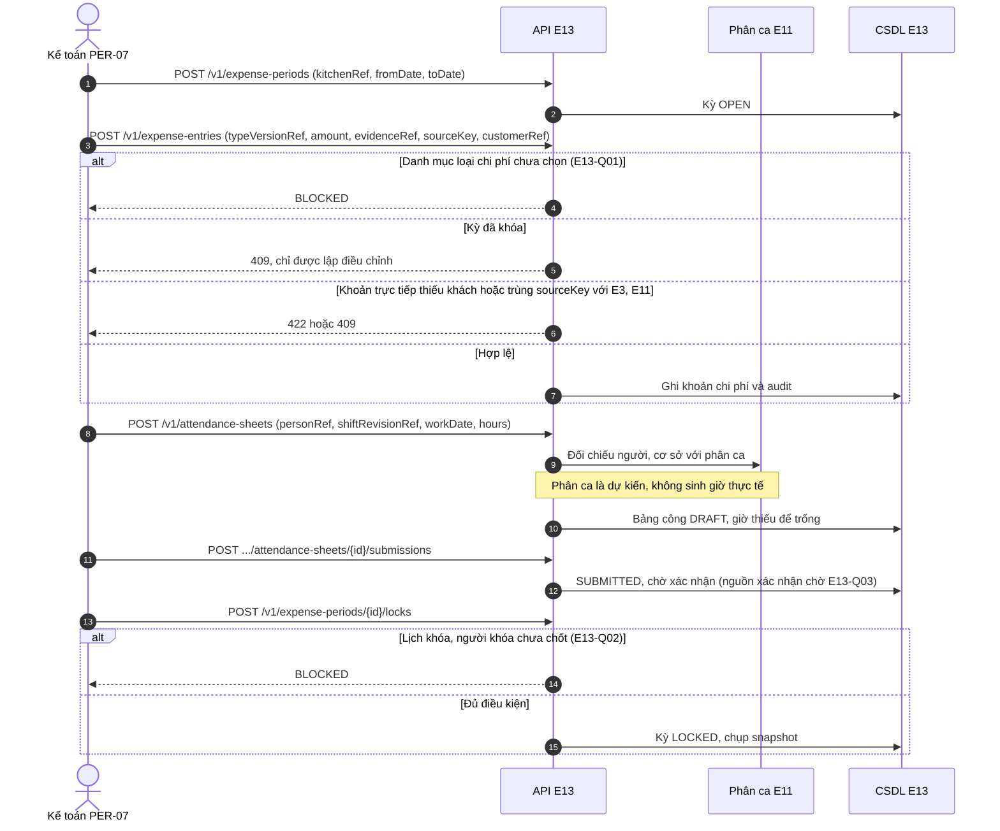
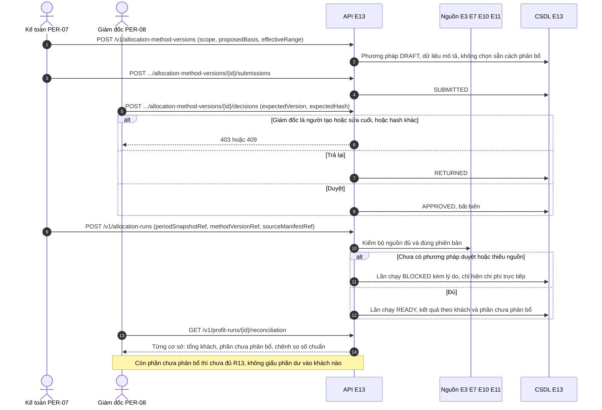
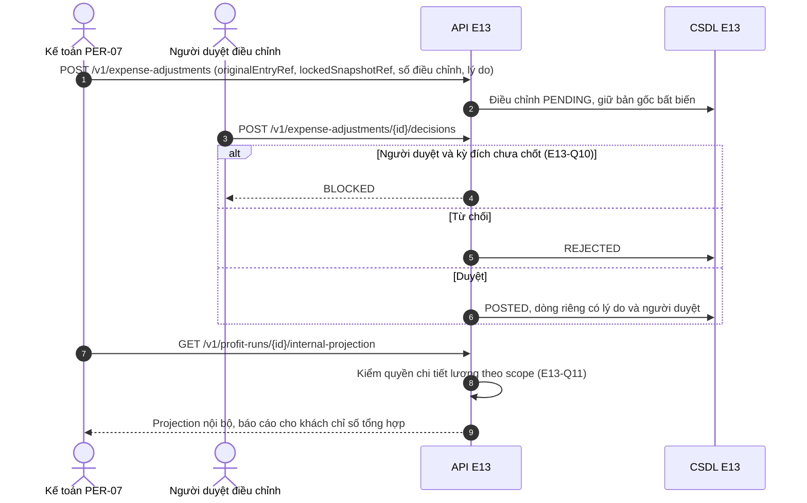

# Sơ đồ tuần tự E13: Chi phí và lợi nhuận

Nháp có điều kiện · 16/11/2026 · Chưa phê duyệt, chưa triển khai.

| Phiên bản | Ngày | Người thực hiện | Nội dung |
| :--- | :--- | :--- | :--- |
| 0.1.0 | 2026-11-16 | BA | Khởi tạo: 3 sơ đồ tuần tự theo API-EXP và quy tắc E13 hiện có. Không thêm endpoint, mã lỗi hay quy tắc |

Route lấy từ [API E13](../api/api-spec.md); trạng thái lấy từ [states](states.md). Bước có gate ghi nhãn BLOCKED.

## 1. Kỳ chi phí, ghi chi phí và chấm công

## 2. Phương pháp phân bổ và lần báo cáo lợi nhuận

## 3. Điều chỉnh sau khóa và đầu ra nội bộ

Chống trùng, receipt và export nội bộ là đề xuất; còn BLOCKED E13-Q12. Chưa có bằng chứng chạy.
