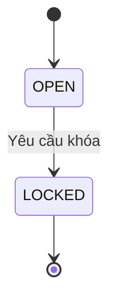
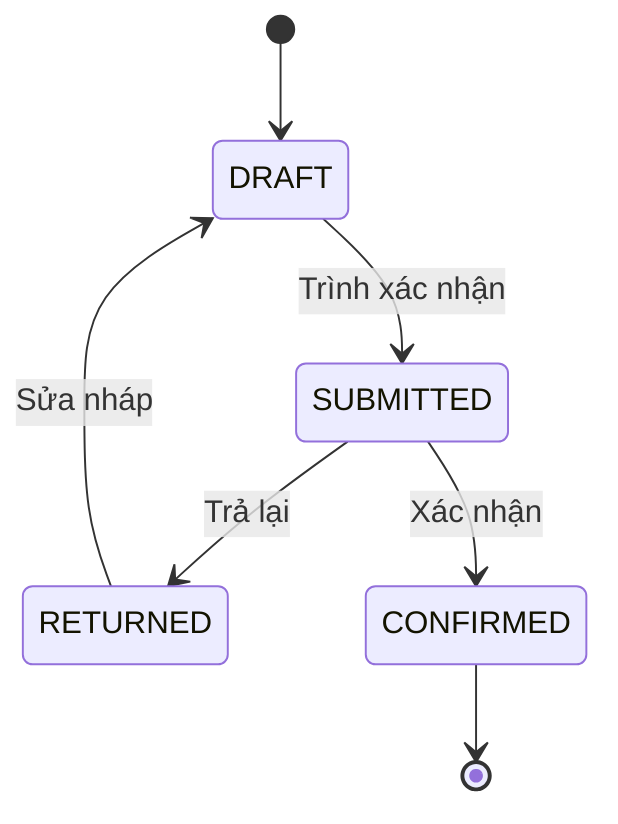
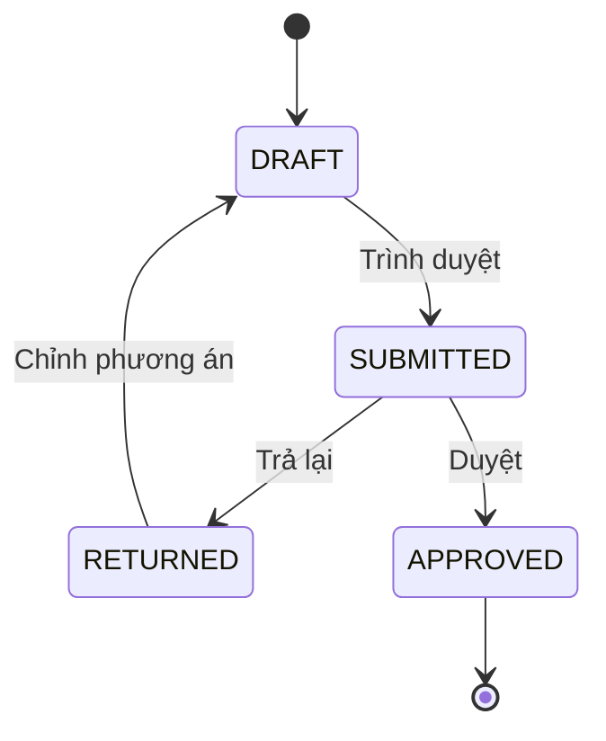
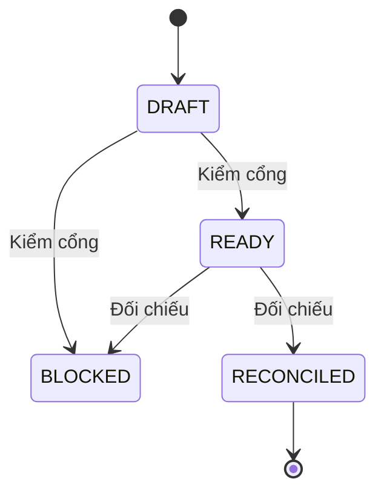
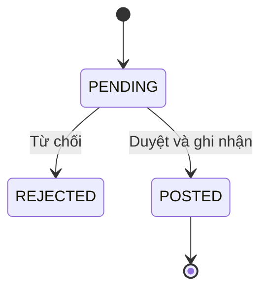

# Trạng thái và điều kiện chuyển EXP

Nháp có điều kiện · Chưa phê duyệt · 12/11/2026.

| Phiên bản | Ngày | Người thực hiện | Nội dung |
| :--- | :--- | :--- | :--- |
| 0.1.0 | 12/11/2026 | BA | Mở tài liệu FEAT-088; giữ các quyết định còn chờ |

## Kỳ chi phí

Khởi đầu OPEN; kết thúc LOCKED. Mọi trạng thái duyệt chỉ là thiết kế có điều kiện, chưa phải dữ liệu được duyệt.

| Hiện tại | Sự kiện | Guard | Đích | Vai trò |
| :--- | :--- | :--- | :--- | :--- |
| OPEN | Yêu cầu khóa | Q02 đã duyệt, đủ nguồn, đúng version | LOCKED | Người có quyền khóa chờ Q02 |
| LOCKED | Yêu cầu sửa trực tiếp | Không được phép | LOCKED | Mọi vai trò: từ chối ERR-EXP-409-01 |

## Bảng chấm công

Khởi đầu DRAFT; kết thúc CONFIRMED. Mọi trạng thái duyệt chỉ là thiết kế có điều kiện, chưa phải dữ liệu được duyệt.

| Hiện tại | Sự kiện | Guard | Đích | Vai trò |
| :--- | :--- | :--- | :--- | :--- |
| DRAFT | Trình xác nhận | Nguồn giờ và ca đủ theo Q03 | SUBMITTED | PER-07 |
| SUBMITTED | Trả lại | Có lý do | RETURNED | Người xác nhận chờ Q03 |
| RETURNED | Sửa nháp | Kỳ còn mở, đúng version | DRAFT | PER-07 |
| SUBMITTED | Xác nhận | Quyền và nguồn đã duyệt Q03 | CONFIRMED | Người xác nhận chờ Q03 |

## Phiên bản phương pháp

Khởi đầu DRAFT; kết thúc APPROVED. Mọi trạng thái duyệt chỉ là thiết kế có điều kiện, chưa phải dữ liệu được duyệt.

| Hiện tại | Sự kiện | Guard | Đích | Vai trò |
| :--- | :--- | :--- | :--- | :--- |
| DRAFT | Trình duyệt | Đủ nội dung đề xuất, không có default | SUBMITTED | PER-07 |
| SUBMITTED | Trả lại | Có lý do | RETURNED | PER-08 |
| RETURNED | Chỉnh phương án | Tạo revision mới; bản cũ giữ lịch sử | DRAFT | PER-07 |
| SUBMITTED | Duyệt | Giám đốc độc lập, evidence/hash đúng, Q05 | APPROVED | PER-08 |

## Lần báo cáo lợi nhuận

Khởi đầu DRAFT; kết thúc RECONCILED. Mọi trạng thái duyệt chỉ là thiết kế có điều kiện, chưa phải dữ liệu được duyệt.

| Hiện tại | Sự kiện | Guard | Đích | Vai trò |
| :--- | :--- | :--- | :--- | :--- |
| DRAFT | Kiểm cổng | Thiếu phương pháp/nguồn/định nghĩa | BLOCKED | PER-07/PER-08 |
| DRAFT | Kiểm cổng | Đủ nguồn và phương pháp được duyệt | READY | PER-07/PER-08 |
| READY | Đối chiếu | U = 0, D = 0; số chuẩn độc lập và đầy đủ | RECONCILED | PER-07/PER-08 |
| READY | Đối chiếu | Thiếu nguồn, còn phần chưa phân bổ hoặc lệch tổng | BLOCKED | PER-07/PER-08 |

## Điều chỉnh sau khóa

Khởi đầu PENDING; kết thúc POSTED hoặc REJECTED. Mọi trạng thái duyệt chỉ là thiết kế có điều kiện, chưa phải dữ liệu được duyệt.

| Hiện tại | Sự kiện | Guard | Đích | Vai trò |
| :--- | :--- | :--- | :--- | :--- |
| PENDING | Từ chối | Quyền duyệt và lý do theo Q10 | REJECTED | Người duyệt chờ Q10 |
| PENDING | Duyệt và ghi nhận | Q10 đã duyệt, khác lập/sửa cuối, đủ lý do/bằng chứng | POSTED | Người duyệt chờ Q10 |

Không có chuyển LOCKED → OPEN tại E13. Sửa công đã xác nhận/kỳ khóa qua điều chỉnh, không ghi đè. Báo cáo BLOCKED/RECONCILED giữ như snapshot; bổ sung nguồn tạo run mới từ DRAFT, không đổi methodVersion của run cũ. Phương pháp mới không tự hồi tố. Chồng hiệu lực, thu hồi phương pháp và kỳ đích điều chỉnh chờ Q05/Q10; không đặc tả tiếp.
