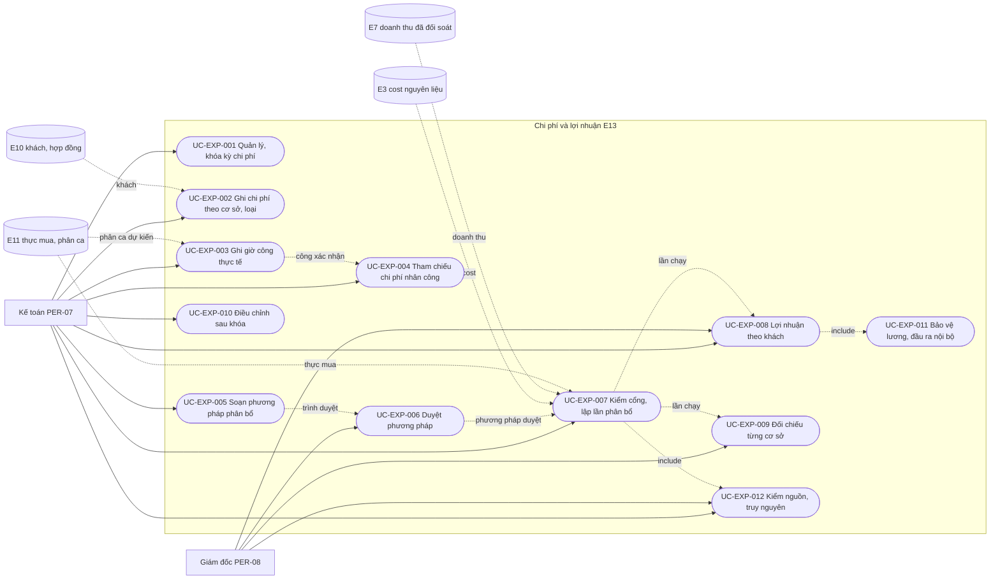

# Sơ đồ use case E13: Chi phí và lợi nhuận

Nháp có điều kiện · 16/11/2026 · Chưa phê duyệt, chưa triển khai.

| Phiên bản | Ngày | Người thực hiện | Nội dung |
| :--- | :--- | :--- | :--- |
| 0.1.0 | 2026-11-16 | BA | Khởi tạo: sơ đồ actor và ma trận FR, UC, màn hình, API cho 12 UC hiện có. Không thêm FR hoặc UC |

File này chỉ vẽ lại phạm vi trong [SRS E13](spec.md), [danh mục UC](../usecases/index.md) và [màn hình](../ui/screens.md). E13 chỉ có một feature (FEAT-088, P2). Phương pháp phân bổ chưa được chọn; khi chưa có bản duyệt, lợi nhuận theo khách BLOCKED và chỉ xem được chi phí trực tiếp.

## 1. Tác nhân

| Tác nhân | Persona | Ghi chú |
| :--- | :--- | :--- |
| Kế toán | PER-07 | Kỳ chi phí, ghi chi phí, chấm công, nhân công, soạn phương pháp, lập lần phân bổ, điều chỉnh |
| Giám đốc | PER-08 | Duyệt phương pháp, đối chiếu cơ sở, xem lợi nhuận; khác người tạo và người sửa cuối |
| Nguồn E3, E7, E10, E11 | Hệ thống | Cost nguyên liệu, doanh thu đã đối soát, khách và hợp đồng, thực mua và phân ca |

## 2. Sơ đồ

Chấm công chỉ phục vụ chi phí nhân công; không tính lương, bảo hiểm hay thuế thu nhập cá nhân. Báo cáo gửi khách không có lợi nhuận hay biên lợi nhuận (FR-EXP-SAFE-001).

## 3. Ma trận FR, UC, màn hình, API

| UC | FR | Tác nhân chính | Màn hình | API | Gate chính |
| :--- | :--- | :--- | :--- | :--- | :--- |
| [UC-EXP-001](../usecases/UC-EXP-001.md) | FR-EXP-PER-001 | Kế toán | UI-EXP-01 | API-EXP-001, 013 | E13-Q02 |
| [UC-EXP-002](../usecases/UC-EXP-002.md) | FR-EXP-COST-001 | Kế toán | UI-EXP-02 | API-EXP-002, 018 | E13-Q01 |
| [UC-EXP-003](../usecases/UC-EXP-003.md) | FR-EXP-TIME-001 | Kế toán | UI-EXP-03 | API-EXP-003, 014 | E13-Q03 |
| [UC-EXP-004](../usecases/UC-EXP-004.md) | FR-EXP-LAB-001 | Kế toán | UI-EXP-03 | API-EXP-004 | E13-Q04 |
| [UC-EXP-005](../usecases/UC-EXP-005.md) | FR-EXP-METH-001 | Kế toán | UI-EXP-04 | API-EXP-005, 015 | E13-Q05/06 |
| [UC-EXP-006](../usecases/UC-EXP-006.md) | FR-EXP-APRV-001 | Giám đốc | UI-EXP-04 | API-EXP-006 | E13-Q05 |
| [UC-EXP-007](../usecases/UC-EXP-007.md) | FR-EXP-ALLOC-001 | Kế toán | UI-EXP-05 | API-EXP-007 | E13-Q05/12 |
| [UC-EXP-008](../usecases/UC-EXP-008.md) | FR-EXP-PROF-001 | Kế toán, Giám đốc | UI-EXP-06 | API-EXP-008, 017 | E13-Q07/09 |
| [UC-EXP-009](../usecases/UC-EXP-009.md) | FR-EXP-RECON-001 | Giám đốc | UI-EXP-07 | API-EXP-009 | E13-Q08 |
| [UC-EXP-010](../usecases/UC-EXP-010.md) | FR-EXP-ADJ-001 | Kế toán | UI-EXP-08 | API-EXP-010, 016 | E13-Q10 |
| [UC-EXP-011](../usecases/UC-EXP-011.md) | FR-EXP-SAFE-001 | Kế toán, Giám đốc | UI-EXP-06 | API-EXP-011 | E13-Q11 |
| [UC-EXP-012](../usecases/UC-EXP-012.md) | FR-EXP-SRC-001 | Kế toán, Giám đốc | UI-EXP-05 | API-EXP-012 | E13-Q12 |

12/12 FR có đúng một UC, tất cả thuộc FEAT-088. Số liệu đo tài liệu, không đo phần mềm.
