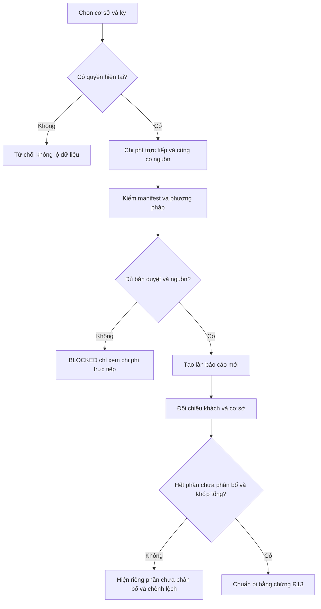
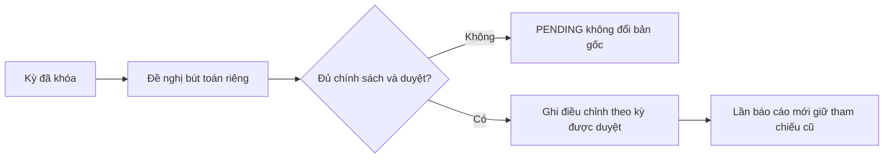

# Luồng sử dụng EXP

Nháp có điều kiện · Chưa phê duyệt · 12/11/2026.

| Phiên bản | Ngày | Người thực hiện | Nội dung |
| :--- | :--- | :--- | :--- |
| 0.1.0 | 12/11/2026 | BA | Mở tài liệu FEAT-088; giữ các quyết định còn chờ |

## Ghi nhận và báo cáo

## Sửa sau khóa

| Trạng thái UI | Hành vi |
| :--- | :--- |
| Normal | Hiện dữ liệu synthetic và nhãn nguồn; dữ liệu thật vẫn có gate. |
| Loading | Đang đọc nguồn; không hiện số cũ thành số kỳ mới. |
| Empty | Chưa có bản ghi, không biểu diễn là chi phí 0. |
| Error | Thông báo an toàn và hướng xử lý, giữ phạm vi đã chọn. |
| Offline | Không xếp hàng ghi tiền tự động; dữ liệu chỉ minh họa. |
| Blocked | Hiện câu hỏi/nguồn thiếu; không bật hành động tính hoặc phát hành. |

[Màn hình](screens.md) · [Wireframe](../html-wireframe/profit-workbench.html).
