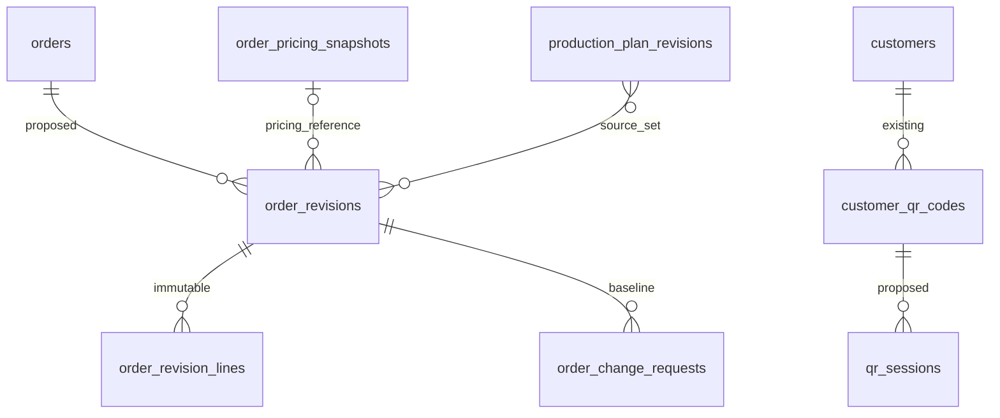

# Đối chiếu schema và từ điển delta E6

**Draft để review · 11/11/2026 · Chưa phê duyệt nghiệp vụ / chưa triển khai backend.**

| Phiên bản | Ngày | Nội dung |
| :--- | :--- | :--- |
| 0.2.0 | 2026-11-11 | Bổ sung thiết kế có điều kiện, không đóng gate |

Nguồn kiểm trực tiếp: [schema DBML dùng chung](../../nen-tang/srs/schema.dbml). Hiện có **65 bảng**; file DBML không thay trong phiên E6. Có bảng không đồng nghĩa schema được phê duyệt hoặc migration đã chạy. Các thiết kế dưới đây chưa merge.

## Quan hệ hiện hữu và khoảng trống

| Bảng / cột hiện hữu | Quan hệ / invariant | Kết quả rà và tác động |
| :--- | :--- | :--- |
| users / user_roles / sessions | Quyền/phiên nền | users.customer_id và user_type SERVICE đã có; cần scope nhiều điểm/guest và policy binding, không giả user_roles đã có customer_id; ORD-Q11 |
| customer_qr_codes | customer_id FK, service_point_id nullable FK; token_hash unique; ACTIVE/ROTATED/REVOKED | Thiếu expiry/version/rotated successor; API version và TTL là delta ORD-Q02/11 |
| eaters | customer_id,service_point_id FK; user_id nullable unique | FK riêng không đảm bảo point thuộc cùng customer; nullable unique không chặn nhiều guest cùng người |
| service_schedules | unique(service_point_id,shift,weekday), weekday1..7 | Chưa hiệu lực theo khoảng ngày/lịch nghỉ; ORD-Q03; API không hứa đã lưu được bằng bảng hiện tại |
| customer_quotas | unique(customer_id,effective_from), meal_type_id FK, approved_by | Chưa khoảng hiệu lực/status hoặc bản chụp giá/cơ cấu; tránh sửa lịch sử khi meal_type thay |
| meal_selections | unique(eater_id,service_date,shift); point/menuDay/dish FK; source SELF/DEFAULT/COORDINATOR | Một dishId/selection; không đủ nhiều MAIN. Không thêm default gộp bằng eater giả. Chuyển điểm cần ORD-Q13 |
| selection_counters | PK(menu_day_id,service_point_id,shift,dish_id) | qty chỉ cache lựa chọn thuộc scope; phải đối soát trước lock; date suy từ menu_day không từ client |
| orders | unique(point,date,shift); total_servings NOT NULL; unit_price_vnd bigint; version | Khi chưa có tổng không tự insert T=0; summary có total=null trước order gửi. Một loại suất/điểm/ngày/ca; không tự mở đa loại suất |
| order_dish_lines | unique(order_id,dish_id); selected/default/coordinator | Ghi chú tổng mọi dòng=T chỉ đúng MAIN một món/suất. Không dùng lưu tất cả SIDE/VEG/SOUP rồi áp ghi chú đó |
| change_requests, approvals | Quy trình duyệt chung | Tránh hai workflow song song: order_change_requests đề xuất là extension liên kết approvals; cách reuse cần Tech lead chốt |
| audit_logs | actor_user_id NOT NULL FK users; on_behalf_user_id | Service có thể tham chiếu users loại SERVICE; guest không user chưa có cách audit trực tiếp; phải thiết kế principal/service audit, không tạo người thật giả |
| eater_health_profiles | Đã có trong DBML | Không phải căn cứ mở FEAT-046/047; O-03 vẫn chặn, không thêm form/endpoint ghi |
| customer_price_terms / order_pricing_snapshots | Snapshot unique(order_id,order_version), context_status | Liên kết order revision với order_version đã chụp; không tạo nguồn giá bán song song |
| order_discount_records / events | pricing_snapshot_id, quantity_basis và policy chưa chốt | Order đổi chỉ tạo sự kiện cần rà; không tự giảm gross_amount_due, không tính lại chiết khấu thành đã chi |

## Từ điển delta đề xuất

Mọi ID là bigint biểu diễn chuỗi qua API; thời điểm UTC; ngày phục vụ theo Asia/Ho_Chi_Minh. `required` là yêu cầu thiết kế, không phải CHECK đã triển khai.

| Thực thể đề xuất | Thuộc tính / kiểu / nullability | Khóa, quan hệ và hành vi |
| :--- | :--- | :--- |
| order_revisions | id PK; order_id FK required; revision_no int≥1 required; order_version int≥1; base_revision_id nullable FK self; total_servings int≥0; menu_day_id/menu_version/quota_version/kitchen_id/meal_type_id required; deadline_at datetime required; pricing_snapshot_id nullable FK; source_snapshot JSON required; created_by principal,created_at,reason | unique(order_id,revision_no); base phải cùng order; pricing snapshot phải cùng order/version. Immutable; chưa resolve kế toán không giả snapshot giá đã đầy đủ; ORD-Q04/08 |
| order_revision_lines | id PK; revision_id FK; dish_id FK; recipe_id FK; portion_code; role; selected/default/coordinator int≥0; all required trong mô hình MAIN | unique(revision_id,dish_id,recipe_id,portion_code); snapshot tên/đơn vị giữ lịch sử; quy tắc SIDE riêng chờ ORD-Q10 |
| order_change_requests | id PK; order_id FK; base_revision_id FK; delta_lines JSON; reason string10..500; evidence_file_id nullable FK files; status PENDING/APPROVED/REJECTED/STALE; version int; created/last_modified principal; approval_ref nullable | base cùng order; không auto-approve; actor approval khác creator/last editor; liên kết approvals cần review; delta âm không âm quantity |
| production_plan_revisions | id PK; kitchen_id FK; service_date; shift; revision_no int; previous_id nullable FK; source_order_revision_ids JSON; lines_snapshot JSON; created_at; event_set_hash | unique(kitchen,date,shift,revision_no); đúng một revision mỗi order. JSON FK không được DB cưỡng chế: app kiểm mọi ID hoặc chuẩn hóa source table trước build |
| qr_sessions / identity binding | id PK; qr_id FK; principal/eater ref; scope JSON; issued/expires_at; revoked_at nullable; credential_hash | Khóa định danh và account/guest merge chờ ORD-Q01; chỉ proposal, không tự chọn phone/employeeCode/OTP |
| idempotency_receipts / outbox | request/event id; actor scope; route; body_hash; resource_ref; status; result; created_at; attempts | Ghi cùng transaction; event dedupe bền vững; request TTL24h đề xuất E1-Q02 không thay domain unique |
| choice_mode_versions / weekly receipt | customer,effective_from,enabled,version; batchId,policy,per_day_receipts | ORD-Q05/09; chưa thêm bảng vào schema; không hứa đã có persistence |

Không migration/DDL được phát hành. Tech lead phải chọn reuse vs extension, chuẩn hóa source rows và duyệt transaction/retention trước chuyển đặc tả thành schema triển khai.

## Bổ sung consistency độc lập — 11/11/2026

Xem [mapping consistency](../api/data-mapping.md) và [manifest/lifecycle](lock-plan-review.md). Phân biệt token tổng, version order, revision order/plan; lock thành công không hứa plan đã sẵn sàng. Các trường completeness/ack/publish vẫn là delta review, chưa thêm vào catalog hoặc wireframe; không thay E6-EVID-001/002.

## Chuẩn hóa alias logic — 11/11/2026

| Ngữ cảnh | Tên dùng trong tài liệu delta | Alias / tên vật lý hiện hữu | Cách đọc |
| :--- | :--- | :--- | :--- |
| order_dish_lines hiện hữu | selected/default/coordinator trong DTO | qty_selected/qty_default/qty_coordinator trong DBML | Mapping số lượng, không đổi tên cột DB |
| order_revision_lines đề xuất | selected/default/coordinator | ERD trước ghi tắt qty_selected/default/coordinator | Đồng bộ tên logic với từ điển; tên cột vật lý delta chưa freeze |
| order_change_requests đề xuất | delta_lines, created/last_modified principal, approval_ref | ERD trước delta, proposed_by/approved_by | Không coi approval_ref là actorId; approval cần liên kết workflow và chứng cứ riêng |
| production_plan_revisions đề xuất | service_date | ERD trước date | Cùng ngày phục vụ trong scope, không timestamp tạo revision |

Khóa dòng recipe/portion hiện chưa chứng minh role/unit phụ thuộc hàm vào khóa; không tự thêm unique hoặc quy đổi món kèm. [Review delta](../api/delta-contract-review.md) ghi điều kiện ánh xạ và các phương án chưa chọn. OrderRevision DTO còn thiếu unit/id dòng để hỗ trợ delta đầy đủ; không dùng alias để che gap đó.
