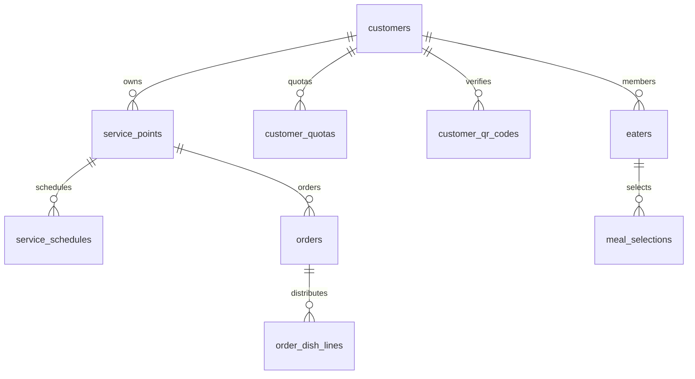

# ERD E6 — kế thừa và delta cần thiết

**Draft — thiết kế BA để review; chưa duyệt nghiệp vụ, chưa triển khai phần mềm.**

| Phiên bản | Ngày | Người thực hiện | Thay đổi |
| :--- | :--- | :--- | :--- |
| 0.1.0 | 2026-11-11 | BA | Bổ sung theo kế hoạch; giữ điểm mở và xác nhận đã có |

Nguồn cột/PK/FK/enum hiện hữu: [DBML tổng](../../nen-tang/srs/schema.dbml), [từ điển nền](../../nen-tang/srs/erd.md). Chưa sửa DBML65 bảng cho E6 khi các invariant chưa chốt.

| Miền | Bảng hiện có | Ràng buộc cần review |
| :--- | :--- | :--- |
| Khách/điểm/lịch | customers,service_points,service_schedules | Schedule unique(point,shift,weekday); đổi bếp không viết lại snapshot |
| Định mức/QR | customer_quotas,customer_qr_codes | QR chỉ lưu token_hash; quay vòng token và scope; quota unique(customer,effective_from) nhưng giá/cơ cấu snapshot chưa đủ |
| Người/lựa chọn | eaters,meal_selections,selection_counters | Unique(eater,date,shift); counter cùng transaction; user_id unique chưa giải quyết guest duplicate ORD-Q01 |
| Order | orders,order_dish_lines | Unique(point,date,shift); tổngMAIN=T chỉ với1MAIN/suất; current version không đủ lịch sử đổi sau khóa |

## Delta đề xuất — chưa merge schema

- `order_revisions`: PK id; order_id FK,revision_no int unique(order_id,revision_no),base_revision_id?,menu/quota/price snapshot JSON,deadline snapshot,total_servings int>=0,status,created_at/by,reason. Bất biến khi khóa.
- `order_revision_lines`: PK id; revision_id FK,dish_id FK,recipe_id FK,portion_code,role,selected/default/coordinator int>=0; unique(revision_id,dish_id,recipe_id,portion_code). Không suy tổng món phụ bằng tổng suấtMAIN.
- `order_change_requests`: PK id; order_id FK,base_revision_id,delta_lines JSON,created/last_modified principal,approval_ref,reason,status,version; tách người tạo/sửa cuối và duyệt; lifecycle chờ Q-16.
- `production_plan_revisions`: PK id; kitchen_id,service_date,shift,revision_no,source_order_revision_ids JSON,lines_snapshot JSON,created_at; unique(kitchen,date,shift,revision_no); outbox event dedupe.
- Cần kho phiênQR/identity policy và idempotency requests; không quyết kiểu khóa duy nhất trước ORD-Q01. Nullable unique user_id trong MySQL không chống trùng guest.

Tech lead cần chốt transaction và lưu giá/định mức immutable cùng kế toán snapshot hiện có, tránh hai nguồn giá. Đề xuất chỉ để review, chưa DDL/migration; không tăng tổng schema đã compile.

Review E6-RV-07: khóa dòng delta được đồng bộ với [data dictionary](data-dictionary.md) để không gộp hai recipe/portion khác nhau. Đây vẫn là đề xuất, không merge DBML; ORD-Q10/O-02 chưa đóng.
