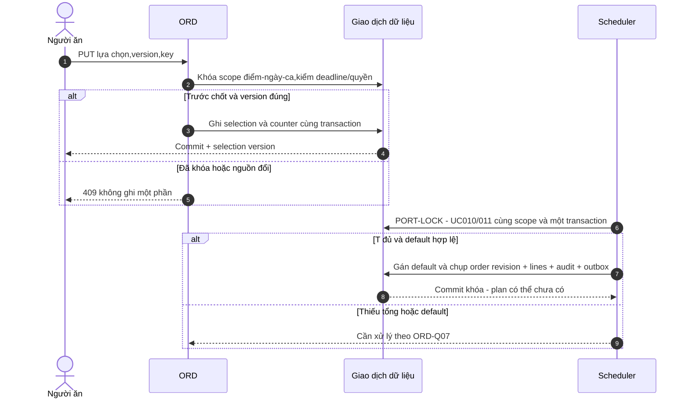
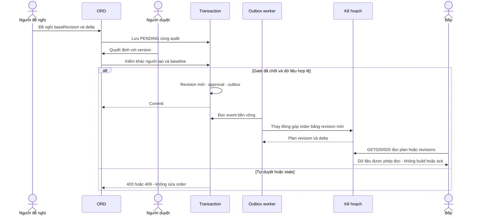

# Sequence E6: race chọn món và khóa

**Draft: thiết kế BA để review; chưa duyệt nghiệp vụ, chưa triển khai phần mềm.**

| Phiên bản | Ngày | Người thực hiện | Thay đổi |
| :--- | :--- | :--- | :--- |
| 0.1.0 | 2026-11-11 | BA | Bổ sung theo kế hoạch; giữ điểm mở và xác nhận đã có |

Thứ tự commit được server xác định; retry PORT-LOCK cùng eventKey không khóa/tạo order revision lần hai. Worker xử lý outbox tạo plan riêng sau commit; lỗi xử lý event không mở khóa số đặt. Publish là bước riêng chờ ORD-Q14, không đồng nghĩa build plan. Đây là thiết kế, chưa có bằng chứng race test.

## Đổi sau khóa và phát hành delta

Làm rõ 12/11/2026: service principal gọi port/event, không mở UI; vận hành GET kết quả không kích hoạt job. Hai sơ đồ giữ ranh giới producer+read theo UC011/019 và AC/TC019-1/3. GET không commit nghiệp vụ, tạo receipt, publish/ack/start-production hoặc retry bằng Idempotency-Key. Không thêm contract retry/retention; CG04/05/06/07 vẫn OPEN.
