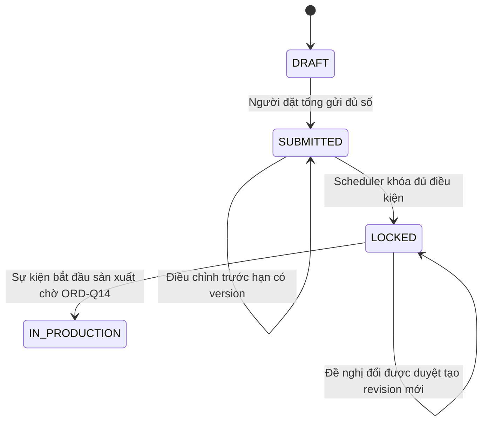
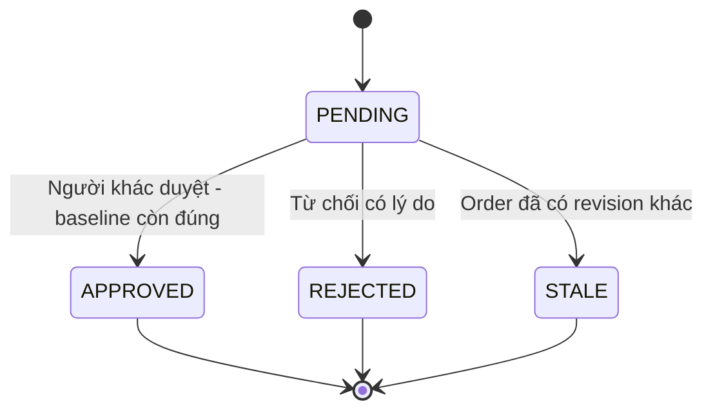

# Trạng thái E6: order và đề nghị đổi

**Draft: thiết kế BA để review; chưa duyệt nghiệp vụ, chưa triển khai phần mềm.**

| Phiên bản | Ngày | Người thực hiện | Thay đổi |
| :--- | :--- | :--- | :--- |
| 0.1.0 | 2026-11-11 | BA | Bổ sung theo kế hoạch; giữ điểm mở và xác nhận đã có |

| Hiện tại | Trigger | Guard | Đích | Actor |
| :--- | :--- | :--- | :--- | :--- |
| DRAFT | Gửi tổng | T>=S+C,đúng scope/định mức | SUBMITTED | Người đặt tổng/DDV nhập hộ |
| SUBMITTED | Đổi trước hạn | Clock server còn mở,version đúng | SUBMITTED version+1 | Người có quyền |
| SUBMITTED | Hạn chốt | Total/default đủ,khóa scope,snapshot nguyên tử | LOCKED | Scheduler |
| LOCKED | Duyệt đổi | Đề nghị riêng,Q-16/O-06 đã chốt,base revision đúng | LOCKED revision mới | Người duyệt |
| LOCKED | Xác nhận bắt đầu sản xuất: chưa chốt | Sự kiện/quyền theo ORD-Q14, nguồn kế hoạch xác định | IN_PRODUCTION (transition chưa mở) | Vận hành theo quyền cần chốt |

IN_PRODUCTION là điểm bàn giao, không terminal toàn vòng đời; DELIVERED/CONFIRMED/DISPUTED/RECONCILED thuộc E7. Không có transition tự đi tiếp khi thiếu total/default. Đề nghị đổi độc lập: PENDING→APPROVED/REJECTED; bản rejected không sửa order. Trạng thái đề nghị là đề xuất chưa mergeDB.

## Bổ sung 0.2.0: job, đề nghị và kế hoạch

STALE là trạng thái đề xuất delta, không enum đã merge. Không sửa đề nghị đã quyết định; tạo đề nghị mới từ baseline mới. Sau APPROVED retry trả quyết định gốc, không tạo thêm revision.

Job khóa/tổng hợp đề xuất QUEUED→RUNNING→SUCCEEDED/FAILED/NEEDS_ATTENTION. FAILED/NEEDS_ATTENTION không đồng nghĩa order đã mở lại; đọc commit/receipt trước retry. Order DRAFT/SUBMITTED quá hạn nhưng thiếu dữ liệu không tự chuyển LOCKED hoặc total=0. IN_PRODUCTION và quyền phát hành chờ ORD-Q14, không có API start production trong gói này.

Kế hoạch là chuỗi snapshot bất biến v1→v2, không chuyển trạng thái v1 thành nội dung v2. Khi event cũ tới muộn, kiểm source revision và không hồi lui plan. QR ACTIVE→ROTATED/REVOKED giữ lịch sử; không có transition phục hồi token cũ. Phiên đã mở khi quay QR xử lý theo ORD-Q02.

Review E6-RV-05: phát hành hoặc xem kế hoạch không tự chuyển order sang IN_PRODUCTION. Phân biệt publish, acknowledgement và bắt đầu sản xuất theo [DR-04](../review/decision-review.md); chưa có API hoặc quyết định vận hành mới.
