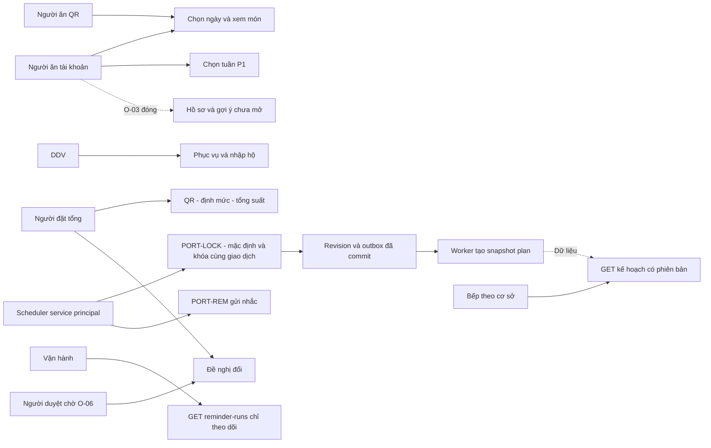

# Chỉ mục và sơ đồ use case E6

**Draft để review · 11/11/2026 · Chưa duyệt nghiệp vụ, chưa triển khai backend/UAT.**

| Phiên bản | Ngày | Thay đổi |
| :--- | :--- | :--- |
| 0.2.0 | 2026-11-11 | Bổ sung chi tiết E6, giữ gate và mã gốc |

Các UC là đặc tả review có điều kiện; không gắn nhãn ready khi gate chưa chốt.

- [UC-ORD-001 — Cấp quyền người đặt tổng](../usecases/UC-ORD-001.md): FR-AUTH-EXT-001.
- [UC-ORD-002 — Đăng ký qua QR công ty](../usecases/UC-ORD-002.md): FR-AUTH-QREG-001.
- [UC-ORD-003 — Mở phiên QR giới hạn](../usecases/UC-ORD-003.md): FR-AUTH-QSES-001.
- [UC-ORD-004 — Quản lý QR và danh sách người ăn](../usecases/UC-ORD-004.md): FR-AUTH-QRM-001.
- [UC-ORD-005 — Quản lý dữ liệu phục vụ](../usecases/UC-ORD-005.md): FR-CUS-SVC-001.
- [UC-ORD-006 — Đặt định mức công ty](../usecases/UC-ORD-006.md): FR-ORD-QTA-001.
- [UC-ORD-007 — Chọn và đổi một món chính](../usecases/UC-ORD-007.md): FR-ORD-SEL-001.
- [UC-ORD-008 — Gửi lựa chọn cả tuần](../usecases/UC-ORD-008.md): FR-ORD-WEEK-001.
- [UC-ORD-009 — Chốt tổng suất và phân bổ](../usecases/UC-ORD-009.md): FR-ORD-SUB-001.
- [UC-ORD-010 — Gán món mặc định khi khóa](../usecases/UC-ORD-010.md): FR-ORD-DEF-001.
- [UC-ORD-011 — Khóa tại hạn và phát hành nguồn kế hoạch](../usecases/UC-ORD-011.md): FR-ORD-LOCK-001.
- [UC-ORD-012 — Đề nghị và duyệt thay đổi sau khóa](../usecases/UC-ORD-012.md): FR-ORD-CHG-001.
- [UC-ORD-013 — Điều phối nhập hộ](../usecases/UC-ORD-013.md): FR-ORD-PXY-001.
- [UC-ORD-014 — Nhắc người chưa chọn](../usecases/UC-ORD-014.md): FR-ORD-REM-001.
- [UC-ORD-015 — Đổi chế độ chọn món](../usecases/UC-ORD-015.md): FR-ORD-MODE-001.
- [UC-ORD-016 — Xem thông tin món công bố](../usecases/UC-ORD-016.md): FR-NUTR-DSP-001.
- [UC-ORD-017 — Giữ cổng hồ sơ sức khỏe](../usecases/UC-ORD-017.md): FR-NUTR-PROF-001.
- [UC-ORD-018 — Giữ cổng gợi ý cá nhân](../usecases/UC-ORD-018.md): FR-NUTR-REC-001.
- [UC-ORD-019 — Đọc kế hoạch sản xuất phiên bản](../usecases/UC-ORD-019.md): FR-PLAN-MEAL-001.

Làm rõ 12/11/2026: UC010/011 cùng PORT-LOCK, không hai job khóa; các cạnh dữ liệu không là thao tác UI của worker. Bếp đọc không tạo/publish/ack/start-production; GET của vận hành không gửi nhắc. GATE-046/047 không nhận profile/consent hoặc chạy thuật toán. Chỉ mục UC/mã truy vết giữ nguyên.
