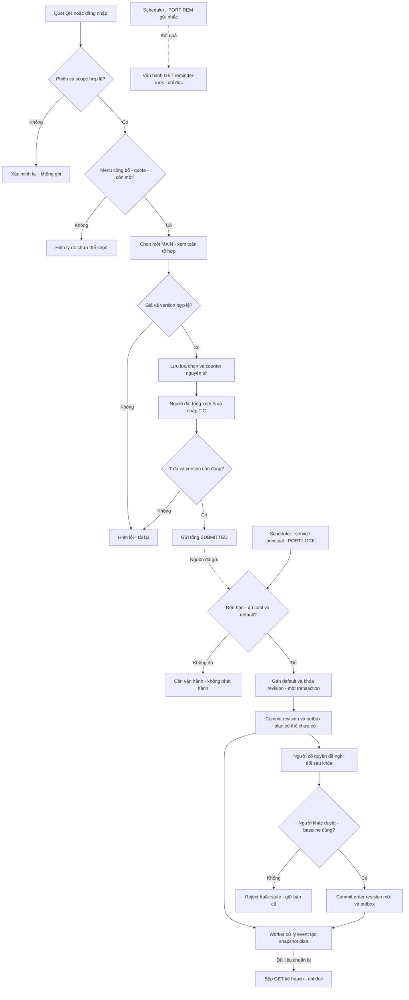

# User flow E6: chọn, chốt và phát hành

**Draft để review · 11/11/2026 · Chưa phê duyệt nghiệp vụ / chưa triển khai backend.**

| Phiên bản | Ngày | Nội dung |
| :--- | :--- | :--- |
| 0.2.0 | 2026-11-11 | Bổ sung thiết kế có điều kiện, không đóng gate |

[19 UC](../srs/usecase-diagram.md) là nguồn nhánh chi tiết; [quy tắc](../srs/operational-rules.md) chứa guard. Mọi nhánh đề xuất chờ mã câu hỏi tương ứng.

Nhánh tuần: tài khoản → chọn từng ngày → preview kết quả → policy ORD-Q05 chưa chốt thì chặn gửi → khi được duyệt trả receipt atomic/per-day rõ. Nhánh nhập hộ: DDV chọn khách/điểm → nhập source/evidence → preview S/C/T → áp cùng validation/version/deadline; sau khóa chuyển đề nghị, không bypass.

Nhánh dữ liệu rỗng: chưa có menu/định mức → không có nút lưu khả dụng; thiếu dinh dưỡng → “Chưa có dữ liệu”, vẫn phân biệt với món không đủ điều kiện chọn. Mất mạng sau lệnh ghi có key theo route → “Chưa xác nhận kết quả”, giữ request key để đối soát; không hiển thị thành công giả.

## Ranh giới đọc và trạng thái màn ngày 12/11/2026

Luồng trên là thiết kế có điều kiện, không sự kiện publish/ack/start-production. UC010/011 cùng PORT-LOCK; scheduler/worker không mở UI. GET020 của vận hành/bếp và GET025 revisions chỉ đọc; GET023 không kích hoạt PORT-REM. GET001 xem món không tạo Calculation hoặc receipt. Không retry GET bằng Idempotency-Key; tải lại dữ liệu không phải phục hồi lệnh ghi.

Normal hiển thị dữ liệu/phiên bản được phép đọc; Loading chờ response; Empty/plan chưa có không kích hoạt producer; Error phân biệt thiếu nguồn và timeout theo API; Offline khi đọc báo chưa tải được, khi ghi mất phản hồi báo chưa xác nhận kết quả. Quyền publish/ack/start và visibility vẫn theo ORD-Q14, không có nút/route mới.

GATE-046/047 chỉ hiện chưa mở, không nhận profile/consent, thu sức khỏe hoặc chạy thuật toán. Grant A trong ví dụ synthetic không chốt phạm vi toàn tài khoản. Căn cứ [UC](../review/uc-operation-review.md), [lifecycle](../srs/lock-plan-review.md) và [API](../api/api-spec.md).
