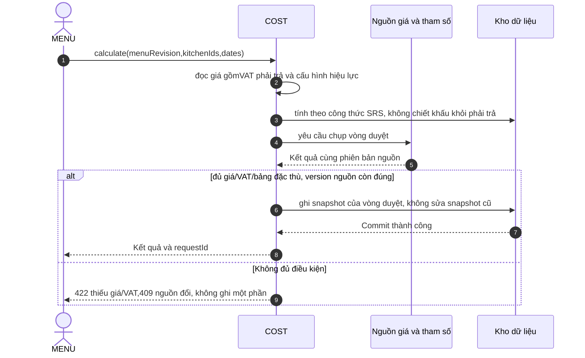

# Luồng tuần tự (Cost)

**Draft: thiết kế BA để review; chưa duyệt nghiệp vụ, chưa triển khai phần mềm.**

| Phiên bản | Ngày | Người thực hiện | Thay đổi |
| :--- | :--- | :--- | :--- |
| 0.1.0 | 2026-11-11 | BA | Bổ sung theo kế hoạch; giữ điểm mở và xác nhận đã có |

## Tính cost và chụp khi duyệt

Mất phản hồi sau commit: tra resource/version hoặc replay cùng key theo quyền hiện tại, không tạo mới mù. Hủy thao tác trước xác nhận không gọi lệnh ghi; sau commit phải dùng lifecycle nghiệp vụ, không dùng nút quay lại để rollback. Lỗi DB/audit rollback cả giao dịch. Thiết kế chưa có transaction/backend thực thi.

[SRS](spec.md) · [API](../api/api-spec.md) · [Trạng thái](states.md).
