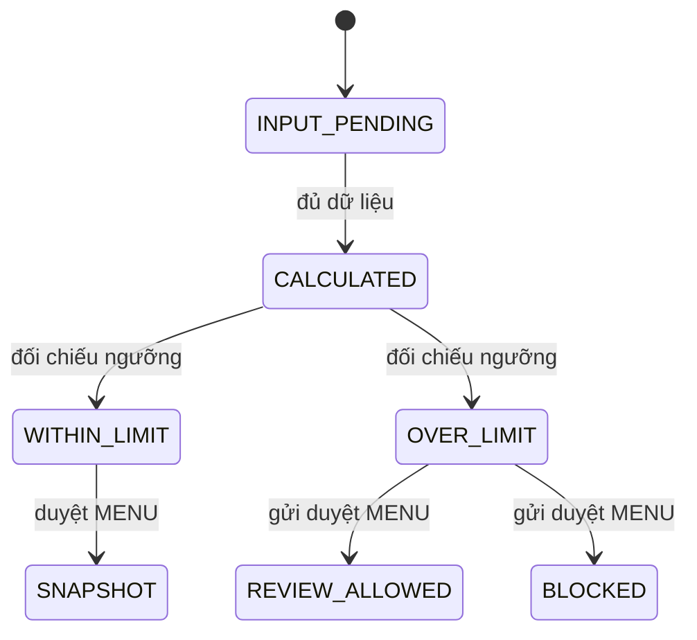

# Trạng thái (Cost)

**Draft: thiết kế BA để review; chưa duyệt nghiệp vụ, chưa triển khai phần mềm.**

| Phiên bản | Ngày | Người thực hiện | Thay đổi |
| :--- | :--- | :--- | :--- |
| 0.1.0 | 2026-11-11 | BA | Bổ sung theo kế hoạch; giữ điểm mở và xác nhận đã có |

## Kết quả kiểm cost (trạng thái suy ra)

| Hiện tại | Trigger | Guard | Đích | Actor |
| :--- | :--- | :--- | :--- | :--- |
| INPUT_PENDING | đủ dữ liệu | giá/VAT/bảng đặc thù hợp lệ | CALCULATED | COST |
| CALCULATED | đối chiếu ngưỡng | cost%<=ngưỡng sau làm tròn | WITHIN_LIMIT | COST |
| CALCULATED | đối chiếu ngưỡng | cost%>ngưỡng sau làm tròn | OVER_LIMIT | COST |
| OVER_LIMIT | gửi duyệt MENU | modeCANH_BAO và các gate khác đạt | REVIEW_ALLOWED | MENU |
| OVER_LIMIT | gửi duyệt MENU | modeCHAN | BLOCKED | MENU |
| WITHIN_LIMIT | duyệt MENU | đúng nguồn/vòng duyệt | SNAPSHOT | MENU/COST |

Đây là trạng thái đánh giá, không phải enum bảng mới. Thiếu dữ liệu không được chuyển CALCULATED. SNAPSHOT bất biến; giá mới tạo recalculation/cảnh báo, không sửa lịch sử duyệt. Lifecycle giá/bảng tính/khoản khoán vẫn theo SRS Cost; phần kế toán CK chờ xác nhận không có trạng thái chi trả tự suy diễn.

Mọi transition ngoài bảng bị từ chối, không tự suy từ nút UI. Version cũ409; quyền thiếu403/ngoài scope404 theo SRS. Các quyền/số liệu chưa chốt giữ trong sổ câu hỏi, không coi state diagram là quyết định duyệt.
