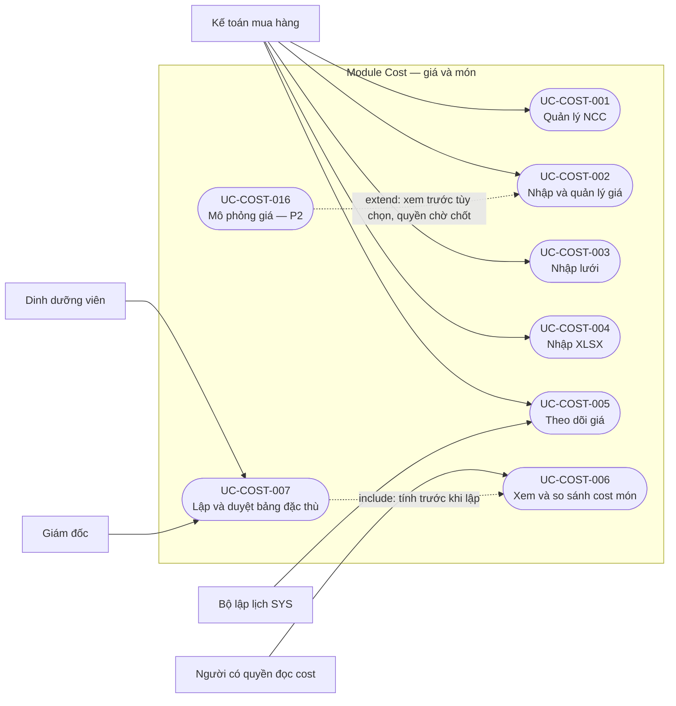
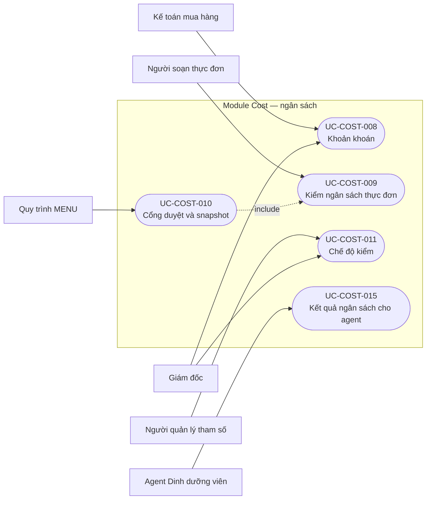
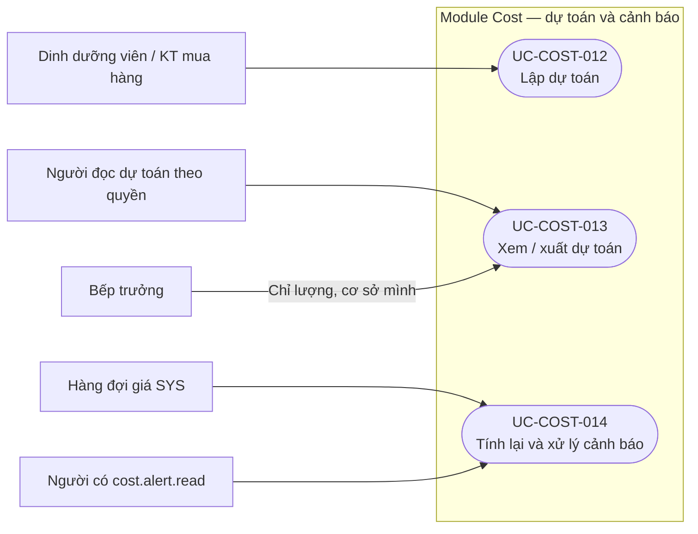

# Sơ đồ use case và ma trận truy vết — Cost

Phiên bản: 0.1.0 · Ngày: 11/11/2026 · Trạng thái: Draft, chờ review nghiệp vụ.

## Lịch sử sửa đổi

| Phiên bản | Ngày | Người thực hiện | Nội dung |
| :--- | :--- | :--- | :--- |
| 0.1.0 | 2026-11-11 | BA | Khởi tạo từ SRS Cost v0.1.1, SRS nền tảng v0.2.0, SRS MENU v0.3.1 và ERD v0.3.0 |

## Phạm vi và cách đọc

Ranh giới là module Cost trong nền tảng Gia Phát. MENU, SYS, bộ lập lịch và hai Agent được mô tả là tác nhân gọi/hỗ trợ ngoài ranh giới module, không phải hệ thống độc lập về triển khai. Mermaid flowchart dùng nút bo tròn để biểu diễn use case, không phải ký pháp UML use-case nguyên bản.

Có **16 use case**, bao phủ **43/45 FR Cost bằng luồng**, và **2/45 FR chỉ được theo dõi là chưa triển khai**. P1/P2 giữ nguyên ưu tiên SRS; việc đã viết luồng không nâng chúng thành P0. Mọi điểm mở trong SRS còn nguyên; các vấn đề mới có mã FLOW-COST-Qxx trong [user flow](../ui/user-flow.md).

## Tác nhân và phạm vi quyền

| Tác nhân | Tương tác | Giới hạn |
| :--- | :--- | :--- |
| KT_MUA_HANG | NCC, nhập giá, theo dõi giá, đề nghị khoản khoán, lập/xem dự toán, xử lý cảnh báo | Không duyệt bảng tính/khoản khoán của mình; không suy ra quyền quản lý tham số từ quyền nhập giá |
| DINH_DUONG_VIEN | Xem cost, lập bảng tính đặc thù, soạn/kiểm thực đơn, lập dự toán, xử lý cảnh báo | Không ghi giá nhập hay tự duyệt bảng tính |
| GIAM_DOC | Xem cost, duyệt bảng tính/khoản khoán/tham số, xem dự toán, xử lý cảnh báo | Có quyền duyệt không có nghĩa được tự duyệt nội dung mình tạo/sửa |
| KT_DOANH_THU | Đọc NCC/giá/cost/dự toán | Không ghi giá, không có cost.alert.read theo SRS hiện tại |
| QL_CO_SO | Đọc giá/cost/dự toán | Chỉ cơ sở được gán; không có cost.alert.read |
| BEP_TRUONG | Xem/xuất lượng nguyên liệu | Chỉ cơ sở mình, không nhận tiền/cost; E3-Q11 còn mở |
| svc-agent-noi-bo | Gọi dịch vụ nội bộ theo quyền người dùng | Không nâng quyền; UI của E5 chưa thiết kế trong đợt này |
| svc-agent-dinh-duong-vien | UC-COST-015 | Chỉ kết quả ngân sách cả thực đơn, không đọc bảng Cost |
| Quy trình MENU | UC-COST-010 | Gửi duyệt, duyệt cuối và ghi snapshot theo quyền MENU |
| Bộ lập lịch/hàng đợi SYS | UC-COST-005 và UC-COST-014 | Không giả lập hành động phê duyệt của con người |
| Người quản lý tham số SYS | UC-COST-011 | Quyền theo SRS nền tảng, người đề nghị và Giám đốc duyệt tách biệt |

Nguồn quyền duy nhất: [SRS Cost mục 2.2](spec.md). Quyền đọc danh sách khoản khoán và quyền mô phỏng P2 còn cần làm rõ, xem FLOW-COST-Q05/Q10.

## Sơ đồ 1 — Nguồn giá và cost món

UC-COST-003/004 tái sử dụng kiểm dữ liệu giá của 002, không bao gồm toàn bộ nhánh huỷ/đổi tham chiếu của 002. UC-COST-016 chỉ là nhánh P2 có thể gọi trước nhập giá; không tự lưu giá. Tác nhân cụ thể của mô phỏng chờ quyết định quyền.

## Sơ đồ 2 — Ngân sách, khoản khoán và duyệt

UC-COST-015 không include giao diện phân rã của UC-COST-009: chỉ tái sử dụng tính toán phía server, tuyệt đối không trả dữ liệu nội bộ của 009 cho agent.

## Sơ đồ 3 — Dự toán và cảnh báo

## Danh mục use case

| Mã | Mục tiêu | Điểm chạm |
| :--- | :--- | :--- |
| [UC-COST-001](../usecases/UC-COST-001.md) | Quản lý nhà cung cấp | SCR-COST-01, SCR-COST-02 |
| [UC-COST-002](../usecases/UC-COST-002.md) | Nhập và quản lý giá tham chiếu | SCR-COST-03, SCR-COST-04 |
| [UC-COST-003](../usecases/UC-COST-003.md) | Nhập đồng thời nhiều giá trên lưới | SCR-COST-03 |
| [UC-COST-004](../usecases/UC-COST-004.md) | Nhập giá từ bảng tính | SCR-COST-05 |
| [UC-COST-005](../usecases/UC-COST-005.md) | Theo dõi lịch sử, giá thiếu và giá cũ | SCR-COST-06, SCR-COST-07 |
| [UC-COST-006](../usecases/UC-COST-006.md) | Xem và so sánh cost món | SCR-COST-08 |
| [UC-COST-007](../usecases/UC-COST-007.md) | Lập và duyệt bảng tính món đặc thù | SCR-COST-09, SCR-COST-10 |
| [UC-COST-008](../usecases/UC-COST-008.md) | Đề nghị và duyệt khoản khoán | SCR-COST-11 |
| [UC-COST-009](../usecases/UC-COST-009.md) | Kiểm cost và phân rã ngân sách thực đơn | SCR-MENU-10, SCR-COST-12 |
| [UC-COST-010](../usecases/UC-COST-010.md) | Kiểm cổng duyệt và chụp cost đã duyệt | SCR-MENU-10, SCR-MENU-12, SCR-COST-12 |
| [UC-COST-011](../usecases/UC-COST-011.md) | Đề nghị và duyệt chế độ kiểm cost | SCR-COST-13 |
| [UC-COST-012](../usecases/UC-COST-012.md) | Lập và lập lại bảng dự toán | SCR-COST-14, SCR-COST-15 |
| [UC-COST-013](../usecases/UC-COST-013.md) | Xem lịch sử và xuất bảng dự toán | SCR-COST-15 |
| [UC-COST-014](../usecases/UC-COST-014.md) | Tính lại và xử lý cảnh báo vượt cost | SCR-COST-16, SCR-COST-17 |
| [UC-COST-015](../usecases/UC-COST-015.md) | Kiểm ngân sách cho Agent Dinh dưỡng viên | SVC-COST-01 (không phải màn hình) |
| [UC-COST-016](../usecases/UC-COST-016.md) | Xem trước tác động của giá giả định | SCR-COST-18 |

## Ma trận FR → use case

Mỗi dòng là một FR được định nghĩa trong SRS, không đếm số lần mã được nhắc. Hai dòng chờ quyết định không có luồng thực hiện được phê duyệt.

| FR | Use case | Trạng thái diễn giải |
| :--- | :--- | :--- |
| `FR-COST-SUP-001` | [UC-COST-001](../usecases/UC-COST-001.md) | Có luồng nháp; giữ ưu tiên và điểm mở của SRS |
| `FR-COST-SUP-002` | [UC-COST-001](../usecases/UC-COST-001.md) | Có luồng nháp; giữ ưu tiên và điểm mở của SRS |
| `FR-COST-SUP-003` | [UC-COST-001](../usecases/UC-COST-001.md) | Có luồng nháp; giữ ưu tiên và điểm mở của SRS |
| `FR-COST-PRC-001` | [UC-COST-002](../usecases/UC-COST-002.md) | Có luồng nháp; giữ ưu tiên và điểm mở của SRS |
| `FR-COST-PRC-002` | [UC-COST-002](../usecases/UC-COST-002.md) | Có luồng nháp; giữ ưu tiên và điểm mở của SRS |
| `FR-COST-PRC-003` | [UC-COST-002](../usecases/UC-COST-002.md) | Có luồng nháp; giữ ưu tiên và điểm mở của SRS |
| `FR-COST-PRC-004` | [UC-COST-003](../usecases/UC-COST-003.md) | Có luồng nháp; giữ ưu tiên và điểm mở của SRS |
| `FR-COST-PRC-005` | [UC-COST-004](../usecases/UC-COST-004.md) | Có luồng nháp; giữ ưu tiên và điểm mở của SRS |
| `FR-COST-PRC-006` | [UC-COST-005](../usecases/UC-COST-005.md) | Có luồng nháp; giữ ưu tiên và điểm mở của SRS |
| `FR-COST-PRC-007` | [UC-COST-002](../usecases/UC-COST-002.md) | Có luồng nháp; giữ ưu tiên và điểm mở của SRS |
| `FR-COST-PRC-008` | [UC-COST-005](../usecases/UC-COST-005.md) | Có luồng nháp; giữ ưu tiên và điểm mở của SRS |
| `FR-COST-PRC-009` | [UC-COST-005](../usecases/UC-COST-005.md) | Có luồng nháp; giữ ưu tiên và điểm mở của SRS |
| `FR-COST-PRC-010` | [UC-COST-002](../usecases/UC-COST-002.md) | Có luồng nháp; giữ ưu tiên và điểm mở của SRS |
| `FR-COST-PRC-011` | [UC-COST-002](../usecases/UC-COST-002.md) | Có luồng nháp; giữ ưu tiên và điểm mở của SRS |
| `FR-COST-DISH-001` | [UC-COST-006](../usecases/UC-COST-006.md) | Có luồng nháp; giữ ưu tiên và điểm mở của SRS |
| `FR-COST-DISH-002` | [UC-COST-006](../usecases/UC-COST-006.md) | Có luồng nháp; giữ ưu tiên và điểm mở của SRS |
| `FR-COST-DISH-003` | [UC-COST-006](../usecases/UC-COST-006.md) | Có luồng nháp; giữ ưu tiên và điểm mở của SRS |
| `FR-COST-DISH-004` | [UC-COST-006](../usecases/UC-COST-006.md) | Có luồng nháp; giữ ưu tiên và điểm mở của SRS |
| `FR-COST-DISH-005` | [UC-COST-006](../usecases/UC-COST-006.md) | Có luồng nháp; giữ ưu tiên và điểm mở của SRS |
| `FR-COST-DISH-006` | [UC-COST-007](../usecases/UC-COST-007.md) | Có luồng nháp; giữ ưu tiên và điểm mở của SRS |
| `FR-COST-DISH-007` | [UC-COST-007](../usecases/UC-COST-007.md) | Có luồng nháp; giữ ưu tiên và điểm mở của SRS |
| `FR-COST-DISH-008` | [UC-COST-006](../usecases/UC-COST-006.md) | Có luồng nháp; giữ ưu tiên và điểm mở của SRS |
| `FR-COST-MEAL-001` | [UC-COST-009](../usecases/UC-COST-009.md) | Có luồng nháp; giữ ưu tiên và điểm mở của SRS |
| `FR-COST-MEAL-002` | [UC-COST-009](../usecases/UC-COST-009.md) | Có luồng nháp; giữ ưu tiên và điểm mở của SRS |
| `FR-COST-MEAL-003` | [UC-COST-009](../usecases/UC-COST-009.md) | Có luồng nháp; giữ ưu tiên và điểm mở của SRS |
| `FR-COST-MEAL-004` | [UC-COST-008](../usecases/UC-COST-008.md) | Có luồng nháp; giữ ưu tiên và điểm mở của SRS |
| `FR-COST-MEAL-005` | [UC-COST-010](../usecases/UC-COST-010.md) | Có luồng nháp; giữ ưu tiên và điểm mở của SRS |
| `FR-COST-MEAL-006` | [UC-COST-010](../usecases/UC-COST-010.md) | Có luồng nháp; giữ ưu tiên và điểm mở của SRS |
| `FR-COST-MEAL-007` | Chưa có luồng thực hiện | Chờ quyết định: E3-Q9 — ngoại lệ vượt ngưỡng; nhắc trong UC-COST-010, không có nút bỏ qua CHAN |
| `FR-COST-MEAL-008` | [UC-COST-011](../usecases/UC-COST-011.md) | Có luồng nháp; giữ ưu tiên và điểm mở của SRS |
| `FR-COST-RUL-001` | [UC-COST-009](../usecases/UC-COST-009.md) | Có luồng nháp; giữ ưu tiên và điểm mở của SRS |
| `FR-COST-RUL-002` | [UC-COST-009](../usecases/UC-COST-009.md) | Có luồng nháp; giữ ưu tiên và điểm mở của SRS |
| `FR-COST-RUL-003` | [UC-COST-015](../usecases/UC-COST-015.md) | Có luồng nháp; giữ ưu tiên và điểm mở của SRS |
| `FR-COST-EST-001` | [UC-COST-012](../usecases/UC-COST-012.md) | Có luồng nháp; giữ ưu tiên và điểm mở của SRS |
| `FR-COST-EST-002` | [UC-COST-012](../usecases/UC-COST-012.md) | Có luồng nháp; giữ ưu tiên và điểm mở của SRS |
| `FR-COST-EST-003` | [UC-COST-012](../usecases/UC-COST-012.md) | Có luồng nháp; giữ ưu tiên và điểm mở của SRS |
| `FR-COST-EST-004` | [UC-COST-012](../usecases/UC-COST-012.md), [UC-COST-013](../usecases/UC-COST-013.md) | Có luồng nháp; giữ ưu tiên và điểm mở của SRS |
| `FR-COST-EST-005` | [UC-COST-013](../usecases/UC-COST-013.md) | Có luồng nháp; giữ ưu tiên và điểm mở của SRS |
| `FR-COST-EST-006` | [UC-COST-012](../usecases/UC-COST-012.md), [UC-COST-013](../usecases/UC-COST-013.md) | Có luồng nháp; giữ ưu tiên và điểm mở của SRS |
| `FR-COST-EST-007` | [UC-COST-013](../usecases/UC-COST-013.md) | Có luồng nháp; giữ ưu tiên và điểm mở của SRS |
| `FR-COST-ALR-001` | [UC-COST-014](../usecases/UC-COST-014.md) | Có luồng nháp; giữ ưu tiên và điểm mở của SRS |
| `FR-COST-ALR-002` | [UC-COST-014](../usecases/UC-COST-014.md) | Có luồng nháp; giữ ưu tiên và điểm mở của SRS |
| `FR-COST-ALR-003` | [UC-COST-014](../usecases/UC-COST-014.md) | Có luồng nháp; giữ ưu tiên và điểm mở của SRS |
| `FR-COST-ALR-004` | Chưa có luồng thực hiện | Chờ quyết định: E3-Q10 — chặn chuyển bếp; nhắc trong UC-COST-014, chưa hiện thực R3 |
| `FR-COST-ALR-005` | [UC-COST-016](../usecases/UC-COST-016.md) | Có luồng nháp; giữ ưu tiên và điểm mở của SRS |

Đã có [API](../api/api-spec.md), [wireframe](../html-wireframe/cost-workbench.html), [backlog/AC](../userstories/backlog.md) và [test case](../test/test-cases.md) nháp. Tiếp theo: review FLOW-COST-Qxx, checklist và oracle trước khi triển khai/chạy test. Đây chưa phải bằng chứng triển khai hoặc nghiệm thu chức năng.
