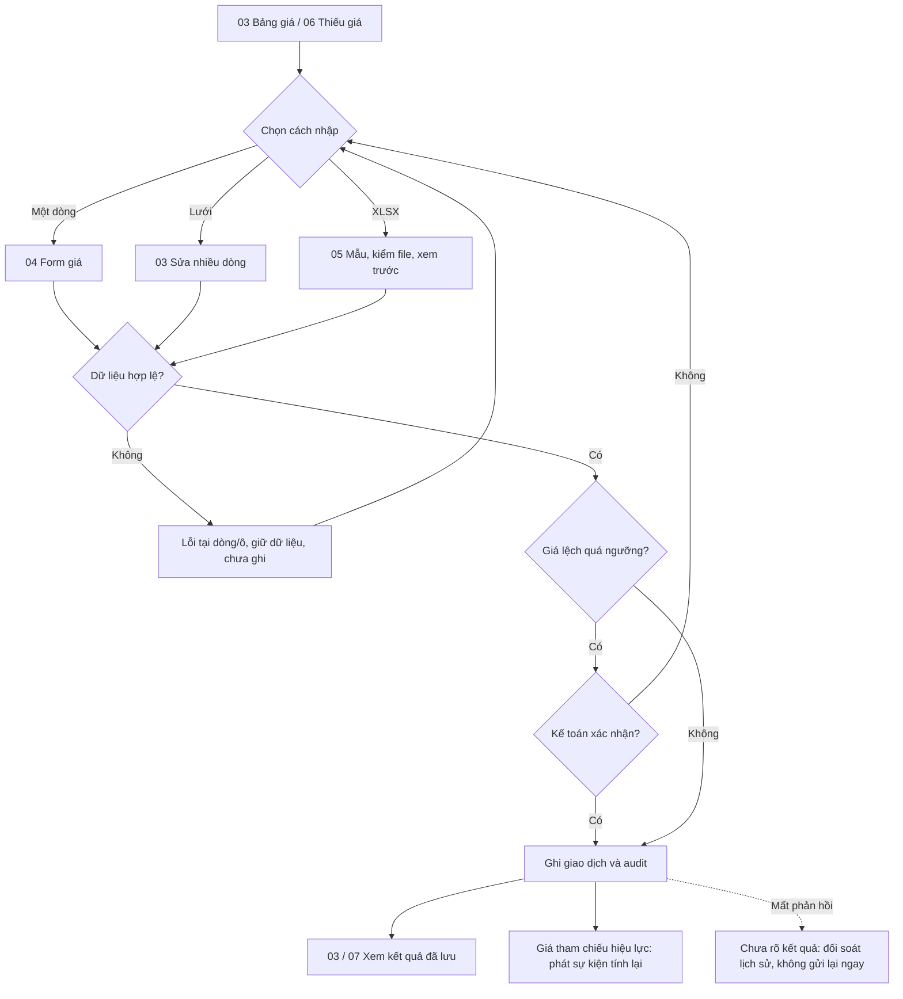
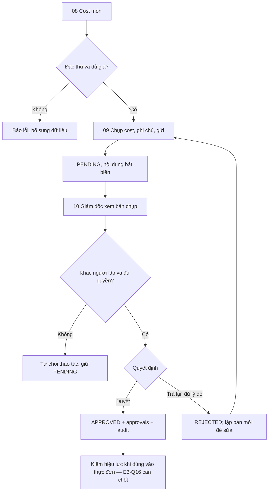
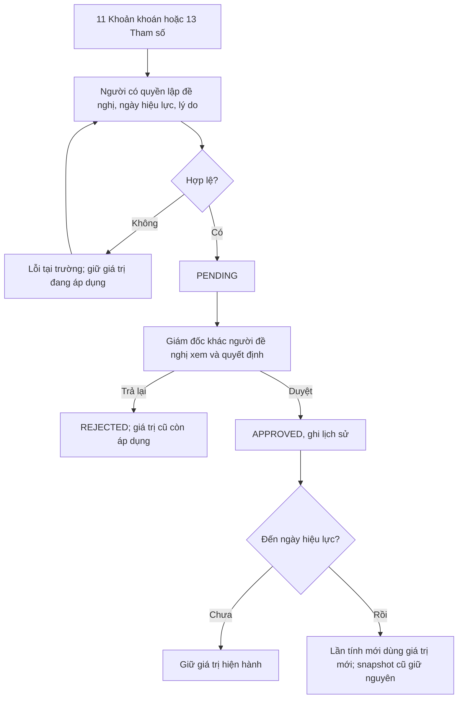
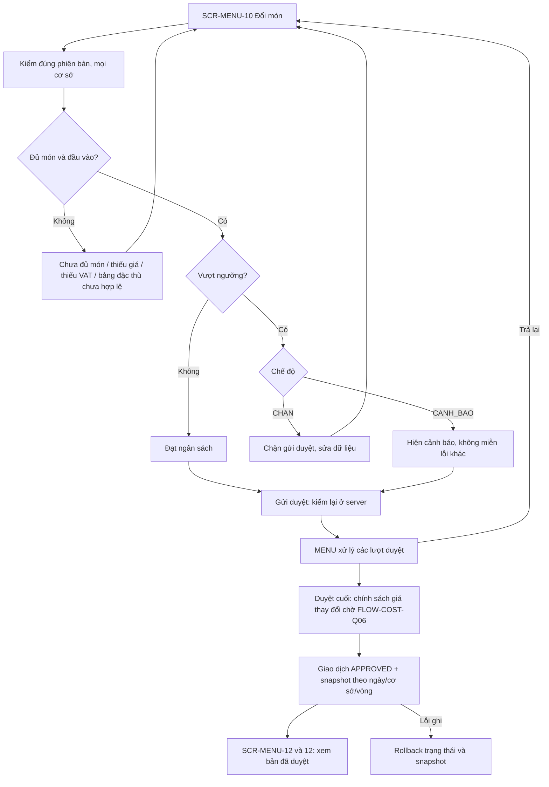
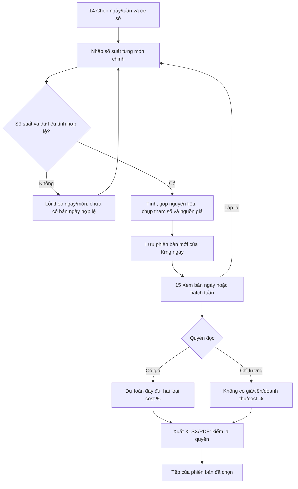
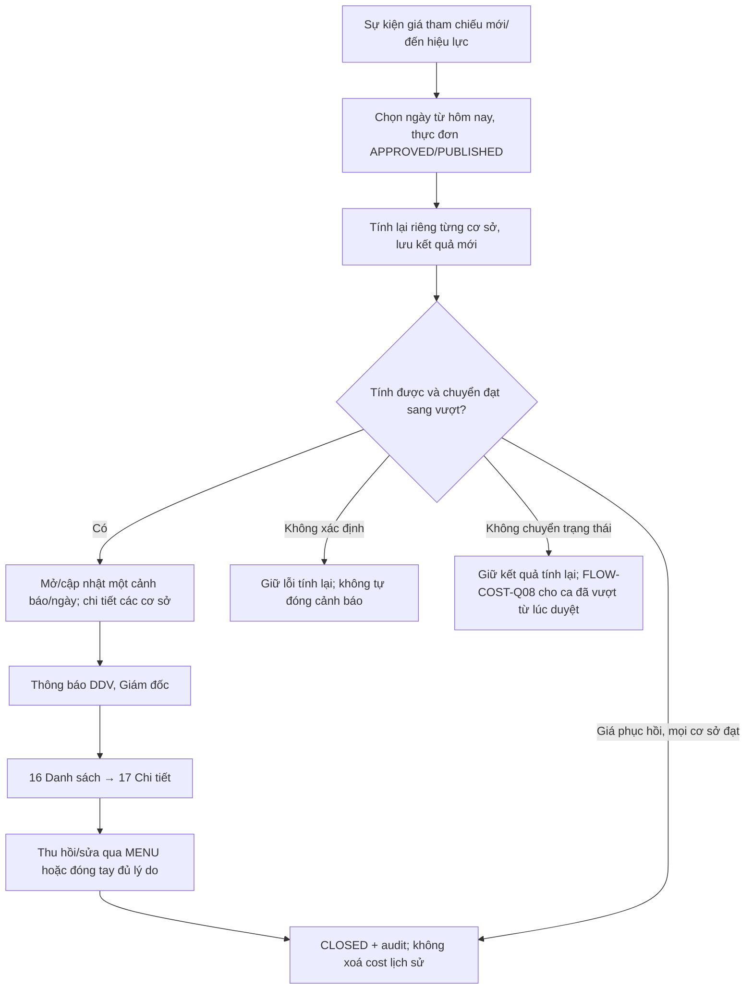
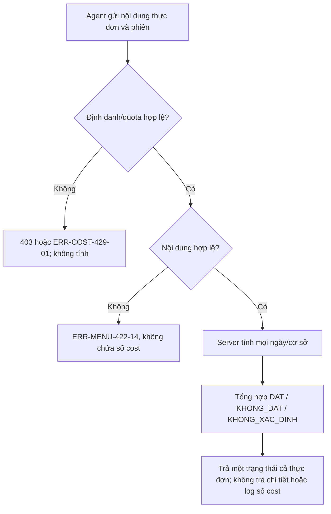

# User flow — Epic E3 Cost

Phiên bản: 0.1.2 · Ngày: 11/11/2026 · Trạng thái: Draft, chờ review nghiệp vụ.

## Lịch sử sửa đổi

| Phiên bản | Ngày | Người thực hiện | Nội dung |
| :--- | :--- | :--- | :--- |
| 0.1.2 | 2026-11-11 | BA | Liên kết thay đổi nghiệp vụ kế toán, chưa vẽ luồng khách/đơn và chuẩn hóa VAT mới. |
| 0.1.1 | 2026-11-11 | BA | Liên kết API và wireframe 18 màn; làm rõ đề xuất Q02 kế thừa SYS. |
| 0.1.0 | 2026-11-11 | BA | Khởi tạo từ SRS Cost v0.1.1, SRS nền tảng v0.2.0, SRS MENU v0.3.1 và ERD v0.3.0 |

## Phạm vi và quy ước

Nguồn: [SRS Cost](../srs/spec.md) · [Ma trận use case/FR](../srs/usecase-diagram.md) · [ERD](../../nen-tang/srs/erd.md). Các màn SCR-COST-xx là **đề xuất thiết kế**, chưa phải màn đã lập trình. Đã có [wireframe Cost 18 màn](../html-wireframe/cost-workbench.html) và [API đề xuất](../api/api-spec.md); màn soạn thực đơn có [wireframe minh hoạ hiện có](../../thuc-don-dinh-luong/html-wireframe/soan-thuc-don-tuan.html). SVC-COST-01 là giao tiếp dịch vụ, không phải màn cho khách xem số cost.

Giá trị mặc định DAT_NHAT/KHONG/CANH_BAO, danh sách khoản khoán, VAT và các lựa chọn mở giữ trạng thái đề xuất/chờ xác nhận. Không sao chép VAT 8% của wireframe thành cấu hình nghiệp vụ.

## Quy ước dùng chung

| Tình huống | Phản hồi và đường đi tiếp |
| :--- | :--- |
| Hết phiên | ERR-AUTH-401-02 → đăng nhập lại; kiểm quyền mới trước khôi phục thao tác; không tự gửi lại lệnh ghi |
| Thiếu quyền | ERR-AUTH-403-02 → trang không có quyền; ẩn thao tác không thay thế kiểm quyền server |
| Ngoài cơ sở/không tồn tại | ERR-SYS-404-01 → về danh sách được phép; không tiết lộ dữ liệu ngoài phạm vi |
| Xung đột phiên bản bản ghi có version | ERR-SYS-409-02 → tải bản mới, cho người dùng rà lại thay đổi; không ghi đè tự động |
| Trước khi gửi lệnh khi offline | Giữ dữ liệu tạm trên màn hình, báo chưa gửi; không cam kết lưu lâu dài trên thiết bị |
| Gửi rồi mất phản hồi | Hiện chưa xác định kết quả, đối soát danh sách/lịch sử trước retry; không khẳng định chưa lưu. Khoá chống trùng/idempotency cần API đặc tả, FLOW-COST-Q02 |
| Lỗi hạ tầng | ERR-SYS-500-01/ERR-SYS-503-01 theo nguyên nhân; hiện requestId nếu có, giữ nội dung nhập; trạng thái giao dịch phải được đối soát |
| Bộ lọc không có kết quả | Phân biệt không có dữ liệu và không khớp bộ lọc; cung cấp bỏ lọc; không coi là lỗi hệ thống |
| Thao tác ghi có lý do | Áp BR-AUD-001; thiếu lý do theo quy định trả ERR-SYS-422-01; lỗi ghi không được báo thành công |
| Quyền bị đổi khi đang mở màn | Kiểm lại ở API ghi/xuất/tải; không dựa vào quyền lúc mở trang. Không giữ số nhạy cảm trên màn sau khi xác định mất quyền |

Đề xuất UX không tự đặt thêm mã ERR nghiệp vụ. Những lỗi chưa có mã chuyên biệt phải được chốt ở hợp đồng API, không mượn mã có nghĩa khác.

## Danh mục điểm chạm

| Mã | Màn hình / điểm chạm | Vào từ | Ra tới | Use case |
| :--- | :--- | :--- | :--- | :--- |
| SCR-COST-01 | Danh sách NCC | Điều hướng Cost | 02, 03 | 001 |
| SCR-COST-02 | Form/chi tiết NCC | 01 | 01, 03 | 001 |
| SCR-COST-03 | Bảng giá/lưới giá theo cơ sở | Điều hướng, 06 | 04, 05, 07 | 002, 003 |
| SCR-COST-04 | Nhập giá/đổi tham chiếu/huỷ giá tương lai | 03, 06, 07 | 03, 07 | 002 |
| SCR-COST-05 | Tải mẫu → kiểm XLSX → xác nhận nhập | 03 | Báo cáo lỗi hoặc 03 | 004 |
| SCR-COST-06 | Nguyên liệu thiếu giá/giá cũ | Điều hướng, thông báo | 07, 04 | 005 |
| SCR-COST-07 | Lịch sử giá nguyên liệu | 03, 06 | 04, 03 | 002, 005 |
| SCR-COST-08 | Phân rã cost món/so sánh công thức | Danh sách món, hộp chọn món, duyệt công thức | 09, quay về MENU | 006 |
| SCR-COST-09 | Lập/chi tiết bảng tính đặc thù | 08, 10 | 10 | 007 |
| SCR-COST-10 | Danh sách bảng tính chờ duyệt | Điều hướng | 09; duyệt hoặc trả lại | 007 |
| SCR-COST-11 | Danh sách/đề nghị/duyệt khoản khoán | Điều hướng | Chi tiết đề nghị, lịch sử | 008 |
| SCR-COST-12 | Phân rã cost ngày/cơ sở và snapshot | SCR-MENU-10, SCR-MENU-12, 17 | Quay lại thực đơn hoặc cảnh báo | 009, 010 |
| SCR-COST-13 | Tham số Cost trong SYS | Quản lý tham số | Đề nghị và duyệt tham số | 011 |
| SCR-COST-14 | Nhập số suất lập dự toán ngày/tuần | Thực đơn, lịch sử dự toán | 15 hoặc lỗi theo ngày | 012 |
| SCR-COST-15 | Bản dự toán/lịch sử/xuất | 14, điều hướng | Phiên bản khác, tải tệp | 012, 013 |
| SCR-COST-16 | Danh sách cảnh báo vượt cost | Thông báo, điều hướng | 17 | 014 |
| SCR-COST-17 | Chi tiết cảnh báo theo cơ sở | 16 | 12, MENU thu hồi/sửa, 16 | 014 |
| SCR-COST-18 | Mô phỏng giá P2 | Đề xuất từ 04 | Đóng, nhập giá qua 04 | 016 |
| SCR-MENU-10 / SCR-MENU-12 | Soạn / duyệt thực đơn, tái sử dụng E2 | MENU | 08, 12, luồng duyệt MENU | 009, 010 |
| SVC-COST-01 | Dịch vụ ngân sách cho agent | Công cụ của agent E9 | Một trạng thái tổng | 015 |

Mã trong cột Use case là hậu tố của UC-COST-xxx; danh mục liên kết nằm ở sơ đồ use case. Tên đường dẫn URL và endpoint chưa được chốt trong tài liệu này.

## Luồng 1 — Nhập giá và khắc phục thiếu giá

Lưới và XLSX ghi tất cả hoặc không gì cả; kiểm tệp E2 tối đa 2.000 dòng, không ghi ở bước xem trước. Kế thừa cơ chế nhập E2 nhưng **không kế thừa trạng thái PENDING của giá bán**: giá nhập Cost không có bước phê duyệt theo SRS hiện tại. Ngày hiệu lực quyết định lúc áp dụng; việc nhập file không làm giá tương lai có hiệu lực ngay. Chứng từ ảnh/PDF và XLSX nhập giá là hai luồng khác nhau.

Huỷ giá tương lai và đổi tham chiếu chỉ trong phạm vi đã cho phép. Giá đã hiệu lực không sửa tiền/ngày; E3-Q14 giữ mở cho đổi cờ tham chiếu. Huỷ tham chiếu tương lai cần chọn lại giá nào vẫn là FLOW-COST-Q01.

## Luồng 2 — Bảng tính món đặc thù

Không xem việc có bản APPROVED là đủ cho mọi cơ sở/ngày. Quy tắc mốc tuổi và dùng chéo cơ sở chưa chốt; bản chụp cũ không được sửa để biến thành mới.

## Luồng 3 — Khoản khoán và tham số

Hai luồng dùng quyền khác nhau: kế toán đề nghị khoản khoán không mặc nhiên được quản lý tham số SYS. Khoản riêng loại suất ưu tiên khoản chung cùng tên; không cộng hai lần. Không tự điền VAT khi chưa có giá trị được chốt.

## Luồng 4 — Soạn, kiểm và duyệt thực đơn

Đường thành công giả định đầu vào không thay đổi giữa kiểm và duyệt; FLOW-COST-Q06 là nhánh chưa chốt, không có nghĩa bỏ kiểm tại duyệt cuối. `CANH_BAO` không cấp ngoại lệ cho thiếu giá/VAT. Cổng MENU vẫn kiểm các điều kiện ngoài Cost. Màn 12 phân biệt **cost đang tính** và **snapshot lúc duyệt**, không ghi đè một số lên số kia.

## Luồng 5 — Dự toán và xuất cho bếp

Lưu một ngày nguyên tử. Chính sách toàn tuần khi một ngày lỗi chờ FLOW-COST-Q07; không suy ra giao dịch toàn tuần từ mũi tên trên. Mỗi lần lập lại giữ bản cũ. Bếp trưởng chỉ xem lượng thuộc cơ sở mình; không cho tệp xuất giữ cột tiền ẩn hay sheet nội bộ chứa cost.

## Luồng 6 — Giá đổi sau khi thực đơn được duyệt

Thông báo không phải lệnh thay thực đơn tự động. Người đọc cảnh báo không đương nhiên có quyền sửa/thu hồi MENU. Đóng tay không biến kết quả vượt thành đạt. Chặn chuyển bếp vẫn chờ E3-Q10, không nối thêm một bước tự chặn trong R3.

## Luồng 7 — Dịch vụ ngân sách cho agent phía khách

FLOW-COST-Q09: có đồng thời ngày vượt và ngày thiếu dữ liệu thì chưa rõ ưu tiên KHONG_DAT/KHONG_XAC_DINH; không dùng kết quả DAT. Không trả ngày thiếu giá hay món vượt. CANH_BAO là chế độ cổng duyệt nội bộ, không đổi định nghĩa đạt ngân sách cho agent.

## Trạng thái màn hình và phục hồi

| Nhóm màn | Normal | Loading | Empty | Error | Offline / mất phản hồi |
| :--- | :--- | :--- | :--- | :--- | :--- |
| 01–02 NCC | Danh sách/chi tiết ACTIVE/INACTIVE | Khoá gửi trùng khi lưu | Chưa có NCC hoặc lọc rỗng; thêm khi có quyền | Trùng tên tại ô; conflict yêu cầu tải lại | Giữ form tạm, đối soát trước gửi lại |
| 03–04 giá | Giá và ngày hiệu lực rõ; chưa hiệu lực không ghi là hiện hành | Lưu cả lô có tiến trình | Chưa có giá; hướng dẫn nhập | Lỗi dòng/ô; bỏ lô nếu không hợp lệ | Không tự gửi lại lô; lịch sử là điểm đối soát |
| 05 XLSX | Chọn tệp, xem trước, xác nhận | Đang kiểm tệp/đang nhập là hai trạng thái | Chưa chọn tệp, tệp không có dòng dữ liệu | Báo lỗi theo dòng/cột; chưa cho nhập | Không báo thành công khi chưa có xác nhận server |
| 06–07 theo dõi/lịch sử | Nhãn thiếu/cũ, nguồn giá/cơ sở | Giữ bộ lọc trong khi tải | Không có dòng cần xử lý | Không lấy dữ liệu được, cho thử lại | Hiện dữ liệu cũ nếu còn trên màn kèm nhãn chưa cập nhật |
| 08 phân rã món | Có ngày/cơ sở/cỡ và nguồn giá | Kết quả cũ gắn nhãn đang tính | Chưa chọn món/công thức | Thiếu giá không trả tổng, cost 0 không chia tỷ trọng | Không coi kết quả cũ là mới |
| 09–10 bảng đặc thù | PENDING/APPROVED/REJECTED rõ | Khoá nút quyết định khi gửi | Không có bản chờ duyệt | Self-approval, thiếu lý do, đã xử lý | Đối soát trạng thái trước duyệt lại |
| 11 khoản khoán | Giá trị đang áp dụng tách đề nghị | Đang lưu/duyệt | Chưa cấu hình khoản: chờ O-01, không tự tạo | Dữ liệu sai/đề nghị trùng/quyền | Giữ form; không coi đề nghị là đã áp dụng |
| 12 phân rã ngày | Có nhãn cơ sở và hiện tại/lúc duyệt | Kết quả gắn phiên bản nội dung | Chưa đủ món | Thiếu giá/VAT/hiệu lực bảng đặc thù | Không cho bỏ qua kiểm server ở gửi duyệt |
| 13 tham số | Hiệu lực hiện tại và đề nghị tách biệt | Đang gửi/duyệt | VAT chưa cấu hình khác với VAT bằng 0 | Sai kiểu/ngày hoặc tự duyệt | Đối soát phiên bản, không tự bật CHAN |
| 14–15 dự toán | Phiên bản, ngày, cơ sở, số suất; hai cách cost % rõ | Đang tính khác đang lưu/xuất | Chưa có dự toán; lập nếu có quyền | Số suất sai, thiếu giá/VAT; lỗi tuần theo ngày | Không tạo bản mới chỉ vì retry không rõ kết quả |
| 16–17 cảnh báo | OPEN/CLOSED, cost cũ/mới theo cơ sở | Đang tải/đóng | Không có cảnh báo mở | Lý do ngắn/quyền; trạng thái cũ | Không tự đánh CLOSED trên client |
| 18 mô phỏng P2 | Nhãn giả định, không có tác động thật | Đang mô phỏng | Không có ngày vượt trong phạm vi | Giá sai, chưa tính được | Thử mô phỏng lại không ghi giá thật |

## Điểm mới cần làm rõ trước triển khai

Mã FLOW-COST-Qxx chỉ là danh sách câu hỏi phát hiện từ luồng, **không phải BR mới hay quyết định đã chốt**. Các điểm O-01, E3-Q1–Q16, E2-Q1 và DL-01 của SRS vẫn giữ nguyên.

| Mã | Câu hỏi / khoảng trống | Ảnh hưởng | Ai cần xác nhận | Cách tài liệu đang xử lý |
| :--- | :--- | :--- | :--- | :--- |
| FLOW-COST-Q01 | Huỷ giá tham chiếu tương lai khi cùng ngày còn báo giá khác thì chọn giá thay thế thế nào? | UC-COST-002; BR-PRC-005 | Kế toán | Không tự chọn NCC; luồng còn chờ phương án để giữ đúng một tham chiếu |
| FLOW-COST-Q02 | Chống gửi trùng và đối soát khi mất phản hồi: request key/phiên bản/lịch sử trả ra thế nào? | Các UC ghi giá, nhập, duyệt, dự toán | Tech lead và BA | API v0.1.0 kế thừa TTL 24h từ SYS, đề xuất scope key/hash/đối soát; chờ Tech lead review, chưa triển khai |
| FLOW-COST-Q03 | Cảnh báo giá cũ/nhà cung cấp ngừng được lưu, đóng và chống trùng thế nào? | UC-COST-001/005; schema mới chỉ mô tả cảnh báo vượt cost theo thực đơn | BA, kế toán, Tech lead | Không dùng cost_alerts có menu_day_id bắt buộc để giả lưu cảnh báo nguyên liệu; cần đặc tả lưu trữ riêng hoặc mở rộng notifications |
| FLOW-COST-Q04 | Cost món hoặc cost phiên bản cũ bằng 0 thì tỷ trọng/chênh lệch % hiện thế nào? | UC-COST-006 | Kế toán, UX/BA | Không chia 0; đề xuất hiện không áp dụng, chờ xác nhận |
| FLOW-COST-Q05 | Ai được đọc danh sách/chi tiết khoản khoán? | UC-COST-008; SRS chỉ có quyền write/approve | Giám đốc, BA | Không suy ra mọi người xem cost được đọc danh mục quản trị khoản khoán |
| FLOW-COST-Q06 | Giá/tham số đổi trong thời gian PENDING: kiểm lại tại duyệt cuối hay chụp bộ giá lúc gửi? Nếu vượt mới thì trả lại thế nào? | UC-COST-010; FR-COST-MEAL-006 | Giám đốc, kế toán | Luồng thành công giả định dữ liệu không đổi; nhánh thay đổi chưa đủ nghiệm thu |
| FLOW-COST-Q07 | Lập tuần có một ngày lỗi thì rollback cả tuần hay lưu ngày hợp lệ? | UC-COST-012 | Kế toán, dinh dưỡng viên | Không tự chốt; mỗi bản ngày nguyên tử, trạng thái cả batch còn mở |
| FLOW-COST-Q08 | Thực đơn đã được duyệt vượt ngưỡng ở CANH_BAO: giá tăng tiếp hoặc phục hồi rồi vượt lại thì phát cảnh báo ra sao? | UC-COST-014 | Giám đốc, dinh dưỡng viên | Giữ điều kiện đã có: chuyển đạt → vượt; không tự đặt ngưỡng tăng mới |
| FLOW-COST-Q09 | Agent gặp đồng thời ngày vượt và ngày không tính được: ưu tiên trạng thái nào? VAT chưa cấu hình có cùng KHONG_XAC_DINH không? | UC-COST-015 | BA, chủ sản phẩm/AI lead | Không trả DAT; nhánh còn chờ quy tắc tổng hợp |
| FLOW-COST-Q10 | Mô phỏng giá P2 cho ai dùng, xét trạng thái và khoảng ngày nào? | UC-COST-016 | Giám đốc, kế toán | Đánh dấu đề xuất; không cấp quyền hoặc nâng P2 thành bắt buộc |

Ưu tiên chốt Q01/Q03/Q05/Q06/Q07 cho luồng nội bộ và review thiết kế Q02 trong API. Q04 là cách hiển thị cần thống nhất; Q08 thuộc cảnh báo P1; Q09 trước tích hợp agent E9; Q10 có thể để sau cùng P2.

## Điều kiện bàn giao bước tiếp theo

1. Review 16 use case và ma trận 45 FR; xác nhận hai FR hoãn và mức ưu tiên hiện có.
2. Giải quyết câu hỏi tác động tới hợp đồng API, dữ liệu và trạng thái; cập nhật SRS qua lịch sử sửa đổi, không chỉ sửa wireframe.
3. Từ luồng đã chốt, thiết kế endpoint/request/response/permission, wireframe chi tiết, user story/AC rồi test case. Không tuyên bố các luồng còn điểm mở là đã nghiệm thu.

## Bổ sung kế toán cần đưa vào luồng

[Quy tắc kế toán](../accounting/business-rules.md) và [CR](../cr/CR-COST-2026-001.md) bổ sung bước xác định giá báo/giá cost gồm VAT trước nhập giá; tách cờ yêu cầu hóa đơn; khoản chiết khấu khách theo đơn không giảm tiền phải trả. Các flow hiện tại chưa diễn giải đủ luồng khách/đơn mới. Chưa xem bước chi trả chiết khấu là có trong R3.
