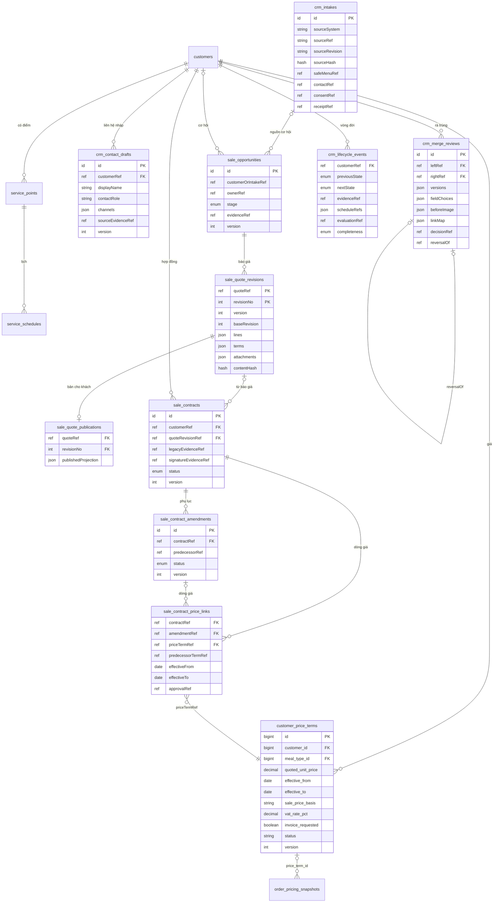

# ERD E10: kế thừa và delta đề xuất

Nháp có điều kiện · 16/11/2026 · Chưa phê duyệt, chưa cố định hợp đồng giao tiếp.

| Phiên bản | Ngày | Người thực hiện | Nội dung |
| :--- | :--- | :--- | :--- |
| 0.1.0 | 2026-11-16 | BA | Khởi tạo: vẽ quan hệ cho nguồn hiện hữu và cấu trúc đề xuất trong từ điển dữ liệu E10. Không thêm thực thể hay trường |

Sơ đồ chỉ vẽ lại [từ điển dữ liệu E10](data-dictionary.md) và câu "Quan hệ" ở cuối từ điển. **Schema chung giữ 65 bảng**; không DDL, không migration. Khóa và độ dài vật lý chờ E10-Q13. Không có quan hệ tới hồ sơ sức khỏe.

## 1. Sơ đồ

`customers`, `service_points`, `service_schedules`, `customer_price_terms`, `order_pricing_snapshots` là bảng có sẵn trong [DBML tổng](../../nen-tang/srs/schema.dbml). Từ điển gộp "merge_reviews/events", "lifecycle_events/risk_evaluations", "quote_revisions/publications", "contracts/amendments" thành từng dòng; sơ đồ tách bảng theo tên nhưng trường chỉ lấy từ dòng gộp tương ứng. `crm_risk_evaluations` và `sale_opportunity_events` chưa có trường riêng nên không vẽ.

## 2. Ràng buộc cần review

| Nhóm | Ràng buộc | Căn cứ / gate |
| :--- | :--- | :--- |
| Liên hệ | Chỉ nháp; không đồng bộ master khách khi CG08 còn mở | BR-CRM-001; E10-Q01 |
| Tiếp nhận | Unique (sourceSystem, sourceRef, sourceRevision); khác hash cùng khóa là xung đột; không lưu raw chat | BR-CRM-011; E10-Q16 |
| Gộp | Không xóa khách gốc; ảnh trước có scope; quyết định và hoàn tác bất biến | BR-CRM-003/004; E10-Q03/04 |
| Vòng đời | Không suy rời từ ngày không có order; thiếu dữ liệu không thành 0 | BR-CRM-005; E10-Q05/06 |
| Báo giá | Unique (quoteRef, revisionNo); revision đã phát hành bất biến; projection khách không có cost | BR-CRM-006/007; E10-Q08 |
| Giá hợp đồng | Không chồng khoảng ACTIVE trên (customer, mealType), kể cả giao dịch đồng thời; ngày kết thúc trống chưa tự là vô hạn | BR-CRM-008; E10-Q11 |
| Phụ lục | Giữ giá cũ bất biến; không viết lại `order_pricing_snapshots` | BR-CRM-009; E10-Q12 |
