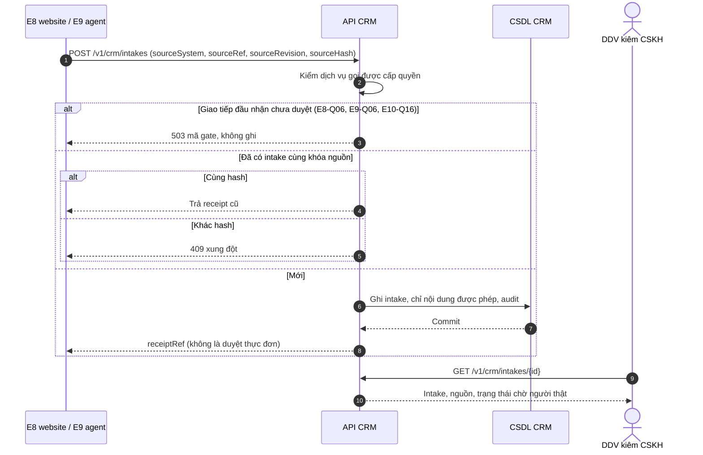
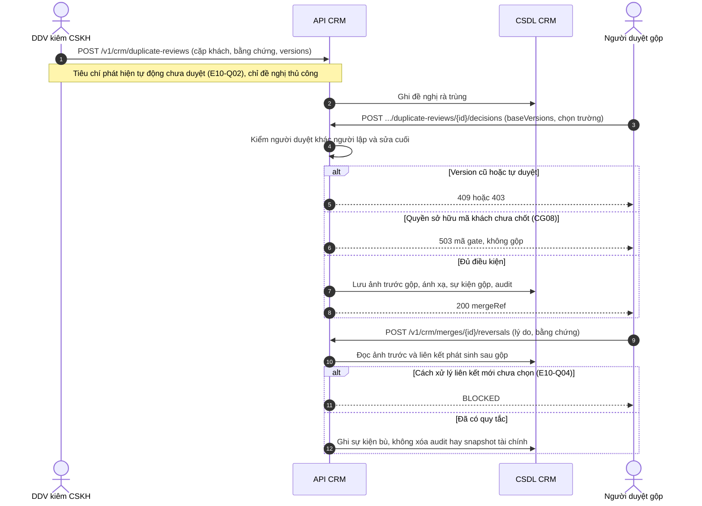
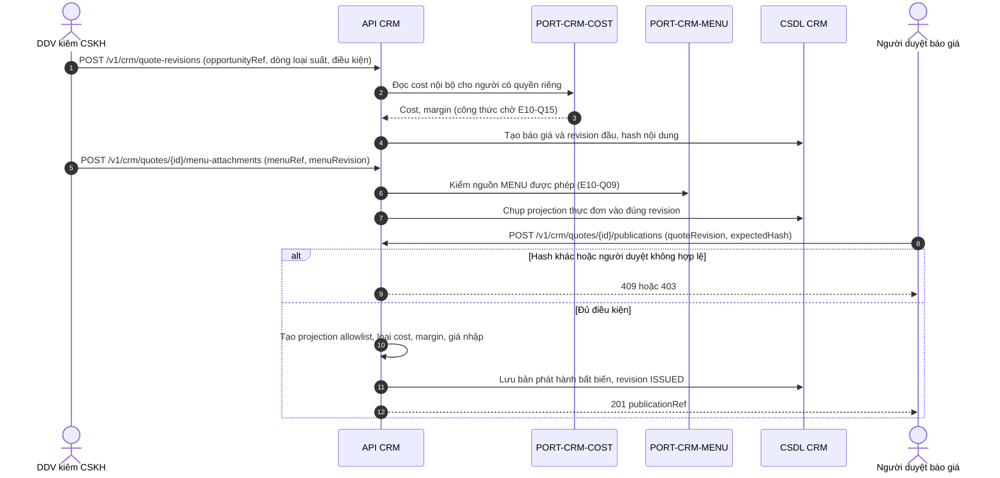
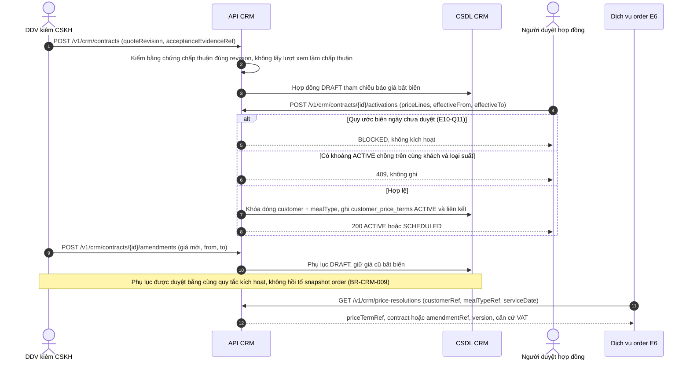

# Sơ đồ tuần tự E10: Khách hàng và bán hàng

Nháp có điều kiện · 16/11/2026 · Chưa phê duyệt, chưa cố định hợp đồng giao tiếp.

| Phiên bản | Ngày | Người thực hiện | Nội dung |
| :--- | :--- | :--- | :--- |
| 0.1.0 | 2026-11-16 | BA | Khởi tạo: 4 sơ đồ tuần tự theo API-CRM, port và BR-CRM hiện có. Không thêm endpoint, mã lỗi hay quy tắc |

Route và port lấy từ [API E10](../api/api-spec.md); trạng thái lấy từ [states](states.md). Bước có gate ghi nhãn BLOCKED.

## 1. Tiếp nhận lead và đề xuất (FEAT-070)

## 2. Rà trùng, gộp và hoàn tác (FEAT-070)

## 3. Báo giá từ nháp đến bản cho khách (FEAT-072)

## 4. Hợp đồng, kích hoạt giá và tra giá (FEAT-073)

Chống trùng, receipt và giao dịch đồng thời là đề xuất; hợp đồng kỹ thuật còn BLOCKED E10-Q13. Chưa có bằng chứng chạy.
