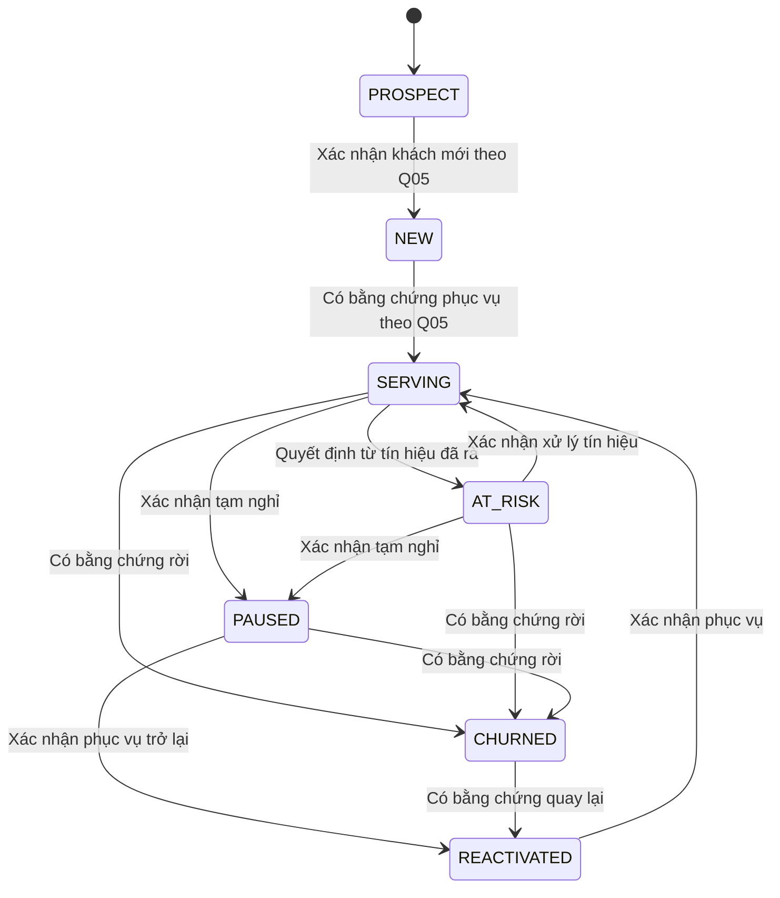
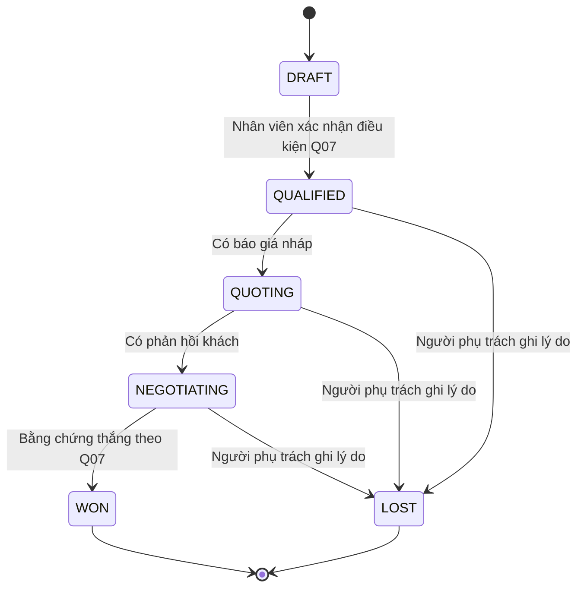
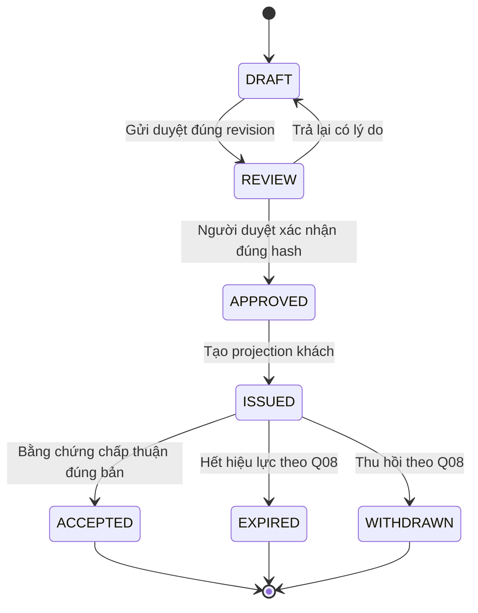
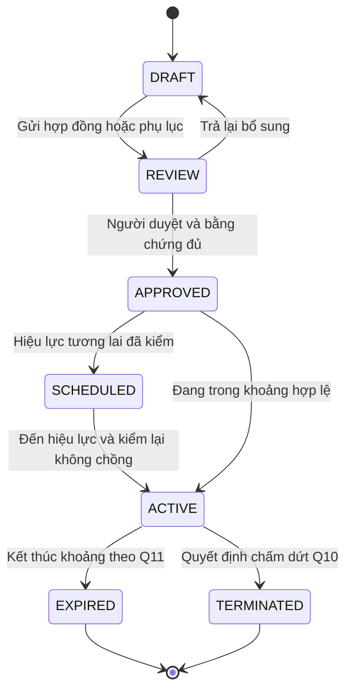

# Trạng thái E10

Nháp có điều kiện · Chưa phê duyệt, chưa cố định hợp đồng giao tiếp.

| Phiên bản | Ngày | Người thực hiện | Nội dung |
| :--- | :--- | :--- | :--- |
| 0.1.0 | 12/11/2026 | BA | Mở riêng tài liệu E10; giữ mọi quyết định chưa có căn cứ ở trạng thái chờ |

Các sơ đồ là phương án review. Mọi chuyển thành công đều kiểm quyền, version và quyết định đã duyệt; khi gate chưa đủ thì giữ nguyên trạng thái.

## Vòng đời khách hàng

Các tên PROSPECT/NEW/SERVING/AT_RISK/PAUSED/CHURNED/REACTIVATED đã có trong customers; không tự thêm enum. Không có trạng thái kết thúc tuyệt đối vì khách rời có thể quay lại. Không order ngoài lịch không kích hoạt mũi tên. Mọi cạnh chờ E10-Q05/06; tín hiệu rủi ro có evaluationRef riêng, không tự đổi lifecycle_status.

## Cơ hội

Tên giai đoạn là đề xuất E10-Q07, chưa cấu hình runtime. WON không tự kích hoạt hợp đồng; mở lại cơ hội chưa được quyết định, không có cạnh ngầm. Đóng WON/LOST là kết thúc vòng cơ hội, khách vẫn có vòng đời riêng.

## Phiên bản báo giá

Mỗi revision có vòng đời riêng; sửa bản đã phát hành tạo revision DRAFT khác, không chuyển bản cũ về DRAFT. revisionNo khác version dùng kiểm cạnh tranh. ACCEPTED là bằng chứng chấp thuận báo giá, chưa là hợp đồng có hiệu lực. Chính sách duyệt/thu hồi/hạn chờ E10-Q08.

## Hợp đồng và phụ lục giá

Đây là mẫu vòng đời áp riêng cho hợp đồng và từng phụ lục, không gộp chúng thành một cột. Một hợp đồng có nhiều phụ lục; phụ lục mới không xóa phụ lục cũ. customer_price_terms hiện chỉ DRAFT/ACTIVE/CANCELLED; các trạng thái khác thuộc đề xuất dữ liệu E10, không ghi vào enum hiện tại. Thay khoảng cũ cần lịch sử hiệu lực bù theo E10-Q12, không UPDATE mất dấu.

| Đối tượng / nguồn | Sự kiện | Điều kiện bảo vệ | Đích | Actor / tác động |
| :--- | :--- | :--- | :--- | :--- |
| Khách PROSPECT/NEW | Xác nhận mới/phục vụ | Bằng chứng lịch điểm; Q05 được duyệt | NEW/SERVING | Người có quyền vòng đời; ghi sự kiện |
| Khách SERVING/AT_RISK | Rà tín hiệu | Nguồn đủ, policy Q06; không dùng ngày nghỉ | AT_RISK/SERVING | Người có quyền; không suy rời |
| Khách SERVING/AT_RISK/PAUSED | Xác nhận nghỉ hoặc rời | Lý do và bằng chứng Q05 | PAUSED/CHURNED | Người có quyền; không ảnh hưởng order đã khóa |
| Khách PAUSED/CHURNED/REACTIVATED | Xác nhận quay lại/phục vụ | Bằng chứng Q05 | REACTIVATED/SERVING | Người có quyền; giữ lịch sử |
| Cơ hội DRAFT/QUALIFIED/QUOTING | Điều kiện/báo giá/phản hồi | Đúng thứ tự Q07 và nguồn | QUALIFIED/QUOTING/NEGOTIATING | Chủ cơ hội; thêm sự kiện |
| Cơ hội QUALIFIED/QUOTING/NEGOTIATING | Đóng thua; hoặc NEGOTIATING đóng thắng | Lý do/bằng chứng Q07 | LOST/WON | Chủ cơ hội; không tự ACTIVE hợp đồng |
| Báo giá DRAFT/REVIEW | Gửi duyệt/trả lại | Đúng revision và quyền | REVIEW/DRAFT | Người soạn/người duyệt; audit |
| Báo giá REVIEW/APPROVED | Duyệt/phát hành | Q08; đúng hash, nguồn và projection | APPROVED/ISSUED | Người duyệt/nhân viên được phép; bản bất biến |
| Báo giá ISSUED | Chấp thuận/hết hạn/thu hồi | Evidence hoặc thời gian/quyết định Q08 | ACCEPTED/EXPIRED/WITHDRAWN | Người xác nhận hoặc bộ lịch đã duyệt; không tự ký |
| Hợp đồng/phụ lục DRAFT/REVIEW | Gửi duyệt/trả lại | Nguồn và version | REVIEW/DRAFT | Người soạn/người duyệt |
| Hợp đồng/phụ lục REVIEW | Duyệt | Bằng chứng ký và quyền Q10 | APPROVED | Người duyệt được chỉ định |
| Hợp đồng/phụ lục APPROVED/SCHEDULED | Kích hoạt | Q11/Q12; ngày hợp lệ; không chồng nguyên tử | SCHEDULED/ACTIVE | Người có quyền hoặc bộ lịch đã duyệt; audit |
| Hợp đồng/phụ lục ACTIVE | Hết hạn/chấm dứt | Biên Q11 hoặc evidence Q10 | EXPIRED/TERMINATED | Bộ lịch/người có quyền; không sửa snapshot |

