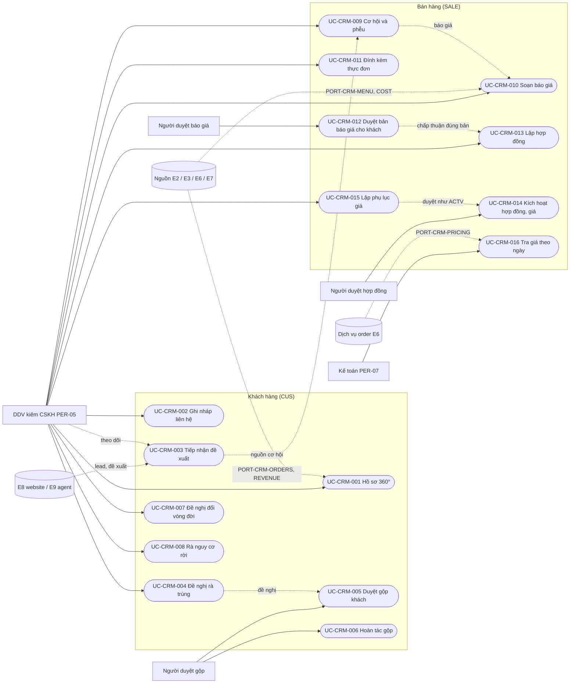

# Sơ đồ use case E10: Khách hàng và bán hàng

Nháp có điều kiện · 16/11/2026 · Chưa phê duyệt, chưa cố định hợp đồng giao tiếp.

| Phiên bản | Ngày | Người thực hiện | Nội dung |
| :--- | :--- | :--- | :--- |
| 0.1.0 | 2026-11-16 | BA | Khởi tạo: sơ đồ actor và ma trận FR, UC, màn hình, API, port cho 16 UC hiện có. Không thêm FR hoặc UC |

File này chỉ vẽ lại phạm vi trong [SRS E10](spec.md), [danh mục UC](../usecases/index.md) và [màn hình](../ui/screens.md). Người duyệt gộp, báo giá, hợp đồng là vai trò chức năng, chưa chỉ định người cụ thể (E10-Q03, E10-Q08, E10-Q10, O-06).

## 1. Tác nhân

| Tác nhân | Persona / loại | Ghi chú |
| :--- | :--- | :--- |
| DDV kiêm chăm sóc khách hàng | PER-05 | Xem 360°, liên hệ, rà trùng, vòng đời, cơ hội, báo giá, hợp đồng, phụ lục |
| Người duyệt gộp và hoàn tác | Chưa chỉ định | Khác người lập và người sửa cuối |
| Người duyệt báo giá | Chưa chỉ định | Tạo bản dành cho khách |
| Người duyệt hợp đồng | Chưa chỉ định | Kích hoạt hợp đồng và giá |
| Kế toán | PER-07 | Tra giá hợp đồng |
| Dịch vụ tiếp nhận | Hệ thống | Nhận lead E8 (PORT-PUB-LEAD-HANDOFF) và đề xuất E9 (PORT-AIN-HANDOFF) |
| Dịch vụ order E6 | Hệ thống | Tra giá theo ngày phục vụ (PORT-CRM-PRICING) |
| Nguồn E2, E3, E6, E7 | Hệ thống | Thực đơn, cost nội bộ, order, doanh thu cho hồ sơ 360° và báo giá |

## 2. Sơ đồ

Cạnh nét đứt là dữ liệu hoặc quan hệ giữa UC. Cost và margin chỉ người nội bộ có quyền riêng đọc; bản báo giá cho khách, website và AIN không nhận các trường này (BR-CRM-007).

## 3. Ma trận FR, UC, màn hình, API

| UC | FR | Feature | Tác nhân chính | Màn hình | API / port | Gate chính |
| :--- | :--- | :--- | :--- | :--- | :--- | :--- |
| [UC-CRM-001](../usecases/UC-CRM-001.md) | FR-CUS-VIEW-001 | FEAT-070 | DDV kiêm CSKH | UI-CRM-01 | API-CRM-001, 017; PORT-CRM-ORDERS, REVENUE | CG08; E10-Q13 |
| [UC-CRM-002](../usecases/UC-CRM-002.md) | FR-CUS-CONT-001 | FEAT-070 | DDV kiêm CSKH | UI-CRM-01 | API-CRM-002 | E10-Q01 |
| [UC-CRM-003](../usecases/UC-CRM-003.md) | FR-CUS-LEAD-001 | FEAT-070 | Dịch vụ tiếp nhận | UI-CRM-02 | API-CRM-003, 018; PORT-PUB-LEAD-HANDOFF, PORT-AIN-HANDOFF | E8-Q06; E9-Q06; E10-Q16 |
| [UC-CRM-004](../usecases/UC-CRM-004.md) | FR-CUS-DUP-001 | FEAT-070 | DDV kiêm CSKH | UI-CRM-03 | API-CRM-004, 019 | E10-Q02 |
| [UC-CRM-005](../usecases/UC-CRM-005.md) | FR-CUS-MRG-001 | FEAT-070 | Người duyệt gộp | UI-CRM-03 | API-CRM-005 | E10-Q03; CG08 |
| [UC-CRM-006](../usecases/UC-CRM-006.md) | FR-CUS-UNDO-001 | FEAT-070 | Người duyệt hoàn tác | UI-CRM-03 | API-CRM-006 | E10-Q03/04 |
| [UC-CRM-007](../usecases/UC-CRM-007.md) | FR-CUS-LIFE-001 | FEAT-071 | DDV kiêm CSKH | UI-CRM-04 | API-CRM-007 | E10-Q05 |
| [UC-CRM-008](../usecases/UC-CRM-008.md) | FR-CUS-RISK-001 | FEAT-071 | DDV kiêm CSKH | UI-CRM-04 | API-CRM-008 | E10-Q06 |
| [UC-CRM-009](../usecases/UC-CRM-009.md) | FR-SALE-OPP-001 | FEAT-072 | DDV kiêm CSKH | UI-CRM-05 | API-CRM-009, 020 | E10-Q07 |
| [UC-CRM-010](../usecases/UC-CRM-010.md) | FR-SALE-QUOT-001 | FEAT-072 | DDV kiêm CSKH | UI-CRM-06 | API-CRM-010, 021; PORT-CRM-COST | E10-Q08/15 |
| [UC-CRM-011](../usecases/UC-CRM-011.md) | FR-SALE-MENU-001 | FEAT-072 | DDV kiêm CSKH | UI-CRM-06 | API-CRM-011; PORT-CRM-MENU | E10-Q09 |
| [UC-CRM-012](../usecases/UC-CRM-012.md) | FR-SALE-SAFE-001 | FEAT-072 | Người duyệt báo giá | UI-CRM-07 | API-CRM-012, 022 | E10-Q08 |
| [UC-CRM-013](../usecases/UC-CRM-013.md) | FR-SALE-CONT-001 | FEAT-073 | DDV kiêm CSKH | UI-CRM-08 | API-CRM-013, 023 | E10-Q10 |
| [UC-CRM-014](../usecases/UC-CRM-014.md) | FR-SALE-ACTV-001 | FEAT-073 | Người duyệt hợp đồng | UI-CRM-08 | API-CRM-014 | E10-Q10/11 |
| [UC-CRM-015](../usecases/UC-CRM-015.md) | FR-SALE-AMND-001 | FEAT-073 | DDV kiêm CSKH | UI-CRM-09 | API-CRM-015 | E10-Q11/12 |
| [UC-CRM-016](../usecases/UC-CRM-016.md) | FR-SALE-PRIC-001 | FEAT-073 | Dịch vụ order, kế toán | UI-CRM-09 | API-CRM-016; PORT-CRM-PRICING | E10-Q11 |

16/16 FR có đúng một UC; 4/4 feature FEAT-070 đến FEAT-073 có ít nhất một UC. Số liệu đo tài liệu, không đo phần mềm.
