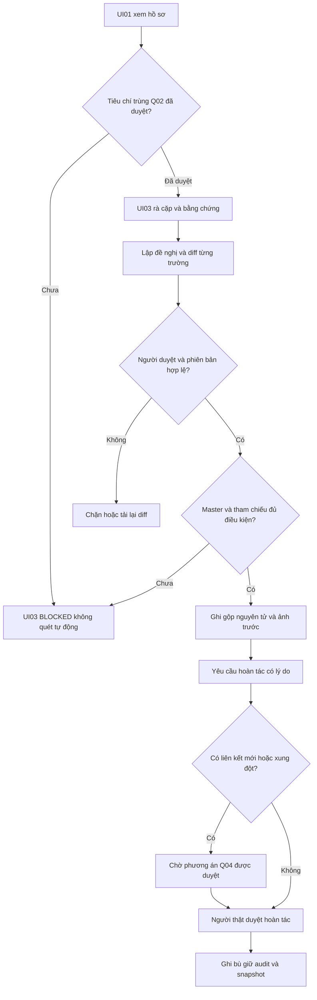
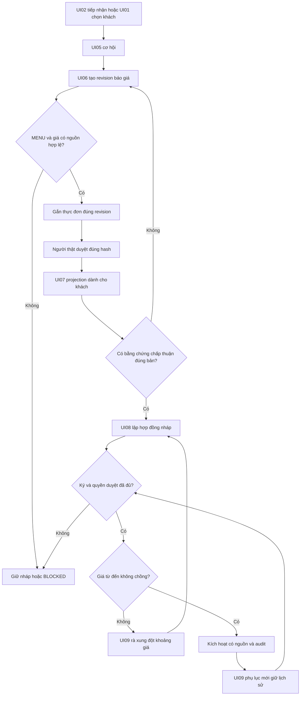

# Luồng người dùng E10

Nháp có điều kiện · Chưa phê duyệt, chưa cố định hợp đồng giao tiếp.

| Phiên bản | Ngày | Người thực hiện | Nội dung |
| :--- | :--- | :--- | :--- |
| 0.1.0 | 12/11/2026 | BA | Mở riêng tài liệu E10; giữ mọi quyết định chưa có căn cứ ở trạng thái chờ |

## Gộp trùng và hoàn tác

Luồng thành công chỉ sau Q02/03/04 và CG08. Lỗi: thiếu quyền, version cũ, mất phản hồi, thiếu ảnh trước. Biên: hai đề nghị cùng khách, gộp vòng A→B→A, order mới giữa xem và duyệt; phải khóa/xác minh tập tham chiếu, không gộp hoặc hoàn tác một phần. Chưa có chính sách xử lý liên kết mới thì dừng.

## Báo giá đến hợp đồng

Thay món hoặc giá sau phát hành tạo revision mới; không tự giữ bằng chứng chấp thuận cũ cho nội dung mới. Hợp đồng nháp chưa cấp quyền order. Chuyển nguồn giá sang E6/Cost vẫn BLOCKED theo dependency, không viết ngược snapshot. Không gửi báo giá thật từ mock.

## Trạng thái giao diện chung

Bình thường: có dữ liệu nguồn và nhãn synthetic trong mock. Đang tải: chưa hiện số cũ như số mới. Rỗng: không có bản ghi trong phạm vi. Thiếu nguồn: nhóm dữ liệu có null và gate. Lỗi: thông báo an toàn và requestId. Mất mạng: không báo lưu thành công; giữ khóa để đối soát sau khi nối lại. Không quyền: không hiển thị dữ liệu hạn chế. Xung đột: tải lại diff trước quyết định.
