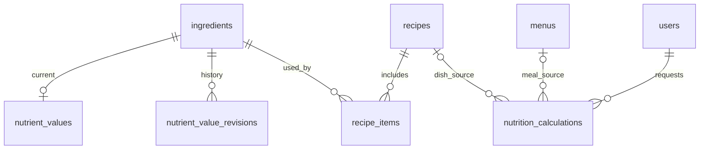

# ERD và từ điển dữ liệu (NUTR)

Phiên bản 0.1.0 · 2026-11-11 · **Draft: đề xuất thiết kế để review, chưa phê duyệt nghiệp vụ; chưa triển khai backend.**

| Phiên bản | Ngày | Người thực hiện | Thay đổi |
| :--- | :--- | :--- | :--- |
| 0.1.0 | 2026-11-11 | BA | Khởi tạo gói MVP từ PRD/roadmap và thiết kế hiện có |

Nguồn vật lý duy nhất: [schema tổng DBML v0.5.0](../../nen-tang/srs/schema.dbml). Thiết kế bổ sung, chưa migration. Không tạo bảng thứ hai thay nutrient_values hoặc agent_runs. DBML không tự thực thi mọi CHECK trong tài liệu này.

## Bảng kế thừa

`ingredients`, `recipes`, `recipe_items`, `menus`, `menu_days`, `menu_day_items` giữ nguyên; qty_std, use_unit, recipe ACTIVE và hiệu lực theo MENU. Từ điển đầy đủ nằm ở [ERD nền](../../nen-tang/srs/erd.md). `nutrient_values` giữ PK ingredient_id và bốn chỉ số/edible_pct/grams_per_unit/source/updated_at/updated_by; bổ sung:

| Cột | Kiểu | Null | Khóa / ràng buộc | Ý nghĩa |
| :--- | :--- | :--- | :--- | :--- |
| version | int | Không | >=1; tăng mỗi lần sửa | Kiểm lost update |
| source_edition | varchar(120) | Không | 1..120 ký tự | Ấn bản xác minh ở NUTR-Q01 |
| source_locator | varchar(120) | Không | 1..120 ký tự | Trang hoặc mã thực phẩm |

Các trường energy_kcal decimal(7,2), protein_g/fat_g/carb_g decimal(6,2) ≥0; edible_pct decimal(5,2)∈[0,100]; grams_per_unit decimal(8,2)>0 nếu use_unit khác g. Không suy từ purchase_unit. Default100 trong schema cũ không phải xác nhận nghiệp vụ; API yêu cầu ediblePct tường minh. source default tên bảng không đủ bằng chứng ấn bản/trang.

## `nutrient_value_revisions`

| Tên / cột vật lý | Kiểu (độ dài) | Null? | Khóa / default | Diễn giải và ràng buộc |
| :--- | :--- | :--- | :--- | :--- |
| id | bigint | Không | pk, increment | Mã revision |
| ingredient_id | bigint | Không | not null, ref: > ingredients.id | Nguyên liệu gốc |
| version | int | Không | not null | Số phiên bản >=1, unique theo nguyên liệu |
| value_snapshot | json | Không | not null | Toàn bộ NutrientValue, gồm nguồn/ấn bản/mã và các giá trị Decimal dạng chuỗi |
| reason | varchar(500) | Không | not null | Lý do 10..500 ký tự |
| changed_by | bigint | Không | not null, ref: > users.id | Người thay đổi |
| changed_at | datetime(3) | Không | not null | UTC |

Unique/index: `(ingredient_id, version) [unique]`.

## `nutrition_calculations`

| Tên / cột vật lý | Kiểu (độ dài) | Null? | Khóa / default | Diễn giải và ràng buộc |
| :--- | :--- | :--- | :--- | :--- |
| id | bigint | Không | pk, increment | Mã kết quả bất biến |
| kind | varchar(8) | Không | not null | DISH hoặc MEAL |
| recipe_id | bigint | Có | ref: > recipes.id | Bắt buộc với DISH, null với MEAL |
| menu_id | bigint | Có | ref: > menus.id | Bắt buộc với MEAL, null với DISH |
| menu_version | int | Có | Không áp dụng | Bắt buộc khi MEAL |
| service_date | date | Không | not null | Ngày nghiệp vụ Việt Nam |
| scope_snapshot | json | Không | not null | Id cơ sở nguồn; dùng kiểm scope hiện tại, không cấp quyền từ snapshot |
| inputs_snapshot | json | Không | not null | Breakdown, recipe/nutrient versions, selectedItemIds và tất cả giá trị quy đổi; không chỉ FK |
| totals | json | Không | not null | 4 Decimal strings precision24,8; methodVersion và roundingPolicy |
| client_revision | int | Không | not null | >=1 |
| created_by | bigint | Không | not null, ref: > users.id | Actor gọi |
| request_route | varchar(80) | Không | not null | Scope key: dish-calculations hoặc meal-calculations |
| request_key | varchar(128) | Không | not null | Idempotency key |
| request_hash | varchar(64) | Không | not null | Hash body chuẩn hóa |
| created_at | datetime(3) | Không | not null | UTC |

Unique/index: `(created_by, request_route, request_key) [unique];     (menu_id, created_at)`.

## Ràng buộc giao dịch, migration và bảo quản

1. Cập nhật nutrient_values theo version, thêm revision với unique(ingredient_id,version) và audit trong cùng giao dịch; revision bất biến, không xóa cứng. Mỗi Calculation đọc nguồn nhất quán; snapshot chứa giá trị chứ không chỉ id để tái tính khi dữ liệu thay đổi.
2. CHECK kind: DISH có recipe_id và không menu_id/menu_version; MEAL có menu_id/menu_version và không recipe_id. Không lưu calculation thiếu nguồn/totals. API chọn recipe hiệu lực tại service_date và đúng ACTIVE; lịch sử có thể đọc snapshot cũ dù recipe SUPERSEDED.
3. Idempotency unique(created_by,request_route,request_key); hash khác thì409; chỉ ghi calculation sau kiểm đủ. isStale là giá trị tính khi đọc, không sửa totals cũ. Scope của món dùng quyền catalog; scope của suất theo MENU hiện hành.
4. Migration chưa chạy: phải rà dữ liệu legacy thiếu nguồn/ấn bản/quy đổi, tạo báo cáo thiếu thay vì tự backfill bằng dữ liệu giả. Điền version/revision ban đầu chỉ sau xác nhận nguồn; chưa bật NOT NULL nguồn mới cho dữ liệu cũ không đạt. Không mặc định coi edible_pct=100 cũ là đã được duyệt. Kế hoạch rollout cần Tech lead/BA review.
5. Chưa đặt thời hạn lưu/xóa vì cần chính sách nền tảng; chưa có API xóa. Không lưu hồ sơ bệnh lý trong phân hệ này.
