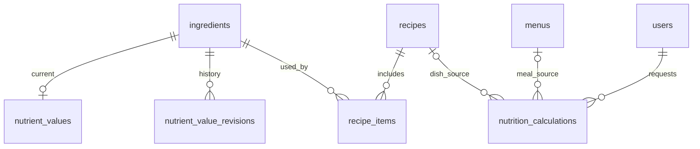

# ERD và từ điển dữ liệu (NUTR)

Phiên bản 0.1.0 · 2026-11-11 · **Draft: đề xuất thiết kế để review, chưa phê duyệt nghiệp vụ; chưa triển khai backend.**

| Phiên bản | Ngày | Người thực hiện | Thay đổi |
| :--- | :--- | :--- | :--- |
| 0.1.0 | 2026-11-11 | BA | Khởi tạo gói MVP từ PRD/roadmap và thiết kế hiện có |

Nguồn vật lý duy nhất: [schema tổng DBML v0.5.0](../../nen-tang/srs/schema.dbml). Thiết kế bổ sung, chưa migration. Không tạo bảng thứ hai thay nutrient_values hoặc agent_runs. DBML không tự thực thi mọi CHECK trong tài liệu này.

Từ điển dữ liệu (bảng kế thừa, bảng mới, ràng buộc giao dịch) đã chuyển nguyên văn sang [data-dictionary.md](data-dictionary.md) ngày 16/11/2026.
