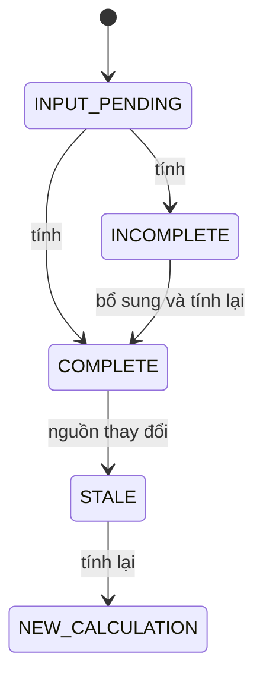

# Trạng thái — Dinh dưỡng

**Draft — thiết kế BA để review; chưa duyệt nghiệp vụ, chưa triển khai phần mềm.**

| Phiên bản | Ngày | Người thực hiện | Thay đổi |
| :--- | :--- | :--- | :--- |
| 0.1.0 | 2026-11-11 | BA | Bổ sung theo kế hoạch; giữ điểm mở và xác nhận đã có |

## Bản tính dinh dưỡng

| Hiện tại | Trigger | Guard | Đích | Actor |
| :--- | :--- | :--- | :--- | :--- |
| INPUT_PENDING | tính | đủ thành phần,quy đổi,recipe | COMPLETE | NUTR |
| INPUT_PENDING | tính | thiếu một đầu vào | INCOMPLETE | NUTR |
| INCOMPLETE | bổ sung và tính lại | nguồn đủ | COMPLETE | Dinh dưỡng viên/NUTR |
| COMPLETE | nguồn thay đổi | version hiện tại khác snapshot | STALE | GET NUTR |
| STALE | tính lại | đủ nguồn hiện hành | NEW_CALCULATION | NUTR |

COMPLETE/STALE là nhãn giao diện suy ra, không thêm status vào nutrition_calculations. NEW_CALCULATION là id mới; bản cũ vẫn giữ nguyên. Không có bước phê duyệt dinh dưỡng riêng khi NUTR-Q01 chưa quyết.

Mọi transition ngoài bảng bị từ chối, không tự suy từ nút UI. Version cũ409; quyền thiếu403/ngoài scope404 theo SRS. Các quyền/số liệu chưa chốt giữ trong sổ câu hỏi, không coi state diagram là quyết định duyệt.
