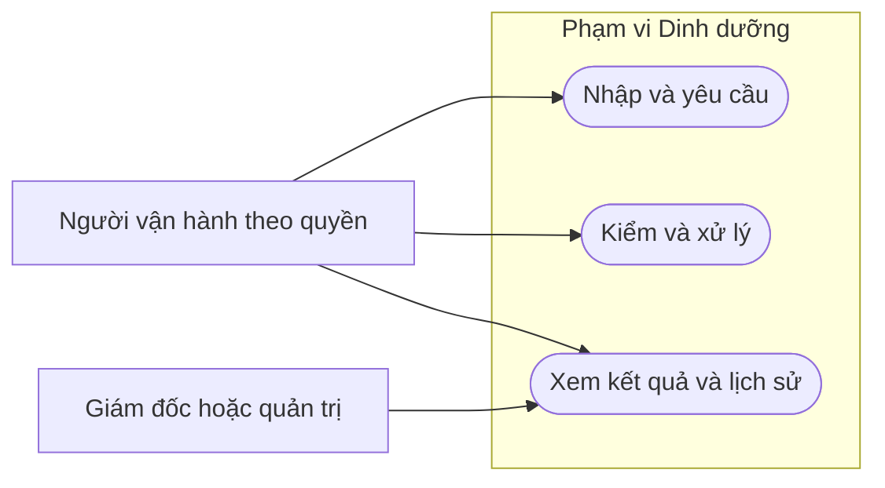

# Sơ đồ use case: Dinh dưỡng

**Draft: thiết kế BA để review; chưa duyệt nghiệp vụ, chưa triển khai phần mềm.**

| Phiên bản | Ngày | Người thực hiện | Thay đổi |
| :--- | :--- | :--- | :--- |
| 0.1.0 | 2026-11-11 | BA | Bổ sung theo kế hoạch; giữ điểm mở và xác nhận đã có |

Sơ đồ tổng quan chia nhóm để đọc; bảng dưới nối từng UC. Include/extend chỉ dùng khi có quan hệ nghiệp vụ, không coi mọi UC tự bao gồm nhau.

| UC | Tên / tài liệu |
| :--- | :--- |
| UC-NUTR-001 | [UC-NUTR-001: Quản lý bảng thành phần](../usecases/UC-NUTR-001.md) |
| UC-NUTR-002 | [UC-NUTR-002: Kiểm độ phủ nguyên liệu](../usecases/UC-NUTR-002.md) |
| UC-NUTR-003 | [UC-NUTR-003: Tính dinh dưỡng món](../usecases/UC-NUTR-003.md) |
| UC-NUTR-004 | [UC-NUTR-004: Tính dinh dưỡng tổ hợp suất](../usecases/UC-NUTR-004.md) |
| UC-NUTR-005 | [UC-NUTR-005: Xem kết quả và nguồn lịch sử](../usecases/UC-NUTR-005.md) |
