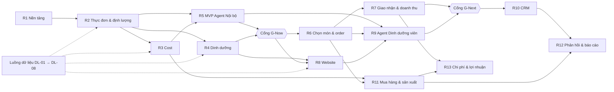

# Kế hoạch Lộ trình Sản phẩm (Product Roadmap) — Nền tảng Gia Phát

## Metadata

- **Document Version**: 0.1.3
- **Status**: Draft
- **Last Updated**: 2026-11-11
- **Tài liệu liên quan**: [PRD](01-prd.md) · [BRD](06-brd.md) · [URD](05-urd.md) · [Kế hoạch tổng thể](00-ke-hoach-tong-the.md)

### Lịch sử sửa đổi

| Phiên bản | Ngày | Người thực hiện | Tóm tắt thay đổi |
| :--- | :--- | :--- | :--- |
| 0.1.3 | 2026-11-11 | BA | Liên kết hồ sơ bổ sung E1–E5/E6 khởi đầu; giữ quy tắc và điểm mở |
| 0.1.2 | 2026-11-11 | BA | Liên kết gói BA nháp E4/E5, ghi gate còn mở; không thay phạm vi hay nghiệm thu release |
| 0.1.1 | 2026-11-11 | BA | Đồng bộ nghiệm thuR3 với NFR-COST-002 và CHAN/CANH_BAO theo SRS hiện có |
| 0.1.0 | 2026-11-10 | BA | Khởi tạo từ PRD v0.1.0 |

**Về ngày phát hành.** Lộ trình này **chưa có ngày**. Quy mô đội phát triển, nhà cung cấp hạ tầng và mô hình AI đang là điểm mở O-04; đặt ngày khi chưa biết các yếu tố đó là đoán. Lộ trình vì vậy ghi **thứ tự**, **điều kiện bắt đầu** và **tiêu chí nghiệm thu** của từng đợt; cột ngày sẽ điền sau khi O-04 có câu trả lời và backlog được ước lượng.

Cột "Cỡ" là so sánh tương đối giữa các đợt theo số tính năng và độ khó (S < M < L < XL), không phải thời lượng.

---

## Khung thời gian & Phân kỳ ưu tiên (Now / Next / Later)

```
┌───────────────────────────┬───────────────────────────┬───────────────────────────┐
│  NOW — MVP nội bộ         │  NEXT — Mở ra cho khách   │  LATER — Vận hành đầy đủ  │
│  23 tính năng · E1 → E5   │  36 tính năng · E6 → E9   │  19 tính năng · E10 → E13 │
├───────────────────────────┼───────────────────────────┼───────────────────────────┤
│ • Tài khoản, phân quyền,  │ • Người ăn chọn món qua   │ • CRM 360°, phễu bán hàng,│
│   nhật ký                 │   QR, công ty chốt số     │   hợp đồng                │
│ • Nguyên liệu, món, công  │ • Giao nhận, doanh thu,   │ • Mua hàng, tồn, phân ca, │
│   thức, loại suất, giá bán│   đối soát, xuất MISA     │   QC, mẫu lưu             │
│ • Bộ kiểm 43 quy tắc      │ • Website mới thay        │ • Phản hồi, phân tích món,│
│ • Giá nhập, cost, ngưỡng  │   WordPress               │   dashboard               │
│   52%, bảng dự toán       │ • Agent Dinh dưỡng viên   │ • Agent Nội bộ: mua hàng, │
│ • Dinh dưỡng 4 chỉ số     │ • Hồ sơ và gợi ý cá nhân  │   CRM, hỏi đáp số liệu    │
│ • Agent Nội bộ dựng thực  │                           │ • Chi phí, lợi nhuận theo │
│   đơn                     │                           │   khách                   │
└───────────────────────────┴───────────────────────────┴───────────────────────────┘
        Người dùng: nội bộ        Thêm: khách, người ăn        Thêm: toàn bộ vận hành
```

---

## Luồng chuẩn bị dữ liệu (chạy song song, không phải phần mềm)

Đây là việc của Gia Phát, bắt đầu được ngay hôm nay và quyết định MVP có dùng được hay không (BRD R-01).

| Mã | Việc | Ai làm | Cần xong trước |
| :--- | :--- | :--- | :--- |
| `DL-01` | Duyệt 43 quy tắc và trả lời H-1 → H-9 trong bảng quy tắc | Người soạn docx | SRS của R2 |
| `DL-02` | Xác nhận thuế suất VAT và thành phần cost [O-01] | Kế toán | SRS của R3 |
| `DL-03` | Lập danh sách nguyên liệu đang dùng kèm đơn vị, hệ số quy đổi, tỷ lệ hao hụt | Dinh dưỡng viên, bếp trưởng | Nghiệm thu R2 |
| `DL-04` | Lập danh sách món kèm 12 thuộc tính và giá bán; trước hết 30 món dùng nhiều nhất | Dinh dưỡng viên | Nghiệm thu R2 |
| `DL-05` | Lập công thức định lượng cho các món ở DL-04 [O-02] | Dinh dưỡng viên | Nghiệm thu R2 |
| `DL-06` | Lập bảng giá nhập hiện hành theo nhà cung cấp | Kế toán | Nghiệm thu R3 |
| `DL-07` | Tra và nhập 4 chỉ số dinh dưỡng cho các nguyên liệu ở DL-03 | Dinh dưỡng viên | Nghiệm thu R4 |
| `DL-08` | Xuất danh sách bài viết và URL của WordPress hiện tại | Người quản trị website | SRS của R8 |

Trong lúc chưa có phần mềm, DL-03 → DL-07 làm trên bảng tính theo mẫu cột do đội phát triển cung cấp, để nhập thẳng vào hệ thống sau.

---

## Bảng chi tiết Lộ trình phát hành (Release Plan)

### NOW — MVP nội bộ

| Release | Tên đợt phát hành | Mục tiêu chính | Danh sách Feature ID | Cỡ | Điều kiện bắt đầu | Ngày dự kiến | Tiêu chí nghiệm thu |
| :--- | :--- | :--- | :--- | :---: | :--- | :--- | :--- |
| `R1` · v0.1.0 | Nền tảng (E1) | Có tài khoản, phân quyền, nhật ký để mọi phân hệ sau dùng chung | `FEAT-001` → `FEAT-005` | M | O-04 có câu trả lời về hạ tầng; O-06 có người duyệt | Chờ O-04 | 5 vai trò nội bộ đăng nhập được; quản lý cơ sở A không đọc được dữ liệu cơ sở B; 100% thao tác sửa số liệu có bản ghi nhật ký; kiểm thử tải đạt 1000 người dùng đồng thời với p95 ≤ 300 ms (đọc), ≤ 800 ms (ghi) trên API mẫu |
| `R2` · v0.2.0 | Thực đơn & định lượng (E2) | Dựng được thực đơn tuần và máy kiểm quy tắc | `FEAT-006` → `FEAT-013` | XL | R1 xong; DL-01 xong; O-02 có câu trả lời | Chờ O-04 | Đủ 30 món có đủ 12 thuộc tính và công thức đã duyệt (DL-03 → 05); mỗi quy tắc trong số quy tắc được duyệt ở DL-01 có ít nhất 1 ca kiểm thử đạt và 1 ca vi phạm; thực đơn vi phạm quy tắc cứng không gửi duyệt được; công thức không tự duyệt được bởi người tạo |
| `R3` · v0.3.0 | Cost (E3) | Biết cost % trước khi chốt thực đơn | `FEAT-014` → `FEAT-018` | L | R2 xong; DL-02 xong | Chờ O-04 | Theo NFR-COST-002:10 món lệch không quá1đ,10 ngày cost% lệch không quá0,01 điểm phần trăm so với kế toán; CHAN chặn gửi duyệt khi vượt, CANH_BAO cảnh báo, thiếu đầu vào vẫn chặn; công bố qua cổng MENU; dự toán đủ cột theo SRS EST004 |
| `R4` · v0.4.0 | Dinh dưỡng (E4) | Có 4 chỉ số dinh dưỡng cho món và suất | `FEAT-019`, `FEAT-020` | S | R2 xong; có nguồn dữ liệu (BRD DP-03) | Chờ O-04 | 100% nguyên liệu của 30 món có đủ 4 chỉ số; dinh dưỡng của 5 suất mẫu do hệ thống tính khớp với số dinh dưỡng viên tính tay; giao diện ghi nhãn "ước tính từ định lượng sống" |
| `R5` · **v1.0.0** | **MVP — Agent Nội bộ dựng thực đơn (E5)** | Dinh dưỡng viên dựng thực đơn tuần từ bản nháp của agent | `FEAT-021` → `FEAT-023` | L | R2, R3 xong; O-04 chọn xong nhà cung cấp mô hình | Chờ O-04 | Trên 20 yêu cầu thử, 100% thực đơn agent trả về không vi phạm quy tắc cứng và không vượt ngưỡng cost; 0 món ngoài danh mục đã duyệt; thực đơn tuần trả về trong ≤ 60 giây; 100% lượt chạy có nhật ký; thời gian dựng một thực đơn tuần giảm ≥ 50% so với số đo trước MVP (BO-03) |

R3 và R4 không phụ thuộc nhau, làm song song được nếu đội đủ người.

**Cổng G-Now** (điều kiện để mở đợt Next): dinh dưỡng viên dùng hệ thống dựng thực đơn thật trong 4 tuần liên tiếp; 100% thực đơn công bố trong 4 tuần đó đạt quy tắc cứng và ngưỡng cost (BO-01, BO-04); có thực đơn đã duyệt cho ít nhất 4 tuần tới.

### NEXT — Mở ra cho khách

| Release | Tên đợt phát hành | Mục tiêu chính | Danh sách Feature ID | Cỡ | Điều kiện bắt đầu | Ngày dự kiến | Tiêu chí nghiệm thu |
| :--- | :--- | :--- | :--- | :---: | :--- | :--- | :--- |
| `R6` · v1.1.0 | Chọn món & order (E6) | Người ăn chọn món, công ty chốt số, bếp có số theo món | `FEAT-030` → `FEAT-048` | XL | Cổng G-Now đạt; chốt kênh thông báo (Q-14); O-03 có câu trả lời nếu làm `FEAT-046`, `047` | Chờ O-04 | Kiểm thử tải: 1000 người dùng đồng thời chọn món trong 10 phút trước hạn chốt, 0 lựa chọn bị mất hoặc ghi trùng; tại hạn chốt 100% suất chưa chọn được gán món mặc định; tổ hợp vượt định mức bị chặn; chạy thử với 2 công ty khách trong 2 tuần |
| `R7` · v1.2.0 | Giao nhận & doanh thu (E7) | Khép vòng từ order đến đối soát | `FEAT-049` → `FEAT-053` | L | R6 xong; chốt quy tắc khi khách không xác nhận (Q-13) | Chờ O-04 | Doanh thu một tháng do hệ thống tính khớp biên bản đối soát với khách của 2 công ty chạy thử; file xuất nhập được vào MISA; kỳ đã khoá không sửa được nếu Giám đốc chưa duyệt mở lại |
| `R8` · v1.3.0 | Website công khai (E8) | Thay WordPress, có thực đơn mẫu kèm giá, lead vào CRM | `FEAT-054` → `FEAT-059` | L | R4 xong (cần dinh dưỡng để hiển thị); DL-08 xong; có quyền quản trị tên miền | Chờ O-04 | 100% URL bài viết cũ trả về đúng trang hoặc 301; 100% lead từ form có bản ghi kèm nguồn; trang thực đơn mẫu hiện đủ giá, định lượng, 4 chỉ số, dị ứng |
| `R9` · v1.4.0 | Agent Dinh dưỡng viên (E9) | Khách tự yêu cầu thực đơn; người ăn được gợi ý | `FEAT-060` → `FEAT-065` | L | R5, R6, R8 xong | Chờ O-04 | Trên 30 yêu cầu thử, 100% thực đơn đạt quy tắc cứng; bộ thử 20 câu dò hỏi cost, giá nhập: 0 lần lộ; bộ thử 20 câu về bệnh lý: 100% có lời nhắc và không chẩn đoán; chi phí AI một ngày không vượt trần đã đặt |

R7 và R8 không phụ thuộc nhau, làm song song được. Phần giới thiệu và blog của R8 (`FEAT-054`, `FEAT-055`, `FEAT-059`) không cần dữ liệu thực đơn, có thể **kéo lên chạy song song với đợt Now** nếu đội đủ người — quyết định khi có O-04.

**Cổng G-Next** (điều kiện để mở đợt Later): ≥ 90% order của các công ty đã chuyển lên hệ thống ghi nhận qua cổng (BO-06); ≥ 70% suất có lựa chọn của người ăn trước hạn chốt (BO-05); số phiên truy cập tự nhiên sau 60 ngày ≥ 90% mức trước chuyển đổi (BO-09).

### LATER — Vận hành đầy đủ

| Release | Tên đợt phát hành | Mục tiêu chính | Danh sách Feature ID | Cỡ | Điều kiện bắt đầu | Ngày dự kiến | Tiêu chí nghiệm thu |
| :--- | :--- | :--- | :--- | :---: | :--- | :--- | :--- |
| `R10` · v2.0.0 | CRM & bán hàng (E10) | Toàn bộ lịch sử khách ở một chỗ, đo được phễu | `FEAT-070` → `FEAT-073` | L | Cổng G-Next đạt | Chưa đặt | 100% khách đang phục vụ có hồ sơ; 100% hợp đồng hiệu lực có phụ lục giá trong hệ thống |
| `R11` · v2.1.0 | Mua hàng & sản xuất (E11) | Nhu cầu nguyên liệu sinh từ kế hoạch; so được dự toán với thực mua | `FEAT-074` → `FEAT-078` | XL | R3, R6 xong | Chưa đặt | Chênh lệch cost thực mua so với dự toán đo được theo ngày và cơ sở, đạt ≤ 3 điểm phần trăm (BO-02); 100% bữa có mẫu lưu trên hệ thống |
| `R12` · v2.2.0 | Phản hồi & báo cáo (E12) | Dữ liệu chọn món và đánh giá quay về cải tiến thực đơn | `FEAT-079` → `FEAT-087` | L | R6, R7, R10, R11 xong | Chưa đặt | Dashboard 4 vai trò lấy số từ dữ liệu thật; tỷ lệ được chọn của từng món tính từ lựa chọn của người ăn |
| `R13` · v2.3.0 | Chi phí & lợi nhuận (E13) | Lợi nhuận theo khách | `FEAT-088` | M | R7, R11 xong; Giám đốc duyệt nguyên tắc phân bổ chi phí | Chưa đặt | Báo cáo lợi nhuận theo khách đối chiếu được với kết quả kinh doanh từng cơ sở |

---

## Sơ đồ phụ thuộc



---

## Điểm mở chặn lộ trình

Giữ nguyên trạng thái mở. Cột cuối cho biết muộn nhất phải có câu trả lời trước đợt nào.

| Mã | Điểm mở | Ai trả lời | Cần trước |
| :--- | :--- | :--- | :--- |
| O-04 | Đội phát triển, hạ tầng, nhà cung cấp AI, ngân sách | Giám đốc | R1 (hạ tầng), R5 (mô hình AI); toàn bộ cột ngày |
| O-06 | Ai duyệt ngoại lệ và ai thay khi vắng | Giám đốc | R1 |
| O-02 | Một món một định lượng hay nhiều cỡ định lượng | Dinh dưỡng viên | R2 |
| O-01 | Cost gồm những khoản nào; thuế suất VAT | Kế toán | R3 |
| O-03 | Gợi ý cá nhân có xét bệnh lý không | Giám đốc | R6 (phần `FEAT-046`, `047`), R9 |
| O-05 | Trường học, bệnh viện, tiệc cỗ có trong bản đầu không | Giám đốc | R6 |

Câu hỏi vận hành kế thừa bản thiết kế cũ, cần trước các đợt Next: Q-13 (khách không xác nhận số nhận) trước R7; Q-14 (kênh thông báo, Zalo OA) trước R6; Q-16 (hạn chốt, ngưỡng đổi sau chốt) trước R6.

## Việc tiếp theo

1. Gia Phát bắt đầu luồng dữ liệu DL-01 → DL-08.
2. Review SRS và mô hình dữ liệu đã có cho E1–E5; chốt các câu hỏi nguồn dữ liệu/AI theo gói bàn giao E4/E5 trước khi triển khai.
3. Khi O-04 có câu trả lời: ước lượng backlog R1 → R5 và điền cột ngày.

## Liên kết đặc tả MVP hiện hành — E4/E5

- E4/R4: [SRS Dinh dưỡng](../dinh-duong/srs/spec.md), [câu hỏi nguồn/dung sai/dữ liệu](../dinh-duong/review/questions.md).
- E5/R5: [SRS Agent Nội bộ](../agent-noi-bo/srs/spec.md), [câu hỏi vận hành và nghiệm thu](../agent-noi-bo/review/questions.md).
- [Gói review và kiểm truy vết](review/mvp-e4-e5-handoff.md). Đây là tài liệu nháp, chưa chứng minh release đã triển khai hoặc qua cổng G-Now.

NUTR-Q04 cần chốt ý nghĩa “khớp” của 5 suất R4; không mượn dung sai Cost. AIO-Q02 cần xác nhận hành vi agent khi Cost ở CANH_BAO; tiêu chí R5 không vượt ngưỡng vẫn giữ, không đổi cổng gửi duyệt MENU. R5 vẫn phụ thuộc R2/R3 theo roadmap; R4 thuộc cổng G-Now, không tự thêm phụ thuộc cứng vào generation. O-04 và các điểm mở khác không tự đóng.

## Tiến độ hồ sơ BA sau bổ sung — 11/11/2026

[Dashboard](../project-dashboard.md) và [bàn giao](review/ba-completion-handoff.md) ghi chi tiết E1–E5; [E6 gói review v0.2](../chon-mon-order/preview.html) đã bổ sung UC/API/UI/AC/RTM; còn gate nghiệp vụ và chưa triển khai release. Phạm vi/ưu tiên, G-Now và tiêu chí nghiệm thu roadmap giữ nguyên. O-03 vẫn gated FEAT-046/047, không tự mở thu thập sức khỏe.

## Cập nhật hồ sơ E6 ngày 11/11/2026

[Bàn giao E6](../chon-mon-order/review/handoff.md): giữ14P0/5P1 và G-Now/R6; 17capability có thiết kế có điều kiện, FEAT-046/047 chỉ gate O-03. Không đổi ưu tiên/ngày release; ORD-Q01–15 chờ xác nhận. Độ phủ liên kết tài liệu không phải phần mềm hoặc UAT.
