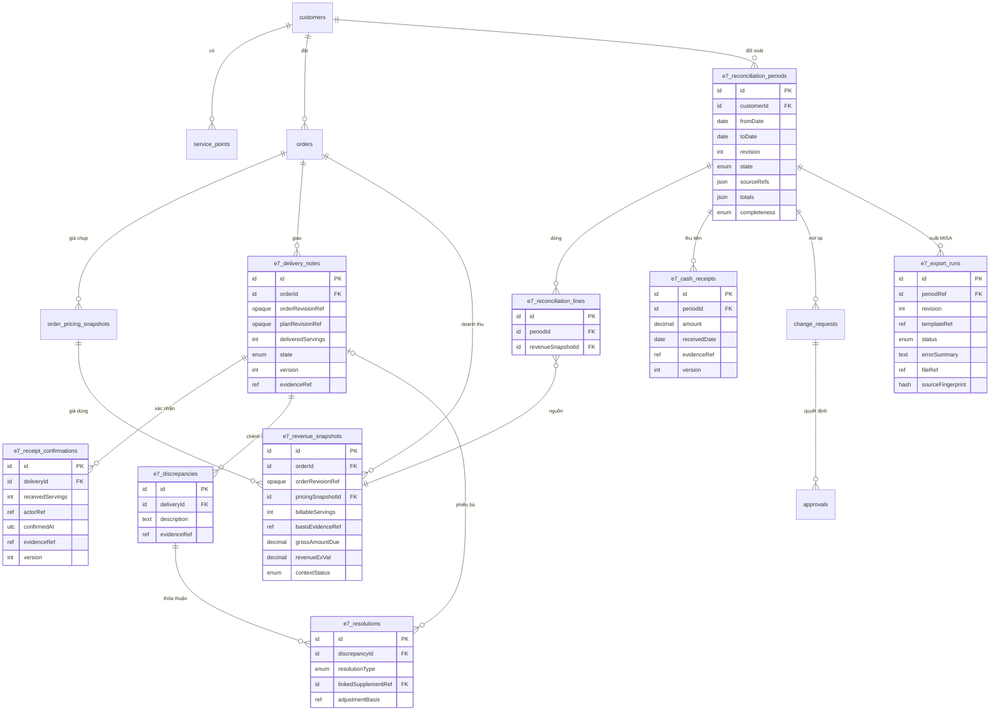

# ERD E7: kế thừa và delta đề xuất

Draft · 16/11/2026 · Thiết kế BA có điều kiện, chưa phê duyệt, chưa triển khai.

| Phiên bản | Ngày | Người thực hiện | Nội dung |
| :--- | :--- | :--- | :--- |
| 0.1.0 | 2026-11-16 | BA | Khởi tạo: vẽ quan hệ cho delta trong từ điển dữ liệu E7. Không thêm thực thể hay trường |

Sơ đồ chỉ vẽ lại [delta dữ liệu E7](data-dictionary.md) và quan hệ logic đã ghi ở đó. **Schema chung giữ 65 bảng**; không có DDL, migration hay bảng được merge. Kiểu dữ liệu, độ dài, unique, index, retention chưa chốt và vẫn BLOCKED E7-Q08. Tên trường viết theo tên logic trong từ điển.

## 1. Sơ đồ

`customers`, `service_points`, `orders`, `order_pricing_snapshots`, `change_requests`, `approvals` là bảng có sẵn trong [DBML tổng](../../nen-tang/srs/schema.dbml); các bảng tiền tố `e7_` là delta. `e7_reconciliation_lines` được tách từ dòng "periods / lines" của từ điển; cột của bảng dòng chưa được liệt kê ở từ điển nên chỉ vẽ khóa.

## 2. Ràng buộc cần review

| Nhóm | Ràng buộc | Căn cứ / gate |
| :--- | :--- | :--- |
| Phiếu và xác nhận | Số giao, số nhận nguyên không âm; chưa xác nhận thì số nhận không có, không mặc định 0; sửa xác nhận giữ lịch sử | BR-E7-002/004; Q-13, E7-Q01/02 |
| Thỏa thuận | Một phần thiếu chỉ có một cách xử lý (giao bù hoặc giảm trừ); phiếu bù liên kết, không sửa phiếu gốc | BR-E7-004; E7-Q02/03 |
| Doanh thu | Giá lấy từ `order_pricing_snapshots` đúng (order_id, order_version); kết quả chưa xác định để trống logic, không ghi 0 | BR-E7-005/006; E7-Q03/04 |
| Kỳ đối soát | Kỳ LOCKED bất biến; chống chồng kỳ chưa chọn | BR-E7-009; E7-Q05 |
| Thu tiền | Tiền dương; cùng chứng từ không cộng hai lần; phân bổ nhiều kỳ chưa chọn | BR-E7-008; E7-Q06 |
| Mở lại | Dùng chung `change_requests` và `approvals` của nền, không tạo nguồn duyệt thứ hai | BR-E7-009; O-06 |
| Xuất MISA | fileRef chỉ có khi tạo file thật; giữ bytes cũ khi kỳ mở lại | BR-E7-011; E7-Q07 |
| Liên kết E6 | `orderRevisionRef`, `planRevisionRef` trỏ tới delta E6 chưa merge (`order_revisions`, `production_plan_revisions`), chưa coi là FK đã triển khai | E6-CG-04/05/06/07 |

E7 không ghi `orders.status` thành DELIVERED, CONFIRMED hay RECONCILED chỉ vì DBML có enum đó; tác động ngược về nguồn E6 chờ contract được duyệt ([phụ thuộc](../review/dependencies.md)).
