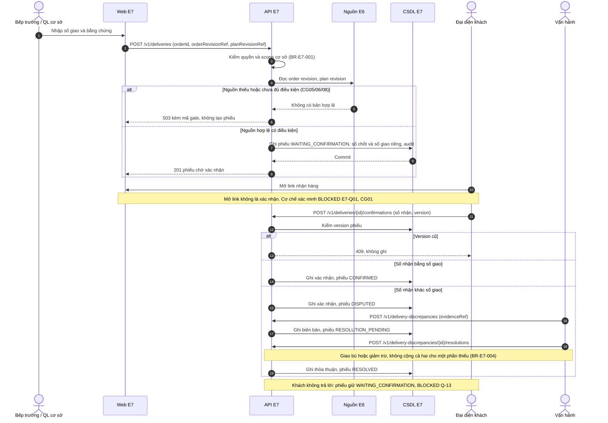
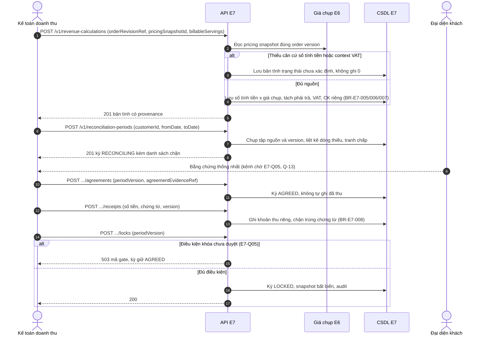
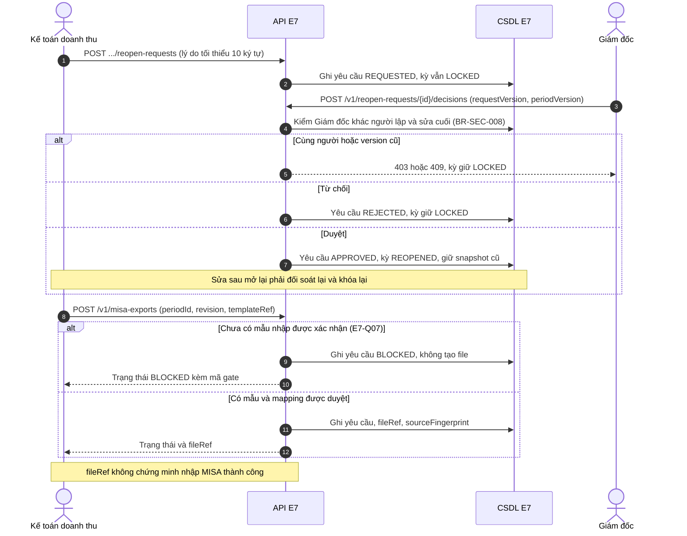

# Sơ đồ tuần tự E7: Giao nhận, doanh thu và đối soát

Draft · 16/11/2026 · Thiết kế BA có điều kiện, chưa phê duyệt, chưa triển khai.

| Phiên bản | Ngày | Người thực hiện | Nội dung |
| :--- | :--- | :--- | :--- |
| 0.1.0 | 2026-11-16 | BA | Khởi tạo: 3 sơ đồ tuần tự theo API-E7 và BR-E7 hiện có. Không thêm endpoint, mã lỗi hay quy tắc |

Các sơ đồ dùng đúng route trong [API E7](../api/api-spec.md) và mã lỗi trong [ma trận lỗi](error-matrix.md). Bước có gate được ghi nhãn BLOCKED; sơ đồ không mô tả cách producer E6 vượt cổng CG01/05/06/08.

## 1. Giao, xác nhận và chênh lệch (FEAT-049, FEAT-050)

## 2. Doanh thu, đối soát, thu tiền và khóa kỳ (FEAT-051, FEAT-052)

## 3. Mở lại kỳ đã khóa và xuất MISA (FEAT-052, FEAT-053)

Thứ tự ghi và chống trùng (idempotency, khóa dòng) là đề xuất; persistence, TTL và envelope còn BLOCKED E7-Q08. Đây là thiết kế, chưa có bằng chứng chạy race hay fault test.
