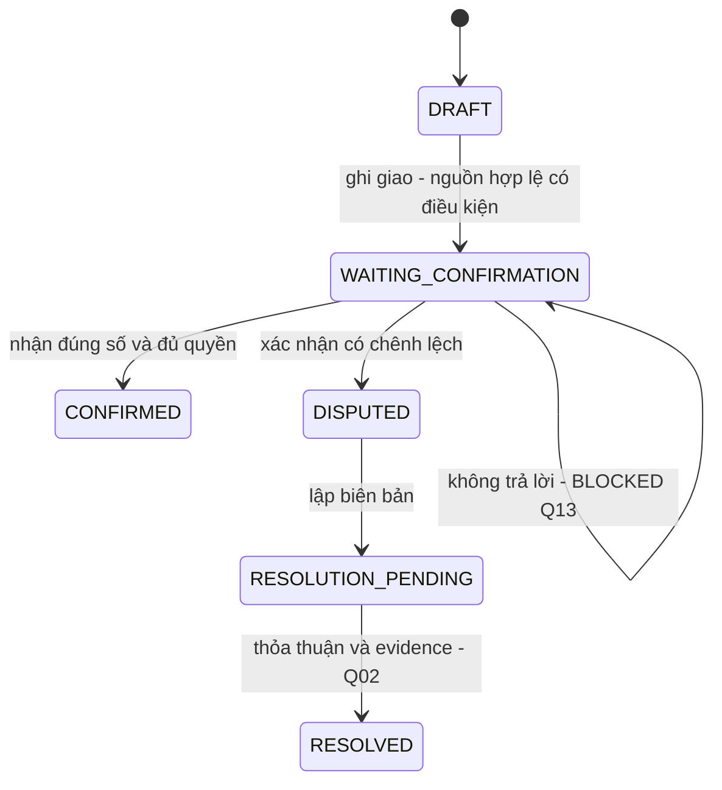
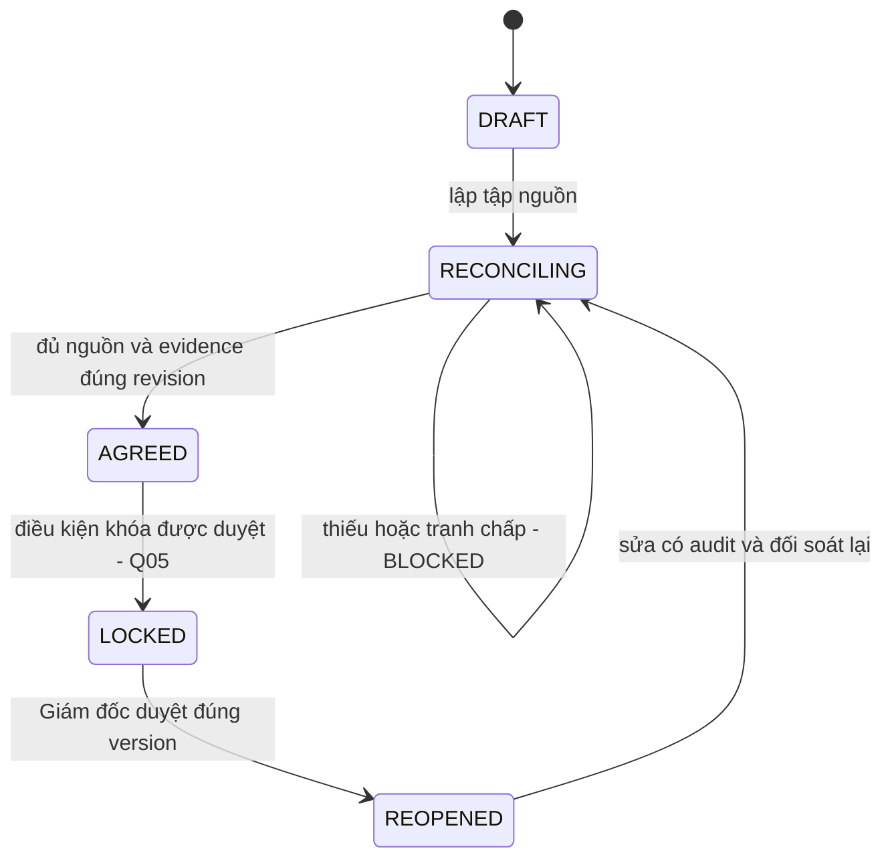
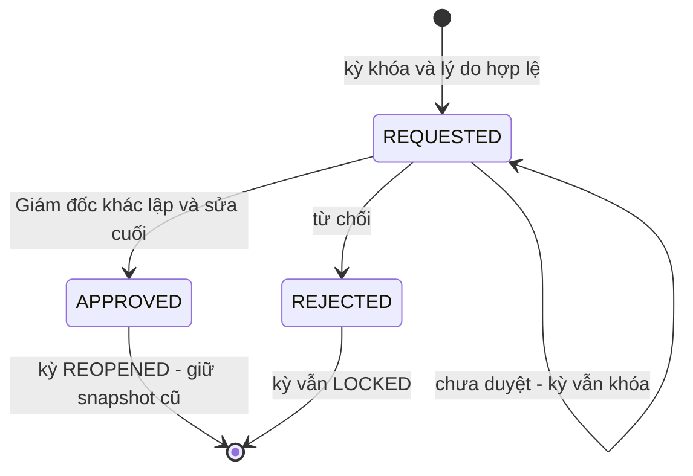

# State diagram E7

Draft · 12/11/2026 · Thiết kế BA có điều kiện, chưa phê duyệt / chưa triển khai.

## Phiếu giao nhận

Tên trạng thái là delta E7, không đổi orders enum. Nguồn hợp lệ BLOCKED CG05/06/08; xác nhận BLOCKED CG01/E7-Q01. Không đặc tả cách vượt cổng.

CONFIRMED không tự xác định số tính tiền/đã thu/đối soát. Phiếu bù liên kết, không sửa gốc. Zero/hủy/nhận thừa/giao nhiều lần chưa transition tự động.

## Kỳ đối soát

Thu tiền là chiều dữ liệu riêng; AGREED/LOCKED không suy PAID. Chưa chọn có phải thu đủ trước khóa. LOCKED chặn cả phiếu/doanh thu/chứng từ/import.

## Yêu cầu mở lại

Kiểm version tại ghi; quyết định cũ không mở kỳ mới. O-06 không tự cấp người thay. File đã xuất giữ revision cũ/cần rà lại, không sửa bytes hoặc auto tái xuất. [Q05/07/08](../review/questions.md).
