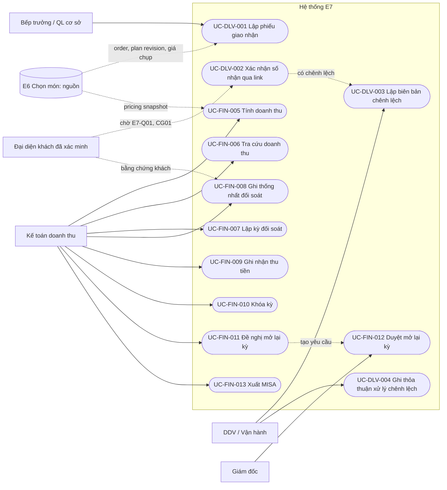

# Sơ đồ use case E7: Giao nhận, doanh thu và đối soát

Draft · 16/11/2026 · Thiết kế BA có điều kiện, chưa phê duyệt, chưa triển khai.

| Phiên bản | Ngày | Người thực hiện | Nội dung |
| :--- | :--- | :--- | :--- |
| 0.1.0 | 2026-11-16 | BA | Khởi tạo: sơ đồ actor và ma trận FR, UC, màn hình, API cho 13 UC hiện có. Không thêm FR hoặc UC |

File này chỉ vẽ lại phạm vi đã có trong [SRS E7](spec.md), [danh mục UC](../usecases/index.md) và [màn hình](../ui/screens.md). Không tạo actor, quyền hay use case mới; các cạnh có gate vẫn BLOCKED theo [sổ câu hỏi](../review/questions.md).

## 1. Tác nhân

| Tác nhân | Vai trò hệ thống | Ghi chú |
| :--- | :--- | :--- |
| Bếp trưởng / Quản lý cơ sở | `BEP_TRUONG`, `QL_CO_SO` | Lập phiếu giao theo cơ sở được giao |
| Đại diện khách được xác minh | Chưa có vai trò; cơ chế xác minh chờ E7-Q01, E6-CG-01 | Mở link không phải là xác nhận |
| Dinh dưỡng viên / Vận hành được cấp quyền | `DINH_DUONG_VIEN` hoặc quyền vận hành (PER-05) | Lập biên bản chênh lệch, ghi thỏa thuận |
| Kế toán doanh thu | `KT_DOANH_THU` | Tính doanh thu, đối soát, thu tiền, khóa kỳ, xuất MISA |
| Giám đốc | `GIAM_DOC` | Duyệt hoặc từ chối mở lại kỳ; phải khác người lập và người sửa cuối |
| E6 Chọn món (hệ thống nguồn) | Producer, không phải người dùng | Cung cấp order revision, plan revision, giá chụp; CG05/06/08 chưa đóng |

## 2. Sơ đồ

Cạnh nét đứt là phụ thuộc dữ liệu hoặc gate, không phải thao tác giao diện đã sẵn sàng. UC-FIN-012 chặn Giám đốc tự duyệt yêu cầu do chính mình lập hoặc sửa cuối (BR-SEC-008); người thay thế khi vắng chờ O-06.

## 3. Ma trận FR, UC, màn hình, API

| UC | FR | Feature | Tác nhân chính | Màn hình | API | Gate chính |
| :--- | :--- | :--- | :--- | :--- | :--- | :--- |
| [UC-DLV-001](../usecases/UC-DLV-001.md) | FR-DLV-NOTE-001 | FEAT-049 | Bếp trưởng / QL cơ sở | UI-E7-01 | API-E7-001, 014 | E6-CG-05/06/08; E7-Q02 |
| [UC-DLV-002](../usecases/UC-DLV-002.md) | FR-DLV-ACK-001 | FEAT-049 | Đại diện khách | UI-E7-02 | API-E7-002, 015 | E6-CG-01/08; E7-Q01; Q-13 |
| [UC-DLV-003](../usecases/UC-DLV-003.md) | FR-DLV-DIFF-001 | FEAT-050 | DDV / Vận hành | UI-E7-03 | API-E7-003, 016 | E7-Q02; E6-CG-08 |
| [UC-DLV-004](../usecases/UC-DLV-004.md) | FR-DLV-RES-001 | FEAT-050 | Vận hành | UI-E7-03 | API-E7-004 | E7-Q02/03 |
| [UC-FIN-005](../usecases/UC-FIN-005.md) | FR-FIN-REV-001 | FEAT-051 | Kế toán doanh thu | UI-E7-04 | API-E7-005 | E7-Q03/04; Q-13 |
| [UC-FIN-006](../usecases/UC-FIN-006.md) | FR-FIN-VIEW-001 | FEAT-051 | Kế toán doanh thu | UI-E7-04 | API-E7-006 | E7-Q04/08 |
| [UC-FIN-007](../usecases/UC-FIN-007.md) | FR-FIN-REC-001 | FEAT-052 | Kế toán doanh thu | UI-E7-05 | API-E7-007, 017 | E7-Q05; Q-13 |
| [UC-FIN-008](../usecases/UC-FIN-008.md) | FR-FIN-AGRE-001 | FEAT-052 | Kế toán + đại diện khách | UI-E7-05 | API-E7-008 | E7-Q05; Q-13 |
| [UC-FIN-009](../usecases/UC-FIN-009.md) | FR-FIN-RCPT-001 | FEAT-052 | Kế toán doanh thu | UI-E7-06 | API-E7-009 | E7-Q06 |
| [UC-FIN-010](../usecases/UC-FIN-010.md) | FR-FIN-LOCK-001 | FEAT-052 | Kế toán doanh thu | UI-E7-05 | API-E7-010 | E7-Q05; Q-13 |
| [UC-FIN-011](../usecases/UC-FIN-011.md) | FR-FIN-RREQ-001 | FEAT-052 | Kế toán doanh thu | UI-E7-07 | API-E7-011 | E7-Q05; O-06 |
| [UC-FIN-012](../usecases/UC-FIN-012.md) | FR-FIN-RDEC-001 | FEAT-052 | Giám đốc | UI-E7-07 | API-E7-012 | E7-Q05; O-06 |
| [UC-FIN-013](../usecases/UC-FIN-013.md) | FR-FIN-MISA-001 | FEAT-053 | Kế toán doanh thu | UI-E7-08 | API-E7-013, 018 | E7-Q07/08 |

13/13 FR có đúng một UC; 5/5 feature FEAT-049 đến FEAT-053 có ít nhất một UC. Số liệu này đo tài liệu, không đo phần mềm hay nghiệp vụ đã duyệt.
