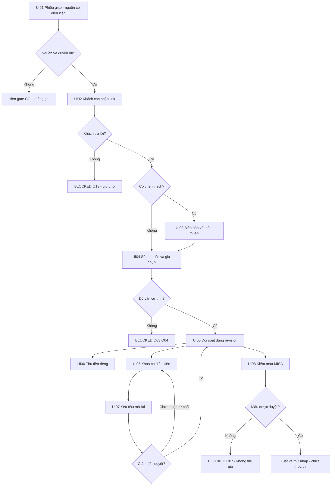

# User flow E7: happy/error/edge

Draft · 12/11/2026 · Thiết kế BA có điều kiện, chưa phê duyệt / chưa triển khai.

| Tình huống | UI / phản hồi | Hậu điều kiện |
| :--- | :--- | :--- |
| Happy có điều kiện | 01→02→04→05, 03 khi chênh; 06 thu riêng; 08 theo mẫu | Giữ evidence/nguồn, không auto PAID |
| Nguồn E6 đổi/thiếu | 01/04 hiện revision và gate | Không tự chọn bản mới |
| Link hết hiệu lực/ngoài scope | 02 báo lỗi quyền | Không hiện khách khác/không ghi |
| Khách im lặng | 02 chờ, 04/05 dòng BLOCKED Q-13 | Không suy số nhận/tính tiền |
| Nhận ít/thừa/giao bù | 03 giữ evidence và Q02/03 | Không tự giảm tiền hoặc cộng bù trùng |
| Mất phản hồi/Offline | Giữ form, hiện chưa rõ kết quả | Đối chiếu chứng từ/version trước retry |
| Khóa/yêu cầu đang chờ | 05/07 readonly, trạng thái yêu cầu riêng | Không sửa qua màn/API khác |
| Loading/Empty/Error | Toolbar mô phỏng; rỗng không là0; lỗi có hướng xử lý | GET không tạo dữ liệu |

Wireframe chỉ dữ liệu synthetic, không auth/link/nguồn E6 thực. Nút mô phỏng không là quyết định được duyệt.
