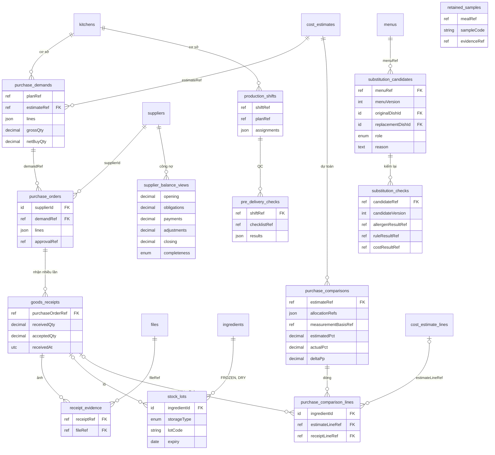

# ERD E11: kế thừa và delta đề xuất

Nháp có điều kiện · 16/11/2026 · Chưa phê duyệt, chưa triển khai.

| Phiên bản | Ngày | Người thực hiện | Nội dung |
| :--- | :--- | :--- | :--- |
| 0.1.0 | 2026-11-16 | BA | Khởi tạo: vẽ quan hệ cho 13 thực thể đề xuất trong từ điển dữ liệu E11. Không thêm thực thể hay trường |

Sơ đồ chỉ vẽ lại [từ điển dữ liệu E11](data-dictionary.md). **Schema chung giữ 65 bảng**; [ERD nền mục 7](../../nen-tang/srs/erd.md) mới có khung `purchase_orders`, `goods_receipts`, `stock_lots`, `production_plans`, chưa là bảng vật lý. Không DDL, không migration. Độ dài và precision chờ E11-Q13. Mọi thực thể đề xuất còn có thêm nhóm "trường chung" của từ điển (id, kitchen_id, source_refs, status, actor_id, recorded_at, reason); sơ đồ không lặp lại nhóm này.

## 1. Sơ đồ

`kitchens`, `suppliers`, `ingredients`, `menus`, `files`, `cost_estimates`, `cost_estimate_lines` là bảng có sẵn trong [DBML tổng](../../nen-tang/srs/schema.dbml). `planRef`, `shiftRef`, `mealRef` trỏ tới kế hoạch E6 (delta chưa merge, CG06) nên không vẽ thành quan hệ. `lotCode`, `expiry` của lô chưa được đặc tả (E11-Q03); sơ đồ chỉ giữ tên.

## 2. Ràng buộc cần review

| Nhóm | Ràng buộc | Căn cứ / gate |
| :--- | :--- | :--- |
| Lượng | Kèm đơn vị; không âm; null không là 0; không cộng kg với suất | Từ điển trường chung |
| Nhu cầu | `netBuyQty` chưa tính vì chưa chốt trừ tồn, hàng đang về, dự phòng | BR-PUR-001; E11-Q01 |
| Đơn mua | Dòng không rỗng; NCC từ danh mục E3; tổng tiền chỉ khi giá xác định | BR-PUR-002; E11-Q02 |
| Nhận hàng | acceptedQty không lớn hơn receivedQty; nhận nhiều lần không ghi đè lần cũ | BR-PUR-005; E11-Q04 |
| Giá | Giá cost gồm VAT do server chuẩn hóa; cờ không yêu cầu hóa đơn không là VAT 0% | Từ điển; E11-Q14 |
| Công nợ | Chỉ là projection đọc, không tạo sổ cái; thiếu nguồn thì chưa xác định | BR-PUR-007; E11-Q06 |
| Thay món | Cùng vai trò; ba kết quả kiểm cùng phiên bản; thiếu một thì BLOCKED | BR-PUR-013/014; E11-Q12/15 |
