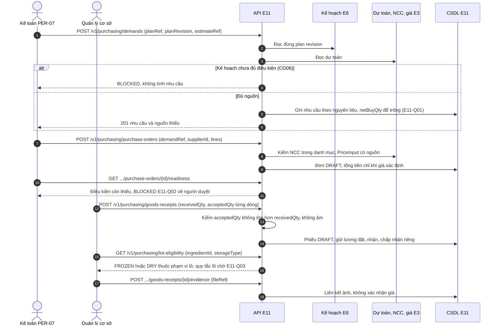
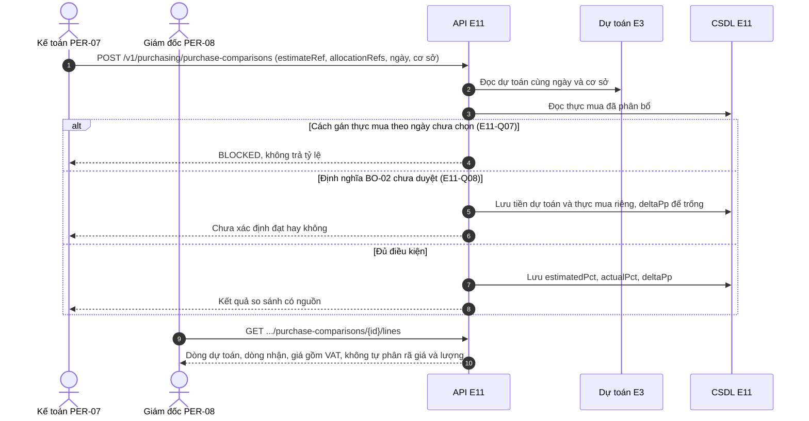
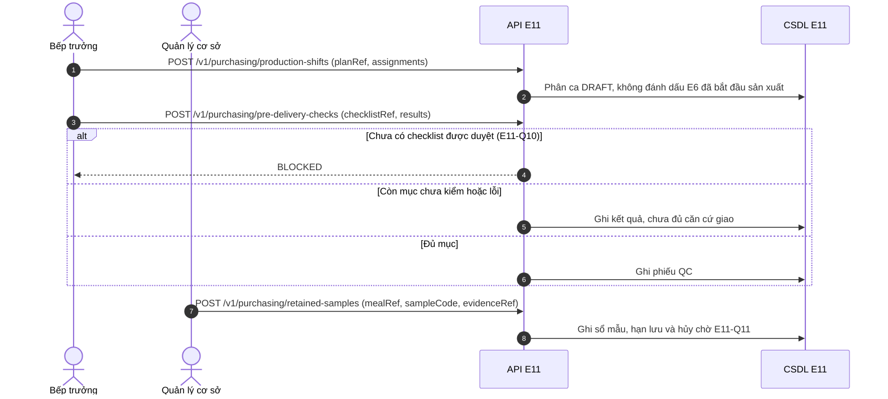
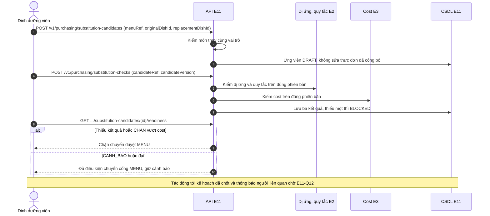

# Sơ đồ tuần tự E11: Mua hàng và sản xuất

Nháp có điều kiện · 16/11/2026 · Chưa phê duyệt, chưa triển khai.

| Phiên bản | Ngày | Người thực hiện | Nội dung |
| :--- | :--- | :--- | :--- |
| 0.1.0 | 2026-11-16 | BA | Khởi tạo: 4 sơ đồ tuần tự theo API-PUR và BR-PUR hiện có. Không thêm endpoint, mã lỗi hay quy tắc |

Route lấy từ [API E11](../api/api-spec.md); trạng thái lấy từ [states](states.md). Bước có gate ghi nhãn BLOCKED; sơ đồ không mô tả cách E6 phát hành kế hoạch (CG06).

## 1. Nhu cầu, đơn mua và nhận hàng (FEAT-074, FEAT-075)

## 2. Đối chiếu dự toán và thực mua (FEAT-076)

## 3. Phân ca, kiểm tra trước giao và mẫu lưu (FEAT-077)

## 4. Thay món do thiếu hàng (FEAT-078)

Chống trùng, receipt, xử lý đồng thời là đề xuất; còn BLOCKED E11-Q13. Chưa có bằng chứng chạy.
