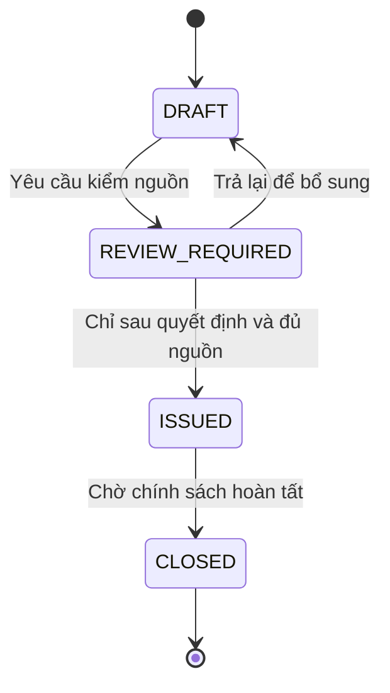
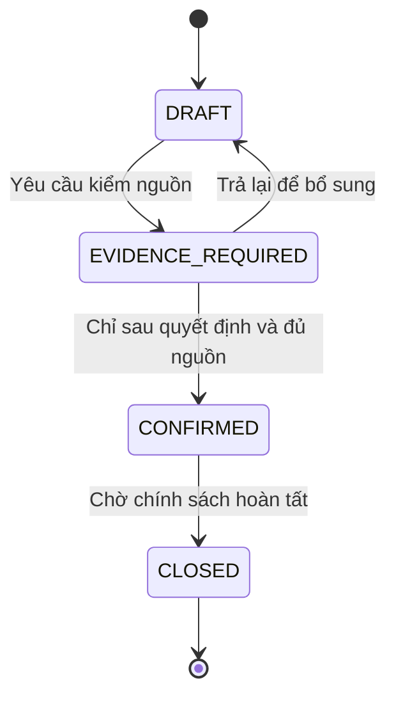
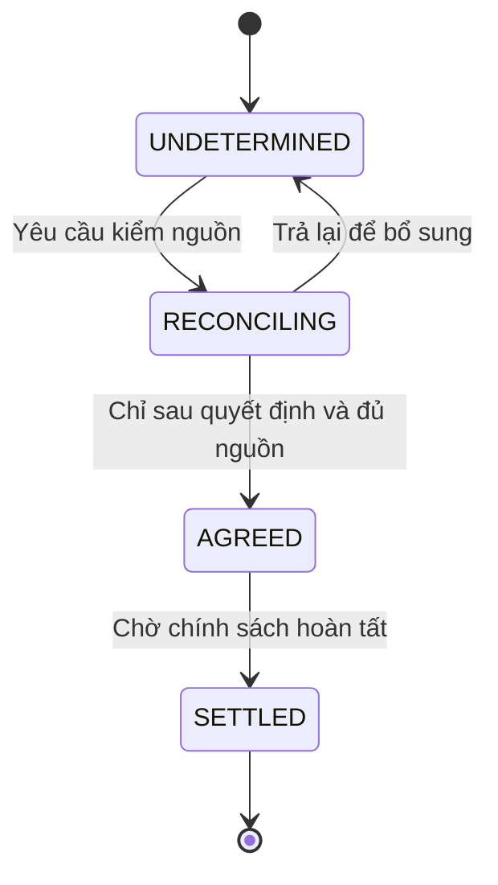
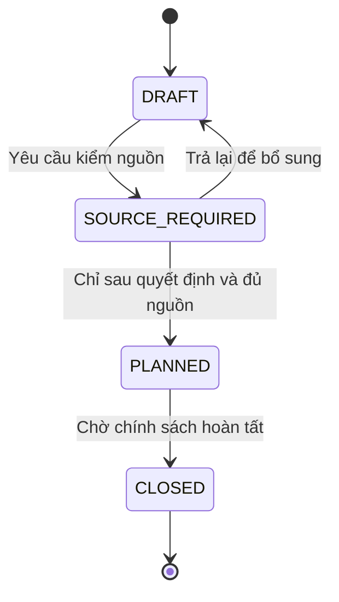
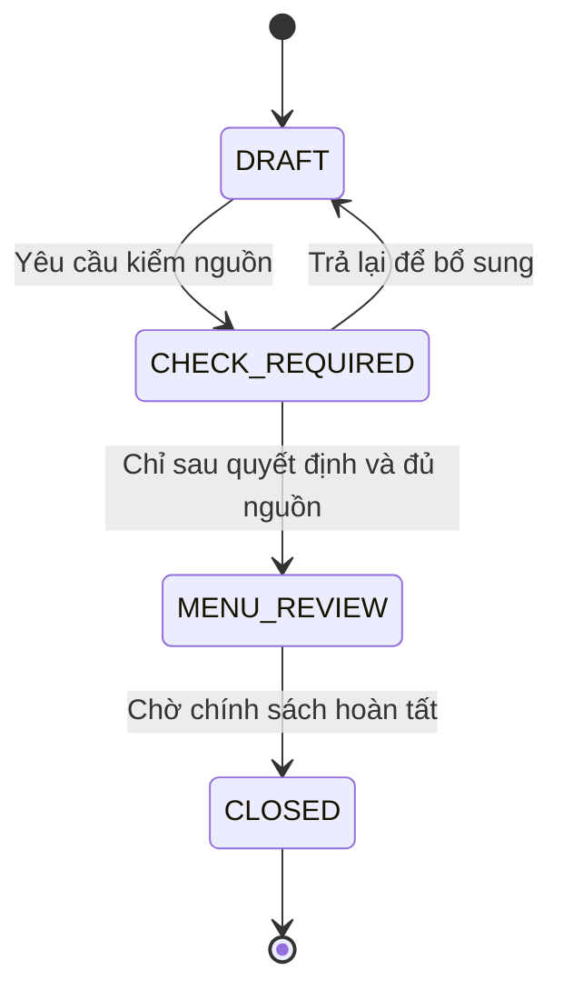

# Trạng thái đề xuất E11

Nháp có điều kiện · Chưa phê duyệt · 12/11/2026.

| Phiên bản | Ngày | Người thực hiện | Nội dung |
| :--- | :--- | :--- | :--- |
| 0.1.0 | 12/11/2026 | BA | Mở tài liệu E11; giữ câu hỏi chưa có câu trả lời |

Các trạng thái là ngôn ngữ review, không phải enum đã duyệt. BLOCKED là kết quả kiểm gate, không trạng thái tự động mất dữ liệu. Sau trạng thái cuối, sửa chữa/đảo giao dịch còn chờ câu hỏi; không cung cấp đường mở lại ngầm.

## Đơn mua

| Nguồn | Trigger | Guard | Đích | Actor / tác động |
| :--- | :--- | :--- | :--- | :--- |
| Khởi tạo | Tạo nháp | Có quyền và dữ liệu nháp | DRAFT | Kế toán lập; người duyệt chưa xác định |
| DRAFT | Yêu cầu kiểm | Đúng version; chưa tạo hiệu lực | REVIEW_REQUIRED | Người lập; giữ provenance |
| REVIEW_REQUIRED | Nguồn thiếu/không đạt | Không làm mất nháp | DRAFT | Người lập bổ sung |
| REVIEW_REQUIRED | Quyết định hợp lệ | BLOCKED E11-Q02; chưa đặc tả thao tác phụ thuộc | ISSUED | Kế toán lập; người duyệt chưa xác định |
| ISSUED | Hoàn tất | BLOCKED E11-Q02; cần bằng chứng đã xác nhận | CLOSED | Kế toán lập; người duyệt chưa xác định |

## Phiếu nhận hàng

| Nguồn | Trigger | Guard | Đích | Actor / tác động |
| :--- | :--- | :--- | :--- | :--- |
| Khởi tạo | Tạo nháp | Có quyền và dữ liệu nháp | DRAFT | Quản lý cơ sở ghi; người xác nhận chờ |
| DRAFT | Yêu cầu kiểm | Đúng version; chưa tạo hiệu lực | EVIDENCE_REQUIRED | Người lập; giữ provenance |
| EVIDENCE_REQUIRED | Nguồn thiếu/không đạt | Không làm mất nháp | DRAFT | Người lập bổ sung |
| EVIDENCE_REQUIRED | Quyết định hợp lệ | BLOCKED E11-Q04/05; chưa đặc tả thao tác phụ thuộc | CONFIRMED | Quản lý cơ sở ghi; người xác nhận chờ |
| CONFIRMED | Hoàn tất | BLOCKED E11-Q04/05; cần bằng chứng đã xác nhận | CLOSED | Quản lý cơ sở ghi; người xác nhận chờ |

## Công nợ NCC

| Nguồn | Trigger | Guard | Đích | Actor / tác động |
| :--- | :--- | :--- | :--- | :--- |
| Khởi tạo | Tạo nháp | Có quyền và dữ liệu nháp | UNDETERMINED | Kế toán; bên xác nhận chờ |
| UNDETERMINED | Yêu cầu kiểm | Đúng version; chưa tạo hiệu lực | RECONCILING | Người lập; giữ provenance |
| RECONCILING | Nguồn thiếu/không đạt | Không làm mất nháp | UNDETERMINED | Người lập bổ sung |
| RECONCILING | Quyết định hợp lệ | BLOCKED E11-Q06; chưa đặc tả thao tác phụ thuộc | AGREED | Kế toán; bên xác nhận chờ |
| AGREED | Hoàn tất | BLOCKED E11-Q06; cần bằng chứng đã xác nhận | SETTLED | Kế toán; bên xác nhận chờ |

## Ca sản xuất

| Nguồn | Trigger | Guard | Đích | Actor / tác động |
| :--- | :--- | :--- | :--- | :--- |
| Khởi tạo | Tạo nháp | Có quyền và dữ liệu nháp | DRAFT | Bếp trưởng; không thay start E6 |
| DRAFT | Yêu cầu kiểm | Đúng version; chưa tạo hiệu lực | SOURCE_REQUIRED | Người lập; giữ provenance |
| SOURCE_REQUIRED | Nguồn thiếu/không đạt | Không làm mất nháp | DRAFT | Người lập bổ sung |
| SOURCE_REQUIRED | Quyết định hợp lệ | BLOCKED E11-Q09/10; E6 CG06; chưa đặc tả thao tác phụ thuộc | PLANNED | Bếp trưởng; không thay start E6 |
| PLANNED | Hoàn tất | BLOCKED E11-Q09/10; E6 CG06; cần bằng chứng đã xác nhận | CLOSED | Bếp trưởng; không thay start E6 |

## Đề xuất món thay

| Nguồn | Trigger | Guard | Đích | Actor / tác động |
| :--- | :--- | :--- | :--- | :--- |
| Khởi tạo | Tạo nháp | Có quyền và dữ liệu nháp | DRAFT | Dinh dưỡng viên; duyệt theo MENU |
| DRAFT | Yêu cầu kiểm | Đúng version; chưa tạo hiệu lực | CHECK_REQUIRED | Người lập; giữ provenance |
| CHECK_REQUIRED | Nguồn thiếu/không đạt | Không làm mất nháp | DRAFT | Người lập bổ sung |
| CHECK_REQUIRED | Quyết định hợp lệ | BLOCKED E11-Q12/15; DL-01; chưa đặc tả thao tác phụ thuộc | MENU_REVIEW | Dinh dưỡng viên; duyệt theo MENU |
| MENU_REVIEW | Hoàn tất | BLOCKED E11-Q12/15; DL-01; cần bằng chứng đã xác nhận | CLOSED | Dinh dưỡng viên; duyệt theo MENU |

Đơn mua ISSUED không nghĩa nhận đủ; phiếu CONFIRMED không nghĩa đã trả; AGREED không nghĩa SETTLED. MENU_REVIEW không phải APPROVED/PUBLISHED. Ca PLANNED không ghi bắt đầu sản xuất E6.
