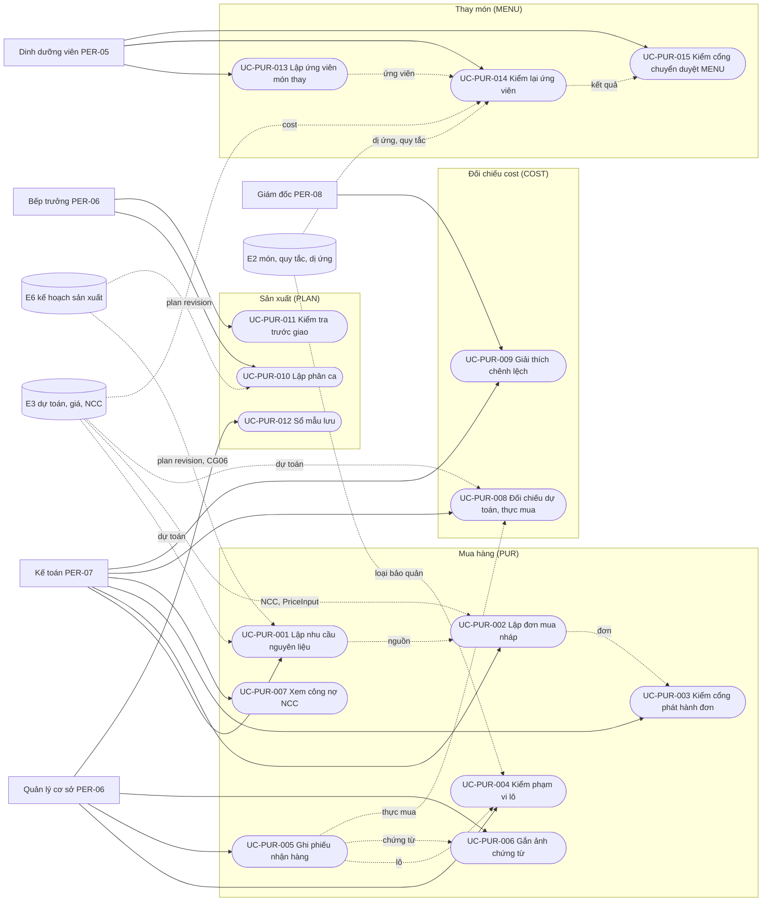

# Sơ đồ use case E11: Mua hàng và sản xuất

Nháp có điều kiện · 16/11/2026 · Chưa phê duyệt, chưa triển khai.

| Phiên bản | Ngày | Người thực hiện | Nội dung |
| :--- | :--- | :--- | :--- |
| 0.1.0 | 2026-11-16 | BA | Khởi tạo: sơ đồ actor và ma trận FR, UC, màn hình, API cho 15 UC hiện có. Không thêm FR hoặc UC |

File này chỉ vẽ lại phạm vi trong [SRS E11](spec.md), [danh mục UC](../usecases/index.md) và [màn hình](../ui/screens.md). Người duyệt và phát hành đơn mua chưa chỉ định (E11-Q02).

## 1. Tác nhân

| Tác nhân | Persona | Ghi chú |
| :--- | :--- | :--- |
| Kế toán | PER-07 | Nhu cầu nguyên liệu, đơn mua, công nợ NCC, đối chiếu dự toán và thực mua |
| Giám đốc | PER-08 | Cùng kế toán xem giải thích chênh lệch |
| Quản lý cơ sở | PER-06 | Phạm vi lô, phiếu nhận, ảnh chứng từ, mẫu lưu |
| Bếp trưởng | PER-06 | Phân ca, kiểm tra trước giao |
| Dinh dưỡng viên | PER-05 | Món thay thế và kiểm lại |
| Nguồn E2, E3, E6 | Hệ thống | Định lượng, vai trò, dị ứng, quy tắc; dự toán, giá gồm VAT; kế hoạch có revision (CG06 chờ) |

## 2. Sơ đồ

Thay món không bỏ cổng MENU: CHAN chặn vượt cost, CANH_BAO giữ cảnh báo và vẫn qua cổng, thiếu đầu vào luôn chặn (BR-PUR-015). Không ghi duyệt, không công bố, không cập nhật E6.

## 3. Ma trận FR, UC, màn hình, API

| UC | FR | Feature | Tác nhân chính | Màn hình | API | Gate chính |
| :--- | :--- | :--- | :--- | :--- | :--- | :--- |
| [UC-PUR-001](../usecases/UC-PUR-001.md) | FR-PUR-DEM-001 | FEAT-074 | Kế toán | UI-PUR-01 | API-PUR-001 | E11-Q01; CG06 |
| [UC-PUR-002](../usecases/UC-PUR-002.md) | FR-PUR-POD-001 | FEAT-074 | Kế toán | UI-PUR-02 | API-PUR-002 | E11-Q02/14 |
| [UC-PUR-003](../usecases/UC-PUR-003.md) | FR-PUR-POG-001 | FEAT-074 | Kế toán | UI-PUR-02 | API-PUR-003 | E11-Q02 |
| [UC-PUR-004](../usecases/UC-PUR-004.md) | FR-PUR-LOT-001 | FEAT-074 | Quản lý cơ sở | UI-PUR-03 | API-PUR-004 | E11-Q03 |
| [UC-PUR-005](../usecases/UC-PUR-005.md) | FR-PUR-RCV-001 | FEAT-075 | Quản lý cơ sở | UI-PUR-03 | API-PUR-005 | E11-Q04/14 |
| [UC-PUR-006](../usecases/UC-PUR-006.md) | FR-PUR-DOC-001 | FEAT-075 | Quản lý cơ sở | UI-PUR-04 | API-PUR-006 | E11-Q05 |
| [UC-PUR-007](../usecases/UC-PUR-007.md) | FR-PUR-APV-001 | FEAT-075 | Kế toán | UI-PUR-05 | API-PUR-007 | E11-Q06 |
| [UC-PUR-008](../usecases/UC-PUR-008.md) | FR-COST-BUY-001 | FEAT-076 | Kế toán | UI-PUR-06 | API-PUR-008 | E11-Q07/08 |
| [UC-PUR-009](../usecases/UC-PUR-009.md) | FR-COST-BEX-001 | FEAT-076 | Giám đốc, kế toán | UI-PUR-06 | API-PUR-009 | E11-Q07/08 |
| [UC-PUR-010](../usecases/UC-PUR-010.md) | FR-PLAN-SHF-001 | FEAT-077 | Bếp trưởng | UI-PUR-07 | API-PUR-010 | E11-Q09; CG06 |
| [UC-PUR-011](../usecases/UC-PUR-011.md) | FR-PLAN-QCG-001 | FEAT-077 | Bếp trưởng | UI-PUR-08 | API-PUR-011 | E11-Q10 |
| [UC-PUR-012](../usecases/UC-PUR-012.md) | FR-PLAN-SMP-001 | FEAT-077 | Quản lý cơ sở | UI-PUR-08 | API-PUR-012 | E11-Q11 |
| [UC-PUR-013](../usecases/UC-PUR-013.md) | FR-MENU-SUB-001 | FEAT-078 | Dinh dưỡng viên | UI-PUR-09 | API-PUR-013 | E11-Q12 |
| [UC-PUR-014](../usecases/UC-PUR-014.md) | FR-MENU-SCK-001 | FEAT-078 | Dinh dưỡng viên | UI-PUR-09 | API-PUR-014 | E11-Q12/15 |
| [UC-PUR-015](../usecases/UC-PUR-015.md) | FR-MENU-SGT-001 | FEAT-078 | Dinh dưỡng viên | UI-PUR-09 | API-PUR-015 | E11-Q12 |

15/15 FR có đúng một UC; 5/5 feature FEAT-074 đến FEAT-078 có ít nhất một UC. Số liệu đo tài liệu, không đo phần mềm.
