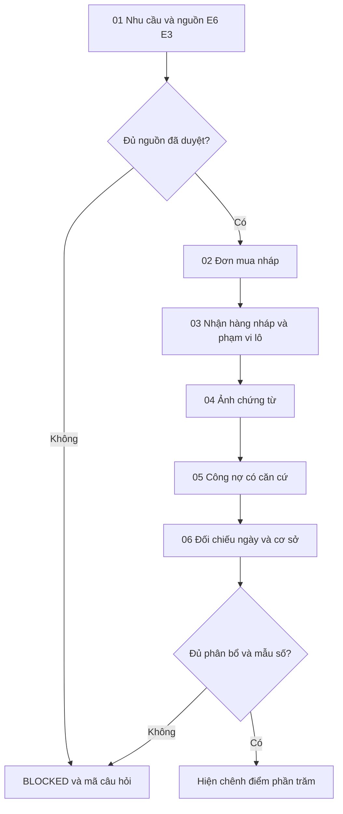
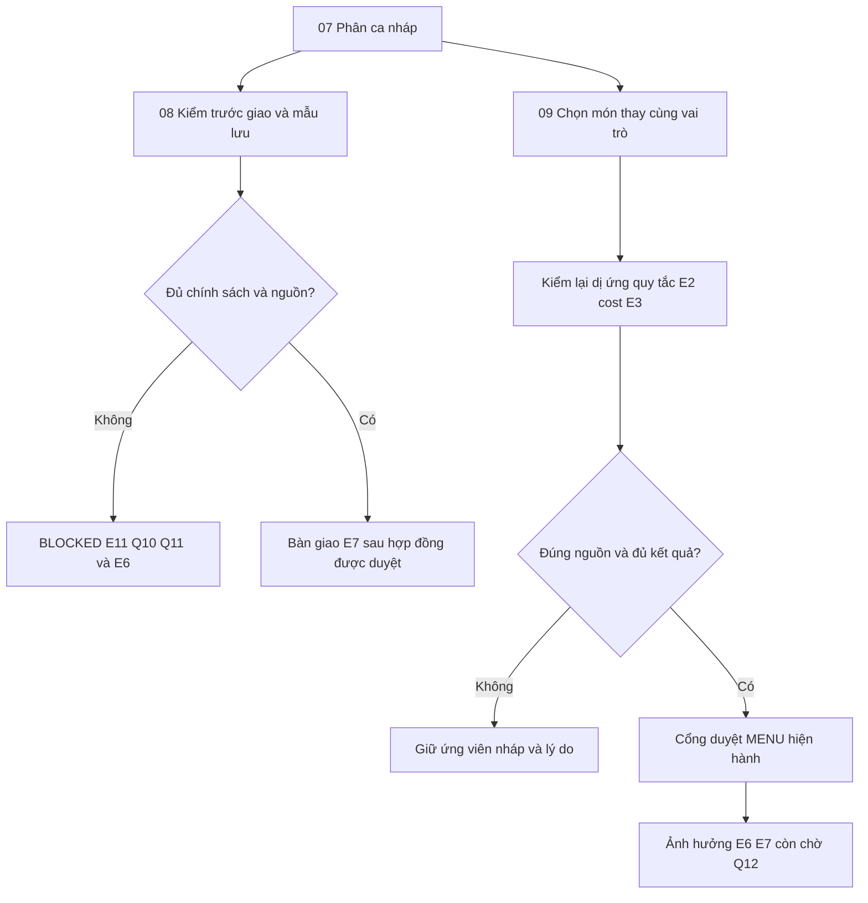

# Luồng người dùng E11

Nháp có điều kiện · Chưa phê duyệt · 12/11/2026.

| Phiên bản | Ngày | Người thực hiện | Nội dung |
| :--- | :--- | :--- | :--- |
| 0.1.0 | 12/11/2026 | BA | Mở tài liệu E11; giữ câu hỏi chưa có câu trả lời |

## Mua hàng đến đối chiếu

Mũi tên là điều hướng review, không tự chuyển hiệu lực hoặc thay chính sách duyệt/ghi nhận. Nhánh mất mạng giữ nháp hiển thị và trạng thái chưa rõ; không retry ghi tự động.

## Bếp và món thay

## Trạng thái giao diện chung

Normal: dữ liệu synthetic có nhãn. Loading: ẩn số cũ; Empty: không có dữ liệu, không hiện tổng 0 giả; Missing: chỉ rõ nguồn/câu hỏi; Error: lỗi có thể phục hồi; Offline: không gửi; Denied: không hiện dữ liệu; Conflict: tải lại version trước thao tác. Mỗi màn có bộ chọn trạng thái để review. Không có thao tác nghiệp vụ thật. [Màn hình](screens.md).
