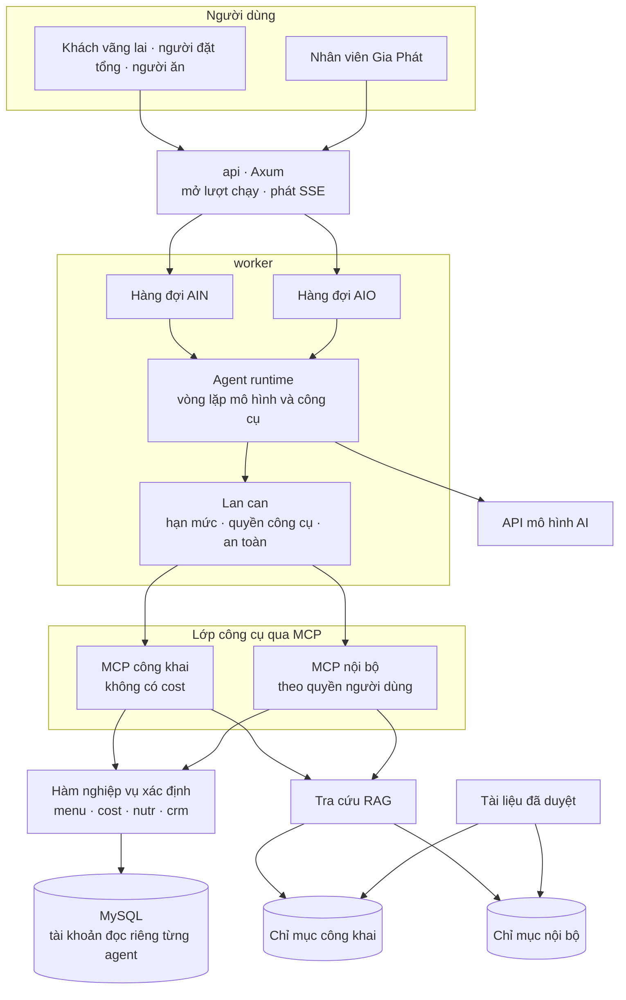
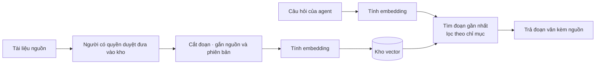

# Kiến trúc AI agent: công cụ, MCP và RAG

Phiên bản 0.1.0 · 14/11/2026 · **Draft: cấu trúc [ĐỀ XUẤT] để review; chưa chọn nhà cung cấp mô hình, chưa viết lời nhắc hệ thống, chưa có mã nguồn.**

| Phiên bản | Ngày | Người thực hiện | Nội dung |
| :--- | :--- | :--- | :--- |
| 0.1.0 | 2026-11-14 | BA | Khởi tạo theo CR-CORE-2026-001: agent runtime, lớp công cụ, hai MCP server, RAG hai chỉ mục, lan can |

Nguồn: [Kế hoạch tổng thể](../../gia-phat/00-ke-hoach-tong-the.md) mục 5 · [SRS Agent Nội bộ E5](../../agent-noi-bo/srs/spec.md) · [SRS Agent Dinh dưỡng viên E9](../../agent-dinh-duong-vien/srs/spec.md) · [Kiến trúc hệ thống](architecture.md) · [CR-CORE-2026-001](../cr/CR-CORE-2026-001.md).

Tài liệu này mô tả **cách tổ chức kỹ thuật** của hai agent. Nó không thêm khả năng mới cho agent, không đổi FR của E5 và E9, không đóng câu hỏi mở nào. Khi khác SRS E5 hoặc E9, SRS là căn cứ.

---

## 1. Nguyên tắc kế thừa

Sáu nguyên tắc ở mục 5.1 kế hoạch tổng thể giữ nguyên và quyết định hình dạng kiến trúc:

| # | Nguyên tắc | Hệ quả kiến trúc |
| :--- | :--- | :--- |
| 1 | AI không tự tính số | Mọi con số đến từ công cụ gọi hàm xác định của MENU, COST, NUTR. RAG không được dùng để lấy con số |
| 2 | AI chỉ dùng món, công thức đã duyệt | Công cụ tra cứu chỉ trả bản ghi ở trạng thái đã duyệt, đang hiệu lực |
| 3 | Đầu ra là bản nháp | Mô hình không có công cụ ghi dữ liệu nghiệp vụ. Áp dụng nháp hoặc gửi đề xuất là hành động của người dùng qua API, không phải của mô hình |
| 4 | Mỗi kết quả kèm bảng kiểm | Agent runtime luôn chạy lại bộ kiểm trước khi trả phương án |
| 5 | Tách hoàn toàn hai agent | Hai bộ công cụ, hai MCP server, hai tài khoản dịch vụ, hai hàng đợi, hai chỉ mục RAG, hai hạn mức |
| 6 | Mọi lượt chạy đều ghi lại | Mỗi lần gọi mô hình và mỗi lần gọi công cụ là một sự kiện trong nhật ký lượt chạy |

## 2. Tổng quan



Bộ công khai chỉ đọc chỉ mục công khai. Bộ nội bộ đọc được cả hai chỉ mục.

## 3. Agent runtime

Agent runtime nằm trong crate `ai`, chạy trong tiến trình `worker`.

| Bước | Việc | Ghi chú |
| :--- | :--- | :--- |
| 1 | `api` nhận yêu cầu, kiểm quyền và hạn mức, tạo lượt chạy, đẩy vào hàng đợi của đúng agent | Tương ứng `PORT-AIN-ADMISSION` của E9; trạng thái lượt chạy theo SRS E5 và E9 |
| 2 | `worker` lấy lượt chạy, dựng ngữ cảnh: lời nhắc hệ thống của agent, lịch sử phiên, danh sách công cụ được phép | Lời nhắc hệ thống chưa viết; cấu hình tách riêng từng agent |
| 3 | Gọi mô hình. Mô hình trả lời bằng chữ hoặc yêu cầu gọi công cụ | Lời gọi mô hình đi qua một giao diện duy nhất để đổi nhà cung cấp không ảnh hưởng phần còn lại |
| 4 | Lan can kiểm yêu cầu gọi công cụ: công cụ có trong danh sách của agent không, người dùng còn quyền không, ngân sách còn không | Tương ứng `PORT-AIN-TOOL-GUARD`; từ chối mặc định |
| 5 | Gọi công cụ qua MCP, đưa kết quả lại cho mô hình, lặp từ bước 3 | Giới hạn số vòng và tổng thời gian theo SRS (E5: 60 giây mỗi thực đơn) |
| 6 | Trước khi trả phương án thực đơn, runtime tự gọi bộ kiểm quy tắc và kiểm cost lần cuối | Không phụ thuộc việc mô hình có nhớ gọi hay không |
| 7 | Lọc đầu ra, phát kết quả về `api` qua Redis, `api` phát cho trình duyệt bằng SSE | Tương ứng `PORT-AIN-SAFETY` |
| 8 | Ghi nhật ký lượt chạy: người hỏi, phiên bản cấu hình, token vào ra, chi phí, công cụ đã gọi, kết cục | Chi phí chưa biết ghi là chưa biết, không ghi 0 (theo SRS E5) |

Văn bản người dùng nhập, tên món và kết quả công cụ đều là dữ liệu không đáng tin: runtime không coi nội dung trong đó là chỉ dẫn (theo SRS E5).

## 4. Công cụ (tool)

Công cụ là hàm Rust trong các crate nghiệp vụ, được bọc lại với mô tả và lược đồ tham số để mô hình gọi. Mô hình **chỉ có công cụ đọc và kiểm**. Hai hành động có tác dụng ghi là áp dụng phương án thành bản nháp (`FR-AIO-APLY-001`) và gửi đề xuất về Gia Phát (`FR-AIN-SEND-001`) do người dùng bấm trên giao diện, đi qua API thường; mô hình không tự làm được.

### 4.1 Bộ công khai (Agent Dinh dưỡng viên)

| Công cụ | Nguồn | Trả về | Không trả về |
| :--- | :--- | :--- | :--- |
| Tra món đã duyệt | `menu` | Tên, vai trò, phương pháp chế biến, dị ứng, cờ Healthy | Nhóm cost, giá nhập |
| Lấy định lượng theo loại suất | `menu` | Định lượng sống theo công thức đang hiệu lực | |
| Tính dinh dưỡng món hoặc suất | `nutr` | 4 chỉ số: năng lượng, đạm, béo, bột đường | |
| Kiểm quy tắc thực đơn | `menu` | Danh sách quy tắc đạt và vi phạm | |
| Kiểm ngân sách | `cost` | Chỉ **đạt** hoặc **không đạt** | Con số cost, cost %, biên lợi nhuận |
| Tra cứu tài liệu | RAG, chỉ mục công khai | Đoạn văn kèm nguồn | |

### 4.2 Bộ nội bộ (Agent Nội bộ)

Gồm mọi công cụ của bộ công khai, cộng thêm:

| Công cụ | Nguồn | Đợt | Ghi chú |
| :--- | :--- | :--- | :--- |
| Đọc cost món, cost suất, cost % | `cost` | R5 | Theo quyền xem cost của người đang dùng |
| Đọc giá nhập đang hiệu lực | `cost` | R5 | |
| Đọc kế hoạch, tồn, đơn mua | `ord`, `pur` | R12 (FEAT-083) | Chưa đặc tả ở E5; FEAT-082 (rà soát khi giá đổi) dùng các công cụ `menu`, `cost` đã có |
| Đọc hồ sơ khách | `crm` | R12 (FEAT-084) | Chỉ đọc |
| Truy vấn khung nhìn báo cáo định sẵn | `rpt` | R12 (FEAT-085) | Không cho mô hình tự viết SQL |
| Tra cứu tài liệu | RAG, cả hai chỉ mục | R5 | |

Quyền hữu hiệu của mỗi lần gọi là **giao** của quyền tài khoản dịch vụ `svc-agent-noi-bo` và quyền của người đang dùng (BR-SEC-009): quản lý cơ sở A không hỏi được số liệu cơ sở B qua agent.

### 4.3 Quy tắc chung cho công cụ

1. Mỗi công cụ có lược đồ tham số chặt; tham số sai bị từ chối trước khi chạm crate nghiệp vụ.
2. Công cụ trả kiểu dữ liệu riêng cho agent (projection), không trả thẳng bản ghi cơ sở dữ liệu. Kiểu của bộ công khai không có trường cost nên không thể lộ do sơ suất.
3. Công cụ không tin mã cơ sở hay mã công ty do mô hình truyền vào; phạm vi lấy từ ngữ cảnh người dùng của lượt chạy.
4. Mỗi lần gọi ghi một sự kiện có mã yêu cầu, thời gian và kết cục.

## 5. MCP

MCP (Model Context Protocol) là giao thức chuẩn để mô hình gọi công cụ. Mỗi bộ công cụ được đóng thành một MCP server riêng; agent runtime là MCP client.

| | MCP công khai | MCP nội bộ |
| :--- | :--- | :--- |
| Agent dùng | Agent Dinh dưỡng viên | Agent Nội bộ |
| Công cụ | Mục 4.1 | Mục 4.1 và 4.2 |
| Tài khoản MySQL | Chỉ đọc, không có quyền trên bảng giá nhập và cost | Chỉ đọc |
| Chỉ mục RAG | Công khai | Công khai và nội bộ |
| Ai kết nối được | Chỉ agent runtime của AIN | Chỉ agent runtime của AIO |

Lý do dùng MCP thay vì gọi hàm trực tiếp:

- **Cách ly bằng cấu trúc.** Agent phía khách không kết nối MCP nội bộ, nên không có đường nào tới cost dù lời nhắc bị lừa. Đây là cách hiện thực yêu cầu "chặn ở tầng công cụ và quyền cơ sở dữ liệu, không dựa vào lời nhắc" của `FR-AIN-SAFE-001`.
- **Một định nghĩa công cụ.** Mô tả và lược đồ tham số viết một lần, dùng cho mọi nhà cung cấp mô hình, nên Q-09 chưa trả lời không chặn việc thiết kế công cụ.
- **Mở rộng về sau.** Kết nối ra ngoài (Zalo OA theo Q-14, xuất MISA) nếu cần cho agent sẽ là MCP server thứ ba, không sửa hai server hiện có.

Triển khai [ĐỀ XUẤT]: dùng `rmcp`, SDK Rust chính thức của MCP. Ở bản đầu hai server chạy trong cùng tiến trình `worker` (kết nối nội bộ) để giảm thành phần vận hành; vì đã qua giao thức MCP nên tách thành tiến trình riêng sau này không đổi mã agent. Tra ngày 14/11/2026 `rmcp` đã qua nhiều bản lớn, cần ghim phiên bản và kiểm lại khi dựng khung mã (R-10 trong CR).

## 6. RAG

RAG (Retrieval-Augmented Generation) cho agent tra đoạn văn liên quan trong kho tài liệu đã duyệt trước khi trả lời.

### 6.1 Dùng và không dùng RAG cho việc gì

| Câu hỏi | Nguồn đúng |
| :--- | :--- |
| "Món này bao nhiêu gram, bao nhiêu kcal?" | Công cụ `menu`, `nutr`. **Không** dùng RAG |
| "Thực đơn này có đạt ngân sách không?" | Công cụ `cost`. **Không** dùng RAG |
| "Vì sao không xếp hai món chiên cùng ngày?" | RAG: quy chuẩn thực đơn đã duyệt |
| "Gia Phát giao hàng lúc mấy giờ, đổi số suất thế nào?" | RAG: chính sách dịch vụ, FAQ |
| "Quy trình xử lý khi khách không xác nhận số nhận?" | RAG: hướng dẫn vận hành nội bộ |

### 6.2 Hai chỉ mục

| | Chỉ mục công khai | Chỉ mục nội bộ |
| :--- | :--- | :--- |
| Nội dung | Diễn giải quy chuẩn thực đơn đã duyệt; kiến thức dinh dưỡng chung đã duyệt; chính sách dịch vụ và FAQ; bài blog đã đăng | Hướng dẫn vận hành; quy tắc kế toán đã làm rõ; hướng dẫn sử dụng nội bộ |
| Không chứa | Giá nhập, cost, biên lợi nhuận, dữ liệu khách hàng, dữ liệu sức khoẻ cá nhân | Dữ liệu sức khoẻ cá nhân |
| Người duyệt nội dung | Chưa xác định | Chưa xác định |

Ghi chú CRM và dữ liệu từng khách **không** đưa vào RAG ở bản đầu: agent đọc qua công cụ `crm` để quyền theo phạm vi dữ liệu vẫn được kiểm ở từng lần gọi.

### 6.3 Đường nạp và đường tra



- Chỉ tài liệu đã được người có quyền duyệt mới vào kho. Mỗi đoạn giữ đường dẫn nguồn và phiên bản để câu trả lời dẫn nguồn được và để gỡ khi tài liệu đổi.
- Nạp lại chạy bằng job trong `worker` khi tài liệu nguồn đổi phiên bản.
- Kho vector [ĐỀ XUẤT] là Qdrant, hai collection tách riêng. Mô hình embedding chưa chọn, phụ thuộc Q-09.
- Nếu câu trả lời Q-09 là dữ liệu không được ra khỏi Việt Nam thì cả kho vector và mô hình embedding phải đặt trong nước.

## 7. Lan can

| Lớp | Việc | Nguồn yêu cầu |
| :--- | :--- | :--- |
| Trước khi nhận lượt | Kiểm hạn mức lượt và ngân sách theo nhóm người dùng; khách vãng lai giới hạn theo IP và phiên | `FR-AIN-LIMT-001`, `PORT-AIN-ADMISSION` |
| Trước mỗi lần gọi công cụ | Từ chối mặc định; kiểm công cụ thuộc bộ của agent, quyền người dùng, ngân sách còn hiệu lực | `FR-AIN-SAFE-001`, `PORT-AIN-TOOL-GUARD`, BR-SEC-009 |
| Đầu vào | Nhận diện câu hỏi bệnh lý; không lưu và không đưa dữ liệu sức khoẻ thô vào mô hình hay công cụ | `FR-AIN-MED-001`; gợi ý cá nhân giữ gate O-03 |
| Đầu ra | Lọc trước khi trả; bộ công khai không có trường cost để lộ | `PORT-AIN-SAFETY` |
| Sau lượt chạy | Ghi nhật ký và chi phí; đối soát lượt và chi phí | `FR-AIO-LOG-001`, `FR-AIN-LOG-001` |
| Công bố | Thực đơn do AI dựng luôn qua cổng duyệt MENU-07, người thật duyệt | Nguyên tắc 3 |

## 8. Ánh xạ sang mã nguồn [ĐỀ XUẤT]

```
backend/crates/ai/
├─ runtime/        vòng lặp agent, quản lý phiên, phát luồng
├─ llm/            giao diện gọi mô hình, một hiện thực cho mỗi nhà cung cấp
├─ tools/          định nghĩa công cụ, projection cho từng bộ
├─ mcp/            hai MCP server và MCP client
├─ rag/            nạp tài liệu, embedding, tìm kiếm
├─ guard/          hạn mức, quyền công cụ, an toàn đầu vào và đầu ra
└─ log/            nhật ký lượt chạy, chi phí
```

## 9. Điểm mở

Tài liệu này không đóng câu hỏi nào. Các điểm sau chặn việc chốt chi tiết:

| Mã | Nội dung | Phần bị chặn |
| :--- | :--- | :--- |
| Q-09, O-04 | Nhà cung cấp mô hình, ngân sách, dữ liệu có được ra khỏi Việt Nam | Crate `llm`, mô hình embedding, nơi đặt kho vector |
| AIO-Q01 đến AIO-Q06 | Câu hỏi mở của Agent Nội bộ | Quyền đọc nhật ký, điều kiện trả nháp đạt |
| E9-Q01 đến E9-Q14 | Câu hỏi mở của Agent Dinh dưỡng viên | Hạn mức, nơi nhận đề xuất, lời nhắc bệnh lý |
| O-03 | Gợi ý cá nhân có xét bệnh lý không | FEAT-046, 047, 063 chỉ có gate, không có công cụ |
| Chưa có mã | Ai duyệt tài liệu trước khi đưa vào kho RAG | Mục 6.2 |

Điểm cuối bảng là câu hỏi mới phát sinh từ tài liệu này, cần đưa vào gói quyết định ở lần rà kế tiếp.
