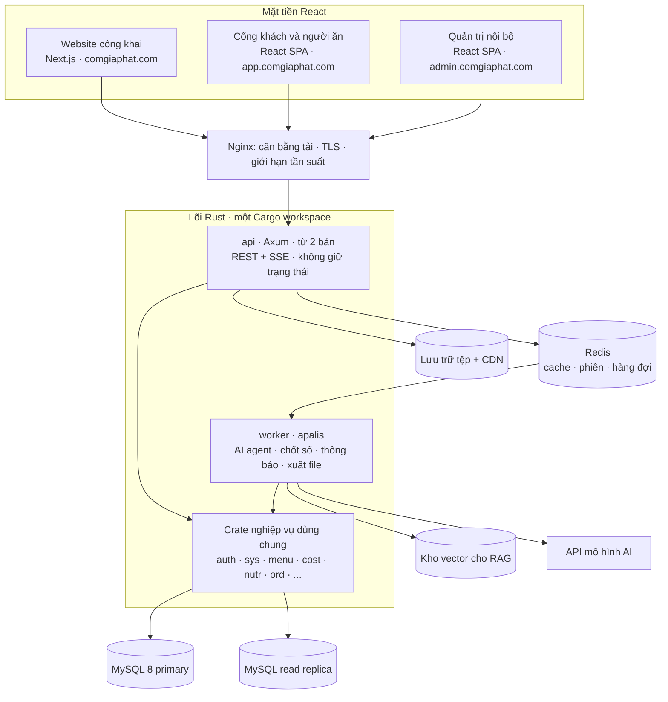

# Kiến trúc hệ thống: Nền tảng Gia Phát

Phiên bản 0.1.0 · 14/11/2026 · **Draft: ngôn ngữ backend đã chốt (D-22); tên thư viện và cấu trúc thư mục là [ĐỀ XUẤT]; chưa có mã nguồn.**

| Phiên bản | Ngày | Người thực hiện | Nội dung |
| :--- | :--- | :--- | :--- |
| 0.1.0 | 2026-11-14 | BA | Khởi tạo theo CR-CORE-2026-001: kiến trúc chạy, lựa chọn công nghệ, cấu trúc mã nguồn Rust và React |

Nguồn: [Kế hoạch tổng thể](../../gia-phat/00-ke-hoach-tong-the.md) mục 2 và 3 · [SRS nền tảng](spec.md) · [CR-CORE-2026-001](../cr/CR-CORE-2026-001.md). Tài liệu này mô tả **cách tổ chức**, không thêm hoặc đổi FR, BR, NFR, API hay bảng dữ liệu. Khi khác SRS, SRS là căn cứ.

Quy ước: **[D-xx]** đã chốt · **[ĐỀ XUẤT]** chờ duyệt · **[Q-xx] / [O-xx]** điểm mở, giữ nguyên trạng thái mở.

---

## 1. Tóm tắt

- Bốn mặt tiền React dùng chung một lõi backend viết bằng Rust [D-22].
- Lõi là **modular monolith**: một Cargo workspace, mỗi phân hệ nghiệp vụ một crate, biên dịch thành hai tiến trình là `api` và `worker`.
- Dữ liệu giữ nguyên: MySQL 8 (schema 65 bảng), Redis, lưu trữ tệp tương thích S3.
- AI agent chạy trong `worker`, không chạy trong luồng xử lý yêu cầu web. Chi tiết ở [Kiến trúc AI agent](agent-architecture.md).

## 2. Kiến trúc chạy



| Tầng | Thành phần | Trách nhiệm |
| :--- | :--- | :--- |
| Mặt tiền | 3 ứng dụng React | Hiển thị và thu thao tác; không chứa quy tắc nghiệp vụ. Bản quản trị build riêng để mã nội bộ không lộ ra cổng khách |
| Biên | Nginx | TLS, cân bằng tải giữa các bản `api`, giới hạn tần suất theo IP |
| Lõi | `api` | Xác thực, phân quyền, kiểm dữ liệu vào, gọi crate nghiệp vụ, trả JSON; đẩy việc chậm vào hàng đợi; phát luồng kết quả agent qua SSE |
| Lõi | `worker` | Chạy việc nền: lượt chạy AI agent, job chốt số tại hạn chốt, thông báo, tính nhu cầu nguyên liệu, xuất file |
| Lõi | Crate nghiệp vụ | Quy tắc và phép tính xác định (kiểm quy tắc thực đơn, cost, dinh dưỡng). `api` và `worker` dùng chung, nên một quy tắc chỉ viết một lần |
| Dữ liệu | MySQL 8 | Nguồn dữ liệu chính; ghi vào primary, trang đọc nhiều và báo cáo đọc từ replica |
| Dữ liệu | Redis | Cache thực đơn đã công bố, phiên, bộ đếm chọn món, hàng đợi của worker |
| Dữ liệu | Kho tệp, kho vector | Ảnh món, chứng từ; chỉ mục tài liệu cho RAG |

## 3. Lựa chọn công nghệ

| Lớp | Lựa chọn | Trạng thái | Lý do |
| :--- | :--- | :--- | :--- |
| Ngôn ngữ backend | Rust | [D-22] | Quyết định của chủ đầu tư ngày 14/11/2026 |
| Khung web | Axum + Tokio + Tower | [D-22] cho Axum | Middleware Tower dùng chung cho xác thực, phân quyền, nhật ký, giới hạn tần suất |
| Truy cập MySQL | SQLx + migration của SQLx | [ĐỀ XUẤT] | Kiểm câu lệnh SQL lúc biên dịch; không ẩn SQL sau ORM nên dễ soát truy vấn giờ chốt |
| Hàng đợi việc nền | apalis với `apalis-redis`, lịch định kỳ bằng `apalis-cron` | [ĐỀ XUẤT] | Dựng trên Tower, dùng Redis sẵn có. Tra ngày 14/11/2026: dòng 0.7 tách thành các crate riêng; lịch cron cần kiểm lại độ bền khi dựng khung mã |
| Hợp đồng API | utoipa sinh OpenAPI từ mã Rust | [ĐỀ XUẤT] | Sinh client TypeScript cho React, kiểu dữ liệu hai phía không lệch |
| Tiền | Số nguyên đồng (`i64`) | Theo SRS nền tảng mục 2.5 | Không dùng số thực |
| Tỷ lệ, khối lượng | `rust_decimal` | [ĐỀ XUẤT] | Đáp ứng NFR-COST-002: cost món lệch tối đa 1 đ, cost % ngày lệch tối đa 0,01 điểm phần trăm |
| Mật khẩu, phiên | Argon2; phiên lưu Redis | [ĐỀ XUẤT] | Chi tiết theo FR của AUTH trong SRS nền tảng |
| Quan sát | `tracing` + OpenTelemetry | [ĐỀ XUẤT] | Truy vết một yêu cầu qua `api`, hàng đợi và `worker` bằng cùng mã yêu cầu |
| Cổng khách, quản trị | React + TypeScript + Vite, TanStack Query | React [đã chốt]; còn lại [ĐỀ XUẤT] | Không cần SEO |
| Website công khai | Next.js (React) có SSR/ISR | [ĐỀ XUẤT] | Blog và trang dịch vụ cần SEO; cần một tiến trình Node nhỏ chỉ cho site này. Phương án không dùng Node: React + Vite dựng tĩnh, mỗi lần đăng bài phải build lại |
| Cơ sở dữ liệu | MySQL 8, 1 primary + 1 read replica | [đã chốt] | Schema 65 bảng đã kiểm xuất DDL cho MySQL |
| Kho vector | Qdrant | [ĐỀ XUẤT] | MySQL 8 không có tìm kiếm vector; xem tài liệu kiến trúc agent |
| Mô hình AI | Chưa chọn | [Q-09], [O-04] | Không tự chọn trong tài liệu này |

## 4. Cấu trúc mã nguồn [ĐỀ XUẤT]

```
gia-phat/
├─ backend/                      Cargo workspace
│  ├─ Cargo.toml
│  ├─ apps/
│  │  ├─ api/                    tiến trình Axum: router, middleware, SSE
│  │  └─ worker/                 tiến trình apalis: job nền, agent runtime
│  ├─ crates/
│  │  ├─ core/                   lỗi chung, cấu hình, kiểu tiền, thời gian, phân trang
│  │  ├─ db/                     kết nối SQLx, migration, giao dịch
│  │  ├─ auth/                   AUTH: đăng nhập, vai trò, phạm vi dữ liệu, tài khoản dịch vụ
│  │  ├─ sys/                    SYS: nhật ký, tham số, thông báo, tệp, tác vụ nền
│  │  ├─ menu/                   MENU: nguyên liệu, món, công thức, thực đơn, bộ kiểm quy tắc
│  │  ├─ cost/                   COST: giá nhập, cost món và suất, dự toán
│  │  ├─ nutr/                   NUTR: thành phần và tính dinh dưỡng
│  │  ├─ ord/                    ORD, PLAN: chọn món, chốt số, kế hoạch
│  │  ├─ dlv/  fin/              DLV, FIN: giao nhận, doanh thu, đối soát
│  │  ├─ crm/  pur/              CUS, SALE; PUR
│  │  ├─ fb/  rpt/  exp/         FB; RPT; EXP
│  │  ├─ publicweb/              PUB: nội dung website, lead
│  │  └─ ai/                     agent runtime, lớp công cụ, MCP, RAG, lời gọi mô hình
│  └─ migrations/
├─ frontend/                     pnpm workspace
│  ├─ apps/
│  │  ├─ web-public/             website công khai
│  │  ├─ portal/                 cổng khách hàng và người ăn
│  │  └─ admin/                  quản trị nội bộ
│  └─ packages/
│     ├─ ui/                     thành phần giao diện dùng chung
│     └─ api-client/             client TypeScript sinh từ OpenAPI
├─ infra/                        Nginx, Docker, cấu hình môi trường
└─ docs/                         bộ tài liệu BA hiện có
```

### 4.1 Ánh xạ epic sang crate

| Epic | Phân hệ | Crate |
| :--- | :--- | :--- |
| E1 `nen-tang` | AUTH, SYS | `auth`, `sys`, `core`, `db` |
| E2 `thuc-don-dinh-luong` | MENU | `menu` |
| E3 `cost` | COST | `cost` |
| E4 `dinh-duong` | NUTR | `nutr` |
| E5 `agent-noi-bo` | AIO | `ai` |
| E6 `chon-mon-order` | ORD, CUS (người ăn), PLAN | `ord` |
| E7 `giao-nhan-doanh-thu` | DLV, FIN | `dlv`, `fin` |
| E8 `website-cong-khai` | PUB | `publicweb` |
| E9 `agent-dinh-duong-vien` | AIN | `ai` |
| E10 `crm-ban-hang` | CUS, SALE | `crm` |
| E11 `mua-hang-san-xuat` | PUR, PLAN (phân ca, QC) | `pur` |
| E12 `phan-hoi-bao-cao` | FB, RPT | `fb`, `rpt` |
| E13 `chi-phi-loi-nhuan` | EXP | `exp` |

### 4.2 Quy tắc phụ thuộc giữa các crate

1. Crate nghiệp vụ chỉ gọi crate khác qua giao diện công khai (trait dịch vụ) của crate đó; không truy vấn bảng của crate khác. Đây là quy tắc đã có ở SRS nền tảng mục 2.2, nay được trình biên dịch Rust hỗ trợ kiểm vì mỗi crate tự quyết phần nào công khai.
2. Chiều phụ thuộc đi theo thứ tự epic: `cost` và `nutr` phụ thuộc `menu`; `ord` phụ thuộc `menu`; `ai` phụ thuộc `menu`, `cost`, `nutr`. Không có phụ thuộc vòng.
3. Điểm móc ngược chiều (ví dụ COST đăng ký bước kiểm vào cổng gửi duyệt của MENU, `FR-MENU-APV-006`) làm bằng trait do `menu` định nghĩa và `cost` hiện thực, lắp ráp ở `apps/api`.
4. Mỗi cổng nội bộ `PORT-...` trong các bản api-spec là một trait Rust; không mở thành HTTP.
5. `apps/api` và `apps/worker` chỉ lắp ráp, không chứa quy tắc nghiệp vụ.

## 5. Cách kiến trúc đáp ứng yêu cầu phi chức năng

| Yêu cầu | Cách đáp ứng |
| :--- | :--- |
| NFR-PERF-001: 1000 người dùng đồng thời, từ 300 thao tác ghi mỗi phút giờ chốt | `api` không giữ trạng thái, chạy nhiều bản; thực đơn ngày đọc từ Redis; mỗi lựa chọn là một lệnh ghi nhỏ có khoá duy nhất `(người ăn, ngày, ca)`; tổng theo món cập nhật bằng bộ đếm |
| NFR-PERF-002: p95 đọc ≤ 300 ms, ghi ≤ 800 ms | Trang đọc nhiều dùng replica và cache; việc chậm không chạy trong yêu cầu web |
| NFR-PERF-003: ký tự đầu của AI ≤ 5 s | Lượt chạy agent vào hàng đợi riêng, kết quả phát qua SSE; hàng đợi AI tách khỏi hàng đợi chốt số để AI quá tải không làm chậm chọn món |
| NFR-SEC-001: vai trò × cơ sở × công ty khách | Middleware Tower kiểm quyền ở `api`; crate nghiệp vụ nhận ngữ cảnh người dùng và lọc phạm vi dữ liệu trong truy vấn |
| NFR-AUD-001: truy vết mọi thay đổi và mọi lượt chạy AI | Ghi nhật ký trong cùng giao dịch với thay đổi; mỗi lượt agent ghi người hỏi, công cụ được gọi, kết quả, chi phí |
| NFR-COST-002: sai số cost | Tiền là số nguyên đồng; tỷ lệ dùng `rust_decimal`; không dùng số thực ở bất kỳ bước nào |
| Hạn chốt chỉ chạy một lần | Job chốt số có khoá duy nhất theo `(khách, điểm, ngày, ca)`; chạy lại không tạo kế hoạch thứ hai |

## 6. Điểm mở và rủi ro

| Mã | Nội dung | Ảnh hưởng |
| :--- | :--- | :--- |
| Q-15, O-04 | Đội phát triển, hạ tầng, nhà cung cấp mô hình AI chưa xác định | Chưa dựng khung mã; chưa chốt tên thư viện |
| Q-09 | Nhà cung cấp mô hình, ngân sách, dữ liệu có được ra khỏi Việt Nam | Quyết định nơi đặt kho vector và cách gọi mô hình |
| Q-12 | Máy chủ và người vận hành | Quyết định cách triển khai Nginx, MySQL, Redis |
| R-08 đến R-11 | Rủi ro nhân sự Rust và độ ổn định thư viện | Xem [CR-CORE-2026-001](../cr/CR-CORE-2026-001.md) mục 3 |

Tài liệu này không đóng câu hỏi nào ở trên.
