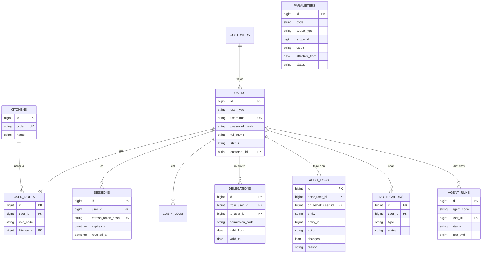
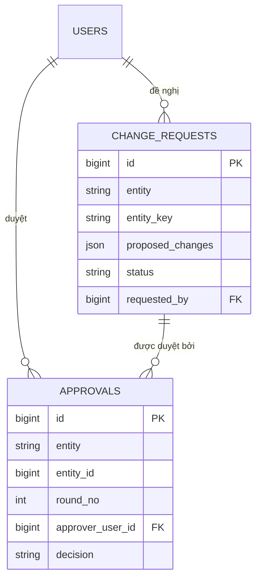
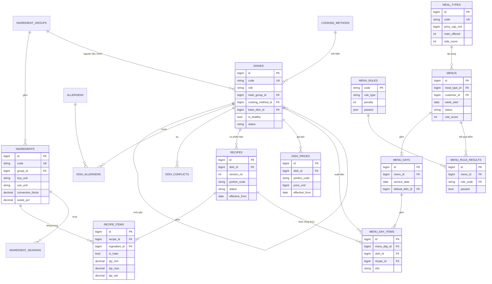
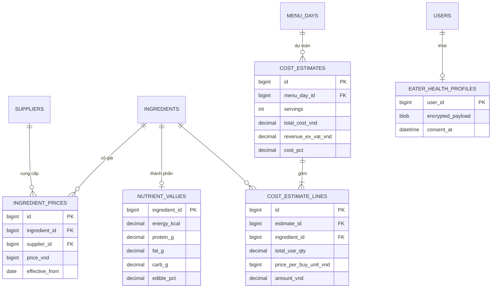
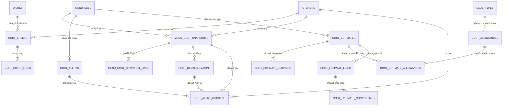
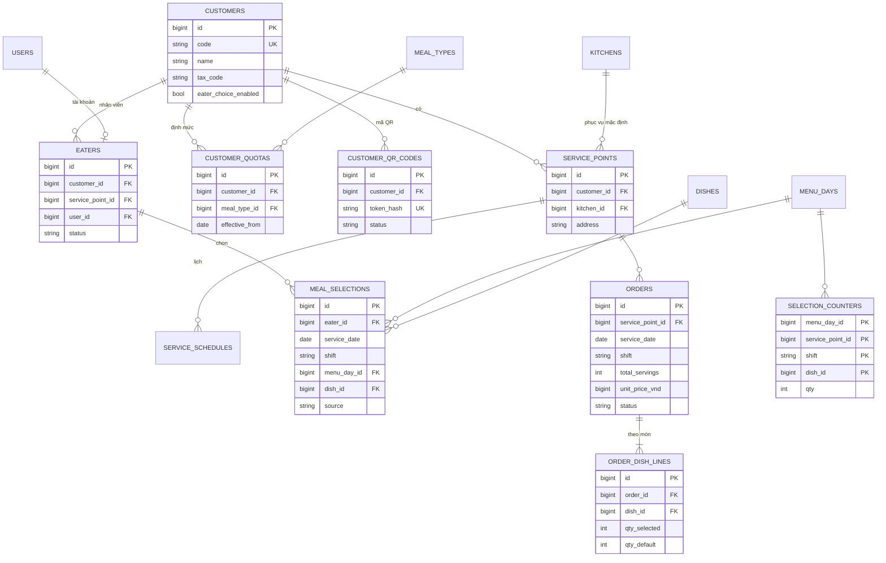
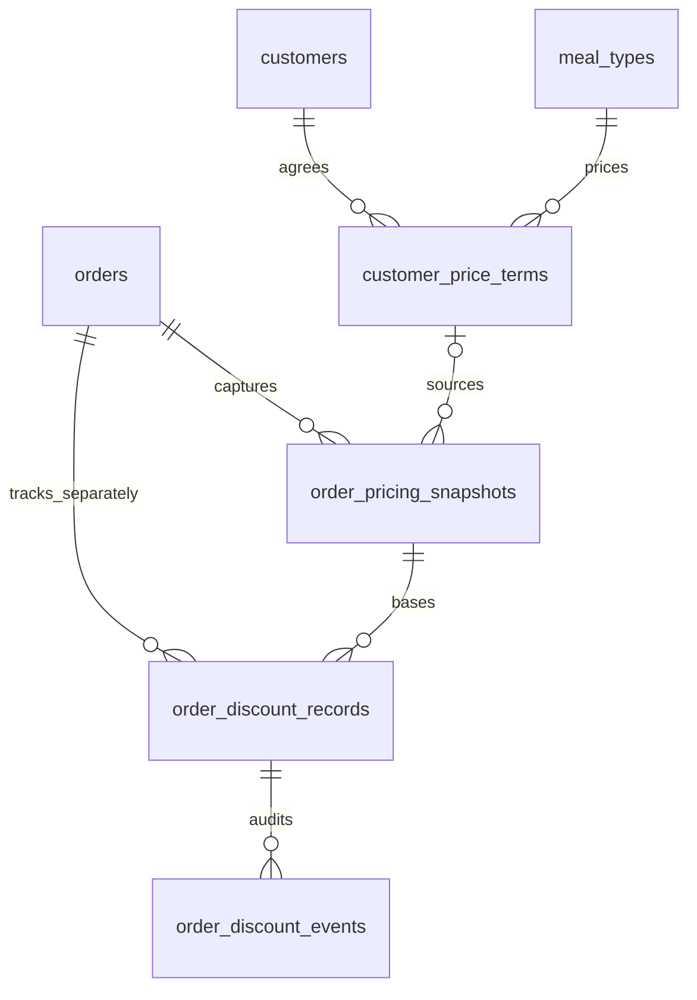

# Mô hình dữ liệu tổng (ERD) — Nền tảng Gia Phát

## Metadata

| Trường | Giá trị |
| :--- | :--- |
| Phạm vi | Toàn hệ thống. Từ điển dữ liệu chi tiết cho các bảng của đợt Now (R1 → R5) và bảng chịu tải cao của R6; các bảng còn lại mới ở mức khung, chi tiết viết ở ERD của epic tương ứng |
| Phiên bản | 0.5.0 |
| Trạng thái | Draft |
| Ngày | 2026-11-11 |
| Cơ sở dữ liệu | MySQL 8, InnoDB, `utf8mb4` |
| Tài liệu liên quan | [SRS nền tảng](spec.md) · [PRD](../../gia-phat/01-prd.md) · [Bảng quy tắc thực đơn](../../gia-phat/brainstorms/quy-tac-thuc-don.md) |

### Lịch sử sửa đổi

| Phiên bản | Ngày | Người thực hiện | Tóm tắt thay đổi |
| :--- | :--- | :--- | :--- |
| 0.5.0 | 2026-11-11 | BA | Bổ sung 4 bảng E4/E5 và 3 cột nguồn/version dinh dưỡng; tổng65 bảng; chưa migration. |
| 0.4.0 | 2026-11-11 | BA | Thêm4 bảng thiết kế kế toán và metadata giá mua; giữ thao tác phụ thuộc CK ở trạng thái gated; chưa migration. |
| 0.3.0 | 2026-11-11 | BA | Đồng bộ SRS Cost: 11 bảng mới; dự toán có phiên bản; thay cost đơn bằng bản chụp theo cơ sở; từ điển dữ liệu và ràng buộc triển khai. |
| 0.1.0 | 2026-11-10 | BA | Khởi tạo |
| 0.2.0 | 2026-11-10 | BA | Thêm 2 bảng dùng chung `change_requests`, `approvals` (mục 3.5) theo 3 điểm thiếu phát hiện ở SRS epic E2 mục 4.3 |

Quy ước: **[D-xx]** đã chốt · **[ĐỀ XUẤT]** chờ duyệt · **[O-xx] / [N-xx] / [H-x]** điểm mở, giữ nguyên trạng thái mở. Tên bảng, tên cột, kiểu và độ dài là [ĐỀ XUẤT] của bản thiết kế này.

---

## 1. Quy ước chung

| Hạng mục | Quy ước |
| :--- | :--- |
| Khoá chính | `id BIGINT UNSIGNED AUTO_INCREMENT` |
| Mã nghiệp vụ | Cột `code VARCHAR(32)` duy nhất, do hệ thống cấp, hiển thị cho người dùng |
| Tiền | Giá nhập/khoản khoán dùng `BIGINT` đồng; kết quả tính COST dùng `DECIMAL(24,8)` để lưu phần lẻ, chỉ làm tròn khi hiển thị. Xem mục 5.4. |
| Khối lượng, số lượng nguyên liệu | `DECIMAL(10,3)` kèm cột đơn vị |
| Tỷ lệ phần trăm | Tỷ lệ cấu hình dùng `DECIMAL(5,2)`. Riêng cost % dùng `DECIMAL(12,2)` vì có thể vượt 100%; không áp CHECK 0–100 cho cost %. |
| Thời điểm | `DATETIME(3)` lưu UTC. Ngày nghiệp vụ (ngày phục vụ, ngày hiệu lực) là `DATE` theo giờ Việt Nam |
| Liệt kê | `VARCHAR(24)` + ràng buộc `CHECK`, không dùng kiểu `ENUM` của MySQL để thêm giá trị không phải khoá bảng |
| Cột chuẩn | Mọi bảng nghiệp vụ có: `created_at`, `created_by`, `updated_at`, `updated_by`, `version INT` (khoá lạc quan), `cancelled_at`, `cancelled_reason`. Từ điển bên dưới **không lặp lại** các cột này |
| Xoá | Không xoá cứng; huỷ bằng `cancelled_at` (`FR-SYS-AUD-004`) |
| Phiên bản và hiệu lực | Bảng có giá trị đổi theo thời gian (công thức, giá bán, giá nhập, tham số) không sửa đè: thêm dòng mới với `effective_from` |

---

## 2. Bản đồ các miền dữ liệu

| Miền | Bảng | Đợt | Chi tiết ở |
| :--- | :--- | :---: | :--- |
| AUTH | `users`, `user_roles`, `kitchens`, `sessions`, `login_logs`, `delegations` | R1 | Mục 3 |
| SYS | `audit_logs`, `parameters`, `notifications`, `files`, `agent_runs`, `change_requests`, `approvals` | R1, R2, R5 | Mục 3 |
| MENU | `ingredient_groups`, `ingredients`, `ingredient_seasons`, `cooking_methods`, `allergens`, `dishes`, `dish_allergens`, `dish_conflicts`, `recipes`, `recipe_items`, `dish_prices`, `meal_types`, `menus`, `menu_days`, `menu_day_items`, `menu_rules`, `menu_rule_results` | R2 | Mục 4 |
| COST | Giá nhập, bảng tính đặc thù, khoản khoán, bản chụp theo cơ sở, dự toán có phiên bản, tính lại và cảnh báo (15 bảng) | R3 | Mục 5, chi tiết 5.4 |
| NUTR | `nutrient_values`, `eater_health_profiles` | R4, R6 | Mục 5 |
| CUS + ORD | `customers`, `service_points`, `service_schedules`, `customer_quotas`, `customer_qr_codes`, `eaters`, `meal_selections`, `selection_counters`, `orders`, `order_dish_lines` | R6 | Mục 6 |
| PLAN + DLV + FIN | `production_plans`, `production_plan_lines`, `deliveries`, `discrepancies`, `revenue_lines`, `adjustments`, `recon_periods`, `payments` | R6, R7 | Mục 7 (khung) |
| PUB + SALE + PUR + FB | `posts`, `leads`, `opportunities`, `contracts`, `price_annexes`, `purchase_orders`, `goods_receipts`, `stock_lots`, `feedbacks` | R8 → R12 | Mục 7 (khung) |

---

## 3. Miền AUTH và SYS

### 3.1 `users` — Tài khoản

| Tên trường | Tên cột | Kiểu | Độ dài | Null? | Khoá | Ràng buộc / Mặc định | Diễn giải nghiệp vụ |
| :--- | :--- | :--- | :--- | :--- | :--- | :--- | :--- |
| Mã tài khoản | Mã bản ghi | BIGINT UNSIGNED | — | Không | PK | AUTO_INCREMENT | — |
| Loại định danh | user_type | VARCHAR | 24 | Không | — | `STAFF`, `CUSTOMER`, `EATER`, `SERVICE` | 4 loại theo SRS mục 2.3 |
| Tên đăng nhập | username | VARCHAR | 64 | Không | Unique | Dạng tên: [N-01] | — |
| Mật khẩu đã băm | password_hash | VARCHAR | 255 | Có | — | Argon2id; null với `SERVICE` | `NFR-SEC-002` |
| Họ tên | full_name | VARCHAR | 120 | Không | — | — | — |
| Số điện thoại | Điện thoại | VARCHAR | 15 | Có | — | — | — |
| Email | email | VARCHAR | 255 | Có | — | — | — |
| Trạng thái | status | VARCHAR | 24 | Không | — | Mặc định `PENDING_PASSWORD`; `ACTIVE`, `TEMP_LOCKED`, `LOCKED` | Sơ đồ trạng thái ở SRS 4.1 |
| Số lần sai liên tiếp | failed_attempts | TINYINT UNSIGNED | — | Không | — | Mặc định 0 | `BR-SEC-002` |
| Khoá tạm đến | locked_until | DATETIME(3) | — | Có | — | — | `BR-SEC-002` |
| Hạn mật khẩu tạm | temp_password_expires_at | DATETIME(3) | — | Có | — | — | `BR-SEC-004` |
| Công ty khách | customer_id | BIGINT UNSIGNED | — | Có | FK → `customers.id` | Bắt buộc khi `user_type` là `CUSTOMER`, `EATER` | Phạm vi dữ liệu theo công ty |

### 3.2 `user_roles` — Vai trò và phạm vi

| Tên trường | Tên cột | Kiểu | Độ dài | Null? | Khoá | Ràng buộc / Mặc định | Diễn giải nghiệp vụ |
| :--- | :--- | :--- | :--- | :--- | :--- | :--- | :--- |
| Mã | Mã bản ghi | BIGINT UNSIGNED | — | Không | PK | — | — |
| Tài khoản | user_id | BIGINT UNSIGNED | — | Không | FK → `users.id` | — | — |
| Vai trò | role_code | VARCHAR | 24 | Không | — | `GIAM_DOC`, `DINH_DUONG_VIEN`, `QL_CO_SO`, `BEP_TRUONG`, `KT_MUA_HANG`, `KT_DOANH_THU`, `QUAN_TRI`, `NGUOI_DAT_TONG`, `NGUOI_NHAN`, `NGUOI_AN` | Danh sách vai trò cố định |
| Cơ sở | kitchen_id | BIGINT UNSIGNED | — | Có | FK → `kitchens.id` | Bắt buộc với `QL_CO_SO`, `BEP_TRUONG` | `BR-SEC-007` |
| — | — | — | — | — | Unique | (`user_id`, `role_code`, `kitchen_id`) | — |

### 3.3 `audit_logs` — Nhật ký thay đổi

| Tên trường | Tên cột | Kiểu | Độ dài | Null? | Khoá | Ràng buộc / Mặc định | Diễn giải nghiệp vụ |
| :--- | :--- | :--- | :--- | :--- | :--- | :--- | :--- |
| Mã | Mã bản ghi | BIGINT UNSIGNED | — | Không | PK | — | — |
| Thời điểm | occurred_at | DATETIME(3) | — | Không | — | Chỉ mục | — |
| Người thực hiện | actor_user_id | BIGINT UNSIGNED | — | Không | FK → `users.id` | — | Có thể là tài khoản dịch vụ |
| Thay mặt | on_behalf_user_id | BIGINT UNSIGNED | — | Có | FK → `users.id` | — | Người dùng đang dùng agent |
| Thực thể | entity | VARCHAR | 48 | Không | — | Chỉ mục cùng `entity_id` | Tên bảng nghiệp vụ |
| Mã bản ghi | entity_id | BIGINT UNSIGNED | — | Không | — | — | — |
| Hành động | action | VARCHAR | 24 | Không | — | `CREATE`, `UPDATE`, `CANCEL`, `APPROVE`, `REJECT`, `PUBLISH`, `LOCK`, `REOPEN` | — |
| Thay đổi | changes | JSON | — | Có | — | Mảng `{field, old, new}` | Giá trị cũ → mới |
| Lý do | reason | VARCHAR | 500 | Có | — | ≥ 10 ký tự với thao tác ở `BR-AUD-001` | — |
| Mã yêu cầu | request_id | CHAR | 36 | Không | — | — | Nối với log ứng dụng |

Bảng này không có các cột chuẩn `updated_*`, `cancelled_*`; tài khoản MySQL của ứng dụng chỉ có `INSERT`, `SELECT` (`BR-AUD-002`). Phân vùng theo tháng của `occurred_at`; thời gian lưu: [N-03].

### 3.4 `parameters` — Tham số

| Tên trường | Tên cột | Kiểu | Độ dài | Null? | Khoá | Ràng buộc / Mặc định | Diễn giải nghiệp vụ |
| :--- | :--- | :--- | :--- | :--- | :--- | :--- | :--- |
| Mã | Mã bản ghi | BIGINT UNSIGNED | — | Không | PK | — | — |
| Mã tham số | Mã nghiệp vụ | VARCHAR | 48 | Không | — | Danh mục ở SRS 4.3 | — |
| Loại phạm vi | scope_type | VARCHAR | 24 | Không | — | `GLOBAL`, `KITCHEN`, `CUSTOMER`, `SERVICE_POINT` | — |
| Mã phạm vi | scope_id | BIGINT UNSIGNED | — | Có | — | Null khi `GLOBAL` | — |
| Giá trị | value | VARCHAR | 255 | Không | — | Kiểm theo kiểu của tham số | — |
| Hiệu lực từ | effective_from | DATE | — | Không | — | ≥ ngày tạo (`BR-SYS-001`) | — |
| Trạng thái | status | VARCHAR | 24 | Không | — | `PENDING`, `APPROVED`, `REJECTED` | `FR-SYS-PRM-002` |
| Người duyệt | approved_by | BIGINT UNSIGNED | — | Có | FK → `users.id` | Khác `created_by` | `BR-SEC-008` |
| — | — | — | — | — | Unique | (`code`, `scope_type`, `scope_id`, `effective_from`) | — |

`sessions`, `login_logs`, `delegations`, `notifications`, `files`, `agent_runs`, `kitchens`: cấu trúc như sơ đồ; từ điển đầy đủ bổ sung khi thiết kế kỹ thuật R1.

### 3.5 `change_requests` và `approvals` — Đề nghị thay đổi và lượt duyệt (thêm ở v0.2.0)

Hai bảng dùng chung cho mọi phân hệ, không gắn khoá ngoại cứng tới bảng nghiệp vụ (tham chiếu bằng cặp `entity` + `entity_id`, giống `audit_logs`).

**`change_requests`** — giá trị đề nghị cho một bản ghi đang hiệu lực, chờ duyệt. Bản ghi gốc giữ nguyên giá trị cũ cho đến khi đề nghị được duyệt.

Dùng cho: sửa thuộc tính ảnh hưởng quy tắc của món `ACTIVE` (`FR-MENU-DISH-002`); sửa danh mục quy tắc (`FR-MENU-RUL-006`). Các epic sau dùng lại cho mọi trường hợp "sửa bản ghi đang hiệu lực cần duyệt".

| Tên trường | Tên cột | Kiểu | Độ dài | Null? | Khoá | Ràng buộc / Mặc định | Diễn giải nghiệp vụ |
| :--- | :--- | :--- | :--- | :--- | :--- | :--- | :--- |
| Mã | Mã bản ghi | BIGINT UNSIGNED | — | Không | PK | AUTO_INCREMENT | — |
| Thực thể | entity | VARCHAR | 48 | Không | — | Ví dụ `dishes`, `menu_rules` | Tên bảng nghiệp vụ |
| Khoá bản ghi | entity_key | VARCHAR | 32 | Không | — | — | `id` dạng chuỗi, hoặc `code` với bảng có khoá chính là mã (`menu_rules`) |
| Thay đổi đề nghị | proposed_changes | JSON | — | Không | — | Mảng `{field, old, new}` | `old` là giá trị lúc đề nghị, để phát hiện bản ghi gốc đã đổi |
| Lý do | reason | VARCHAR | 500 | Không | — | ≥ 10 ký tự | `BR-AUD-001` |
| Trạng thái | status | VARCHAR | 24 | Không | — | Mặc định `PENDING`; `APPROVED`, `REJECTED`, `WITHDRAWN`, `STALE` | `STALE` = bản ghi gốc đã đổi sau khi đề nghị, phải đề nghị lại |
| Người đề nghị | requested_by | BIGINT UNSIGNED | — | Không | FK → `users.id` | — | — |
| Thời điểm đề nghị | requested_at | DATETIME(3) | — | Không | — | — | — |
| Thời điểm áp dụng | applied_at | DATETIME(3) | — | Có | — | — | Lúc giá trị mới được ghi vào bản ghi gốc |
| — | — | — | — | — | Chỉ mục | (`entity`, `entity_key`, `status`) | Mỗi bản ghi có tối đa 1 đề nghị `PENDING` — kiểm ở tầng ứng dụng |

**`approvals`** — mỗi dòng là một quyết định của một người duyệt. Thay cho việc chỉ có một cột `approved_by`, để ghi được nhiều người duyệt (`BR-MNU-008`) và giữ lịch sử các lần trả lại.

| Tên trường | Tên cột | Kiểu | Độ dài | Null? | Khoá | Ràng buộc / Mặc định | Diễn giải nghiệp vụ |
| :--- | :--- | :--- | :--- | :--- | :--- | :--- | :--- |
| Mã | Mã bản ghi | BIGINT UNSIGNED | — | Không | PK | AUTO_INCREMENT | — |
| Thực thể | entity | VARCHAR | 48 | Không | — | Ví dụ `menus`, `recipes`, `dish_prices`, `change_requests` | — |
| Mã bản ghi | entity_id | BIGINT UNSIGNED | — | Không | — | — | — |
| Vòng duyệt | round_no | SMALLINT UNSIGNED | — | Không | — | Mặc định 1; tăng mỗi lần gửi duyệt lại | Phân biệt các lần gửi duyệt của cùng bản ghi |
| Người duyệt | approver_user_id | BIGINT UNSIGNED | — | Không | FK → `users.id` | Khác người tạo và người sửa cuối của bản ghi (`BR-SEC-008`) | — |
| Duyệt thay | delegation_id | BIGINT UNSIGNED | — | Có | FK → `delegations.id` | — | Có giá trị khi người duyệt dùng quyền được uỷ (`FR-AUTH-RBAC-003`) |
| Quyết định | decision | VARCHAR | 16 | Không | — | `APPROVED`, `REJECTED` | — |
| Lý do | reason | VARCHAR | 500 | Có | — | Bắt buộc khi `REJECTED` | — |
| Thời điểm | decided_at | DATETIME(3) | — | Không | — | — | — |
| — | — | — | — | — | Unique | (`entity`, `entity_id`, `round_no`, `approver_user_id`) | Một người chỉ duyệt một lần mỗi vòng |

Hai bảng này không có cột chuẩn `updated_*`, `cancelled_*`: dòng `approvals` không sửa sau khi ghi; `change_requests` chỉ đổi `status` và `applied_at`.

**Quan hệ với các cột `approved_by` đã có.** Các cột `approved_by`, `approved_at` trên `dishes`, `recipes`, `dish_prices`, `menus`, `parameters`, `customer_quotas` được giữ, mang nghĩa **người duyệt cuối cùng làm bản ghi có hiệu lực**, để truy vấn nhanh. Nguồn đầy đủ là `approvals`. Hai nơi được ghi trong cùng một giao dịch.

**Số người duyệt cần có** của một thực đơn: 1, hoặc 2 khi điểm quy tắc < `QUY_TAC_DIEM_TOI_THIEU`. Thực đơn chuyển `APPROVED` khi số dòng `APPROVED` của vòng hiện tại đạt số cần có; một dòng `REJECTED` đưa thực đơn về `DRAFT`.

---

## 4. Miền MENU

### 4.1 `ingredients` — Nguyên liệu

| Tên trường | Tên cột | Kiểu | Độ dài | Null? | Khoá | Ràng buộc / Mặc định | Diễn giải nghiệp vụ |
| :--- | :--- | :--- | :--- | :--- | :--- | :--- | :--- |
| Mã | Mã bản ghi | BIGINT UNSIGNED | — | Không | PK | — | — |
| Mã nguyên liệu | Mã nghiệp vụ | VARCHAR | 32 | Không | Unique | — | — |
| Tên | Tên | VARCHAR | 120 | Không | — | — | Ví dụ "Thịt lợn nạc vai" |
| Nhóm nguyên liệu | group_id | BIGINT UNSIGNED | — | Không | FK → `ingredient_groups.id` | — | Lợn, gà, bò, ếch, tôm, cá… Danh sách: [H-3] |
| Đơn vị mua | buy_unit | VARCHAR | 16 | Không | — | `kg`, `bìa`, `quả`, `lít`, `bó`… | Đơn vị trên chứng từ |
| Đơn vị dùng | use_unit | VARCHAR | 16 | Không | — | `g`, `bìa`, `quả`, `ml` | Đơn vị trong công thức |
| Hệ số quy đổi | conversion_factor | DECIMAL | 12,4 | Không | — | > 0 | Số đơn vị dùng trong 1 đơn vị mua (1 kg = 1000 g) |
| Tỷ lệ hao hụt | waste_pct | DECIMAL | 5,2 | Có | — | 0–99,99; bắt buộc nếu `has_bone_or_shell` | `BR-COST-010` |
| Có xương/vỏ | has_bone_or_shell | BOOLEAN | — | Không | — | Mặc định FALSE | — |
| Loại bảo quản | storage_type | VARCHAR | 24 | Không | — | `FRESH`, `FROZEN`, `DRY` | Quyết định ngưỡng giá cũ (`BR-COST-005`) |
| Nguồn cung ổn định | stable_supply | BOOLEAN | — | Không | — | Mặc định TRUE | `BR-MENU-044` |
| Tính vào cost | in_cost | BOOLEAN | — | Không | — | Mặc định TRUE | Cho phép loại khoản không tính cost; định nghĩa: [O-01] |

### 4.2 `dishes` — Món

| Tên trường | Tên cột | Kiểu | Độ dài | Null? | Khoá | Ràng buộc / Mặc định | Diễn giải nghiệp vụ |
| :--- | :--- | :--- | :--- | :--- | :--- | :--- | :--- |
| Mã | Mã bản ghi | BIGINT UNSIGNED | — | Không | PK | — | — |
| Mã món | Mã nghiệp vụ | VARCHAR | 32 | Không | Unique | — | — |
| Tên | Tên | VARCHAR | 160 | Không | — | — | — |
| Vai trò | role | VARCHAR | 24 | Không | — | `MAIN`, `SIDE`, `VEG`, `SOUP` | `BR-MENU-001`, `004`, `005` |
| Nhóm nguyên liệu chính | main_group_id | BIGINT UNSIGNED | — | Không | FK → `ingredient_groups.id` | — | `BR-MENU-010` → `015` |
| Phương pháp chế biến | cooking_method_id | BIGINT UNSIGNED | — | Không | FK → `cooking_methods.id` | Danh sách: [H-8] | `BR-MENU-020` → `023` |
| Món gốc | base_dish_id | BIGINT UNSIGNED | — | Có | FK → `dishes.id` | — | Hai món cùng món gốc tính là một khi đếm lặp (`BR-MENU-014`) |
| Healthy | is_healthy | BOOLEAN | — | Không | — | Mặc định FALSE; TRUE đòi hỏi phương pháp thuộc danh sách ít dầu mỡ [H-1] | `BR-MENU-002`, `003` |
| Vị chua | is_sour | BOOLEAN | — | Không | — | Mặc định FALSE | `BR-MENU-030` |
| Kết cấu | texture | VARCHAR | 24 | Không | — | `DRY`, `SAUCE`, `NEUTRAL` | `BR-MENU-031`, `032` |
| Thanh nhẹ | is_light | BOOLEAN | — | Không | — | Mặc định FALSE | `BR-MENU-033` |
| Cầu kỳ | is_complex | BOOLEAN | — | Không | — | Mặc định FALSE | `BR-MENU-040`, `041` |
| Chịu vận chuyển | transport_ok | BOOLEAN | — | Không | — | Mặc định TRUE | `BR-MENU-042` |
| Phù hợp bếp lớn | bulk_ok | BOOLEAN | — | Không | — | Mặc định TRUE | `BR-MENU-043` |
| Nhóm cost | cost_tier | VARCHAR | 24 | Không | — | `LOW`, `HIGH` | `BR-COST-006` |
| Đặc thù | is_special | BOOLEAN | — | Không | — | Mặc định FALSE | `BR-COST-007` |
| Ảnh | image_file_id | BIGINT UNSIGNED | — | Có | FK → `files.id` | — | — |
| Trạng thái | status | VARCHAR | 24 | Không | — | `DRAFT`, `PENDING`, `ACTIVE`, `INACTIVE` | Chỉ `ACTIVE` vào được thực đơn và được agent dùng |
| Người duyệt | approved_by | BIGINT UNSIGNED | — | Có | FK → `users.id` | Khác `created_by` | `BR-SEC-008` |

### 4.3 `recipes` và `recipe_items` — Công thức có phiên bản

| Tên trường | Tên cột | Kiểu | Độ dài | Null? | Khoá | Ràng buộc / Mặc định | Diễn giải nghiệp vụ |
| :--- | :--- | :--- | :--- | :--- | :--- | :--- | :--- |
| Mã | recipes.id | BIGINT UNSIGNED | — | Không | PK | — | — |
| Món | recipes.dish_id | BIGINT UNSIGNED | — | Không | FK → `dishes.id` | — | — |
| Cỡ định lượng | recipes.portion_code | VARCHAR | 16 | Không | — | Mặc định `STD` | Xem ghi chú [O-02] bên dưới |
| Số phiên bản | recipes.version_no | INT UNSIGNED | — | Không | — | Tăng dần theo (`dish_id`, `portion_code`) | — |
| Hiệu lực từ | recipes.effective_from | DATE | — | Không | — | — | Công thức dùng cho ngày D là phiên bản `ACTIVE` có `effective_from` ≤ D lớn nhất |
| Trạng thái | recipes.status | VARCHAR | 24 | Không | — | `DRAFT`, `PENDING`, `ACTIVE`, `SUPERSEDED` | — |
| Người duyệt | recipes.approved_by | BIGINT UNSIGNED | — | Có | FK → `users.id` | Khác `created_by` | `BR-SEC-008` |
| — | — | — | — | — | Unique | (`dish_id`, `portion_code`, `version_no`) | — |
| Mã dòng | recipe_items.id | BIGINT UNSIGNED | — | Không | PK | — | — |
| Công thức | recipe_items.recipe_id | BIGINT UNSIGNED | — | Không | FK → `recipes.id` | — | — |
| Nguyên liệu | recipe_items.ingredient_id | BIGINT UNSIGNED | — | Không | FK → `ingredients.id` | — | — |
| Là nguyên liệu chính | recipe_items.is_main | BOOLEAN | — | Không | — | — | `BR-COST-009` |
| Định lượng tối thiểu | recipe_items.qty_min | DECIMAL | 10,3 | Không | — | > 0 | Docx: "65–70g" → 65 |
| Định lượng tối đa | recipe_items.qty_max | DECIMAL | 10,3 | Không | — | ≥ `qty_min` | → 70 |
| Định lượng tính cost | recipe_items.qty_std | DECIMAL | 10,3 | Không | — | Trong [`qty_min`, `qty_max`] | Giá trị dùng để tính cost và dinh dưỡng |
| Đơn vị | recipe_items.unit | VARCHAR | 16 | Không | — | Bằng `ingredients.use_unit` | Định lượng **sống** theo docx |

**Ghi chú [O-02].** Cột `portion_code` giữ được cả hai phương án mà không phải đổi cấu trúc: nếu mỗi món chỉ có một định lượng thì mọi công thức dùng `STD`; nếu có nhiều cỡ thì mỗi cỡ là một `portion_code` với công thức và giá bán riêng. Quyết định O-02 chỉ ảnh hưởng giao diện và quy tắc chọn món.

Công thức đã `ACTIVE` không sửa; thay đổi tạo phiên bản mới, phiên bản cũ chuyển `SUPERSEDED`.

### 4.4 `dish_prices` — Giá bán món [D-18]

| Tên trường | Tên cột | Kiểu | Độ dài | Null? | Khoá | Ràng buộc / Mặc định | Diễn giải nghiệp vụ |
| :--- | :--- | :--- | :--- | :--- | :--- | :--- | :--- |
| Mã | Mã bản ghi | BIGINT UNSIGNED | — | Không | PK | — | — |
| Món | dish_id | BIGINT UNSIGNED | — | Không | FK → `dishes.id` | — | — |
| Cỡ định lượng | portion_code | VARCHAR | 16 | Không | — | Mặc định `STD` | Khớp `recipes.portion_code` |
| Giá bán | price_vnd | BIGINT | — | Không | — | ≥ 0; đã gồm VAT [D-15] | Hiển thị cho khách |
| Hiệu lực từ | effective_from | DATE | — | Không | — | — | Giá đã hiệu lực không sửa |
| Trạng thái | status | VARCHAR | 24 | Không | — | `PENDING`, `APPROVED` | — |
| Người duyệt | approved_by | BIGINT UNSIGNED | — | Có | FK → `users.id` | Khác `created_by` | — |
| — | — | — | — | — | Unique | (`dish_id`, `portion_code`, `effective_from`) | — |

### 4.5 `meal_types` — Loại suất [D-20]

| Tên trường | Tên cột | Kiểu | Độ dài | Null? | Khoá | Ràng buộc / Mặc định | Diễn giải nghiệp vụ |
| :--- | :--- | :--- | :--- | :--- | :--- | :--- | :--- |
| Mã | Mã bản ghi | BIGINT UNSIGNED | — | Không | PK | — | — |
| Mã loại suất | Mã nghiệp vụ | VARCHAR | 32 | Không | Unique | — | — |
| Tên | Tên | VARCHAR | 120 | Không | — | — | Ví dụ "Suất 40k" |
| Ngưỡng giá | price_cap_vnd | BIGINT | — | Không | — | > 0; đã gồm VAT | Tổng giá bán các món của một suất không vượt mức này (`BR-COST-012`) |
| Số món chính đưa ra | main_offered | TINYINT UNSIGNED | — | Không | — | Mặc định 3 | `BR-MENU-001` |
| Số món chính được chọn | main_pick | TINYINT UNSIGNED | — | Không | — | Mặc định 1 [D-04] | — |
| Số món phụ | side_count | TINYINT UNSIGNED | — | Không | — | ≥ 0 | `BR-MENU-005` |
| Có rau | has_veg | BOOLEAN | — | Không | — | Mặc định TRUE | `BR-MENU-004` |
| Có canh | has_soup | BOOLEAN | — | Không | — | Mặc định TRUE | `BR-MENU-004` |
| Công khai | is_public | BOOLEAN | — | Không | — | Mặc định FALSE | Hiện trên website [D-10] |
| Trạng thái | status | VARCHAR | 24 | Không | — | `DRAFT`, `ACTIVE`, `INACTIVE` | — |

### 4.6 `menus`, `menu_days`, `menu_day_items` — Thực đơn kỳ

| Tên trường | Tên cột | Kiểu | Độ dài | Null? | Khoá | Ràng buộc / Mặc định | Diễn giải nghiệp vụ |
| :--- | :--- | :--- | :--- | :--- | :--- | :--- | :--- |
| Mã | menus.id | BIGINT UNSIGNED | — | Không | PK | — | — |
| Loại suất | menus.meal_type_id | BIGINT UNSIGNED | — | Không | FK → `meal_types.id` | — | — |
| Công ty khách | menus.customer_id | BIGINT UNSIGNED | — | Có | FK → `customers.id` | Null = thực đơn chung của loại suất | — |
| Tuần bắt đầu | menus.week_start | DATE | — | Không | — | Là thứ Hai | — |
| Trạng thái | menus.status | VARCHAR | 24 | Không | — | `DRAFT`, `CHECKED`, `PENDING`, `APPROVED`, `PUBLISHED`, `WITHDRAWN` | `FEAT-013` |
| Điểm quy tắc | menus.rule_score | SMALLINT | — | Có | — | 0–100 | 100 trừ điểm phạt quy tắc mềm |
| Nguồn tạo | menus.source | VARCHAR | 24 | Không | — | `MANUAL`, `AGENT_INTERNAL`, `AGENT_CUSTOMER` | — |
| Lượt chạy agent | menus.agent_run_id | BIGINT UNSIGNED | — | Có | FK → `agent_runs.id` | — | Truy vết thực đơn do AI tạo |
| Người duyệt | menus.approved_by | BIGINT UNSIGNED | — | Có | FK → `users.id` | Khác `created_by` | BN-17 |
| — | — | — | — | — | Unique | (`meal_type_id`, `customer_id`, `week_start`) với bản không huỷ | — |
| Mã ngày | menu_days.id | BIGINT UNSIGNED | — | Không | PK | — | — |
| Thực đơn | menu_days.menu_id | BIGINT UNSIGNED | — | Không | FK → `menus.id` | — | — |
| Ngày phục vụ | menu_days.service_date | DATE | — | Không | — | Unique cùng `menu_id` | — |
| Món mặc định | menu_days.default_dish_id | BIGINT UNSIGNED | — | Có | FK → `dishes.id` | Phải là một món `MAIN` của ngày; bắt buộc trước khi công bố | [D-14] |
| Cost theo cơ sở | `menu_cost_snapshots` | Quan hệ | — | — | FK → `menu_days.id` | Một bản/ngày/cơ sở/vòng duyệt | Thay `menu_days.cost_pct` từ v0.3.0; không còn số cost duy nhất cho cả ngày |
| Mã dòng | menu_day_items.id | BIGINT UNSIGNED | — | Không | PK | — | — |
| Ngày | menu_day_items.menu_day_id | BIGINT UNSIGNED | — | Không | FK → `menu_days.id` | — | — |
| Món | menu_day_items.dish_id | BIGINT UNSIGNED | — | Không | FK → `dishes.id` | `status` = `ACTIVE` | — |
| Công thức | menu_day_items.recipe_id | BIGINT UNSIGNED | — | Không | FK → `recipes.id` | Phiên bản hiệu lực tại ngày phục vụ | Chụp lại để cost không đổi khi công thức đổi sau |
| Vị trí | menu_day_items.slot | VARCHAR | 24 | Không | — | `MAIN`, `SIDE`, `VEG`, `SOUP`; khớp `dishes.role` | — |
| Thứ tự | menu_day_items.sort_order | TINYINT UNSIGNED | — | Không | — | — | — |

### 4.7 `menu_rules` và `menu_rule_results` — Bộ kiểm quy tắc

| Tên trường | Tên cột | Kiểu | Độ dài | Null? | Khoá | Ràng buộc / Mặc định | Diễn giải nghiệp vụ |
| :--- | :--- | :--- | :--- | :--- | :--- | :--- | :--- |
| Mã quy tắc | menu_rules.code | VARCHAR | 16 | Không | PK | `BR-MENU-xxx`, `BR-COST-xxx` | Khớp bảng quy tắc |
| Loại | menu_rules.rule_type | VARCHAR | 24 | Không | — | `HARD`, `SOFT` | Cứng chặn, mềm trừ điểm |
| Điểm phạt | menu_rules.penalty | TINYINT UNSIGNED | — | Không | — | 0 với `HARD`; 1, 2, 3 với `SOFT` | Nhẹ / vừa / nặng |
| Tham số | menu_rules.params | JSON | — | Có | — | Ví dụ `{"max_consecutive_days": 2}` | Con số được duyệt ở DL-01; đổi không cần sửa mã |
| Đang áp dụng | menu_rules.is_active | BOOLEAN | — | Không | — | Mặc định TRUE | Quy tắc bị đánh dấu "bỏ" khi duyệt |
| Mã kết quả | menu_rule_results.id | BIGINT UNSIGNED | — | Không | PK | — | — |
| Thực đơn | menu_rule_results.menu_id | BIGINT UNSIGNED | — | Không | FK → `menus.id` | — | — |
| Ngày | menu_rule_results.menu_day_id | BIGINT UNSIGNED | — | Có | FK → `menu_days.id` | Null với quy tắc cấp tuần | — |
| Quy tắc | menu_rule_results.rule_code | VARCHAR | 16 | Không | FK → `menu_rules.code` | — | — |
| Đạt | menu_rule_results.passed | BOOLEAN | — | Không | — | — | — |
| Chi tiết | menu_rule_results.detail | VARCHAR | 500 | Có | — | — | Ví dụ "Thịt lợn xuất hiện 3 ngày liền: T2, T3, T4" |
| Lý do chấp nhận | menu_rule_results.waiver_reason | VARCHAR | 500 | Có | — | Bắt buộc với quy tắc mềm–nặng không đạt | — |

Kết quả kiểm được tính lại và ghi đè mỗi lần thực đơn thay đổi khi còn ở trạng thái `DRAFT`; đóng băng từ `APPROVED`.

---

## 5. Miền COST và NUTR

### 5.1 `ingredient_prices` — Giá nhập [D-13]

| Tên trường | Tên cột | Kiểu | Độ dài | Null? | Khoá | Ràng buộc / Mặc định | Diễn giải nghiệp vụ |
| :--- | :--- | :--- | :--- | :--- | :--- | :--- | :--- |
| Mã | Mã bản ghi | BIGINT UNSIGNED | — | Không | PK | — | — |
| Nguyên liệu | ingredient_id | BIGINT UNSIGNED | — | Không | FK → `ingredients.id` | — | — |
| Nhà cung cấp | supplier_id | BIGINT UNSIGNED | — | Không | FK → `suppliers.id` | — | — |
| Cơ sở | kitchen_id | BIGINT UNSIGNED | — | Có | FK → `kitchens.id` | Null = áp dụng cả 2 cơ sở | Hai cơ sở có thể mua giá khác nhau |
| Giá nhập | price_vnd | BIGINT | — | Không | — | > 0; trên 1 `buy_unit` | Có gồm VAT đầu vào hay không: [O-01] |
| Hiệu lực từ | effective_from | DATE | — | Không | — | — | `BR-COST-004` |
| Là giá dùng tính cost | is_reference | BOOLEAN | — | Không | — | Mỗi (`ingredient_id`, `kitchen_id`, `effective_from`) có đúng 1 dòng TRUE | Khi một nguyên liệu có nhiều nhà cung cấp |
| Chứng từ | source_file_id | BIGINT UNSIGNED | — | Có | FK → `files.id` | — | Ảnh chứng từ |

Tất cả bảng thuộc `TableGroup cost` đều bị chặn SELECT với Agent Dinh dưỡng viên (`BR-SEC-010`, `NFR-COST-006`), gồm cả bản chụp và cảnh báo; xem mục 5.4.

### 5.2 `nutrient_values` — Thành phần dinh dưỡng [D-17]

| Tên trường | Tên cột | Kiểu | Độ dài | Null? | Khoá | Ràng buộc / Mặc định | Diễn giải nghiệp vụ |
| :--- | :--- | :--- | :--- | :--- | :--- | :--- | :--- |
| Nguyên liệu | ingredient_id | BIGINT UNSIGNED | — | Không | PK, FK → `ingredients.id` | — | Quan hệ 1–1 |
| Năng lượng | energy_kcal | DECIMAL | 7,2 | Không | — | ≥ 0; trên 100 g phần ăn được | — |
| Đạm | protein_g | DECIMAL | 6,2 | Không | — | ≥ 0; trên 100 g | — |
| Béo | fat_g | DECIMAL | 6,2 | Không | — | ≥ 0; trên 100 g | — |
| Bột đường | carb_g | DECIMAL | 6,2 | Không | — | ≥ 0; trên 100 g | — |
| Tỷ lệ ăn được | edible_pct | DECIMAL | 5,2 | Không | — | 0–100; mặc định 100 | Phần còn lại sau khi bỏ xương, vỏ |
| Khối lượng 1 đơn vị | grams_per_unit | DECIMAL | 8,2 | Có | — | Bắt buộc khi `use_unit` không phải `g` | 1 bìa đậu, 1 quả trứng nặng bao nhiêu gram |
| Nguồn | source | VARCHAR | 120 | Không | — | Mặc định "Bảng thành phần thực phẩm Việt Nam" | — |

### 5.3 Công thức tính

Nguồn duy nhất cho công thức cost là [SRS Cost mục 3.3](../../cost/srs/spec.md): cost món (3.3.1), cost suất và làm tròn so ngưỡng (3.3.2), bộ kiểm (3.3.3), dự toán theo số suất từng món (3.3.4). Không áp lại hao hụt ở bước lượng mua. Các mặc định `DAT_NHAT`, `KHONG`, `CANH_BAO` là đề xuất, không phải quyết định đã duyệt. VAT chưa được đặt thì không tính cost %.

Dinh dưỡng giữ công thức khung: `qty_std` quy về gram × `edible_pct/100` × chỉ số trên 100 g ÷ 100; cộng các dòng cho món. Chi tiết hiện hành tại [SRS Dinh dưỡng](../../dinh-duong/srs/spec.md); NUTR-Q02/Q04 còn chờ xác nhận. Không dùng `COST_AP_HAO_HUT` để tự thay đổi cách tính dinh dưỡng.

### 5.4 Bổ sung mô hình COST v0.3.0

**Thiết kế đề xuất, chưa phải migration đã chạy.** Dùng chung [schema DBML](schema.dbml). Phần dưới thay thế các mô tả cost cũ nếu có khác biệt; các điểm mở O-01, E3-Q1 → Q13, E2-Q1, DL-01 vẫn mở.

#### Ràng buộc và tính nhất quán

1. Bỏ `menu_days.cost_pct`; tra bản chụp theo ngày, cơ sở và vòng duyệt. Duyệt lại tạo vòng mới. Chỉ khi người duyệt cuối hoàn tất mới ghi bản chụp cùng giao dịch với `menus.APPROVED`. Với mỗi cơ sở cần kiểm phải có bản chụp; thiếu giá/VAT thì chưa đủ điều kiện duyệt, không thay bằng cost 0.
2. Các bảng snapshot, sheet lines, recalculation và dự toán là bất biến sau khi lưu. Chỉ trạng thái duyệt bảng tính, trạng thái khoản khoán và vòng đời cảnh báo được cập nhật, có audit. Bản trả lại được lập mới. Không cascade delete dữ liệu đã chụp.
3. Giá và khoản khoán cùng phạm vi phải được xử lý bằng giao dịch. MySQL unique có cột NULL **không** chặn trùng giá chung: migration phải dùng khoá scope sinh `COALESCE(kitchen_id,0)` cho giá và `COALESCE(meal_type_id,0)` cho khoản khoán (ID hợp lệ > 0). Với giá, unique `(ingredient_id,supplier_id,scope,effective_from)`; thêm khoá tham chiếu có điều kiện cho dòng chưa huỷ, `is_reference=true`. Khoá hàng nguyên liệu trước đổi tham chiếu; bảo đảm đúng một dòng tham chiếu khi nhóm còn giá. Không thay số tiền/ngày của giá đã hiệu lực. SRS chưa rõ có được đổi cờ tham chiếu của giá đã hiệu lực hay không: ghi nhận tại mục 4.5 SRS Cost; không tự cấp quyền này.
4. Khoản khoán: unique có điều kiện `(tên chuẩn hoá,scope,effective_from)` cho dòng APPROVED. Chọn bản APPROVED có ngày hiệu lực lớn nhất ≤ ngày tính cho mỗi tên/phạm vi; khoản riêng loại suất thắng khoản chung cùng tên. Giá trị, tên, phạm vi và ngày của bản APPROVED không sửa đè.
5. `cost_alerts` có đúng tối đa một OPEN cho mỗi `menu_day_id` (thực đơn đã suy ra qua FK). Migration dùng unique trên generated key `CASE WHEN status='OPEN' THEN menu_day_id ELSE NULL END`. Một đầu mục chứa các cơ sở tại `cost_alert_kitchens`; không tạo hai cảnh báo cùng ngày khi cả hai cơ sở vượt. Đóng do giá phục hồi chỉ khi mọi cơ sở liên quan tính được và đạt; kết quả không xác định không được coi là đã phục hồi. Chi tiết phải trỏ đến snapshot/recalculation cùng ngày và cùng cơ sở. Giữ lịch sử tính lại; worker xử lý có thứ tự theo ngày để kết quả cũ không ghi đè liên kết mới.
6. Khi giá đổi, tạo `cost_recalculations` theo sự kiện, unique `(snapshot_id,event_key)` chống retry trùng. Chỉ tính các ngày từ hôm nay thuộc thực đơn APPROVED/PUBLISHED theo FR-COST-ALR-001; dùng vòng duyệt hiện hành. Chi tiết nguyên liệu/giá gây thay đổi lưu trong JSON. Phân quyền chặn đọc toàn bộ TableGroup cost với agent phía khách; thông báo và bảng kiểm cũng phải lọc trường nhạy cảm ở API.
7. Dự toán có `version_no` tăng trong phạm vi (ngày,cơ sở); cấp số dưới khoá giao dịch. `batch_key` gắn các bản của một lần lập tuần; gộp tuần đúng batch/cơ sở, giữ phân rã ngày và giá từng ngày, không lấy một giá tuỳ ý nhân cả tuần. Một dòng nguyên liệu/ngày chứa nhiều component theo món; cộng lượng trước khi làm tròn mua. Khoản khoán lưu riêng. Tổng lượt chọn món chính / `main_pick` phải là số nguyên > 0; kiểm trước ghi. Đây là ràng buộc kỹ thuật theo BR-EST-001, cần xác nhận nếu mở loại suất chọn nhiều món.
8. Giá nhập và khoản khoán là số nguyên đồng. Phép chia như giá/1000 không được ép BIGINT. Kết quả lưu DECIMAL(24,8), cost % DECIMAL(12,2). Tính trung gian bằng decimal/rational đủ chính xác, không làm tròn mỗi bước; chỉ lượng mua làm tròn lên 2 số và cost % nửa lên 2 số theo SRS. Kiểm tràn số, không cắt âm thầm. DECIMAL lưu 8 số là lựa chọn lưu trữ đề xuất, không phải thay đổi BR-CALC-006.
9. CHECK trong migration: giá > 0; khoản khoán, chi phí, số suất và cost % >= 0; main_pick và conversion_factor > 0; 0 <= waste_pct < 100; trạng thái thuộc tập nêu ở DBML. FK phải khớp dữ liệu cha (món/công thức/nguyên liệu, ngày/cơ sở). Với dòng `in_cost=true`, bắt buộc đủ giá/NCC/ngày giá; `false` cho phép giá null, cost dòng = 0 nhưng vẫn giữ lượng nguyên liệu trong dự toán. Các CHECK, generated key và điều kiện liên bảng này chưa được thực thi chỉ bằng import DBML.

#### Hợp đồng JSON bản chụp

`inputs_snapshot` là object có `schema_version=1`, lưu **giá trị** cùng ID nguồn, không chỉ liên kết tới dữ liệu sống:

- `parameters`: `{code, value, parameter_id, effective_from}` cho cách tính món chính, hao hụt, chế độ kiểm, VAT, ngưỡng, tuổi hiệu lực bảng tính; VAT phải có giá trị khi ghi snapshot/dự toán.
- `meal_type`: `{id, name, price_cap_vnd, main_pick}`; `service_date`; `menu_version`; `default_dish_id`.
- `dishes`: `{dish_id, name, role, recipe_id, portion_code, cost_vnd, special_sheet_id}`. Chụp cả món chính được và không được chọn trong phép lấy lớn nhất/bình quân.
- `allowances`: `{allowance_id, name, meal_type_id, effective_from, amount_vnd}` đã giải quyết ưu tiên phạm vi, không tính trùng.
- `calculation`: `{formula_version, main_cost_method, main_cost_vnd, other_dishes_cost_vnd, allowance_cost_vnd, revenue_ex_vat_vnd, threshold_pct}`. Bảng tính món chỉ cần parameters liên quan và món/công thức của nó; không bắt buộc meal_type/VAT.
- Riêng tính lại: thêm `lines` chứa toàn bộ trường dữ liệu giá/định lượng tương đương `menu_cost_snapshot_lines`, và `trigger_prices` là danh sách ID giá gây tác vụ. Bảng tính, snapshot và dự toán khác dùng các bảng con để lưu dòng chi tiết.

Số decimal trong JSON mã hoá bằng chuỗi thập phân, không dùng float của JSON client. Mỗi payload kiểm schema trước lưu. Tên bảng/cột và hợp đồng này là đề xuất thiết kế; danh sách khoản khoán thực tế và giá trị VAT vẫn chờ O-01.

#### Sơ đồ bổ sung

#### Từ điển dữ liệu COST

Các bảng dưới liệt kê toàn bộ trường mới và trường dự toán thay đổi; DBML là bản import. `id` tự tăng. Trường không có default không được tự suy ra giá trị 0. FK tới users của người tạo/người tính là bắt buộc nếu ghi bởi người dùng; worker dùng tài khoản dịch vụ có định danh. Các bảng chụp không có bộ cột sửa/xoá thông thường — đây là ngoại lệ có chủ đích của mục 1.

##### `suppliers`

| Tên trường | Tên cột | Kiểu | Độ dài | Null? | Khoá | Ràng buộc / mặc định | Diễn giải nghiệp vụ |
| :--- | :--- | :--- | :--- | :--- | :--- | :--- | :--- |
| Mã bản ghi | `id` | BIGINT | — | Không | PK | Theo mục 5.4 | Mã bản ghi |
| Mã nghiệp vụ | `code` | VARCHAR | 32 | Không | Unique | Theo mục 5.4 | Mã nghiệp vụ |
| Tên | `name` | VARCHAR | 160 | Không | — | Theo mục 5.4 | Tên |
| Điện thoại | `phone` | VARCHAR | 15 | Có | — | Theo mục 5.4 | Điện thoại |
| REGULAR / MARKET_VENDOR | `supplier_type` | VARCHAR | 24 | Không | — | Theo mục 5.4 | REGULAR / MARKET_VENDOR |
| ACTIVE / INACTIVE | `status` | VARCHAR | 24 | Không | — | Mặc định 'ACTIVE' | ACTIVE / INACTIVE |
| Ghi chú nhà cung cấp | `note` | VARCHAR | 1000 | Có | — | Theo mục 5.4 | Ghi chú nhà cung cấp |
| Thời điểm tạo | `created_at` | DATETIME | 3 | Không | — | Theo mục 5.4 | Thời điểm tạo |
| Người tạo | `created_by` | BIGINT | — | Có | — | Theo mục 5.4 | Người tạo |
| Thời điểm sửa | `updated_at` | DATETIME | 3 | Không | — | Theo mục 5.4 | Thời điểm sửa |
| Người sửa | `updated_by` | BIGINT | — | Có | — | Theo mục 5.4 | Người sửa |
| Phiên bản khoá lạc quan | `version` | INT | — | Không | — | Mặc định 1 | Phiên bản khoá lạc quan |
| Thời điểm huỷ | `cancelled_at` | DATETIME | 3 | Có | — | Theo mục 5.4 | Thời điểm huỷ |
| Lý do huỷ | `cancelled_reason` | VARCHAR | 500 | Có | — | Theo mục 5.4 | Lý do huỷ |

##### `ingredient_prices`

| Tên trường | Tên cột | Kiểu | Độ dài | Null? | Khoá | Ràng buộc / mặc định | Diễn giải nghiệp vụ |
| :--- | :--- | :--- | :--- | :--- | :--- | :--- | :--- |
| Mã bản ghi | `id` | BIGINT | — | Không | PK | Theo mục 5.4 | Mã bản ghi |
| Nguyên liệu | `ingredient_id` | BIGINT | — | Không | FK → ingredients.id | Theo mục 5.4 | Nguyên liệu |
| Nhà cung cấp | `supplier_id` | BIGINT | — | Không | FK → suppliers.id | Theo mục 5.4 | Nhà cung cấp |
| Null = áp dụng cả 2 cơ sở | `kitchen_id` | BIGINT | — | Có | FK → kitchens.id | Theo mục 5.4 | Null = áp dụng cả 2 cơ sở |
| Trên 1 buy_unit. Có gồm VAT đầu vào không: điểm mở O-01 | `price_vnd` | BIGINT | — | Không | — | Theo mục 5.4 | Trên 1 buy_unit. Có gồm VAT đầu vào không: điểm mở O-01 |
| BR-COST-004 | `effective_from` | DATE | — | Không | — | Theo mục 5.4 | BR-COST-004 |
| Đặt bằng giao dịch theo BR-PRC-005 | `is_reference` | BOOLEAN | — | Không | — | Mặc định false | Đặt bằng giao dịch theo BR-PRC-005; dòng đầu tiên tự được chọn |
| source file id | `source_file_id` | BIGINT | — | Có | FK → files.id | Theo mục 5.4 | source file id |
| Thời điểm tạo | `created_at` | DATETIME | 3 | Không | — | Theo mục 5.4 | Thời điểm tạo |
| Người tạo | `created_by` | BIGINT | — | Có | — | Theo mục 5.4 | Người tạo |
| Thời điểm sửa | `updated_at` | DATETIME | 3 | Không | — | Theo mục 5.4 | Thời điểm sửa |
| Người sửa | `updated_by` | BIGINT | — | Có | — | Theo mục 5.4 | Người sửa |
| Phiên bản khoá lạc quan | `version` | INT | — | Không | — | Mặc định 1 | Phiên bản khoá lạc quan |
| Thời điểm huỷ | `cancelled_at` | DATETIME | 3 | Có | — | Theo mục 5.4 | Thời điểm huỷ |
| Lý do huỷ | `cancelled_reason` | VARCHAR | 500 | Có | — | Theo mục 5.4 | Lý do huỷ |

##### `cost_estimates`

| Tên trường | Tên cột | Kiểu | Độ dài | Null? | Khoá | Ràng buộc / mặc định | Diễn giải nghiệp vụ |
| :--- | :--- | :--- | :--- | :--- | :--- | :--- | :--- |
| Mã bản ghi | `id` | BIGINT | — | Không | PK | Theo mục 5.4 | Mã bản ghi |
| Ngày thực đơn | `menu_day_id` | BIGINT | — | Không | FK → menu_days.id | Theo mục 5.4 | Ngày thực đơn |
| Cơ sở | `kitchen_id` | BIGINT | — | Không | FK → kitchens.id | Theo mục 5.4 | Cơ sở |
| Tăng theo ngày thực đơn và cơ sở, không ghi đè bản cũ | `version_no` | INT | — | Không | — | Theo mục 5.4 | Tăng theo ngày thực đơn và cơ sở, không ghi đè bản cũ |
| Cùng mã cho lần lập dự toán tuần | `batch_key` | CHAR | 36 | Không | — | Theo mục 5.4 | Cùng mã cho lần lập dự toán tuần; dùng gộp đúng bộ phiên bản |
| Tổng lượt chọn món chính / main_pick | `servings` | INT | — | Không | — | Theo mục 5.4 | Tổng lượt chọn món chính / main_pick; nguyên > 0 |
| Số món chính chọn trên suất đã chụp | `main_pick` | TINYINT | — | Không | — | Theo mục 5.4 | Số món chính chọn trên suất đã chụp; > 0 |
| DAT_NHAT / BINH_QUAN / MAC_DINH | `main_cost_method` | VARCHAR | 24 | Không | — | Theo mục 5.4 | DAT_NHAT / BINH_QUAN / MAC_DINH |
| Đồng, giá trị tính trước làm tròn hiển thị | `total_cost_vnd` | DECIMAL | 24,8 | Không | — | Theo mục 5.4 | Đồng, giá trị tính trước làm tròn hiển thị; >= 0 |
| Đồng, giá trị tính trước làm tròn hiển thị | `cost_per_serving_vnd` | DECIMAL | 24,8 | Không | — | Theo mục 5.4 | Đồng, giá trị tính trước làm tròn hiển thị; >= 0 |
| Đồng, giá trị tính trước làm tròn hiển thị | `revenue_ex_vat_vnd` | DECIMAL | 24,8 | Không | — | Theo mục 5.4 | Đồng, giá trị tính trước làm tròn hiển thị; >= 0 |
| Theo số suất từng món, nửa lên 2 chữ số | `cost_pct` | DECIMAL | 12,2 | Không | — | Theo mục 5.4 | Theo số suất từng món, nửa lên 2 chữ số; có thể > 100 |
| Cost % theo phương pháp kiểm thực đơn | `menu_cost_pct` | DECIMAL | 12,2 | Không | — | Theo mục 5.4 | Cost % theo phương pháp kiểm thực đơn; không nhầm cost_pct dự toán |
| Ngưỡng cost | `threshold_pct` | DECIMAL | 5,2 | Không | — | Theo mục 5.4 | Ngưỡng cost |
| Ngày lấy giá nhập | `price_as_of` | DATE | — | Không | — | Theo mục 5.4 | Ngày lấy giá nhập |
| Bản chụp đầu vào theo hợp đồng JSON ở ERD mục 5.4 | `inputs_snapshot` | JSON | — | Không | — | Theo mục 5.4 | Bản chụp đầu vào theo hợp đồng JSON ở ERD mục 5.4; không đọc lại dữ liệu sống |
| Thời điểm tính | `computed_at` | DATETIME | 3 | Không | — | Theo mục 5.4 | Thời điểm tính |
| Người tính | `computed_by` | BIGINT | — | Không | FK → users.id | Theo mục 5.4 | Người tính |

##### `cost_estimate_lines`

| Tên trường | Tên cột | Kiểu | Độ dài | Null? | Khoá | Ràng buộc / mặc định | Diễn giải nghiệp vụ |
| :--- | :--- | :--- | :--- | :--- | :--- | :--- | :--- |
| Mã bản ghi | `id` | BIGINT | — | Không | PK | Theo mục 5.4 | Mã bản ghi |
| Mã dự toán | `estimate_id` | BIGINT | — | Không | FK → cost_estimates.id | Theo mục 5.4 | Mã dự toán |
| Nguyên liệu | `ingredient_id` | BIGINT | — | Không | FK → ingredients.id | Theo mục 5.4 | Nguyên liệu |
| Null khi nguyên liệu ngoài cost | `ingredient_price_id` | BIGINT | — | Có | FK → ingredient_prices.id | Theo mục 5.4 | Null khi nguyên liệu ngoài cost |
| Nhà cung cấp | `supplier_id` | BIGINT | — | Có | FK → suppliers.id | Theo mục 5.4 | Nhà cung cấp |
| Tên nguyên liệu đã chụp | `ingredient_name` | VARCHAR | 120 | Không | — | Theo mục 5.4 | Tên nguyên liệu đã chụp |
| Tên nhà cung cấp đã chụp | `supplier_name` | VARCHAR | 160 | Có | — | Theo mục 5.4 | Tên nhà cung cấp đã chụp |
| Ngày hiệu lực giá đã chụp | `price_effective_from` | DATE | — | Có | — | Theo mục 5.4 | Ngày hiệu lực giá đã chụp |
| Tính vào cost | `in_cost` | BOOLEAN | — | Không | — | Theo mục 5.4 | Tính vào cost |
| Đơn vị dùng | `use_unit` | VARCHAR | 16 | Không | — | Theo mục 5.4 | Đơn vị dùng |
| Đơn vị mua | `buy_unit` | VARCHAR | 16 | Không | — | Theo mục 5.4 | Đơn vị mua |
| > 0, đã chụp | `conversion_factor` | DECIMAL | 12,4 | Không | — | Theo mục 5.4 | > 0, đã chụp |
| Tổng định lượng sau hao hụt từ các component | `total_use_qty` | DECIMAL | 24,8 | Không | — | Theo mục 5.4 | Tổng định lượng sau hao hụt từ các component |
| Làm tròn lên 2 chữ số sau gộp theo nguyên liệu | `buy_qty` | DECIMAL | 18,2 | Không | — | Theo mục 5.4 | Làm tròn lên 2 chữ số sau gộp theo nguyên liệu |
| > 0 khi in_cost | `price_per_buy_unit_vnd` | BIGINT | — | Có | — | Theo mục 5.4 | > 0 khi in_cost; null khi ngoài cost |
| Đồng, giá trị tính trước làm tròn hiển thị | `amount_vnd` | DECIMAL | 24,8 | Không | — | Theo mục 5.4 | Đồng, giá trị tính trước làm tròn hiển thị; >= 0 |

##### `cost_sheets`

| Tên trường | Tên cột | Kiểu | Độ dài | Null? | Khoá | Ràng buộc / mặc định | Diễn giải nghiệp vụ |
| :--- | :--- | :--- | :--- | :--- | :--- | :--- | :--- |
| Mã bản ghi | `id` | BIGINT | — | Không | PK | Theo mục 5.4 | Mã bản ghi |
| Món đặc thù | `dish_id` | BIGINT | — | Không | FK → dishes.id | Theo mục 5.4 | Món đặc thù |
| Phiên bản công thức đã tính | `recipe_id` | BIGINT | — | Không | FK → recipes.id | Theo mục 5.4 | Phiên bản công thức đã tính |
| Cơ sở tính giá | `kitchen_id` | BIGINT | — | Không | FK → kitchens.id | Theo mục 5.4 | Cơ sở tính giá |
| Ngày lấy công thức và giá | `calculation_date` | DATE | — | Không | — | Theo mục 5.4 | Ngày lấy công thức và giá |
| PENDING / APPROVED / REJECTED | `status` | VARCHAR | 24 | Không | — | Mặc định 'PENDING' | PENDING / APPROVED / REJECTED |
| Đồng, giá trị tính trước làm tròn hiển thị | `total_cost_vnd` | DECIMAL | 24,8 | Không | — | Theo mục 5.4 | Đồng, giá trị tính trước làm tròn hiển thị; >= 0 |
| Bản chụp đầu vào theo hợp đồng JSON ở ERD mục 5.4 | `inputs_snapshot` | JSON | — | Không | — | Theo mục 5.4 | Bản chụp đầu vào theo hợp đồng JSON ở ERD mục 5.4; không đọc lại dữ liệu sống |
| Ghi chú người lập | `note` | VARCHAR | 1000 | Có | — | Theo mục 5.4 | Ghi chú người lập |
| Người duyệt cuối, khác người lập | `approved_by` | BIGINT | — | Có | FK → users.id | Theo mục 5.4 | Người duyệt cuối, khác người lập |
| Thời điểm duyệt UTC | `approved_at` | DATETIME | 3 | Có | — | Theo mục 5.4 | Thời điểm duyệt UTC |
| Thời điểm tạo, UTC | `created_at` | DATETIME | 3 | Không | — | Theo mục 5.4 | Thời điểm tạo, UTC |
| Người lập | `created_by` | BIGINT | — | Không | FK → users.id | Theo mục 5.4 | Người lập |

##### `cost_sheet_lines`

| Tên trường | Tên cột | Kiểu | Độ dài | Null? | Khoá | Ràng buộc / mặc định | Diễn giải nghiệp vụ |
| :--- | :--- | :--- | :--- | :--- | :--- | :--- | :--- |
| Mã bản ghi | `id` | BIGINT | — | Không | PK | Theo mục 5.4 | Mã bản ghi |
| Bảng tính cha | `sheet_id` | BIGINT | — | Không | FK → cost_sheets.id | Theo mục 5.4 | Bảng tính cha |
| Công thức nguồn | `recipe_id` | BIGINT | — | Không | FK → recipes.id | Theo mục 5.4 | Công thức nguồn |
| Nguyên liệu nguồn | `ingredient_id` | BIGINT | — | Không | FK → ingredients.id | Theo mục 5.4 | Nguyên liệu nguồn |
| Null chỉ khi in_cost = false | `ingredient_price_id` | BIGINT | — | Có | FK → ingredient_prices.id | Theo mục 5.4 | Null chỉ khi in_cost = false |
| Nhà cung cấp đã chọn | `supplier_id` | BIGINT | — | Có | FK → suppliers.id | Theo mục 5.4 | Nhà cung cấp đã chọn; null nếu không tính cost |
| Tên nguyên liệu tại lúc chụp | `ingredient_name` | VARCHAR | 120 | Không | — | Theo mục 5.4 | Tên nguyên liệu tại lúc chụp |
| Tên nhà cung cấp tại lúc chụp | `supplier_name` | VARCHAR | 160 | Có | — | Theo mục 5.4 | Tên nhà cung cấp tại lúc chụp |
| Ngày hiệu lực của giá đã dùng | `price_effective_from` | DATE | — | Có | — | Theo mục 5.4 | Ngày hiệu lực của giá đã dùng |
| Cờ tính vào cost tại lúc chụp | `in_cost` | BOOLEAN | — | Không | — | Theo mục 5.4 | Cờ tính vào cost tại lúc chụp |
| Nguyên liệu chính trong công thức | `is_main` | BOOLEAN | — | Không | — | Theo mục 5.4 | Nguyên liệu chính trong công thức |
| Định lượng chuẩn trước hao hụt | `qty_std` | DECIMAL | 10,3 | Không | — | Theo mục 5.4 | Định lượng chuẩn trước hao hụt; > 0 |
| Đơn vị dùng đã chụp | `use_unit` | VARCHAR | 16 | Không | — | Theo mục 5.4 | Đơn vị dùng đã chụp |
| Đơn vị mua đã chụp | `buy_unit` | VARCHAR | 16 | Không | — | Theo mục 5.4 | Đơn vị mua đã chụp |
| Số đơn vị dùng trên đơn vị mua | `conversion_factor` | DECIMAL | 12,4 | Không | — | Theo mục 5.4 | Số đơn vị dùng trên đơn vị mua; > 0 |
| Hao hụt đã chụp, 0 <= giá trị < 100 | `waste_pct` | DECIMAL | 5,2 | Không | — | Theo mục 5.4 | Hao hụt đã chụp, 0 <= giá trị < 100 |
| Giá trên đơn vị mua | `price_per_buy_unit_vnd` | BIGINT | — | Có | — | Theo mục 5.4 | Giá trên đơn vị mua; > 0 khi in_cost = true |
| Đồng, giá trị tính trước làm tròn hiển thị | `line_cost_vnd` | DECIMAL | 24,8 | Không | — | Theo mục 5.4 | Đồng, giá trị tính trước làm tròn hiển thị; >= 0 |

##### `cost_allowances`

| Tên trường | Tên cột | Kiểu | Độ dài | Null? | Khoá | Ràng buộc / mặc định | Diễn giải nghiệp vụ |
| :--- | :--- | :--- | :--- | :--- | :--- | :--- | :--- |
| Mã bản ghi | `id` | BIGINT | — | Không | PK | Theo mục 5.4 | Mã bản ghi |
| Tên khoản khoán | `name` | VARCHAR | 120 | Không | — | Theo mục 5.4 | Tên khoản khoán; chuẩn hoá như BR-CAT-001 |
| Null = mọi loại suất | `meal_type_id` | BIGINT | — | Có | FK → meal_types.id | Theo mục 5.4 | Null = mọi loại suất |
| Số nguyên đồng trên suất | `amount_vnd` | BIGINT | — | Không | — | Theo mục 5.4 | Số nguyên đồng trên suất; >= 0 |
| Ngày bắt đầu hiệu lực | `effective_from` | DATE | — | Không | — | Theo mục 5.4 | Ngày bắt đầu hiệu lực |
| PENDING / APPROVED / REJECTED | `status` | VARCHAR | 24 | Không | — | Mặc định 'PENDING' | PENDING / APPROVED / REJECTED |
| Lý do đề nghị | `reason` | VARCHAR | 500 | Không | — | Theo mục 5.4 | Lý do đề nghị; ít nhất 10 ký tự |
| Khác người lập | `approved_by` | BIGINT | — | Có | FK → users.id | Theo mục 5.4 | Khác người lập |
| Thời điểm duyệt | `approved_at` | DATETIME | 3 | Có | — | Theo mục 5.4 | Thời điểm duyệt |
| Thời điểm tạo, UTC | `created_at` | DATETIME | 3 | Không | — | Theo mục 5.4 | Thời điểm tạo, UTC |
| Người lập | `created_by` | BIGINT | — | Không | FK → users.id | Theo mục 5.4 | Người lập |

##### `menu_cost_snapshots`

| Tên trường | Tên cột | Kiểu | Độ dài | Null? | Khoá | Ràng buộc / mặc định | Diễn giải nghiệp vụ |
| :--- | :--- | :--- | :--- | :--- | :--- | :--- | :--- |
| Mã bản ghi | `id` | BIGINT | — | Không | PK | Theo mục 5.4 | Mã bản ghi |
| Ngày của thực đơn được duyệt | `menu_day_id` | BIGINT | — | Không | FK → menu_days.id | Theo mục 5.4 | Ngày của thực đơn được duyệt |
| Một bản cho mỗi cơ sở được kiểm | `kitchen_id` | BIGINT | — | Không | FK → kitchens.id | Theo mục 5.4 | Một bản cho mỗi cơ sở được kiểm |
| Vòng duyệt của menus, khớp approvals.round_no | `approval_round_no` | SMALLINT | — | Không | — | Theo mục 5.4 | Vòng duyệt của menus, khớp approvals.round_no |
| Ngày phục vụ được chụp | `service_date` | DATE | — | Không | — | Theo mục 5.4 | Ngày phục vụ được chụp |
| Đồng, giá trị tính trước làm tròn hiển thị | `cost_per_serving_vnd` | DECIMAL | 24,8 | Không | — | Theo mục 5.4 | Đồng, giá trị tính trước làm tròn hiển thị; >= 0 |
| Đồng, giá trị tính trước làm tròn hiển thị | `revenue_ex_vat_vnd` | DECIMAL | 24,8 | Không | — | Theo mục 5.4 | Đồng, giá trị tính trước làm tròn hiển thị; >= 0 |
| Làm tròn nửa lên 2 chữ số | `cost_pct` | DECIMAL | 12,2 | Không | — | Theo mục 5.4 | Làm tròn nửa lên 2 chữ số; >= 0, có thể > 100 |
| Ngưỡng đã dùng | `threshold_pct` | DECIMAL | 5,2 | Không | — | Theo mục 5.4 | Ngưỡng đã dùng |
| DAT / KHONG_DAT | `result` | VARCHAR | 24 | Không | — | Theo mục 5.4 | DAT / KHONG_DAT; cảnh báo cho phép duyệt bản KHONG_DAT |
| Bản chụp đầu vào theo hợp đồng JSON ở ERD mục 5.4 | `inputs_snapshot` | JSON | — | Không | — | Theo mục 5.4 | Bản chụp đầu vào theo hợp đồng JSON ở ERD mục 5.4; không đọc lại dữ liệu sống |
| Thời điểm tạo, UTC | `created_at` | DATETIME | 3 | Không | — | Theo mục 5.4 | Thời điểm tạo, UTC |
| Người lập | `created_by` | BIGINT | — | Không | FK → users.id | Theo mục 5.4 | Người lập |

##### `menu_cost_snapshot_lines`

| Tên trường | Tên cột | Kiểu | Độ dài | Null? | Khoá | Ràng buộc / mặc định | Diễn giải nghiệp vụ |
| :--- | :--- | :--- | :--- | :--- | :--- | :--- | :--- |
| Mã bản ghi | `id` | BIGINT | — | Không | PK | Theo mục 5.4 | Mã bản ghi |
| Bản chụp ngày/cơ sở | `snapshot_id` | BIGINT | — | Không | FK → menu_cost_snapshots.id | Theo mục 5.4 | Bản chụp ngày/cơ sở |
| Món đã dùng | `dish_id` | BIGINT | — | Không | FK → dishes.id | Theo mục 5.4 | Món đã dùng |
| Công thức nguồn | `recipe_id` | BIGINT | — | Không | FK → recipes.id | Theo mục 5.4 | Công thức nguồn |
| Nguyên liệu nguồn | `ingredient_id` | BIGINT | — | Không | FK → ingredients.id | Theo mục 5.4 | Nguyên liệu nguồn |
| Null chỉ khi in_cost = false | `ingredient_price_id` | BIGINT | — | Có | FK → ingredient_prices.id | Theo mục 5.4 | Null chỉ khi in_cost = false |
| Nhà cung cấp đã chọn | `supplier_id` | BIGINT | — | Có | FK → suppliers.id | Theo mục 5.4 | Nhà cung cấp đã chọn; null nếu không tính cost |
| Tên nguyên liệu tại lúc chụp | `ingredient_name` | VARCHAR | 120 | Không | — | Theo mục 5.4 | Tên nguyên liệu tại lúc chụp |
| Tên nhà cung cấp tại lúc chụp | `supplier_name` | VARCHAR | 160 | Có | — | Theo mục 5.4 | Tên nhà cung cấp tại lúc chụp |
| Ngày hiệu lực của giá đã dùng | `price_effective_from` | DATE | — | Có | — | Theo mục 5.4 | Ngày hiệu lực của giá đã dùng |
| Cờ tính vào cost tại lúc chụp | `in_cost` | BOOLEAN | — | Không | — | Theo mục 5.4 | Cờ tính vào cost tại lúc chụp |
| Nguyên liệu chính trong công thức | `is_main` | BOOLEAN | — | Không | — | Theo mục 5.4 | Nguyên liệu chính trong công thức |
| Định lượng chuẩn trước hao hụt | `qty_std` | DECIMAL | 10,3 | Không | — | Theo mục 5.4 | Định lượng chuẩn trước hao hụt; > 0 |
| Đơn vị dùng đã chụp | `use_unit` | VARCHAR | 16 | Không | — | Theo mục 5.4 | Đơn vị dùng đã chụp |
| Đơn vị mua đã chụp | `buy_unit` | VARCHAR | 16 | Không | — | Theo mục 5.4 | Đơn vị mua đã chụp |
| Số đơn vị dùng trên đơn vị mua | `conversion_factor` | DECIMAL | 12,4 | Không | — | Theo mục 5.4 | Số đơn vị dùng trên đơn vị mua; > 0 |
| Hao hụt đã chụp, 0 <= giá trị < 100 | `waste_pct` | DECIMAL | 5,2 | Không | — | Theo mục 5.4 | Hao hụt đã chụp, 0 <= giá trị < 100 |
| Giá trên đơn vị mua | `price_per_buy_unit_vnd` | BIGINT | — | Có | — | Theo mục 5.4 | Giá trên đơn vị mua; > 0 khi in_cost = true |
| Đồng, giá trị tính trước làm tròn hiển thị | `line_cost_vnd` | DECIMAL | 24,8 | Không | — | Theo mục 5.4 | Đồng, giá trị tính trước làm tròn hiển thị; >= 0 |

##### `cost_recalculations`

| Tên trường | Tên cột | Kiểu | Độ dài | Null? | Khoá | Ràng buộc / mặc định | Diễn giải nghiệp vụ |
| :--- | :--- | :--- | :--- | :--- | :--- | :--- | :--- |
| Mã bản ghi | `id` | BIGINT | — | Không | PK | Theo mục 5.4 | Mã bản ghi |
| Bản duyệt gốc dùng so sánh | `snapshot_id` | BIGINT | — | Không | FK → menu_cost_snapshots.id | Theo mục 5.4 | Bản duyệt gốc dùng so sánh |
| Khoá sự kiện giá để retry không trùng | `event_key` | VARCHAR | 120 | Không | — | Theo mục 5.4 | Khoá sự kiện giá để retry không trùng |
| DAT / KHONG_DAT / KHONG_XAC_DINH | `result` | VARCHAR | 24 | Không | — | Theo mục 5.4 | DAT / KHONG_DAT / KHONG_XAC_DINH |
| Null khi không tính được | `cost_per_serving_vnd` | DECIMAL | 24,8 | Có | — | Theo mục 5.4 | Null khi không tính được |
| Null khi không tính được | `cost_pct` | DECIMAL | 12,2 | Có | — | Theo mục 5.4 | Null khi không tính được; không gán 0 |
| Bản chụp đầu vào theo hợp đồng JSON ở ERD mục 5.4 | `inputs_snapshot` | JSON | — | Không | — | Theo mục 5.4 | Bản chụp đầu vào theo hợp đồng JSON ở ERD mục 5.4; không đọc lại dữ liệu sống |
| Danh sách nguyên liệu thiếu giá nếu có | `missing_ingredient_ids` | JSON | — | Có | — | Theo mục 5.4 | Danh sách nguyên liệu thiếu giá nếu có |
| Thời điểm tính lại UTC | `computed_at` | DATETIME | 3 | Không | — | Theo mục 5.4 | Thời điểm tính lại UTC |

##### `cost_alerts`

| Tên trường | Tên cột | Kiểu | Độ dài | Null? | Khoá | Ràng buộc / mặc định | Diễn giải nghiệp vụ |
| :--- | :--- | :--- | :--- | :--- | :--- | :--- | :--- |
| Mã bản ghi | `id` | BIGINT | — | Không | PK | Theo mục 5.4 | Mã bản ghi |
| Duy nhất một cảnh báo mở theo ngày thực đơn | `menu_day_id` | BIGINT | — | Không | FK → menu_days.id | Theo mục 5.4 | Duy nhất một cảnh báo mở theo ngày thực đơn |
| OPEN / CLOSED | `status` | VARCHAR | 16 | Không | — | Mặc định 'OPEN' | OPEN / CLOSED |
| Thời điểm mở | `opened_at` | DATETIME | 3 | Không | — | Theo mục 5.4 | Thời điểm mở |
| Thời điểm sửa | `updated_at` | DATETIME | 3 | Không | — | Theo mục 5.4 | Thời điểm sửa |
| Thời điểm đóng | `closed_at` | DATETIME | 3 | Có | — | Theo mục 5.4 | Thời điểm đóng |
| Null nếu đóng tự động | `closed_by` | BIGINT | — | Có | FK → users.id | Theo mục 5.4 | Null nếu đóng tự động |
| Bắt buộc khi đóng tay | `close_reason` | VARCHAR | 500 | Có | — | Theo mục 5.4 | Bắt buộc khi đóng tay; ít nhất 10 ký tự |
| MENU_REVISED / PRICE_RECOVERED / MANUAL | `close_type` | VARCHAR | 24 | Có | — | Theo mục 5.4 | MENU_REVISED / PRICE_RECOVERED / MANUAL |
| Khoá lạc quan | `version` | INT | — | Không | — | Mặc định 1 | Khoá lạc quan |

##### `cost_alert_kitchens`

| Tên trường | Tên cột | Kiểu | Độ dài | Null? | Khoá | Ràng buộc / mặc định | Diễn giải nghiệp vụ |
| :--- | :--- | :--- | :--- | :--- | :--- | :--- | :--- |
| Mã bản ghi | `id` | BIGINT | — | Không | PK | Theo mục 5.4 | Mã bản ghi |
| Cảnh báo ngày | `alert_id` | BIGINT | — | Không | FK → cost_alerts.id | Theo mục 5.4 | Cảnh báo ngày |
| Cơ sở bị ảnh hưởng | `kitchen_id` | BIGINT | — | Không | FK → kitchens.id | Theo mục 5.4 | Cơ sở bị ảnh hưởng |
| Cost lúc duyệt | `snapshot_id` | BIGINT | — | Không | FK → menu_cost_snapshots.id | Theo mục 5.4 | Cost lúc duyệt |
| Cost hiện tại và giá gây thay đổi | `latest_recalculation_id` | BIGINT | — | Không | FK → cost_recalculations.id | Theo mục 5.4 | Cost hiện tại và giá gây thay đổi |

##### `cost_estimate_servings`

| Tên trường | Tên cột | Kiểu | Độ dài | Null? | Khoá | Ràng buộc / mặc định | Diễn giải nghiệp vụ |
| :--- | :--- | :--- | :--- | :--- | :--- | :--- | :--- |
| Mã bản ghi | `id` | BIGINT | — | Không | PK | Theo mục 5.4 | Mã bản ghi |
| Mã dự toán | `estimate_id` | BIGINT | — | Không | FK → cost_estimates.id | Theo mục 5.4 | Mã dự toán |
| Món chính thuộc ngày dự toán | `dish_id` | BIGINT | — | Không | FK → dishes.id | Theo mục 5.4 | Món chính thuộc ngày dự toán |
| Tên món đã chụp | `dish_name` | VARCHAR | 160 | Không | — | Theo mục 5.4 | Tên món đã chụp |
| Số lượt chọn món | `servings` | INT | — | Không | — | Theo mục 5.4 | Số lượt chọn món; nguyên >= 0 |

##### `cost_estimate_components`

| Tên trường | Tên cột | Kiểu | Độ dài | Null? | Khoá | Ràng buộc / mặc định | Diễn giải nghiệp vụ |
| :--- | :--- | :--- | :--- | :--- | :--- | :--- | :--- |
| Mã bản ghi | `id` | BIGINT | — | Không | PK | Theo mục 5.4 | Mã bản ghi |
| Dòng nguyên liệu dự toán | `estimate_line_id` | BIGINT | — | Không | FK → cost_estimate_lines.id | Theo mục 5.4 | Dòng nguyên liệu dự toán |
| Món | `dish_id` | BIGINT | — | Không | FK → dishes.id | Theo mục 5.4 | Món |
| Công thức | `recipe_id` | BIGINT | — | Không | FK → recipes.id | Theo mục 5.4 | Công thức |
| Tên món đã chụp | `dish_name` | VARCHAR | 160 | Không | — | Theo mục 5.4 | Tên món đã chụp |
| Định lượng sau áp hao hụt đúng một lần | `qty_per_serving` | DECIMAL | 24,8 | Không | — | Theo mục 5.4 | Định lượng sau áp hao hụt đúng một lần |
| Số suất món | `servings` | INT | — | Không | — | Theo mục 5.4 | Số suất món; >= 0 |
| qty_per_serving x servings | `total_use_qty` | DECIMAL | 24,8 | Không | — | Theo mục 5.4 | qty_per_serving x servings |
| qty_std, use_unit, in_cost, waste_pct, conversion_factor đã dùng | `recipe_item_snapshot` | JSON | — | Không | — | Theo mục 5.4 | qty_std, use_unit, in_cost, waste_pct, conversion_factor đã dùng |

##### `cost_estimate_allowances`

| Tên trường | Tên cột | Kiểu | Độ dài | Null? | Khoá | Ràng buộc / mặc định | Diễn giải nghiệp vụ |
| :--- | :--- | :--- | :--- | :--- | :--- | :--- | :--- |
| Mã bản ghi | `id` | BIGINT | — | Không | PK | Theo mục 5.4 | Mã bản ghi |
| Mã dự toán | `estimate_id` | BIGINT | — | Không | FK → cost_estimates.id | Theo mục 5.4 | Mã dự toán |
| Khoản khoán | `allowance_id` | BIGINT | — | Không | FK → cost_allowances.id | Theo mục 5.4 | Khoản khoán |
| Tên khoản tại lúc lập | `name` | VARCHAR | 120 | Không | — | Theo mục 5.4 | Tên khoản tại lúc lập |
| Đồng trên suất | `amount_per_serving_vnd` | BIGINT | — | Không | — | Theo mục 5.4 | Đồng trên suất; >= 0 |
| Đồng, giá trị tính trước làm tròn hiển thị | `total_amount_vnd` | DECIMAL | 24,8 | Không | — | Theo mục 5.4 | Đồng, giá trị tính trước làm tròn hiển thị; >= 0 |

---

## 6. Miền CUS và ORD (R6)

### 6.1 `meal_selections` — Lựa chọn món của người ăn (bảng chịu tải cao nhất)

| Tên trường | Tên cột | Kiểu | Độ dài | Null? | Khoá | Ràng buộc / Mặc định | Diễn giải nghiệp vụ |
| :--- | :--- | :--- | :--- | :--- | :--- | :--- | :--- |
| Mã | Mã bản ghi | BIGINT UNSIGNED | — | Không | PK | — | — |
| Người ăn | eater_id | BIGINT UNSIGNED | — | Không | FK → `eaters.id` | — | Người ăn qua QR được định danh thế nào: chốt ở SRS R6 |
| Ngày phục vụ | service_date | DATE | — | Không | — | — | — |
| Ca | shift | VARCHAR | 16 | Không | — | `LUNCH`, `MORNING`, `AFTERNOON`, `DINNER` | Chủ yếu ca trưa |
| Điểm phục vụ | service_point_id | BIGINT UNSIGNED | — | Không | FK → `service_points.id` | — | — |
| Ngày thực đơn | menu_day_id | BIGINT UNSIGNED | — | Không | FK → `menu_days.id` | Thực đơn `PUBLISHED` | — |
| Món chính | dish_id | BIGINT UNSIGNED | — | Không | FK → `dishes.id` | Thuộc các món `MAIN` của `menu_day_id` | [D-04] |
| Cỡ định lượng | portion_code | VARCHAR | 16 | Không | — | Mặc định `STD` | [O-02] |
| Nguồn | source | VARCHAR | 24 | Không | — | `SELF`, `DEFAULT`, `COORDINATOR` | Tự chọn / gán mặc định [D-14] / người đặt tổng nhập |
| Khoá chống gửi lặp | idempotency_key | CHAR | 36 | Có | — | — | Quy ước API ở SRS 3.3 |
| — | — | — | — | — | Unique | (`eater_id`, `service_date`, `shift`) | Mỗi người một lựa chọn mỗi ca; đổi món là sửa dòng này |

Chỉ mục phụ: (`service_point_id`, `service_date`, `shift`, `dish_id`). Phân vùng theo tháng của `service_date`.

`selection_counters` giữ tổng theo món, cập nhật trong cùng giao dịch với `meal_selections` (`+1` món mới, `−1` món cũ khi đổi), để trang tổng hợp của người đặt tổng không phải đếm lại toàn bảng. Tại hạn chốt, tác vụ nền đối chiếu bộ đếm với số đếm thật trước khi khoá.

### 6.2 Các bảng còn lại của miền

| Bảng | Cột chính | Ghi chú |
| :--- | :--- | :--- |
| `customers` | `code`, `name`, `tax_code`, `lifecycle_status`, `eater_choice_enabled` | Cờ cuối = `FEAT-044` |
| `service_points` | `customer_id`, `kitchen_id`, `address`, `name` | Cơ sở mặc định theo điểm |
| `service_schedules` | `service_point_id`, `shift`, `weekday`, `delivery_time` | Dùng cho tín hiệu nguy cơ rời và nhắc order; hạn chốt lấy từ `parameters` |
| `customer_quotas` | `customer_id`, `meal_type_id`, `effective_from`, `approved_by` | Định mức chung của công ty [D-21] |
| `customer_qr_codes` | `customer_id`, `token_hash`, `status`, `rotated_at` | Lưu bản băm; đổi mã làm mã cũ mất hiệu lực (BRD R-08) |
| `eaters` | `customer_id`, `service_point_id`, `user_id` (null với người ăn qua QR), `display_name`, `status` | — |
| `orders` | `service_point_id`, `service_date`, `shift`, `meal_type_id`, `total_servings`, `unit_price_vnd` (chụp), `status`, `locked_at` | Một dòng cho mỗi điểm · ngày · ca; đặt, giao, nhận, tính tiền theo **suất** |
| `order_dish_lines` | `order_id`, `dish_id`, `qty_selected`, `qty_default`, `qty_coordinator` | Phân rã theo **món** cho kế hoạch sản xuất; tổng 3 cột của mọi dòng = `orders.total_servings` |

---

## 7. Các miền còn lại — mức khung

Bảng và quan hệ chính; từ điển dữ liệu viết ở ERD của epic tương ứng.

| Miền | Bảng | Quan hệ chính | Ghi chú thiết kế |
| :--- | :--- | :--- | :--- |
| PLAN | `production_plans` (cơ sở · ngày · ca · `version_no` · `status`), `production_plan_lines` (món · `qty_locked` · `qty_produced` · `qty_rejected`) | `orders` gộp theo (`kitchen_id`, `service_date`, `shift`) → 1 kế hoạch | Số chốt và số sản xuất theo món |
| DLV | `deliveries` (`order_id` · `qty_delivered` · `delivered_at` · `qty_received` · `confirmed_by` · `confirmed_at`), `discrepancies` | 1 `orders` – n `deliveries` | Số giao, số nhận theo suất |
| FIN | `revenue_lines` (`order_id` · `qty_billable` · `unit_price_vnd` · `amount_vnd` · `period_id`), `adjustments`, `recon_periods`, `payments` | `revenue_lines` sinh từ `deliveries` đã xác nhận | Giảm trừ là dòng riêng; kỳ khoá chỉ đọc |
| PUB | `posts` (`slug` duy nhất · `legacy_url` · `status`) | — | `legacy_url` phục vụ chuyển hướng 301 |
| SALE | `leads`, `opportunities`, `contracts`, `price_annexes` | `leads.draft_menu_id` → `menus` | Lead mang theo thực đơn khách đã dựng |
| PUR | `purchase_orders`, `goods_receipts`, `stock_lots` | `goods_receipts` cập nhật `ingredient_prices` | Lô chỉ cho hàng `FROZEN`, `DRY` |
| FB | `feedbacks` | → `menu_day_items`, `eaters` | — |

---

## 8. Đối chiếu với các thực thể bản HTML còn thiếu

Bản phân tích ngày 10/11/2026 nêu 8 nhóm thực thể bản HTML không có. Vị trí của chúng trong mô hình này:

| Thiếu ở bản HTML | Bảng trong mô hình này |
| :--- | :--- |
| Người dùng, vai trò | `users`, `user_roles`, `delegations` |
| Cơ sở (bếp) | `kitchens` |
| Nguyên liệu (danh mục chủ) | `ingredients`, `ingredient_groups` |
| Giá nhập theo nhà cung cấp và ngày | `ingredient_prices` |
| Loại suất / combo | `meal_types`, `customer_quotas` |
| Lịch phục vụ của điểm | `service_schedules` |
| Người ăn và lựa chọn món | `eaters`, `meal_selections`, `selection_counters` |
| Thành phần dinh dưỡng | `nutrient_values` |

---

## 9. Điểm mở

Giữ nguyên trạng thái mở.

| Mã | Điểm mở | Ảnh hưởng lên mô hình | Mô hình đã chừa chỗ? |
| :--- | :--- | :--- | :---: |
| O-01 | Cost gồm những khoản nào; thuế suất VAT; giá nhập có gồm VAT đầu vào không | `ingredients.in_cost`, tham số `VAT_PCT`, các khoản khoán/suất, `ingredient_prices.price_vnd` | Có |
| O-02 | Một món một định lượng hay nhiều cỡ | `portion_code` ở `recipes`, `dish_prices`, `meal_selections` | Có |
| O-03 | Gợi ý cá nhân có xét bệnh lý không | Nội dung `eater_health_profiles.encrypted_payload` | Có |
| O-06 | Ai duyệt, ai thay khi vắng | Dữ liệu của `user_roles`, `delegations`; không đổi cấu trúc | Có |
| N-01 | Dạng tên đăng nhập nội bộ | `users.username` | Có |
| N-03 | Thời gian lưu nhật ký | Chính sách phân vùng `audit_logs`, `login_logs` | Có |
| H-1, H-3, H-8 | Danh sách phương pháp Healthy, nhóm nguyên liệu chính, phương pháp chế biến | Dữ liệu của `cooking_methods`, `ingredient_groups`; không đổi cấu trúc | Có |
| — | Người ăn qua QR định danh thế nào (chốt ở SRS R6) | `eaters` với `user_id` null; có thể cần thêm cột định danh | Một phần |
| — | Cost món chính khi chưa biết tỷ lệ chọn: bình quân hay món đắt nhất | Công thức mục 5.3 | Chưa quyết |
| — | `waste_pct` có cộng vào định lượng khi tính cost không | Công thức mục 5.3 | Cần xác nhận |

## 10. Bước tiếp theo

Đã đồng bộ [schema DBML v0.3.0](schema.dbml) và kiểm tra xuất cú pháp MySQL. Bước tiếp theo: xác nhận các điểm mở Cost (SRS mục 4.4–4.5), viết use case/API và thiết kế migration thực thi CHECK, generated keys và phân quyền ở mục 5.4. Chưa chạy DDL lên database, chưa nghiệm thu nghiệp vụ.

## Bổ sung mô hình kế toán — CR-COST-2026-001

Thiết kế nháp được đồng bộ vào DBML v0.4.0; **không phải migration đã chạy**. Tổng61 bảng,15 bảng Cost hiện có và4 bảng mở rộng kế toán liên kết CUS/ORD. [Hợp đồng](../../cost/api/accounting-contract.md), [backlog](../../cost/userstories/accounting-backlog.md), [nhánh mở](../../cost/review/cost-branch-decisions.md).

Orders hiện là một loại suất mỗi điểm/ngày/ca; order_dish_lines là lựa chọn món, không phải dòng hóa đơn tính tiền. Chiết khấu dựa trên số suất và snapshot của order, không tự mở rộng sang đơn nhiều loại suất.

### Ràng buộc áp dụng trong transaction/service

- Giá mới bắt buộc basis được xác minh; legacy giữ nguyên price_vnd và null metadata, không tự cộng VAT hoặc sửa snapshot. Thiếu VAT ở EXCLUSIVE không tạo giá; kết quả không nguyên đồng bị chặn chờ rounding, không làm tròn ngầm.
- PERCENT chỉ có rate_pct; FIXED_PER_SERVING chỉ có amount_per_serving; số không âm, qty nguyên không âm. Tỷ lệ vượt100 và khoản vượt base không cho xác nhận trước khi chốt mức trần; chỉ lưu giả định draft nếu hợp đồng cho phép.
- pricing_snapshot.order_id phải bằng discount.order_id; kiểm bằng transaction hoặc composite FK bổ sung trong migration. Không tin customer/scope client; đọc từ order→service_point→customer.
- Bản chụp bất biến; (order,order_version) duy nhất. Khi order đổi, thêm snapshot; khoản liên quan NEEDS_REVIEW và audit một lần theo event_key. Không tự sửa số phải trả hoặc settlement.
- Một order có nhiều draft không đồng nghĩa nhiều chương trình được cộng dồn. CONFIRMED/CANCELLED dành cho thiết kế tương lai; không mở API quyết định/chi trả trước CK-Q04–Q10. Không có cột paid mặc định0 để nhầm với đã đối soát.
- Quyền đọc/ghi extension chưa được cấp theo vai trò mặc định. Agent phía khách không đọc bảng giá, snapshot kế toán hoặc chiết khấu. Grant DB và allowlist serializer phải review cùng NFR-COST-006.
- customer_price_terms ACTIVE không chồng khoảng hiệu lực cho cùng khách/loại suất; effective_to>=effective_from. Cách duyệt activation còn mở; API đợt này chỉ draft.

### Từ điển dữ liệu bổ sung

#### `ingredient_prices — cột bổ sung`

| Cột vật lý | Kiểu | Null? | Khóa / ràng buộc / mặc định | Diễn giải |
| :--- | :--- | :--- | :--- | :--- |
| price_vnd | bigint | Không | not null | Gia cost cuoi cung gom VAT phai tra / buy_unit; server tinh. Legacy chua xac minh khong tu cong VAT |
| quoted_unit_price | decimal(18,6) | Có | — | Gia bao goc; null voi legacy, khong suy dien nguoc |
| price_basis | varchar(24) | Không | not null, default: 'LEGACY_UNVERIFIED' | INCLUSIVE / EXCLUSIVE / FINAL_CONFIRMED / LEGACY_UNVERIFIED; new write khong nhan legacy |
| vat_rate_pct | decimal(9,6) | Có | — | Nullable, khong mac dinh0; EXCLUSIVE can rate hoac amount, khong ca hai |
| vat_unit_amount | decimal(18,6) | Có | — | VAT phai tra / buy_unit, nullable; neu co rate thi server tinh amount |
| pricing_evidence | varchar(1000) | Có | — | Nguon xac nhan gia cuoi; FINAL_CONFIRMED bat buoc; khong phan loai thue phap ly |
| pricing_verified_at | datetime(3) | Có | — | Chua xac minh thi null, khong suy ra tu created_at |
| pricing_verified_by | bigint | Có | ref: > users.id | pricing_verified_by |
| normalization_version | varchar(32) | Có | — | Thuat toan chuan hoa gia; null voi legacy |

#### `customer_price_terms`

| Cột vật lý | Kiểu | Null? | Khóa / ràng buộc / mặc định | Diễn giải |
| :--- | :--- | :--- | :--- | :--- |
| id | bigint | Không | pk, increment | id |
| customer_id | bigint | Không | not null, ref: > customers.id | customer_id |
| meal_type_id | bigint | Không | not null, ref: > meal_types.id | meal_type_id |
| quoted_unit_price | decimal(18,6) | Không | not null | quoted_unit_price |
| sale_price_basis | varchar(24) | Không | not null, default: 'UNKNOWN' | INCLUSIVE / EXCLUSIVE / FINAL_CONFIRMED / UNKNOWN |
| vat_rate_pct | decimal(9,6) | Có | — | Null khac0; invoiceRequested khong quyet dinh rate |
| invoice_requested | boolean | Có | — | Null=chua hoi; false khong nghia VAT0 |
| evidence | varchar(1000) | Có | — | Thoa thuan va nguon xac nhan |
| effective_from | date | Không | not null | effective_from |
| effective_to | date | Có | — | Nullable; rang buoc khong chong lan ACTIVE theo customer/meal type can transaction |
| status | varchar(24) | Không | not null, default: 'DRAFT' | DRAFT / ACTIVE / CANCELLED; activation gated cho sales policy |
| version | int | Không | not null, default: 1 | version |
| created_by | bigint | Không | not null, ref: > users.id | created_by |
| created_at | datetime(3) | Không | not null | created_at |
| updated_by | bigint | Có | ref: > users.id | updated_by |
| updated_at | datetime(3) | Có | — | updated_at |

#### `order_pricing_snapshots`

| Cột vật lý | Kiểu | Null? | Khóa / ràng buộc / mặc định | Diễn giải |
| :--- | :--- | :--- | :--- | :--- |
| id | bigint | Không | pk, increment | id |
| order_id | bigint | Không | not null, ref: > orders.id | order_id |
| order_version | int | Không | not null | order_version |
| price_term_id | bigint | Có | ref: > customer_price_terms.id | price_term_id |
| quoted_unit_price | decimal(18,6) | Không | not null | quoted_unit_price |
| sale_price_basis | varchar(24) | Không | not null | sale_price_basis |
| vat_rate_pct | decimal(9,6) | Có | — | vat_rate_pct |
| invoice_requested | boolean | Có | — | invoice_requested |
| servings | int | Không | not null | servings |
| gross_amount_due | decimal(18,6) | Có | — | Khong tru khoan chiet khau rieng; null neu UNKNOWN |
| revenue_ex_vat | decimal(18,6) | Có | — | Null neu chua du VAT/context; khong lay gross neu invoice=false |
| context_status | varchar(24) | Không | not null | RESOLVED / UNRESOLVED / LEGACY_UNVERIFIED |
| captured_at | datetime(3) | Không | not null | captured_at |
| captured_by | bigint | Không | not null, ref: > users.id | captured_by |
| inputs_snapshot | json | Không | not null | Bat bien; quyen doc rieng, khong serialize cho agent khach |

#### `order_discount_records`

| Cột vật lý | Kiểu | Null? | Khóa / ràng buộc / mặc định | Diễn giải |
| :--- | :--- | :--- | :--- | :--- |
| id | bigint | Không | pk, increment | id |
| order_id | bigint | Không | not null, ref: > orders.id | order_id |
| pricing_snapshot_id | bigint | Không | not null, ref: > order_pricing_snapshots.id | pricing_snapshot_id |
| proposal_key | varchar(64) | Không | not null | Khong phai key TTL; unique proposal trong order |
| calculation_type | varchar(24) | Không | not null | PERCENT / FIXED_PER_SERVING |
| rate_pct | decimal(9,6) | Có | — | Chi PERCENT; base chua chot thi draft only |
| amount_per_serving | decimal(18,6) | Có | — | Chi FIXED_PER_SERVING; rounding CK-Q03 |
| percent_basis | varchar(24) | Không | not null, default: 'UNRESOLVED' | GROSS / NET / UNRESOLVED; ghi gia dinh draft khong dong CK-Q01 |
| eligible_servings | int | Có | — | CK-Q02; khong lay qty dish lines thay so suat |
| quantity_basis | varchar(24) | Không | not null, default: 'UNRESOLVED' | ORDERED / DELIVERED / CONFIRMED / UNRESOLVED |
| base_amount | decimal(18,6) | Có | — | Server-derived, null neu chua xac dinh |
| calculated_amount | decimal(18,6) | Có | — | So tinh thu, khong phai paid amount; null neu thieu base |
| status | varchar(24) | Không | not null, default: 'DRAFT' | DRAFT / NEEDS_REVIEW / CONFIRMED / CANCELLED; confirm/cancel da xu ly gated CK-Q04-09 |
| calculation_snapshot | json | Không | not null | Gia dinh, gates, ruleVersion; khong ghi len amountDue cua order |
| version | int | Không | not null, default: 1 | version |
| created_by | bigint | Không | not null, ref: > users.id | created_by |
| created_at | datetime(3) | Không | not null | created_at |
| updated_by | bigint | Có | ref: > users.id | updated_by |
| updated_at | datetime(3) | Có | — | updated_at |

#### `order_discount_events`

| Cột vật lý | Kiểu | Null? | Khóa / ràng buộc / mặc định | Diễn giải |
| :--- | :--- | :--- | :--- | :--- |
| id | bigint | Không | pk, increment | id |
| discount_id | bigint | Không | not null, ref: > order_discount_records.id | discount_id |
| event_key | varchar(64) | Không | not null | Event replay chi ghi mot lan |
| event_type | varchar(32) | Không | not null | DRAFT_CREATED / DRAFT_UPDATED / ORDER_CHANGED / REVIEW_REQUESTED; khong settlement event |
| actor_id | bigint | Có | ref: > users.id | Nullable cho worker; event phai co actor hoac system source |
| source | varchar(32) | Không | not null | source |
| payload | json | Không | not null | Before/after va reason, version; khong luu token |
| created_at | datetime(3) | Không | not null | created_at |

## 8. Gói E4/E5 MVP — 2026-11-11

DBML v0.5.0 có **65 bảng**: giữ61 bảng của bản v0.4.0, thêm nutrient_value_revisions, nutrition_calculations, agent_run_contexts, agent_tool_events. nutrient_values thêm version/source_edition/source_locator. Không thay công thức, bảng hoặc cổng Cost/kế toán; các số61 ở báo cáo cũ là ảnh chụp lần kiểm trước.

Từ điển, CHECK nghiệp vụ, transaction và migration: [Dinh dưỡng](../../dinh-duong/srs/erd.md), [Agent Nội bộ](../../agent-noi-bo/srs/erd.md). JSON có cấu trúc theo hợp đồng API từng phân hệ, không phải cột lưu tùy ý. DBML compile chỉ kiểm cú pháp/refs, không xác nhận CHECK được triển khai. Default nguồn/edible_pct cũ không thay việc xác minh nguồn dữ liệu.

Mọi cấu trúc mới là đề xuất để review; chưa migration/backend. Hồ sơ sức khỏe và agent khách giữ ngoài E4/E5 MVP. [Gói bàn giao và kết quả kiểm](../../gia-phat/review/mvp-e4-e5-handoff.md).

## Rà soát delta E6 — 11/11/2026

[Data dictionary E6](../../chon-mon-order/srs/data-dictionary.md) chỉ rõ khoảng trống QR/scope, revision order/plan, quan hệ pricing và invariant MAIN. DBML vẫn65bảng và không thay trong phiên; delta chưa phê duyệt/chưa migration. users loại SERVICE đã có, guest session/audit cần ORD-Q11; eater_health_profiles có trong schema không mở O-03.
