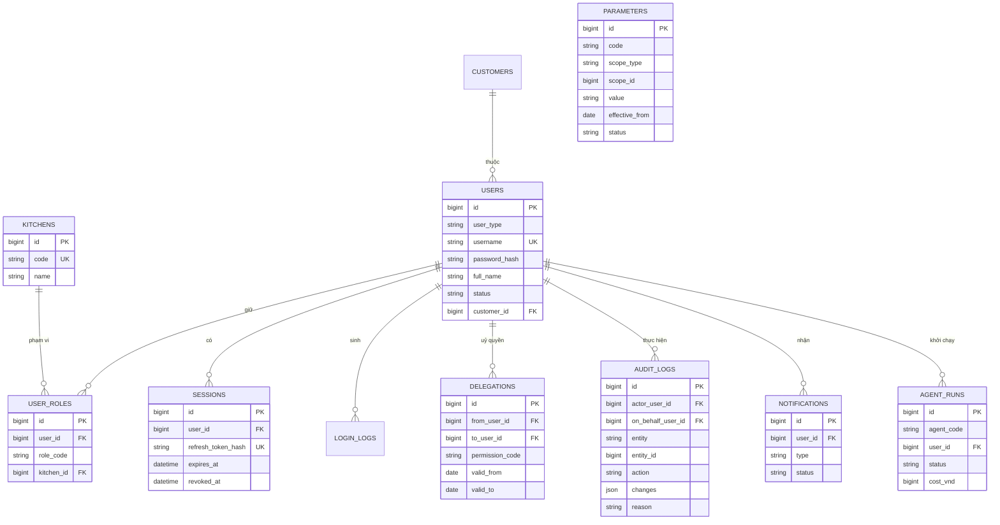
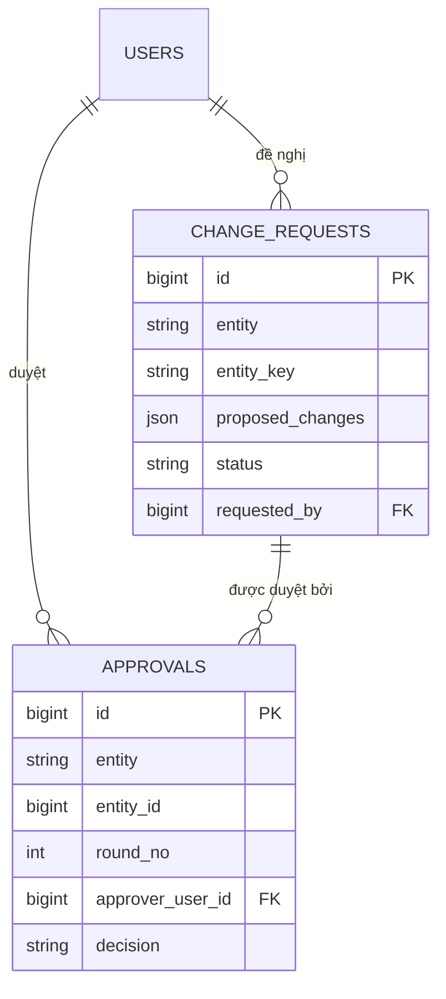
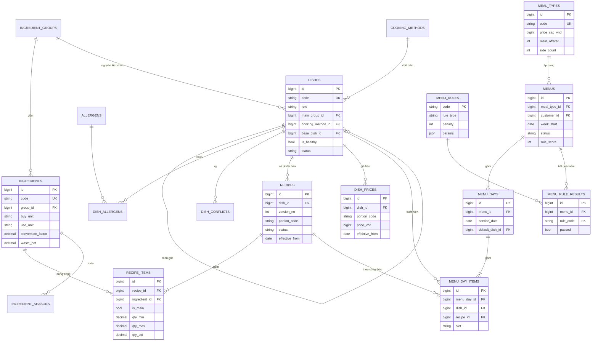
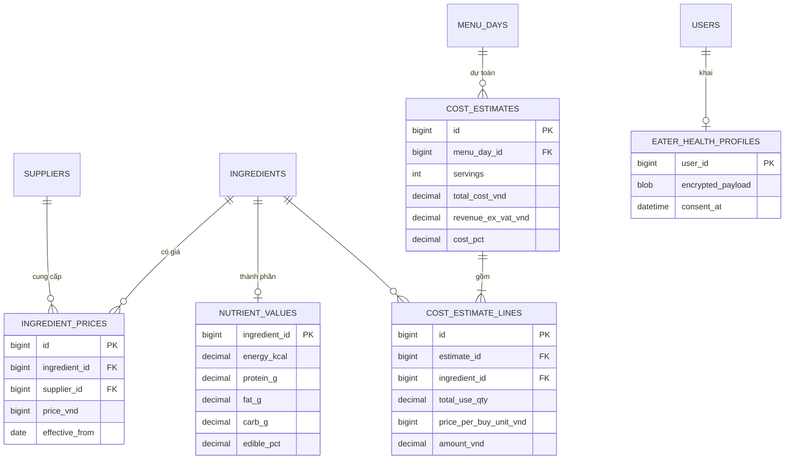
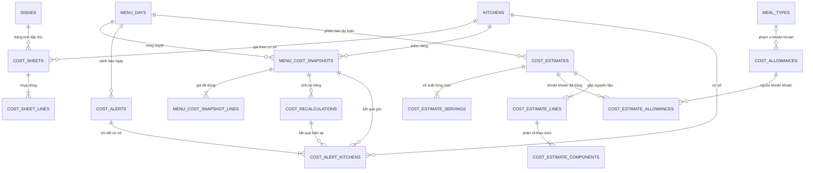
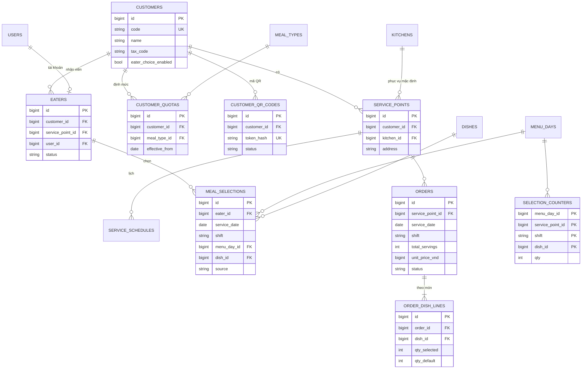
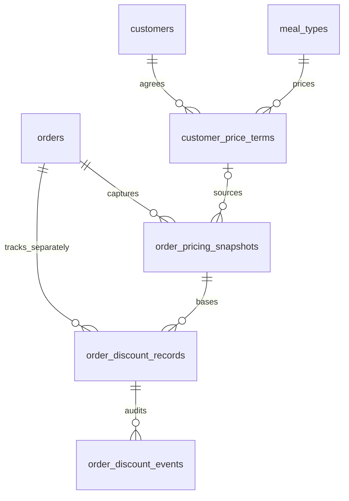

# Mô hình dữ liệu tổng (ERD): Nền tảng Gia Phát

## Metadata

| Trường | Giá trị |
| :--- | :--- |
| Phạm vi | Toàn hệ thống. Từ điển dữ liệu chi tiết cho các bảng của đợt Now (R1 → R5) và bảng chịu tải cao của R6; các bảng còn lại mới ở mức khung, chi tiết viết ở ERD của epic tương ứng |
| Phiên bản | 0.5.0 |
| Trạng thái | Draft |
| 0.5.1 | 13/11/2026 | BA | XC-01; ACC-CONF-02 |
| Ngày | 2026-11-11 |
| Cơ sở dữ liệu | MySQL 8, InnoDB, `utf8mb4` |
| Tài liệu liên quan | [SRS nền tảng](spec.md) · [PRD](../../gia-phat/01-prd.md) · [Bảng quy tắc thực đơn](../../gia-phat/brainstorms/quy-tac-thuc-don.md) |

### Lịch sử sửa đổi

| Phiên bản | Ngày | Người thực hiện | Tóm tắt thay đổi |
| :--- | :--- | :--- | :--- |
| 0.5.0 | 2026-11-11 | BA | Bổ sung 4 bảng E4/E5 và 3 cột nguồn/version dinh dưỡng; tổng65 bảng; chưa migration. |
| 0.4.0 | 2026-11-11 | BA | Thêm4 bảng thiết kế kế toán và metadata giá mua; giữ thao tác phụ thuộc CK ở trạng thái gated; chưa migration. |
| 0.3.0 | 2026-11-11 | BA | Đồng bộ SRS Cost: 11 bảng mới; dự toán có phiên bản; thay cost đơn bằng bản chụp theo cơ sở; từ điển dữ liệu và ràng buộc triển khai. |
| 0.1.0 | 2026-11-10 | BA | Khởi tạo |
| 0.2.0 | 2026-11-10 | BA | Thêm 2 bảng dùng chung `change_requests`, `approvals` (mục 3.5) theo 3 điểm thiếu phát hiện ở SRS epic E2 mục 4.3 |

Quy ước: **[D-xx]** đã chốt · **[ĐỀ XUẤT]** chờ duyệt · **[O-xx] / [N-xx] / [H-x]** điểm mở, giữ nguyên trạng thái mở. Tên bảng, tên cột, kiểu và độ dài là [ĐỀ XUẤT] của bản thiết kế này.

---

## 1. Quy ước chung

| Hạng mục | Quy ước |
| :--- | :--- |
| Khoá chính | `id BIGINT UNSIGNED AUTO_INCREMENT` |
| Mã nghiệp vụ | Cột `code VARCHAR(32)` duy nhất, do hệ thống cấp, hiển thị cho người dùng |
| Tiền | Giá nhập/khoản khoán dùng `BIGINT` đồng; kết quả tính COST dùng `DECIMAL(24,8)` để lưu phần lẻ, chỉ làm tròn khi hiển thị. Xem mục 5.4. |
| Khối lượng, số lượng nguyên liệu | `DECIMAL(10,3)` kèm cột đơn vị |
| Tỷ lệ phần trăm | Tỷ lệ cấu hình dùng `DECIMAL(5,2)`. Riêng cost % dùng `DECIMAL(12,2)` vì có thể vượt 100%; không áp CHECK 0–100 cho cost %. |
| Thời điểm | `DATETIME(3)` lưu UTC. Ngày nghiệp vụ (ngày phục vụ, ngày hiệu lực) là `DATE` theo giờ Việt Nam |
| Liệt kê | `VARCHAR(24)` + ràng buộc `CHECK`, không dùng kiểu `ENUM` của MySQL để thêm giá trị không phải khoá bảng |
| Cột chuẩn | Mọi bảng nghiệp vụ có: `created_at`, `created_by`, `updated_at`, `updated_by`, `version INT` (khoá lạc quan), `cancelled_at`, `cancelled_reason`. Từ điển bên dưới **không lặp lại** các cột này |
| Xoá | Không xoá cứng; huỷ bằng `cancelled_at` (`FR-SYS-AUD-004`) |
| Phiên bản và hiệu lực | Bảng có giá trị đổi theo thời gian (công thức, giá bán, giá nhập, tham số) không sửa đè: thêm dòng mới với `effective_from` |

---

## 2. Bản đồ các miền dữ liệu

| Miền | Bảng | Đợt | Chi tiết ở |
| :--- | :--- | :---: | :--- |
| AUTH | `users`, `user_roles`, `kitchens`, `sessions`, `login_logs`, `delegations` | R1 | Mục 3 |
| SYS | `audit_logs`, `parameters`, `notifications`, `files`, `agent_runs`, `change_requests`, `approvals` | R1, R2, R5 | Mục 3 |
| MENU | `ingredient_groups`, `ingredients`, `ingredient_seasons`, `cooking_methods`, `allergens`, `dishes`, `dish_allergens`, `dish_conflicts`, `recipes`, `recipe_items`, `dish_prices`, `meal_types`, `menus`, `menu_days`, `menu_day_items`, `menu_rules`, `menu_rule_results` | R2 | Mục 4 |
| COST | Giá nhập, bảng tính đặc thù, khoản khoán, bản chụp theo cơ sở, dự toán có phiên bản, tính lại và cảnh báo (15 bảng) | R3 | Mục 5, chi tiết 5.4 |
| NUTR | `nutrient_values`, `eater_health_profiles` | R4, R6 | Mục 5 |
| CUS + ORD | `customers`, `service_points`, `service_schedules`, `customer_quotas`, `customer_qr_codes`, `eaters`, `meal_selections`, `selection_counters`, `orders`, `order_dish_lines` | R6 | Mục 6 |
| PLAN + DLV + FIN | `production_plans`, `production_plan_lines`, `deliveries`, `discrepancies`, `revenue_lines`, `adjustments`, `recon_periods`, `payments` | R6, R7 | Mục 7 (khung) |
| PUB + SALE + PUR + FB | `posts`, `leads`, `opportunities`, `contracts`, `price_annexes`, `purchase_orders`, `goods_receipts`, `stock_lots`, `feedbacks` | R8 → R12 | Mục 7 (khung) |

---

## 3. Miền AUTH và SYS

Từ điển dữ liệu của đoạn này đã chuyển nguyên văn sang [từ điển dữ liệu E1](data-dictionary.md) ngày 16/11/2026.

Từ điển dữ liệu của đoạn này đã chuyển nguyên văn sang [từ điển dữ liệu E1](data-dictionary.md) ngày 16/11/2026.

## 4. Miền MENU

Từ điển dữ liệu của đoạn này đã chuyển nguyên văn sang [từ điển dữ liệu E2](../../thuc-don-dinh-luong/srs/data-dictionary.md) ngày 16/11/2026.

## 5. Miền COST và NUTR

Từ điển dữ liệu của đoạn này đã chuyển nguyên văn sang [từ điển dữ liệu E3](../../cost/srs/data-dictionary.md) ngày 16/11/2026.

Từ điển dữ liệu của đoạn này đã chuyển nguyên văn sang [từ điển dữ liệu E4](../../dinh-duong/srs/data-dictionary.md) ngày 16/11/2026.

### 5.3 Công thức tính

Nguồn duy nhất cho công thức cost là [SRS Cost mục 3.3](../../cost/srs/spec.md): cost món (3.3.1), cost suất và làm tròn so ngưỡng (3.3.2), bộ kiểm (3.3.3), dự toán theo số suất từng món (3.3.4). Không áp lại hao hụt ở bước lượng mua. Các mặc định `DAT_NHAT`, `KHONG`, `CANH_BAO` là đề xuất, không phải quyết định đã duyệt. VAT chưa được đặt thì không tính cost %.

Dinh dưỡng giữ công thức khung: `qty_std` quy về gram × `edible_pct/100` × chỉ số trên 100 g ÷ 100; cộng các dòng cho món. Chi tiết hiện hành tại [SRS Dinh dưỡng](../../dinh-duong/srs/spec.md); NUTR-Q02/Q04 còn chờ xác nhận. Không dùng `COST_AP_HAO_HUT` để tự thay đổi cách tính dinh dưỡng.

Từ điển dữ liệu của đoạn này đã chuyển nguyên văn sang [từ điển dữ liệu E3](../../cost/srs/data-dictionary.md) ngày 16/11/2026.

#### Sơ đồ bổ sung

Từ điển dữ liệu của đoạn này đã chuyển nguyên văn sang [từ điển dữ liệu E3](../../cost/srs/data-dictionary.md) ngày 16/11/2026.

## 6. Miền CUS và ORD (R6)

### 6.1 `meal_selections`: Lựa chọn món của người ăn (bảng chịu tải cao nhất)

| Tên trường | Tên cột | Kiểu | Độ dài | Null? | Khoá | Ràng buộc / Mặc định | Diễn giải nghiệp vụ |
| :--- | :--- | :--- | :--- | :--- | :--- | :--- | :--- |
| Mã | Mã bản ghi | BIGINT UNSIGNED | Không áp dụng | Không | PK | Không áp dụng | Không áp dụng |
| Người ăn | eater_id | BIGINT UNSIGNED | Không áp dụng | Không | FK → `eaters.id` | Không áp dụng | Người ăn qua QR được định danh thế nào: chốt ở SRS R6 |
| Ngày phục vụ | service_date | DATE | Không áp dụng | Không | Không áp dụng | Không áp dụng | Không áp dụng |
| Ca | shift | VARCHAR | 16 | Không | Không áp dụng | `LUNCH`, `MORNING`, `AFTERNOON`, `DINNER` | Chủ yếu ca trưa |
| Điểm phục vụ | service_point_id | BIGINT UNSIGNED | Không áp dụng | Không | FK → `service_points.id` | Không áp dụng | Không áp dụng |
| Ngày thực đơn | menu_day_id | BIGINT UNSIGNED | Không áp dụng | Không | FK → `menu_days.id` | Thực đơn `PUBLISHED` | Không áp dụng |
| Món chính | dish_id | BIGINT UNSIGNED | Không áp dụng | Không | FK → `dishes.id` | Thuộc các món `MAIN` của `menu_day_id` | [D-04] |
| Cỡ định lượng | portion_code | VARCHAR | 16 | Không | Không áp dụng | Mặc định `STD` | [O-02] |
| Nguồn | source | VARCHAR | 24 | Không | Không áp dụng | `SELF`, `DEFAULT`, `COORDINATOR` | Tự chọn / gán mặc định [D-14] / người đặt tổng nhập |
| Khoá chống gửi lặp | idempotency_key | CHAR | 36 | Có | Không áp dụng | Không áp dụng | Quy ước API ở SRS 3.3 |
| Không áp dụng | Không áp dụng | Không áp dụng | Không áp dụng | Không áp dụng | Unique | (`eater_id`, `service_date`, `shift`) | Mỗi người một lựa chọn mỗi ca; đổi món là sửa dòng này |

Chỉ mục phụ: (`service_point_id`, `service_date`, `shift`, `dish_id`). Phân vùng theo tháng của `service_date`.

`selection_counters` giữ tổng theo món, cập nhật trong cùng giao dịch với `meal_selections` (`+1` món mới, `−1` món cũ khi đổi), để trang tổng hợp của người đặt tổng không phải đếm lại toàn bảng. Tại hạn chốt, tác vụ nền đối chiếu bộ đếm với số đếm thật trước khi khoá.

### 6.2 Các bảng còn lại của miền

| Bảng | Cột chính | Ghi chú |
| :--- | :--- | :--- |
| `customers` | `code`, `name`, `tax_code`, `lifecycle_status`, `eater_choice_enabled` | Cờ cuối = `FEAT-044` |
| `service_points` | `customer_id`, `kitchen_id`, `address`, `name` | Cơ sở mặc định theo điểm |
| `service_schedules` | `service_point_id`, `shift`, `weekday`, `delivery_time` | Dùng cho tín hiệu nguy cơ rời và nhắc order; hạn chốt lấy từ `parameters` |
| `customer_quotas` | `customer_id`, `meal_type_id`, `effective_from`, `approved_by` | Định mức chung của công ty [D-21] |
| `customer_qr_codes` | `customer_id`, `token_hash`, `status`, `rotated_at` | Lưu bản băm; đổi mã làm mã cũ mất hiệu lực (BRD R-08) |
| `eaters` | `customer_id`, `service_point_id`, `user_id` (null với người ăn qua QR), `display_name`, `status` | Không có |
| `orders` | `service_point_id`, `service_date`, `shift`, `meal_type_id`, `total_servings`, `unit_price_vnd` (chụp), `status`, `locked_at` | Một dòng cho mỗi điểm · ngày · ca; đặt, giao, nhận, tính tiền theo **suất** |
| `order_dish_lines` | `order_id`, `dish_id`, `qty_selected`, `qty_default`, `qty_coordinator` | Phân rã theo **món** cho kế hoạch sản xuất; tổng 3 cột của mọi dòng = `orders.total_servings` |

---

## 7. Các miền còn lại: mức khung

Bảng và quan hệ chính; từ điển dữ liệu viết ở ERD của epic tương ứng.

| Miền | Bảng | Quan hệ chính | Ghi chú thiết kế |
| :--- | :--- | :--- | :--- |
| PLAN | `production_plans` (cơ sở · ngày · ca · `version_no` · `status`), `production_plan_lines` (món · `qty_locked` · `qty_produced` · `qty_rejected`) | `orders` gộp theo (`kitchen_id`, `service_date`, `shift`) → 1 kế hoạch | Số chốt và số sản xuất theo món |
| DLV | `deliveries` (`order_id` · `qty_delivered` · `delivered_at` · `qty_received` · `confirmed_by` · `confirmed_at`), `discrepancies` | 1 `orders` – n `deliveries` | Số giao, số nhận theo suất |
| FIN | `revenue_lines` (`order_id` · `qty_billable` · `unit_price_vnd` · `amount_vnd` · `period_id`), `adjustments`, `recon_periods`, `payments` | `revenue_lines` sinh từ `deliveries` đã xác nhận | Giảm trừ là dòng riêng; kỳ khoá chỉ đọc |
| PUB | `posts` (`slug` duy nhất · `legacy_url` · `status`) | Không áp dụng | `legacy_url` phục vụ chuyển hướng 301 |
| SALE | `leads`, `opportunities`, `contracts`, `price_annexes` | `leads.draft_menu_id` → `menus` | Lead mang theo thực đơn khách đã dựng |
| PUR | `purchase_orders`, `goods_receipts`, `stock_lots` | `goods_receipts` cập nhật `ingredient_prices` | Lô chỉ cho hàng `FROZEN`, `DRY` |
| FB | `feedbacks` | → `menu_day_items`, `eaters` | Không có |

---

## 8. Đối chiếu với các thực thể bản HTML còn thiếu

Bản phân tích ngày 10/11/2026 nêu 8 nhóm thực thể bản HTML không có. Vị trí của chúng trong mô hình này:

| Thiếu ở bản HTML | Bảng trong mô hình này |
| :--- | :--- |
| Người dùng, vai trò | `users`, `user_roles`, `delegations` |
| Cơ sở (bếp) | `kitchens` |
| Nguyên liệu (danh mục chủ) | `ingredients`, `ingredient_groups` |
| Giá nhập theo nhà cung cấp và ngày | `ingredient_prices` |
| Loại suất / combo | `meal_types`, `customer_quotas` |
| Lịch phục vụ của điểm | `service_schedules` |
| Người ăn và lựa chọn món | `eaters`, `meal_selections`, `selection_counters` |
| Thành phần dinh dưỡng | `nutrient_values` |

---

## 9. Điểm mở

Giữ nguyên trạng thái mở.

| Mã | Điểm mở | Ảnh hưởng lên mô hình | Mô hình đã chừa chỗ? |
| :--- | :--- | :--- | :---: |
| O-01 | Cost gồm những khoản nào; thuế suất VAT; giá nhập có gồm VAT đầu vào không | `ingredients.in_cost`, tham số `VAT_PCT`, các khoản khoán/suất, `ingredient_prices.price_vnd` | Có |
| O-02 | Một món một định lượng hay nhiều cỡ | `portion_code` ở `recipes`, `dish_prices`, `meal_selections` | Có |
| O-03 | Gợi ý cá nhân có xét bệnh lý không | Nội dung `eater_health_profiles.encrypted_payload` | Có |
| O-06 | Ai duyệt, ai thay khi vắng | Dữ liệu của `user_roles`, `delegations`; không đổi cấu trúc | Có |
| N-01 | Dạng tên đăng nhập nội bộ | `users.username` | Có |
| N-03 | Thời gian lưu nhật ký | Chính sách phân vùng `audit_logs`, `login_logs` | Có |
| H-1, H-3, H-8 | Danh sách phương pháp Healthy, nhóm nguyên liệu chính, phương pháp chế biến | Dữ liệu của `cooking_methods`, `ingredient_groups`; không đổi cấu trúc | Có |
| Không áp dụng | Người ăn qua QR định danh thế nào (chốt ở SRS R6) | `eaters` với `user_id` null; có thể cần thêm cột định danh | Một phần |
| Không áp dụng | Cost món chính khi chưa biết tỷ lệ chọn: bình quân hay món đắt nhất | Công thức mục 5.3 | Chưa quyết |
| Không áp dụng | `waste_pct` có cộng vào định lượng khi tính cost không | Công thức mục 5.3 | Cần xác nhận |

## 10. Bước tiếp theo

Đã đồng bộ [schema DBML v0.3.0](schema.dbml) và kiểm tra xuất cú pháp MySQL. Bước tiếp theo: xác nhận các điểm mở Cost (SRS mục 4.4–4.5), viết use case/API và thiết kế migration thực thi CHECK, generated keys và phân quyền ở mục 5.4. Chưa chạy DDL lên database, chưa nghiệm thu nghiệp vụ.

## Bổ sung mô hình kế toán (CR-COST-2026-001)

Thiết kế nháp được đồng bộ vào DBML v0.4.0; **không phải migration đã chạy**. Tổng61 bảng,15 bảng Cost hiện có và4 bảng mở rộng kế toán liên kết CUS/ORD. [Hợp đồng](../../cost/api/accounting-contract.md), [backlog](../../cost/userstories/accounting-backlog.md), [nhánh mở](../../cost/review/cost-branch-decisions.md).

Orders hiện là một loại suất mỗi điểm/ngày/ca; order_dish_lines là lựa chọn món, không phải dòng hóa đơn tính tiền. Chiết khấu dựa trên số suất và snapshot của order, không tự mở rộng sang đơn nhiều loại suất.

Từ điển dữ liệu của đoạn này đã chuyển nguyên văn sang [từ điển dữ liệu E3](../../cost/srs/data-dictionary.md) ngày 16/11/2026.

## 8. Gói E4/E5 MVP: 2026-11-11

DBML v0.5.0 có **65 bảng**: giữ61 bảng của bản v0.4.0, thêm nutrient_value_revisions, nutrition_calculations, agent_run_contexts, agent_tool_events. nutrient_values thêm version/source_edition/source_locator. Không thay công thức, bảng hoặc cổng Cost/kế toán; các số61 ở báo cáo cũ là ảnh chụp lần kiểm trước.

Từ điển, CHECK nghiệp vụ, transaction và migration: [Dinh dưỡng](../../dinh-duong/srs/erd.md), [Agent Nội bộ](../../agent-noi-bo/srs/erd.md). JSON có cấu trúc theo hợp đồng API từng phân hệ, không phải cột lưu tùy ý. DBML compile chỉ kiểm cú pháp/refs, không xác nhận CHECK được triển khai. Default nguồn/edible_pct cũ không thay việc xác minh nguồn dữ liệu.

Mọi cấu trúc mới là đề xuất để review; chưa migration/backend. Hồ sơ sức khỏe và agent khách giữ ngoài E4/E5 MVP. [Gói bàn giao và kết quả kiểm](../../gia-phat/review/mvp-e4-e5-handoff.md).

## Rà soát delta E6 ngày 11/11/2026

[Data dictionary E6](../../chon-mon-order/srs/data-dictionary.md) chỉ rõ khoảng trống QR/scope, revision order/plan, quan hệ pricing và invariant MAIN. DBML vẫn65bảng và không thay trong phiên; delta chưa phê duyệt/chưa migration. users loại SERVICE đã có, guest session/audit cần ORD-Q11; eater_health_profiles có trong schema không mở O-03.
