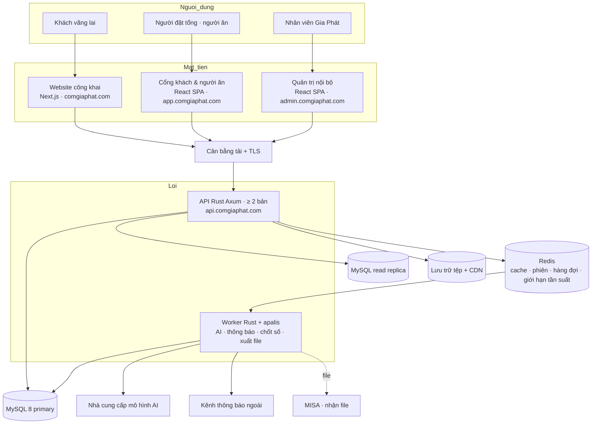
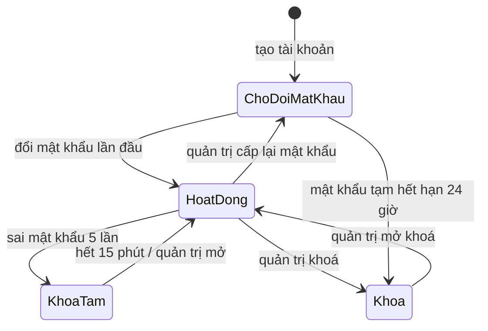

# Tài liệu Đặc tả Yêu cầu Kỹ thuật (SRS): Epic E1 · Nền tảng

## Metadata

| Trường | Giá trị |
| :--- | :--- |
| Epic | E1 · `nen-tang`: đợt phát hành R1 (v0.1.0) |
| Phân hệ | AUTH, SYS + kiến trúc và yêu cầu phi chức năng dùng chung cho toàn hệ thống |
| Tính năng PRD | `FEAT-001` → `FEAT-005` |
| Phiên bản | 0.3.0 |
| Trạng thái | Draft |
| Ngày | 2026-11-14 |
| Tiêu chuẩn | IEEE Std 830-1998 / ISO/IEC/IEEE 29148 · ISO/IEC 25010 cho NFR |

### Lịch sử sửa đổi

| Phiên bản | Ngày | Người thực hiện | Tóm tắt thay đổi |
| :--- | :--- | :--- | :--- |
| 0.3.0 | 2026-11-14 | BA | Backend đổi sang Rust/Axum theo D-22 và CR-CORE-2026-001: sửa sơ đồ 2.1, mục 2.2, 2.5; liên kết kiến trúc hệ thống và kiến trúc AI agent. Không đổi FR, BR, ERR, NFR |
| 0.2.1 | 2026-11-11 | BA | Liên kết hồ sơ bổ sung E1–E5/E6 khởi đầu; giữ quy tắc và điểm mở |
| 0.2.0 | 2026-11-11 | BA | Bổ sung 6 tham số Cost theo SRS E3; giữ trạng thái đề xuất và VAT chưa chốt. |
| 0.1.0 | 2026-11-10 | BA | Khởi tạo |
| 0.1.1 | 2026-11-11 | BA | Làm rõ quy ước phân trang: tham số ngoài khoảng bị từ chối; thêm `ERR-SYS-422-03` |

Quy ước: **[D-xx]** quyết định đã chốt · **[ĐỀ XUẤT]** con số hoặc phương án chờ duyệt · **[O-xx]**, **[N-xx]**, **[Q-xx]** điểm mở, giữ nguyên trạng thái mở. **Mọi con số trong tài liệu này là [ĐỀ XUẤT] trừ khi ghi [D-xx].**

---

## 1. Giới thiệu

### 1.1 Mục đích

Đặc tả phần nền mà 12 epic còn lại dùng chung: xác thực và phân quyền nội bộ, nhật ký thay đổi, tham số, thông báo, cùng kiến trúc kỹ thuật và chỉ tiêu phi chức năng của toàn hệ thống. Người đọc: đội phát triển, kiểm thử, người duyệt nghiệp vụ.

### 1.2 Phạm vi

| Trong phạm vi tài liệu này | Ngoài phạm vi (viết ở SRS epic khác) |
| :--- | :--- |
| Tài khoản và đăng nhập của nhân viên Gia Phát | Tài khoản người đặt tổng, người ăn, phiên QR: epic `chon-mon-order` (R6) |
| Vai trò, quyền, phạm vi dữ liệu theo cơ sở | Quyền chi tiết trên từng chức năng nghiệp vụ: SRS từng epic |
| Tài khoản dịch vụ cho 2 AI agent | Hành vi của agent: epic `agent-noi-bo` (R5), `agent-dinh-duong-vien` (R9) |
| Nhật ký thay đổi, tham số, thông báo trong hệ thống, tải tệp, tác vụ nền | Nội dung từng thông báo nghiệp vụ |
| Kiến trúc, quy ước API, NFR toàn hệ thống | Mô hình dữ liệu tổng: `docs/nen-tang/srs/erd.md` (bước kế tiếp) |

Mô hình định danh ở mục 2.3 đã tính trước chỗ cho người dùng bên ngoài để R6 không phải sửa nền.

### 1.3 Thuật ngữ

| Thuật ngữ | Nghĩa |
| :--- | :--- |
| Cơ sở | Bếp sản xuất của Gia Phát: Hoàng Đạo Thành, Phúc Diễn |
| Phạm vi dữ liệu | Tập bản ghi một tài khoản được thấy: toàn hệ thống, theo cơ sở, theo công ty khách, hoặc của bản thân |
| Tài khoản dịch vụ | Tài khoản không phải người, dùng cho AI agent hoặc tác vụ nền |
| CCU | Số người dùng đồng thời |
| p95 | 95% số yêu cầu có thời gian phản hồi không vượt giá trị này |
| RPO / RTO | Lượng dữ liệu tối đa được phép mất / thời gian tối đa để khôi phục sau sự cố |

### 1.4 Tài liệu tham chiếu

[PRD](../../gia-phat/01-prd.md) · [BRD](../../gia-phat/06-brd.md) · [URD](../../gia-phat/05-urd.md) · [Roadmap](../../gia-phat/02-roadmap.md) · [Kế hoạch tổng thể](../../gia-phat/00-ke-hoach-tong-the.md) · `GiaPhat_CMAP_CRM.html` bản 1.0 (bảng "Vai trò & phân quyền", "Nhật ký thay đổi").

---

## 2. Mô tả tổng quan

### 2.1 Bối cảnh hệ thống

Nhà cung cấp hạ tầng và mô hình AI: [O-04]. Kênh thông báo ngoài: [Q-14]. Chi tiết từng tầng và cấu trúc mã nguồn: [Kiến trúc hệ thống](architecture.md). Cấu trúc hai agent, công cụ, MCP và RAG: [Kiến trúc AI agent](agent-architecture.md).

### 2.2 Phân hệ và tính năng chính

| Phân hệ | Chức năng trong epic này |
| :--- | :--- |
| AUTH | Đăng nhập, phiên, mật khẩu, tài khoản nội bộ, vai trò và phạm vi dữ liệu, tài khoản dịch vụ |
| SYS | Nhật ký thay đổi, tham số, thông báo, tải tệp, tác vụ nền, kiểm tra sức khoẻ hệ thống |

API là **modular monolith**: mỗi phân hệ một crate Rust trong cùng Cargo workspace (`auth`, `sys`, `menu`, `cost`, `nutr`, `ord`, …), gọi nhau qua giao diện dịch vụ của module, không truy vấn chéo bảng của module khác.

### 2.3 Phân loại người dùng

**Loại định danh**: nền tảng hỗ trợ 4 loại ngay từ R1; R1 chỉ hiện thực loại 1 và 4.

| # | Loại định danh | Cách xác thực | Phạm vi dữ liệu | Hiện thực ở |
| :--- | :--- | :--- | :--- | :--- |
| 1 | Nhân viên Gia Phát | Tên đăng nhập + mật khẩu | Toàn hệ thống hoặc theo cơ sở | R1 |
| 2 | Người dùng của công ty khách (người đặt tổng, người nhận, người ăn có tài khoản) | Chốt ở SRS R6; người ăn xác minh bằng QR công ty [D-19] | Theo công ty khách; người ăn: của bản thân | R6 |
| 3 | Phiên QR không tài khoản | Mã QR của công ty | Một công ty, một ngày phục vụ | R6 |
| 4 | Tài khoản dịch vụ | Khoá bí mật nội bộ | Theo danh sách quyền gắn cứng | R1 |

**Vai trò nội bộ**: cố định, không cho tự tạo vai trò mới ở bản đầu.

| Mã vai trò | Tác nhân | Phạm vi mặc định |
| :--- | :--- | :--- |
| `GIAM_DOC` | A-10 | Toàn hệ thống |
| `DINH_DUONG_VIEN` | A-06 | Toàn hệ thống |
| `QL_CO_SO` | A-07 | Cơ sở được gán |
| `BEP_TRUONG` | A-08 | Cơ sở được gán |
| `KT_MUA_HANG` | A-09 | Toàn hệ thống |
| `KT_DOANH_THU` | A-09 | Toàn hệ thống |
| `QUAN_TRI` | Quản trị hệ thống: ai giữ vai trò này: [N-02] | Toàn hệ thống, chỉ trên AUTH và SYS |

Một tài khoản giữ được nhiều vai trò (ví dụ một kế toán giữ cả `KT_MUA_HANG` và `KT_DOANH_THU`).

### 2.4 Môi trường vận hành

| Hạng mục | Yêu cầu |
| :--- | :--- |
| Trình duyệt | 2 phiên bản mới nhất của Chrome, Safari, Edge, Firefox; Chrome và Safari trên điện thoại |
| Màn hình | Chiều rộng từ 360 px |
| Múi giờ | `Asia/Ho_Chi_Minh` cho mọi mốc nghiệp vụ; lưu trong cơ sở dữ liệu ở UTC |
| Ngôn ngữ | Tiếng Việt |
| Môi trường triển khai | 3 môi trường tách biệt: phát triển, thử nghiệm, vận hành thật |

### 2.5 Ràng buộc thiết kế

- ReactJS, Rust/Axum, MySQL [đã chốt; backend theo D-22, [CR-CORE-2026-001](../cr/CR-CORE-2026-001.md)].
- Tiền lưu bằng số nguyên đồng (VND), không dùng số thực.
- Khối lượng lưu bằng số thập phân cố định; mỗi giá trị kèm đơn vị.
- Mọi bảng nghiệp vụ có: người tạo, thời điểm tạo, người sửa cuối, thời điểm sửa cuối, cờ huỷ. Không xoá cứng.
- Mọi API có tiền tố phiên bản `/v1`.

### 2.6 Giả định và phụ thuộc

| Mã | Nội dung |
| :--- | :--- |
| Phụ thuộc | [O-04] chọn nhà cung cấp hạ tầng trước khi dựng môi trường |
| Phụ thuộc | [O-06] xác định người duyệt và người thay khi vắng trước khi cấu hình vai trò `GIAM_DOC` |
| Giả định | Nhân viên nội bộ có điện thoại hoặc máy tính vào được web |

---

## 3. Yêu cầu chi tiết

### 3.1 Yêu cầu chức năng

#### AUTH: Đăng nhập và phiên

| Mã FR | Tên chức năng | Ưu tiên | Mô tả | Input | Output | BR | Mã lỗi |
| :--- | :--- | :---: | :--- | :--- | :--- | :--- | :--- |
| `FR-AUTH-LGN-001` | Đăng nhập nội bộ | P0 | Xác thực nhân viên bằng tên đăng nhập và mật khẩu. Kiểm tra tài khoản đang hoạt động, chưa bị khoá. Ghi nhật ký đăng nhập cả khi thành công lẫn thất bại. Dạng tên đăng nhập: [N-01] | tên đăng nhập, mật khẩu | access token, refresh token (cookie `HttpOnly`), hồ sơ người dùng, danh sách vai trò và phạm vi | `BR-SEC-001`, `002`, `003` | `ERR-AUTH-401-01`, `ERR-AUTH-423-01`, `ERR-AUTH-403-01`, `ERR-AUTH-429-01` |
| `FR-AUTH-LGN-002` | Làm mới phiên | P0 | Đổi refresh token còn hạn lấy access token mới; refresh token cũ bị vô hiệu ngay (xoay vòng). Dùng lại refresh token đã vô hiệu → thu hồi mọi phiên của tài khoản. | refresh token | access token mới, refresh token mới | `BR-SEC-003`, `005` | `ERR-AUTH-401-02` |
| `FR-AUTH-LGN-003` | Đăng xuất | P0 | Thu hồi phiên hiện tại; tuỳ chọn thu hồi mọi phiên của mình. | Không áp dụng | Phiên bị vô hiệu | Không áp dụng | Không áp dụng |
| `FR-AUTH-LGN-004` | Xác thực 2 bước | P1 | Vai trò `GIAM_DOC`, `KT_DOANH_THU`, `QUAN_TRI` nhập thêm mã 6 số từ ứng dụng xác thực. Có làm hay không: [N-04] | mã 6 số | Như `FR-AUTH-LGN-001` | Không áp dụng | `ERR-AUTH-401-03` |

#### AUTH: Mật khẩu

| Mã FR | Tên chức năng | Ưu tiên | Mô tả | Input | Output | BR | Mã lỗi |
| :--- | :--- | :---: | :--- | :--- | :--- | :--- | :--- |
| `FR-AUTH-PWD-001` | Đổi mật khẩu | P0 | Người dùng đổi mật khẩu của mình; phải nhập đúng mật khẩu hiện tại. Sau khi đổi, mọi phiên khác bị thu hồi. | mật khẩu cũ, mật khẩu mới | Xác nhận | `BR-SEC-001`, `005` | `ERR-AUTH-422-01`, `ERR-AUTH-401-01` |
| `FR-AUTH-PWD-002` | Cấp lại mật khẩu | P0 | `QUAN_TRI` cấp mật khẩu tạm cho một tài khoản. Mật khẩu tạm hết hạn sau 24 giờ và buộc đổi ở lần đăng nhập đầu. | mã tài khoản, lý do | Mật khẩu tạm hiển thị một lần | `BR-SEC-004`, `005`, `BR-AUD-001` | `ERR-AUTH-404-01` |

#### AUTH: Tài khoản, vai trò, phạm vi

| Mã FR | Tên chức năng | Ưu tiên | Mô tả | Input | Output | BR | Mã lỗi |
| :--- | :--- | :---: | :--- | :--- | :--- | :--- | :--- |
| `FR-AUTH-ACC-001` | Tạo tài khoản nội bộ | P0 | `QUAN_TRI` tạo tài khoản, gán ít nhất 1 vai trò; vai trò `QL_CO_SO`, `BEP_TRUONG` bắt buộc gán ít nhất 1 cơ sở. | họ tên, tên đăng nhập, vai trò, cơ sở | Tài khoản ở trạng thái "chờ đổi mật khẩu" | `BR-SEC-004`, `006`, `007` | `ERR-AUTH-409-01`, `ERR-AUTH-422-02` |
| `FR-AUTH-ACC-002` | Khoá / mở khoá tài khoản | P0 | Khoá làm tài khoản không đăng nhập được và thu hồi mọi phiên trong ≤ 60 giây. | mã tài khoản, lý do | Trạng thái mới | `BR-SEC-005`, `BR-AUD-001` | `ERR-AUTH-404-01` |
| `FR-AUTH-ACC-003` | Sửa vai trò và cơ sở | P0 | Thay đổi có hiệu lực ở yêu cầu kế tiếp của người dùng, không cần đăng nhập lại. | mã tài khoản, vai trò, cơ sở, lý do | Tài khoản đã cập nhật | `BR-SEC-006`, `007`, `BR-AUD-001` | `ERR-AUTH-422-02` |
| `FR-AUTH-ACC-004` | Xem nhật ký đăng nhập | P0 | Lọc theo tài khoản, khoảng ngày, kết quả. Mỗi dòng: thời điểm, kết quả, địa chỉ IP, thiết bị. | bộ lọc | Danh sách phân trang | Không áp dụng | Không áp dụng |
| `FR-AUTH-RBAC-001` | Kiểm quyền mỗi yêu cầu | P0 | Mỗi API khai báo quyền cần có. Hệ thống kiểm (1) tài khoản có quyền đó qua vai trò, (2) bản ghi được yêu cầu nằm trong phạm vi dữ liệu của tài khoản. Thiếu (1) → 403. Thiếu (2) → 404, để không lộ sự tồn tại của bản ghi. | token, tài nguyên | Cho phép / từ chối | `BR-SEC-006`, `007` | `ERR-AUTH-403-02`, `ERR-SYS-404-01` |
| `FR-AUTH-RBAC-002` | Xem ma trận vai trò – quyền | P0 | Hiển thị vai trò nào có quyền nào. Bản đầu chỉ đọc; thay đổi ma trận qua bản phát hành. | Không áp dụng | Ma trận | Không áp dụng | Không áp dụng |
| `FR-AUTH-RBAC-003` | Uỷ quyền duyệt khi vắng | P1 | Người có quyền duyệt chỉ định người thay trong một khoảng ngày. Người thay nhận đúng các quyền duyệt được uỷ, hết hạn tự thu hồi. Phụ thuộc [O-06] | người được uỷ, quyền, từ ngày, đến ngày | Bản ghi uỷ quyền | `BR-SEC-008`, `BR-AUD-001` | `ERR-AUTH-422-03` |
| `FR-AUTH-SVC-001` | Tài khoản dịch vụ cho agent | P0 | Hai tài khoản tách biệt: `svc-agent-noi-bo`, `svc-agent-dinh-duong-vien`. Mỗi tài khoản có danh sách quyền gắn cứng, không đăng nhập qua giao diện. | Không áp dụng | Không áp dụng | `BR-SEC-009`, `010` | `ERR-AUTH-403-02` |

#### SYS: Nhật ký thay đổi

| Mã FR | Tên chức năng | Ưu tiên | Mô tả | Input | Output | BR | Mã lỗi |
| :--- | :--- | :---: | :--- | :--- | :--- | :--- | :--- |
| `FR-SYS-AUD-001` | Ghi nhật ký thay đổi | P0 | Mọi lệnh tạo, sửa, huỷ, duyệt trên bảng nghiệp vụ sinh 1 bản ghi nhật ký trong cùng giao dịch cơ sở dữ liệu: ai, lúc nào, thực thể, mã bản ghi, hành động, giá trị cũ → mới của từng trường đổi, lý do, mã yêu cầu. Nếu thao tác do agent thực hiện: ghi cả tài khoản dịch vụ và người dùng đang dùng agent. | Không áp dụng (tự động) | Bản ghi nhật ký | `BR-AUD-002` | Không áp dụng |
| `FR-SYS-AUD-002` | Tra cứu nhật ký | P0 | Lọc theo thực thể, mã bản ghi, người, khoảng ngày, hành động. Xem lịch sử của một bản ghi theo thứ tự thời gian. | bộ lọc | Danh sách phân trang | `BR-SEC-007` | Không áp dụng |
| `FR-SYS-AUD-003` | Bắt buộc lý do | P0 | Thao tác thuộc danh sách ở `BR-AUD-001` bị từ chối nếu thiếu lý do từ 10 ký tự. | lý do | Không áp dụng | `BR-AUD-001` | `ERR-SYS-422-01` |
| `FR-SYS-AUD-004` | Huỷ thay cho xoá | P0 | Không có API xoá cứng bản ghi nghiệp vụ. Huỷ đặt cờ, giữ dữ liệu, bản ghi huỷ không xuất hiện ở danh sách mặc định. | mã bản ghi, lý do | Bản ghi ở trạng thái huỷ | `BR-AUD-001` | `ERR-SYS-409-01` |

#### SYS: Tham số

| Mã FR | Tên chức năng | Ưu tiên | Mô tả | Input | Output | BR | Mã lỗi |
| :--- | :--- | :---: | :--- | :--- | :--- | :--- | :--- |
| `FR-SYS-PRM-001` | Quản lý tham số | P0 | Mỗi tham số có: mã, kiểu, giá trị, phạm vi áp dụng (toàn hệ thống / cơ sở / công ty khách / điểm phục vụ), ngày hiệu lực từ. Giá trị dùng cho một ngày nghiệp vụ là giá trị có hiệu lực tại ngày đó ở phạm vi hẹp nhất. Danh mục khởi tạo ở Phụ lục 4.3. | mã, giá trị, phạm vi, ngày hiệu lực, lý do | Phiên bản tham số mới | `BR-SYS-001` | `ERR-SYS-422-02` |
| `FR-SYS-PRM-002` | Duyệt thay đổi tham số | P0 | Tham số gắn cờ "cần duyệt" chỉ có hiệu lực sau khi người có quyền duyệt chấp thuận; người đề nghị không tự duyệt. | mã đề nghị, quyết định, lý do | Trạng thái đề nghị | `BR-SYS-002`, `BR-SEC-008` | `ERR-SYS-403-01` |

#### SYS: Thông báo, tệp, tác vụ nền

| Mã FR | Tên chức năng | Ưu tiên | Mô tả | Input | Output | BR | Mã lỗi |
| :--- | :--- | :---: | :--- | :--- | :--- | :--- | :--- |
| `FR-SYS-NTF-001` | Tạo thông báo trong hệ thống | P0 | Module nghiệp vụ phát sự kiện; SYS tạo thông báo cho người nhận theo vai trò và phạm vi. Mỗi thông báo: loại, tiêu đề, nội dung, liên kết tới bản ghi, mức độ. | sự kiện | Thông báo | Không áp dụng | Không áp dụng |
| `FR-SYS-NTF-002` | Trạng thái thông báo | P0 | 3 trạng thái: mới, đã xem, đã xử lý. Danh sách lọc theo trạng thái; hiện số thông báo mới trên thanh điều hướng. | mã thông báo, trạng thái | Không áp dụng | Không áp dụng | Không áp dụng |
| `FR-SYS-NTF-003` | Gửi qua kênh ngoài | P1 | Giao diện gửi chung cho mọi kênh; gửi qua hàng đợi, thử lại tối đa 3 lần, lưu kết quả từng lần gửi. Kênh cụ thể: [Q-14] | người nhận, mẫu, dữ liệu | Trạng thái gửi | Không áp dụng | `ERR-SYS-502-01` |
| `FR-SYS-FILE-001` | Tải tệp lên | P0 | Nhận JPG, PNG, WEBP, PDF; tối đa 10 MB mỗi tệp. Kiểm tra loại tệp theo nội dung, không theo đuôi tên. Tệp nội bộ chỉ truy cập qua liên kết có chữ ký, hết hạn sau 15 phút. | tệp, thực thể gắn kèm | Mã tệp | Không áp dụng | `ERR-SYS-413-01`, `ERR-SYS-415-01` |
| `FR-SYS-JOB-001` | Tác vụ nền | P0 | Hàng đợi có: thử lại với khoảng cách tăng dần, tối đa 5 lần; hàng đợi lỗi cho tác vụ hỏng hẳn; khoá chống chạy trùng cho tác vụ định giờ. `QUAN_TRI` xem được trạng thái và chạy lại tác vụ lỗi. | Không áp dụng | Không áp dụng | Không áp dụng | Không áp dụng |
| `FR-SYS-HLT-001` | Kiểm tra sức khoẻ | P0 | Điểm kiểm tra `/v1/health` trả trạng thái API, MySQL, Redis, hàng đợi; dùng cho cân bằng tải và giám sát. | Không áp dụng | Trạng thái từng thành phần | Không áp dụng | `ERR-SYS-503-01` |

### 3.2 Quy tắc nghiệp vụ

| Mã BR | Tên quy tắc | Phát biểu (KHI – THÌ) | Ngoại lệ |
| :--- | :--- | :--- | :--- |
| `BR-SEC-001` | Độ mạnh mật khẩu | KHI đặt mật khẩu THÌ phải dài ≥ 10 ký tự, có chữ và số, không trùng tên đăng nhập, không trùng 3 mật khẩu gần nhất | Không áp dụng |
| `BR-SEC-002` | Khoá khi nhập sai | KHI một tài khoản nhập sai mật khẩu 5 lần liên tiếp THÌ khoá đăng nhập 15 phút | `QUAN_TRI` mở khoá sớm được |
| `BR-SEC-003` | Thời hạn phiên | Access token sống 15 phút; refresh token sống 7 ngày, xoay vòng mỗi lần dùng | Thu hồi ngay theo `BR-SEC-005` |
| `BR-SEC-004` | Mật khẩu tạm | KHI tài khoản dùng mật khẩu tạm THÌ chỉ gọi được API đổi mật khẩu; mật khẩu tạm hết hạn sau 24 giờ | Không áp dụng |
| `BR-SEC-005` | Thu hồi phiên | KHI đổi mật khẩu, cấp lại mật khẩu, khoá tài khoản, hoặc phát hiện dùng lại refresh token THÌ thu hồi mọi phiên của tài khoản trong ≤ 60 giây | Đổi mật khẩu giữ lại phiên đang thao tác |
| `BR-SEC-006` | Nhiều vai trò | KHI tài khoản có nhiều vai trò THÌ quyền là hợp của các vai trò | Không áp dụng |
| `BR-SEC-007` | Phạm vi cơ sở | KHI tài khoản chỉ có vai trò `QL_CO_SO` hoặc `BEP_TRUONG` THÌ chỉ đọc và ghi được bản ghi thuộc cơ sở đã gán | Dữ liệu danh mục dùng chung (món, công thức, thực đơn đã công bố) đọc được ở mọi cơ sở |
| `BR-SEC-008` | Tách tạo và duyệt | KHI một bản ghi cần duyệt THÌ người duyệt phải khác người tạo và khác người sửa cuối | Không có ngoại lệ; nếu thiếu người duyệt thì dùng `FR-AUTH-RBAC-003` |
| `BR-SEC-009` | Quyền của agent | KHI agent hành động thay một người dùng THÌ quyền hiệu lực là **giao** của quyền tài khoản dịch vụ và quyền người dùng đó | Không áp dụng |
| `BR-SEC-010` | Agent phía khách không đọc cost | Tài khoản `svc-agent-dinh-duong-vien` không có quyền đọc giá nhập, cost, bảng dự toán; đồng thời tài khoản MySQL mà agent này dùng không có quyền `SELECT` trên các bảng đó | Không có ngoại lệ |
| `BR-AUD-001` | Thao tác bắt buộc lý do | KHI thực hiện: sửa hoặc huỷ bản ghi đã duyệt, sửa giá, sửa công thức đang hiệu lực, sửa tham số, cấp lại mật khẩu, khoá tài khoản, sửa vai trò, uỷ quyền, mở lại kỳ đã khoá THÌ bắt buộc lý do ≥ 10 ký tự | Không áp dụng |
| `BR-AUD-002` | Nhật ký bất biến | Bản ghi nhật ký không sửa, không xoá được qua bất kỳ API nào; tài khoản MySQL của ứng dụng chỉ có quyền `INSERT` và `SELECT` trên bảng nhật ký | Không áp dụng |
| `BR-AUD-003` | Thời gian lưu nhật ký | Nhật ký thay đổi lưu 5 năm; nhật ký đăng nhập lưu 1 năm. Con số cần xác nhận: [N-03] | Không áp dụng |
| `BR-SYS-001` | Tham số theo ngày hiệu lực | KHI sửa tham số THÌ tạo phiên bản mới với ngày hiệu lực ≥ ngày hiện tại; không sửa giá trị đã áp dụng cho ngày trong quá khứ | Không áp dụng |
| `BR-SYS-002` | Tham số cần duyệt | Mọi tham số có cột "Cần duyệt" = "Có" tại mục 4.3 chỉ đổi khi `GIAM_DOC` duyệt; bao gồm `COST_NGUONG_PCT`, `QUY_TAC_DIEM_TOI_THIEU`, `VAT_PCT`, `COST_MON_CHINH_CACH_TINH`, `COST_AP_HAO_HUT`, `COST_CHE_DO_KIEM`. Người duyệt khác người đề nghị (`BR-SEC-008`). | Không áp dụng |

### 3.3 Giao diện ngoài

**Quy ước API (áp dụng cho mọi epic)**

| Hạng mục | Quy ước |
| :--- | :--- |
| Kiểu | REST, JSON, UTF-8, tiền tố `/v1` |
| Xác thực | Access token trong header `Authorization: Bearer`; refresh token trong cookie `HttpOnly`, `Secure`, `SameSite=Strict` |
| Chống gửi lặp | Mọi lệnh tạo nhận header `Idempotency-Key`; cùng khoá trong 24 giờ trả lại kết quả cũ, không tạo bản ghi mới |
| Phân trang | `page` (từ 1), `pageSize` (mặc định 20, từ 1 đến 100); trả `total`. Giá trị ngoài khoảng bị từ chối bằng `ERR-SYS-422-03`, không tự chỉnh. Trang vượt quá trang cuối trả danh sách rỗng kèm `total` |
| Thời gian | ISO 8601 có múi giờ |
| Truy vết | Mỗi yêu cầu có `X-Request-Id`, trả lại ở phản hồi, ghi vào log và nhật ký thay đổi |
| Khuôn lỗi | `{ "code": "ERR-…", "message": "…", "details": [ … ], "requestId": "…" }` |
| Khoá lạc quan | Lệnh sửa gửi kèm `version` của bản ghi; lệch phiên bản → `ERR-SYS-409-02` |

**Hệ thống ngoài**

| Hệ thống | Hướng | Cách kết nối | Trạng thái |
| :--- | :--- | :--- | :--- |
| Nhà cung cấp mô hình AI | Ra | HTTPS từ worker | [O-04] |
| Kênh thông báo | Ra | Qua `FR-SYS-NTF-003` | [Q-14] |
| Lưu trữ tệp | Ra | API tương thích S3 | [O-04] |
| MISA | Ra | Xuất file theo mẫu nhập | Đặc tả ở SRS R7 |

### 3.4 Yêu cầu phi chức năng

Phân loại theo ISO/IEC 25010. Hai chỉ tiêu khác mức mặc định của `rules/04-nfr-standards.md`, có chủ đích: tải tính theo **1000 người dùng đồng thời** (yêu cầu của anh) thay vì 1.000 giao dịch/giây; độ sẵn sàng tính theo **khung giờ phục vụ** thay vì 24/7.

**Mô hình tải dùng để kiểm thử** [ĐỀ XUẤT]: 1000 phiên đồng thời, mỗi phiên gửi 1 yêu cầu mỗi 5 giây → khoảng 200 yêu cầu/giây; tỷ lệ 70% đọc thực đơn, 25% ghi lựa chọn món, 5% thao tác khác; duy trì 15 phút.

| Mã NFR | Nhóm | Yêu cầu | Cách kiểm |
| :--- | :--- | :--- | :--- |
| `NFR-PERF-001` | Hiệu năng | Với mô hình tải trên: p95 ≤ 300 ms cho API đọc, ≤ 800 ms cho API ghi; tỷ lệ lỗi 5xx ≤ 0,1% | Kiểm thử tải trên môi trường thử nghiệm có cấu hình bằng vận hành thật |
| `NFR-PERF-002` | Hiệu năng | Trang chọn món hiển thị nội dung chính trong ≤ 2,5 giây trên mạng 4G | Đo bằng công cụ kiểm thử trang |
| `NFR-PERF-003` | Hiệu năng | Lời gọi AI không chạy trong luồng xử lý yêu cầu web; ký tự đầu tiên ≤ 5 giây, thực đơn tuần hoàn chỉnh ≤ 60 giây | Đo trên 20 yêu cầu mẫu |
| `NFR-PERF-004` | Hiệu năng | Khi hàng đợi AI đầy, p95 của API chọn món không đổi quá 10% so với lúc hàng đợi rỗng | Kiểm thử tải kết hợp |
| `NFR-CAP-001` | Sức chứa | Thiết kế chỉ mục và phân vùng để dữ liệu 3 năm không làm p95 tăng quá 10%. Khối lượng dự kiến tính từ số người ăn/ngày: [Q-18] | Kiểm thử với dữ liệu giả lập 3 năm |
| `NFR-SCAL-001` | Mở rộng | API không giữ trạng thái trong bộ nhớ tiến trình; thêm 1 bản API không cần sửa mã | Chạy 2 và 3 bản, so kết quả |
| `NFR-AVAIL-001` | Sẵn sàng | ≥ 99,5% trong khung 05:00–18:00 các ngày phục vụ | Giám sát `/v1/health` mỗi phút |
| `NFR-AVAIL-002` | Sẵn sàng | Triển khai phiên bản mới không gián đoạn dịch vụ trong khung 05:00–18:00 | Diễn tập triển khai |
| `NFR-REL-001` | Tin cậy | RPO ≤ 15 phút; RTO ≤ 2 giờ | Diễn tập khôi phục mỗi quý |
| `NFR-REL-002` | Tin cậy | Sao lưu đầy đủ hằng ngày, giữ 30 ngày, lưu ở vị trí khác máy chủ cơ sở dữ liệu | Kiểm tra bản sao lưu hằng tuần |
| `NFR-REL-003` | Tin cậy | Một bản API hoặc worker dừng không làm mất lựa chọn món đã ghi nhận thành công | Kiểm thử tắt đột ngột khi đang tải |
| `NFR-SEC-001` | Bảo mật | TLS 1.2 trở lên cho mọi kết nối từ ngoài; ưu tiên TLS 1.3 | Quét cấu hình |
| `NFR-SEC-002` | Bảo mật | Mật khẩu băm bằng Argon2id | Rà soát mã |
| `NFR-SEC-003` | Bảo mật | Dữ liệu sức khoẻ cá nhân mã hoá AES-256 ở mức trường khi lưu; khoá không nằm trong cơ sở dữ liệu | Rà soát mã và cấu hình |
| `NFR-SEC-004` | Bảo mật | Không có lỗ hổng mức cao trở lên theo OWASP Top 10 trước mỗi đợt mở cho người dùng bên ngoài | Quét tự động + rà soát thủ công trước R6, R8, R9 |
| `NFR-SEC-005` | Bảo mật | Giới hạn tần suất: đăng nhập 10 lần/phút/IP; API công khai 60 yêu cầu/phút/IP; chat AI công khai theo `FEAT-064` | Kiểm thử tự động |
| `NFR-SEC-006` | Bảo mật | Khoá bí mật, mật khẩu cơ sở dữ liệu, khoá API mô hình không nằm trong mã nguồn | Quét kho mã |
| `NFR-PRIV-001` | Riêng tư | Dữ liệu cá nhân chỉ thu khi có đồng ý ghi nhận được; người dùng xoá được dữ liệu của mình trong ≤ 72 giờ kể từ khi yêu cầu | Kiểm thử chức năng ở R6 |
| `NFR-PRIV-002` | Riêng tư | Log ứng dụng không chứa mật khẩu, token, dữ liệu sức khoẻ | Rà soát log |
| `NFR-OBS-001` | Giám sát | Log có cấu trúc kèm `requestId`; số đo p95, tỷ lệ lỗi, độ dài hàng đợi, chi phí AI theo ngày; cảnh báo khi tỷ lệ 5xx > 1% trong 5 phút | Diễn tập sự cố |
| `NFR-USE-001` | Sử dụng | Giao diện dùng được ở chiều rộng 360 px, không cuộn ngang | Kiểm thử trên 3 kích thước màn hình |
| `NFR-USE-002` | Sử dụng | Đạt WCAG 2.1 mức AA: tương phản ≥ 4,5:1, thao tác được bằng bàn phím | Kiểm tra bằng công cụ |
| `NFR-MAINT-001` | Bảo trì | Mỗi FR mức P0 có ít nhất 1 kiểm thử tự động; kiểm thử chạy ở mỗi lần gộp mã | Báo cáo kiểm thử |

### 3.5 Ma trận lỗi

| Mã ERR | HTTP | Điều kiện phát sinh | Khoá bản địa hoá | Thông báo hiển thị | Mức | Hành động tiếp theo |
| :--- | :---: | :--- | :--- | :--- | :--- | :--- |
| `ERR-AUTH-401-01` | 401 | Sai tên đăng nhập hoặc mật khẩu | `auth.invalid_credentials` | "Tên đăng nhập hoặc mật khẩu không đúng." | Medium | Nhập lại; không cho biết trường nào sai |
| `ERR-AUTH-401-02` | 401 | Phiên hết hạn, bị thu hồi, hoặc refresh token đã dùng | `auth.session_expired` | "Phiên làm việc đã hết hạn. Vui lòng đăng nhập lại." | Medium | Chuyển về màn hình đăng nhập |
| `ERR-AUTH-401-03` | 401 | Mã xác thực 2 bước sai hoặc hết hạn | `auth.otp_invalid` | "Mã xác thực không đúng hoặc đã hết hạn." | Medium | Nhập mã mới |
| `ERR-AUTH-403-01` | 403 | Tài khoản bị khoá bởi quản trị | `auth.account_locked` | "Tài khoản đang bị khoá. Vui lòng liên hệ quản trị hệ thống." | High | Liên hệ quản trị |
| `ERR-AUTH-403-02` | 403 | Thiếu quyền thực hiện thao tác | `auth.forbidden` | "Bạn không có quyền thực hiện thao tác này." | High | Quay lại; liên hệ quản trị nếu cần quyền |
| `ERR-AUTH-404-01` | 404 | Không tìm thấy tài khoản | `auth.account_not_found` | "Không tìm thấy tài khoản." | Medium | Kiểm tra lại mã tài khoản |
| `ERR-AUTH-409-01` | 409 | Tên đăng nhập đã tồn tại | `auth.username_taken` | "Tên đăng nhập đã được dùng." | Medium | Chọn tên khác |
| `ERR-AUTH-422-01` | 422 | Mật khẩu mới không đạt `BR-SEC-001` | `auth.password_weak` | "Mật khẩu cần ít nhất 10 ký tự, có chữ và số, không trùng 3 mật khẩu gần nhất." | Medium | Nhập mật khẩu khác |
| `ERR-AUTH-422-02` | 422 | Vai trò theo cơ sở nhưng chưa gán cơ sở, hoặc không có vai trò nào | `auth.role_scope_invalid` | "Vai trò này cần gán ít nhất một cơ sở." | Medium | Chọn cơ sở |
| `ERR-AUTH-422-03` | 422 | Uỷ quyền cho chính mình, hoặc khoảng ngày không hợp lệ | `auth.delegation_invalid` | "Thông tin uỷ quyền không hợp lệ." | Medium | Sửa người nhận hoặc khoảng ngày |
| `ERR-AUTH-423-01` | 423 | Khoá tạm do sai mật khẩu 5 lần | `auth.temp_locked` | "Tài khoản tạm khoá 15 phút do nhập sai nhiều lần." | High | Đợi hoặc liên hệ quản trị |
| `ERR-AUTH-429-01` | 429 | Vượt giới hạn tần suất đăng nhập | `auth.rate_limited` | "Bạn thao tác quá nhanh. Vui lòng thử lại sau 1 phút." | Low | Đợi rồi thử lại |
| `ERR-SYS-403-01` | 403 | Người đề nghị tự duyệt, hoặc người tạo tự duyệt | `sys.self_approval` | "Bạn không thể duyệt nội dung do chính mình tạo hoặc sửa." | High | Chuyển cho người duyệt khác |
| `ERR-SYS-404-01` | 404 | Bản ghi không tồn tại hoặc ngoài phạm vi dữ liệu | `sys.not_found` | "Không tìm thấy dữ liệu." | Medium | Quay lại danh sách |
| `ERR-SYS-409-01` | 409 | Huỷ bản ghi đang được bản ghi khác đang hiệu lực tham chiếu | `sys.in_use` | "Không thể huỷ vì dữ liệu đang được sử dụng." | Medium | Xem danh sách nơi đang dùng |
| `ERR-SYS-409-02` | 409 | Bản ghi đã bị người khác sửa (lệch phiên bản) | `sys.version_conflict` | "Dữ liệu vừa được người khác cập nhật. Vui lòng tải lại." | Medium | Tải lại rồi sửa |
| `ERR-SYS-413-01` | 413 | Tệp lớn hơn 10 MB | `sys.file_too_large` | "Tệp vượt quá 10 MB." | Medium | Chọn tệp nhỏ hơn |
| `ERR-SYS-415-01` | 415 | Loại tệp không được hỗ trợ | `sys.file_type` | "Chỉ nhận tệp JPG, PNG, WEBP, PDF." | Medium | Chọn tệp đúng loại |
| `ERR-SYS-422-01` | 422 | Thiếu lý do hoặc lý do dưới 10 ký tự | `sys.reason_required` | "Vui lòng nhập lý do (ít nhất 10 ký tự)." | Medium | Nhập lý do |
| `ERR-SYS-422-02` | 422 | Giá trị tham số sai kiểu, ngoài khoảng, hoặc ngày hiệu lực trong quá khứ | `sys.param_invalid` | "Giá trị tham số không hợp lệ." | Medium | Sửa giá trị |
| `ERR-SYS-422-03` | 422 | Tham số phân trang ngoài khoảng: `page` < 1, `pageSize` < 1 hoặc > 100, hoặc không phải số nguyên | `sys.pagination_invalid` | "Tham số phân trang không hợp lệ." | Low | Giao diện không tạo ra lỗi này; lập trình viên sửa lời gọi |
| `ERR-SYS-500-01` | 500 | Lỗi không lường trước | `sys.internal` | "Có lỗi xảy ra. Vui lòng thử lại; nếu vẫn lỗi, gửi mã {requestId} cho quản trị." | Critical | Thử lại; báo quản trị |
| `ERR-SYS-502-01` | 502 | Kênh thông báo ngoài không phản hồi sau 3 lần thử | `sys.notify_failed` | (không hiện cho người dùng cuối; hiện trong trang tác vụ nền) | Low | Quản trị chạy lại |
| `ERR-SYS-503-01` | 503 | MySQL hoặc Redis không sẵn sàng | `sys.unavailable` | "Hệ thống đang bận. Vui lòng thử lại sau ít phút." | Critical | Thử lại; giám sát tự cảnh báo |

---

## 4. Phụ lục

### 4.1 Sơ đồ: trạng thái tài khoản

Mô hình dữ liệu của AUTH và SYS nằm trong mô hình dữ liệu tổng (`docs/nen-tang/srs/erd.md`, bước kế tiếp).

### 4.2 Ma trận truy vết

| Tính năng PRD | Yêu cầu nghiệp vụ / nhu cầu | FR |
| :--- | :--- | :--- |
| `FEAT-001` Đăng nhập nội bộ và phân quyền | NFR-SEC của BRD; URD mục 5 | `FR-AUTH-LGN-001` → `004`, `FR-AUTH-RBAC-001` → `003`, `FR-AUTH-SVC-001` |
| `FEAT-002` Quản lý tài khoản | Không áp dụng | `FR-AUTH-PWD-001`, `002`, `FR-AUTH-ACC-001` → `004` |
| `FEAT-003` Nhật ký thay đổi | BN-02; bản HTML "Nhật ký thay đổi" | `FR-SYS-AUD-001` → `004` |
| `FEAT-004` Tham số hệ thống | BN-04 (ngưỡng là tham số) | `FR-SYS-PRM-001`, `002` |
| `FEAT-005` Trung tâm thông báo | UN-05 | `FR-SYS-NTF-001` → `003` |
| (nền cho mọi epic) | BN-16 | `FR-AUTH-SVC-001`, `BR-SEC-009`, `010` |
| (nền cho mọi epic) | BO-10 | `NFR-PERF-001` → `004`, `NFR-SCAL-001` |
| (nền cho mọi epic) | BN-19 | `NFR-SEC-003`, `NFR-PRIV-001`, `002` |
| (nền cho mọi epic) | Không áp dụng | `FR-SYS-FILE-001`, `FR-SYS-JOB-001`, `FR-SYS-HLT-001` |

### 4.3 Danh mục tham số khởi tạo

Giá trị là điểm xuất phát; cột "Nguồn" cho biết con số lấy từ đâu.

| Mã tham số | Ý nghĩa | Giá trị | Phạm vi | Cần duyệt | Nguồn |
| :--- | :--- | :--- | :--- | :---: | :--- |
| `COST_NGUONG_PCT` | Ngưỡng cost thực phẩm ÷ doanh thu | 52 | Toàn hệ thống | Có | Docx [D-08] |
| `VAT_PCT` | Thuế suất VAT của suất ăn | Chưa có | Toàn hệ thống | Có | [O-01] |
| `QUY_TAC_DIEM_TOI_THIEU` | Điểm quy tắc dưới mức này cần người thứ hai duyệt | 80 | Toàn hệ thống | Có | Bảng quy tắc, [ĐỀ XUẤT] |
| `GIA_NHAP_CU_TUOI_NGAY` | Số ngày giá nhập hàng tươi được coi là còn mới | 7 | Toàn hệ thống | Không | `BR-COST-005`, [ĐỀ XUẤT] |
| `GIA_NHAP_CU_KHO_NGAY` | Như trên cho hàng khô, đông lạnh | 30 | Toàn hệ thống | Không | `BR-COST-005`, [ĐỀ XUẤT] |
| `HAN_CHOT_CA_TRUA` | Hạn chốt order ca trưa | 15:00 ngày D-1 | Công ty khách / điểm phục vụ | Không | Giả định của bản HTML, [Q-16] |
| `COST_MON_CHINH_CACH_TINH` | Cách tính cost phần món chính | `DAT_NHAT` | Toàn hệ thống | Có | [E3-Q1] |
| `COST_AP_HAO_HUT` | Có nhân hao hụt vào định lượng khi tính cost và lượng mua | `KHONG` | Toàn hệ thống | Có | [E3-Q2] |
| `COST_CHE_DO_KIEM` | `CANH_BAO` hoặc `CHAN` | `CANH_BAO` | Toàn hệ thống | Có | Rủi ro E3-R4 |
| `COST_BANG_TINH_HIEU_LUC_NGAY` | Số ngày bảng tính cost món đặc thù còn hiệu lực | 90 | Toàn hệ thống | Không | [ĐỀ XUẤT] |
| `GIA_NHAP_HOI_TO_NGAY` | Số ngày được nhập giá hồi tố | 7 | Toàn hệ thống | Không | [ĐỀ XUẤT] |
| `GIA_NHAP_LECH_CANH_BAO_PCT` | Mức lệch giá cần hỏi xác nhận | 30 | Toàn hệ thống | Không | [ĐỀ XUẤT] |

Các mặc định Cost mới đều là [ĐỀ XUẤT] theo [SRS Cost mục 4.2](../../cost/srs/spec.md); `VAT_PCT` chưa có giá trị, không tự khởi tạo 0 hoặc 8.

### 4.4 Điểm mở

Giữ nguyên trạng thái mở.

| Mã | Điểm mở | Ai trả lời | Ảnh hưởng trong tài liệu này |
| :--- | :--- | :--- | :--- |
| O-04 | Đội phát triển, hạ tầng, nhà cung cấp AI, ngân sách | Giám đốc | Mục 2.1, 3.3; cấu hình máy chủ cho `NFR-PERF-001` |
| O-06 | Ai duyệt ngoại lệ và ai thay khi vắng | Giám đốc | Vai trò `GIAM_DOC`, `FR-AUTH-RBAC-003`, `BR-SYS-002` |
| O-01 | Thuế suất VAT | Kế toán | Tham số `VAT_PCT` |
| N-01 | Nhân viên đăng nhập bằng số điện thoại, email, hay tên do quản trị đặt? (Bếp trưởng có thể không có email công việc.) | Giám đốc | `FR-AUTH-LGN-001`, `FR-AUTH-PWD-002` |
| N-02 | Ai giữ vai trò quản trị hệ thống: người của Gia Phát hay đội phát triển? | Giám đốc | Vai trò `QUAN_TRI` |
| N-03 | Thời gian lưu nhật ký thay đổi (đề xuất 5 năm) và nhật ký đăng nhập (đề xuất 1 năm) | Giám đốc, kế toán | `BR-AUD-003` |
| N-04 | Có bắt buộc xác thực 2 bước cho Giám đốc, kế toán doanh thu, quản trị không? | Giám đốc | `FR-AUTH-LGN-004` |
| Q-14 | Kênh thông báo ngoài (Zalo OA, SMS, email) | Giám đốc | `FR-SYS-NTF-003` |
| Q-18 | Số người ăn, số công ty, số điểm giao mỗi ngày | Giám đốc | `NFR-CAP-001` |

## Hồ sơ bổ sung để review ngày 11/11/2026

[Preview toàn hồ sơ](../preview.html) · [API](../api/api-spec.md) · [Luồng tuần tự](flows.md) · [Trạng thái](states.md) · [Gap](../gap-analysis.md). Gói bổ sung không tự đóng câu hỏi, thay quy tắc nghiệp vụ hoặc chứng minh backend đã triển khai. [Bàn giao](../../gia-phat/review/ba-completion-handoff.md).

## Liên kết phụ thuộc E6: bổ sung 11/11/2026

[Gói E6 để review](../../chon-mon-order/preview.html) · [Hợp đồng phụ thuộc](../../chon-mon-order/review/dependencies.md) · [Đối chiếu schema](../../chon-mon-order/srs/data-dictionary.md). E6 giữ nguồn công bố/quyền và quy tắc của phân hệ này; delta chưa merge, không thay gate hoặc chứng minh phần mềm đã triển khai.
