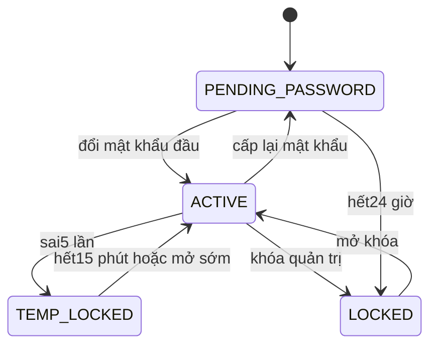

# Trạng thái: Nền tảng

**Draft: thiết kế BA để review; chưa duyệt nghiệp vụ, chưa triển khai phần mềm.**

| Phiên bản | Ngày | Người thực hiện | Thay đổi |
| :--- | :--- | :--- | :--- |
| 0.1.0 | 2026-11-11 | BA | Bổ sung theo kế hoạch; giữ điểm mở và xác nhận đã có |

## Tài khoản nội bộ

| Hiện tại | Trigger | Guard | Đích | Actor |
| :--- | :--- | :--- | :--- | :--- |
| PENDING_PASSWORD | đổi mật khẩu đầu | mật khẩu mới đạt BR-SEC-001 | ACTIVE | Chính tài khoản |
| ACTIVE | sai5 lần | chưa khóa quản trị | TEMP_LOCKED | AUTH |
| TEMP_LOCKED | hết15 phút hoặc mở sớm | không khóa quản trị | ACTIVE | AUTH/QUAN_TRI |
| ACTIVE | khóa quản trị | quyền+reason | LOCKED | QUAN_TRI |
| LOCKED | mở khóa | quyền+reason; không hồi sinh phiên cũ | ACTIVE | QUAN_TRI |
| ACTIVE | cấp lại mật khẩu | quyền+reason | PENDING_PASSWORD | QUAN_TRI |
| PENDING_PASSWORD | hết24 giờ | chưa đổi mật khẩu | LOCKED | AUTH |

Tên nhãn diagram ánh xạ SRS trạng thái tài khoản; TEMP_LOCKED là khóa thời gian, không mặc nhiên yêu cầu thêm enum DB. Trạng thái user, temporary lock và session revocation là các chiều khác nhau; mở khóa không khôi phục refresh token. Tài khoản không có terminal xóa cứng.

Mọi transition ngoài bảng bị từ chối, không tự suy từ nút UI. Version cũ409; quyền thiếu403/ngoài scope404 theo SRS. Các quyền/số liệu chưa chốt giữ trong sổ câu hỏi, không coi state diagram là quyết định duyệt.
